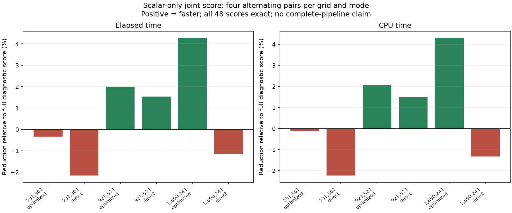
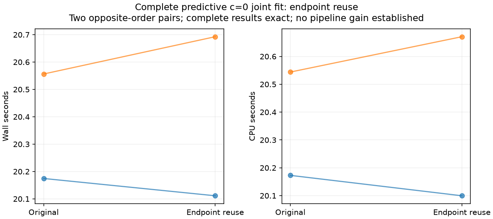

# ALGO07v3: scalar-only joint scores and duplicate final integration

The scalar-only prototype is **not adopted**. All 48 scores on captured DS26-0102
phase grids are exact, but latency and CPU results are mixed. Keeping a separate
runtime path is not justified by these measurements. No runtime or production
change is made by this experiment, and no complete-pipeline speedup is claimed.

The separate endpoint-reuse prototype also remains **unintegrated** after exact
real-fit trials: mean predictive c=0 joint-fit time is 20.365→20.402 s, with
20.358→20.385 CPU s. Removing one 0.087-second integration does not produce a
measurable fit-level benefit here. The next experiment is independent execution
of both complete calibration fits, described in [the plan](next.md).

The preceding [joint-audit report](../2026_11_06_algo07v3_joint_audit/README.md)
was published to remote main as `14b552ce7`, including its full-run regression.
The current experiment does not remove, replace or normalize that evidence.

## What was tested

The full joint integration returns a scalar likelihood plus phase marginals,
MAP phase indices, orbital coefficients and diagnostic metadata. Some callers
use only the scalar. An external AST-guarded copy skips only MAP tracking and
posterior diagnostics, retaining input validation, all matrix operations, phase
grid ordering, visibility and prior handling, and the final log-sum-exp.
The owned runtime remains unchanged; complete diagnostics are still computed.

Actual original native captures contain 481², 961² and 1,921² phase pairs. Both
optimized contractions (predictive route) and direct contractions (numerical
route) are measured. Each grid/mode receives four alternating pairs on CPU 0,
one BLAS thread, with the retained owned LU backend active for both sides.
Inputs, source modules, provider binaries and the original comparison are bound
in [the plan](grids/plan.json). The direct full result must also match the entire
original native result, not only the new scalar. Every input remains unchanged.

| Phase pairs | Mode | Full score, s | Scalar score, s | Wall reduction | CPU reduction | Faster pairs |
| ---: | --- | ---: | ---: | ---: | ---: | ---: |
| 231,361 | optimized | 0.143948 | 0.144437 | −0.34% | −0.10% | 1/4 |
| 231,361 | direct | 0.264556 | 0.270266 | −2.16% | −2.23% | 2/4 |
| 923,521 | optimized | 0.555313 | 0.544194 | +2.00% | +2.06% | 3/4 |
| 923,521 | direct | 1.086634 | 1.069910 | +1.54% | +1.51% | 3/4 |
| 3,690,241 | optimized | 2.462650 | 2.357625 | +4.26% | +4.29% | 3/4 |
| 3,690,241 | direct | 4.399680 | 4.450766 | −1.16% | −1.33% | 2/4 |

Positive reduction means faster. All pairs, including regressions, are retained.
For the largest optimized case one baseline is 2.779 s, compared with the other
baselines at 2.341–2.379 s; its mean improvement should not be treated as a stable
4.26% kernel gain. Neither mode shows a benefit across all three grid sizes.



[All 48 observations](grids/rows.json), [summary](grids/summary.json),
[generated candidate](grids/candidate.py), [complete result](grids/result.json).
These are kernel-only clocks. They exclude geometry preparation, optimizer,
native prefix, admission and publication. They do not measure c=0 versus fitted-c
position accuracy; the scientific model and both runtime arms are unchanged.

## Endpoint-reuse checkpoint result

Both owned joint optimizers compute the endpoint joint likelihood, then compute
the same full joint integral again for the final diagnostic record. Reusing that
already complete result can remove an entire integration rather than a few
diagnostic reductions. This is a separate external prototype, not stacked on
the scalar-only experiment. Optimization, all five phase-refresh rounds,
factorized evidence, physical diagnostics and ordered numerical receipts stay
unchanged. Its component tests cover both optimizers, all three fit methods and
both contraction modes.

`tools/benchmark_algo07v3_final_joint.py` measures a full real fit from the first
native c=0 joint checkpoint. Four trials fork from the same unmodified parent
state, alternating baseline/candidate order. It requires complete result and
numerical-receipt equality, and checks that the kernel call sequence loses
exactly the final duplicate call. It stops after the checkpoint and never
publishes an inferred position. A complete native qualification would still be
required before integrating this candidate.

The corrected checkpoint run finishes successfully. Every complete fit result,
input/output kernel sequence and policy signature agrees; exactly one final
kernel call is removed. This predictive route has no numerical-policy receipt;
the actual numerical route and fitted-c timing are not covered by this result.

| Pair | Original wall, s | Reuse wall, s | Original CPU, s | Reuse CPU, s |
| --- | ---: | ---: | ---: | ---: |
| Baseline first | 20.174481 | 20.111275 | 20.172845 | 20.099560 |
| Candidate first | 20.556383 | 20.692591 | 20.543920 | 20.670833 |
| Mean | **20.365432** | **20.401933** | **20.358383** | **20.385197** |

The mean is 0.18% slower in wall time and 0.13% higher in CPU. One pair improves
and the other regresses. Keep both. This is insufficient reason to integrate
another runtime optimization or spend a complete native pair qualifying a
claimed gain that the scoped experiment does not show.



[Trial results](endpoint-checkpoint/result.json),
[summary](endpoint-checkpoint/summary.json),
[verification](endpoint-checkpoint/verified.json),
[measured harness source](endpoint-checkpoint/benchmark_source.py).
The 410.124-second launcher interval includes recomputing the native prefix and
four trials. It is not a full pipeline runtime or a before/after comparison.
Fit clocks include the same instrumentation on both sides; kernel timing excludes
input/output fingerprinting. The parent checkpoint is unchanged between trials.

The first baseline contains 149 integrations and 138 unique input/policy keys.
The eleven repeats total 0.965922 s of kernel work; the final duplicate is
0.086517 s. Even eliminating all repeats with zero cache overhead would remove
only about 4.8% of this one instrumented fit. That is an upper bound, not a
measured caching gain or a claim about other scans. The input census makes this
a secondary target behind independent complete-fit execution.

The first checkpoint attempt failed in the external harness after its first
baseline fit. While intercepting `_fit_lbfgsb`, the AST builder looked up the
interception wrapper instead of the preserved original function. The child
raised `IndentationError`; the process exited 1, with no candidate timing or
successful comparison. [Failure log](failed-checkpoint/worker.log),
[terminal receipt](failed-checkpoint/terminal.json), and
[original bindings](failed-checkpoint/plan.json) are retained. The corrected
harness explicitly supplies the original function's source to the AST builder.
Its tests check that source selection. The corrected run also fingerprints every
kernel input and its contraction policy, to distinguish identical inputs from
merely equal results. Neither the failed run's elapsed time nor its lone baseline
is used as evidence of an optimization gain.

The new benchmark and existing scalar/final-reuse tests pass **42 tests**.
Source-drift, changed result, changed numerical receipt and unexpected call-count
cases are rejected. Runtime qualification remains the preceding 2,358-test suite;
the present experiment does not change runtime code.

The subsequent paired-fit probe and retained final-reuse tests pass **22 tests**
(overlapping coverage). Actual fork tests check both calibration outputs,
ordered owned-policy receipts, pristine parent state and child failure. The
paired probe measures serial versus two-process fits from the same checkpoint;
audits are excluded. It is an external measurement tool, not a controller change.
Controller integration must still preserve the intervening audit's receipt
position; [the plan](next.md) explains why an eager receipt merge is insufficient.

## Reproduction

From the development checkout, use the repository virtualenv Python:

```sh
env PYTHONPATH=src:tools:. OPENBLAS_NUM_THREADS=1 OMP_NUM_THREADS=1 \
  timeout --kill-after=5s 300s taskset -c 0 python -B \
  tools/benchmark_algo07v3_joint_scalar.py \
  --native /srv/bulk/leo-dev/algo07v3-direct-chunks-native-0102-20261106 \
  --output /absolute/fresh-scalar-root
python -B reports/2026_11_06_algo07v3_scalar_scores/render.py \
  --input /absolute/fresh-scalar-root --output /absolute/fresh-scalar-summary
python -B reports/2026_11_06_algo07v3_scalar_scores/run_probe.py \
  --root /absolute/fresh-checkpoint-root --stage predictive
python -B reports/2026_11_06_algo07v3_scalar_scores/run_probe.py \
  --root /absolute/fresh-paired-root --stage predictive --variant paired
```

The checkpoint wrapper records launch PID, command, a 1,200-second timeout,
worker log and terminal status alongside the root. `--stage numerical` selects
the actual numerical-policy checkpoint rather than approximating it by changing
a contraction flag. This report makes no deployment, capture-to-publication,
dataset-wide throughput or new original-ALGO07 speedup claim.
