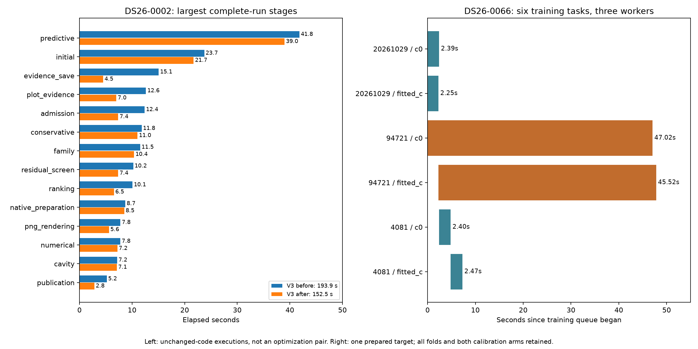

# ALGO07v3: runtime bottlenecks and predictive queue profile

2026-11-06. Observation only; no numerical/runtime or production changes.

**The next target is the cost of long nuisance-model fits.** Scheduling is
already close to the best possible arrangement of the measured tasks. A larger
position cache also has negligible opportunity. Preserve the exact scientific
result while optimizing the numerical kernels used by several fitting stages.



## Complete pipeline costs

Two current-code DS26-0002 executions take **193.899 s** and
**152.529 s** from prepared native GLRT through publication.
These bracket the fresh original ALGO07 run; they are unchanged-code observations,
not a new optimization pair. Each retains both calibration arms, exact science,
ownership, grid/path values and eight byte-identical PNGs against the original.
Capture, detector extraction and queue waiting are excluded. Three CPU slots
and one BLAS thread per process are used throughout.

| Stage | Before reference, seconds | After reference, seconds |
| --- | ---: | ---: |
| predictive | 41.816 | 38.998 |
| initial | 23.728 | 21.707 |
| evidence_save | 15.067 | 4.504 |
| plot_evidence | 12.645 | 7.002 |
| admission | 12.387 | 7.361 |
| conservative | 11.820 | 11.044 |
| family | 11.539 | 10.385 |
| residual_screen | 10.223 | 7.360 |
| ranking | 10.074 | 6.547 |
| native_preparation | 8.709 | 8.516 |
| png_rendering | 7.787 | 5.608 |
| numerical | 7.770 | 7.200 |
| cavity | 7.158 | 7.099 |
| publication | 5.192 | 2.840 |
| other_process_time | 2.731 | 2.014 |
| signed | 2.519 | 1.757 |
| recovery_catalogue | 1.889 | 1.898 |
| incumbent | 0.365 | 0.259 |
| residual | 0.195 | 0.185 |
| inventory | 0.189 | 0.187 |
| final | 0.093 | 0.054 |
| gap | 0.002 | 0.001 |
| addition | 0.001 | 0.001 |

[All stages](stages.json) account for the remaining preparation, catalogue,
recovery and process overhead without adding nested substages twice. Predictive
recovery is the largest stage in both executions. Initial position search is
second. Several other stages invoke related numerical fitting, so a kernel gain
could benefit more than one stage; this must be measured, not multiplied by an
assumed call count. Evidence save varies 15.067 → 4.504 s with unchanged code,
illustrating why isolated before/after wall clocks can overstate a code gain.

The [fresh original/current comparison](../2026_11_06_algo07v3_reference_recovery/README.md)
is **886.905 s versus 193.899 / 152.529 s**, observed ratios **4.57–5.81×**.
Removing original orchestration/verification gaps gives an explicitly different
worker-plus-publication subtotal of 811.989 s, or **4.19–5.32×**.
One reference serves both comparisons. These are one-scan observations, not a
dataset-wide guarantee or a capture-to-WebUI production measurement.

## Why the difficult predictive target takes so long

DS26-0066 target 1 runs unchanged random grouped holdouts, three seeds and both
c=0/fitted-c arms. Each retains five phase rounds and 48 available position
iterations per round. The timer covers the whole prepared annotation, including
training and scoring; context construction is outside it. No evaluation GPS
enters fitting. All source/input bindings are in [plan.json](plan.json).

| Fold seed | Arm | Training points | Elapsed seconds | CPU seconds |
| --- | --- | ---: | ---: | ---: |
| 20261029 | c0 | 1294 | 2.389 | 2.385 |
| 20261029 | fitted_c | 1294 | 2.251 | 2.244 |
| 94721 | c0 | 1560 | 47.017 | 47.012 |
| 94721 | fitted_c | 1560 | 45.521 | 45.518 |
| 4081 | c0 | 1544 | 2.397 | 2.397 |
| 4081 | fitted_c | 1544 | 2.473 | 2.472 |

Training occupies **47.815 s**; held-out scoring takes
**1.659 s**. Overall observed annotation takes
**49.475 s**, using **105.360 CPU seconds**.
The unobserved control takes 50.117 s / 105.504
CPU seconds. This is an instrumentation control, not evidence of a speedup.
Complete annotation fingerprints agree; both decisions also match the saved
qualified native scientific receipt. Inputs are unchanged. [Raw results](result.json).

Training slot occupancy is **71.1%**.
However, scheduling alone cannot use most idle capacity: the two long tasks
are already running while short tasks finish. Exhaustively simulating all
orders with these measured durations gives FIFO 47.772 s
and a prescient best 47.017 s: only
**0.755 s** potential
reordering benefit. Task costs might change under another schedule; this is an
optimistic model, not a tested speedup or a generalizable scheduling policy.

The long fold has only 1,560 points versus 1,544 in a short fold. Point count
alone does not explain its roughly twentyfold cost. The earlier exact hard-call
capture reaches the 256 precision-iteration ceiling in its nuisance posterior.
This is evidence to investigate convergence and dense matrix cost, not permission
to reduce the budget or proof that every call in this annotation hits the ceiling.

## Inside a hard numerical fit

The [post-workspace profile](../2026_11_05_algo07v3_lapack_workspace/README.md)
measures three exact captured likelihood calls with 175 nuisance columns:

| Operation | Share of captured likelihood time |
| --- | ---: |
| Inverse solve | 30.8% |
| Covariance multiplication | 14.8% |
| LU factorization | 12.8% |
| Cholesky factorization | 8.3% |
| Ordered matrix/vector assembly | 6.5% |

These are nested component costs, not percentages of the whole pipeline and
not additive to the stage table. Roughly two thirds of this captured call is
dense matrix arithmetic. A 2× improvement to that portion would at best make
this call about 1.50× faster, before integration overhead; it does not establish
the same gain for an entire scan. Earlier whole-process cProfile traces had
inconsistent fork accounting, so these conclusions use independent stage
clocks and targeted exact instrumentation instead.

## Recommended experiments, in priority order

1. **Profile precision convergence across the slow and fast folds.** Record
   nuisance width, precision iterations and likelihood calls by phase round.
   Keep the same stopping rule. Determine whether exact repeated terms can be
   reused before considering any different solver. A changed stopping rule,
   warm start or approximation would need separate scientific qualification
   and would not automatically meet the current identical-output requirement.
2. **Prototype ordered weighted assembly in compiled code.** It currently
   accounts for 6.5% of the captured call. Fuse temporary creation and scatter
   while preserving multiplication/addition order, signed zero and non-fused
   arithmetic. This has a bounded upside: even eliminating assembly entirely
   would save only 6.5% of this call. Test exact kernels, both complete training
   arms and native publication before integrating.
3. **Investigate dense-solve copies and reuse with exact arithmetic.** This is
   the largest remaining arithmetic cost, but inverse-workspace reuse is already
   integrated. LU workspace, layout-only and combined variants were flat or
   inconsistent. Replacing inverse/covariance mathematics can change rounding;
   do not label it an exact optimization without complete proof and testing.
4. **Measure evidence serialization and publication separately.** Their total
   varies materially between runs. Attribute encoding, hashing and I/O before
   adding caches. Previous encoding-cache tests regressed; immutable persisted
   contracts and PNG bytes must remain unchanged.

Do not prioritize bigger position caches: the measured four additionally
reusable calculations total only **0.0783 s** across both hard training arms.
Do not assume a fourth worker fixes the tail: two indivisible long tasks still
dominate this target. Parallelizing work *inside* those tasks is a separate
experiment; earlier gradient parallelism had CPU/latency regressions. Any extra
CPU allowance must be reported separately from same-resource algorithm gains.

## Validation and reproduction

Nine component-owned tests pass, including actual six-task forked execution,
canonical ordering, unchanged returned values, failure propagation and bounds
validation. [Test receipt](tests.xml). The earlier 1,332 runtime tests remain
the numerical qualification; no runtime code changes in this iteration.

From the active worktree, with a fresh output root:

```sh
PYTHONPATH=src:tools OPENBLAS_NUM_THREADS=1 OMP_NUM_THREADS=1 \
  taskset -c 0,1,2 timeout -k 5 600 python -B \
  tools/profile_algo07v3_training_queue.py --request PREPARED_REQUEST \
  --output FRESH_OUTPUT --target 1
```

Use the pinned project Python. [The profiler](../../tools/profile_algo07v3_training_queue.py)
executes a fresh unobserved annotation and a fresh observed annotation without
changing admission, task order or scientific results. This renderer takes
`--root` (queue output) and `--native` (fresh cumulative run root), validates
bindings and exactness, and exports receipts/figures. Prepared target timings
exclude other scan stages; broader DS26 and production qualification remain open.
