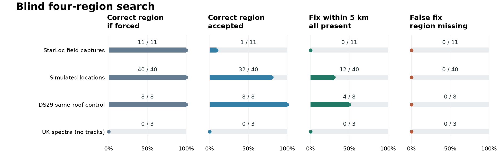

# Blind multi-region Doppler receiver

The Doppler grid picked the correct tile on all 11 StarLoc captures when forced to choose among four offers that included the receiver. Its forced positions had a 3.05 km median error against GNSS. The frozen withholding rule published **zero coordinates at those new physical sites**. Across all panels it also published zero coordinates on 62 offers where the true region was missing. The experiment establishes that the radio measurements carry information about the offered region and exposes a field-coverage problem in the current validation rule. [Field results](results/field/summary.json) · [Withholding reasons](results/diagnostics.json)

## Blind outcomes

Each row counts acquisitions. Each acquisition was evaluated under both offer conditions, giving 124 primary queries from 62 matched pairs. The first four numeric columns concern offers containing the receiver. A forced choice is the strongest available radio estimate, including pooled fits that lack independent validation. The regional decision is an intermediate check. Only the final coordinate is a public fix. The 5 km denominator includes every true-present query.

| Acquisitions | Correct tile if forced | Correct tile accepted | Coordinates published | Published within 5 km | False regional accepts when missing | False coordinates when missing |
|---|---:|---:|---:|---:|---:|---:|
| StarLoc, 11 measured captures at 8 new site groups | 11/11 | 1/11 | 0/11 | 0/11 | 1/11 | 0/11 |
| 40 simulated positions across 8 new regions | 40/40 | 32/40 | 15/40 | 12/40 | 0/40 | 0/40 |
| DS29, 8 measured captures at the development roof | 8/8 | 8/8 | 5/8 | 4/8 | 2/8 | 0/8 |
| Altrincham, 3 measured hours with zero qualifying tracks | 0/3 | 0/3 | 0/3 | 0/3 | 0/3 | 0/3 |

Repeated captures share sites and hardware. The 62 missing-region trials include the three empty UK inputs. Estimating a deployment false-fix rate would require more independently located installations with usable tracks.



### What transferred to the external field receivers

The 11 stationary StarLoc captures used one array, a single Ku channel, and sites spanning 14.52 km, roughly 2,954 km from the DS26/DS29 roof. The source supplied measured tone tracks in preselected pass windows and separate GNSS records for scoring. The receiver received anonymized frequency curves, measurement times, four tiles and capture-time orbit catalogs. Source pass-window selection has undocumented provenance, and exact catalog retrieval time is author-reported. These runs test positioning from prepared tracks. [StarLoc experiment and data](https://connectedsystemslab.github.io/starloc/) · [Input construction and GNSS audit](field_private/provenance.md)

With the true tile offered, 8 of 11 forced estimates landed within 5 km and the worst error was 6.46 km. Returning the center of the winning tile placed only 2 of 11 within 5 km, with an 8.07 km median. Using the first shuffled offer picked the right tile 5 times, and choosing the most central offer picked it twice. In a separate post-scoring control we supplied the coordinates of the other seven field site groups and predicted their centroid. That geographically informed prior reached 7/11 within 5 km, with a 4.72 km median. The forced radio estimate was closer on 6/11 captures. The clustered sites make distinguishing nearby receivers a harder claim than identifying the correct offered region. [Per-capture field scores](results/field/per_query.csv) · [Leave-one-site-group-out control](results/field/site-control.json)

Ten captures lacked the four whole tracks required in each time half. On the remaining capture the correct tile passed regional validation, and the pooled fix was 2.13 km from GNSS. Its early and late positions differed by 10.94 km, so the 5 km agreement rule withheld it. When the same recording was offered four wrong tiles, one wrong region also passed. Both independent fits chose the same point on its boundary, 26.66 km from the receiver. The edge rule caught it. Across the 11 missing-region field queries a forced estimate existed on 10, with median error 48.99 km and worst error 292.06 km. [Field decisions and errors](results/field/per_query.csv) · [Frozen evidence](predictions/field.json)

The second independent installation was Bob Watson's Altrincham, UK station. Three preselected consecutive one-hour windows held 10,800 measured spectra. A fixed signal-only beacon-comb extractor found zero qualifying tracks in the evaluation windows. All six offers were withheld before a position search. This measures the empty-input path. [Watson archive](https://zenodo.org/records/8400658) · [Extraction and timestamp provenance](field2_private/provenance.md)

### Simulated geographical transfer and the known roof

The 40 simulated receivers covered eight regions over 12 new UTC dates. They used pre-scan orbit snapshots as input and materially updated post-capture elements to generate the radio signal. The generator introduced variable height, terrain masks, oscillator drift, sampling gaps, sparse scenes and 204 contaminated tracks. There were 20 neighboring-region and 20 geographically dispersed missing offers. The simulated panel used an archived measurement schedule and a related orbital physics model, so its coverage need not carry over to measured field tracks. [Generation protocol](holdout_private/protocol.json) · [Input receipt](holdout-receipt.json)

The receiver published 15/40 simulated positions and had at least one publication in each of the eight regions. Median error among the 15 publications was **2.67 km**, P90 was **5.87 km**, and the worst error was **6.96 km**. The center of the same accepted tile had an 8.67 km median error. Forcing a result put 33/40 within 5 km when the true tile was present, but returned a position for all 40 missing offers. The median forced error on those missing cases was 148 km for the neighboring layouts and 10,969 km for the dispersed ones. The final rule withheld every one. [Simulated per-query scores](results/synthetic/per_query.csv) · [Site-group and pair results](results/synthetic/summary.json)

On eight DS29 captures, the receiver published five positions. Their median, P90 and worst errors were 4.08, 5.70 and 6.56 km. Two nearby wrong regions passed the regional check when the true tile was missing. Both solutions hit a tile boundary and the coordinate was withheld. DS29 measures new radio observations at the development installation. [Recorded decisions](results/recorded/per_query.csv) · [Recording selection](recorded_private/selection.json)

## Compute cost

The host was an Intel Core Ultra 9 285K. Each worker used one numerical thread. The first two columns cover calls to `solve` after input decoding during the concurrent blind run. The serial rerun used three deterministic queries per panel, one process at a time. Peak RSS includes Python, NumPy and the orbit tables. Times exclude signal acquisition and track extraction. A StarLoc capture lasted 15 minutes and a DS29 or simulated capture lasted about 5 minutes. [Stage times](results/diagnostics.json) · [Serial timing and memory](results/serial-timing.json)

| Panel | Blind median / P90 solve | Serial median solve | Serial median launch through exit | Blind median peak RSS |
|---|---:|---:|---:|---:|
| StarLoc | 0.78 / 1.51 s | 0.48 s | 0.69 s | 119 MiB |
| Simulated | 3.17 / 4.71 s | 2.14 s | 2.33 s | 95 MiB |
| DS29 | 11.40 / 15.04 s | 12.04 s | 12.33 s | 95 MiB |
| Altrincham, empty tracks | 37 / 49 µs | <1 ms | 0.25 s | 43 MiB |

On DS29 the 19 time-shift checks alone consumed a median 9.80 seconds. On simulated trials that reached those checks their median was 2.48 seconds. Any embedded optimization should target repeated Doppler scoring at the held-out positions. Real-time latency, RAM and power on the intended board remain unmeasured. [Recorded stage timings](results/recorded/summary.json) · [Simulated stage timings](results/synthetic/summary.json)

For a next version, keep the forced grid as the comparison baseline and test a pass-level withholding rule on fresh recordings. Holding out entire passes across the scan could retain independence on sparse captures where the fixed midpoint leaves too few tracks on one side. Keep near-missing offers and the tile-edge test in that experiment. The locked StarLoc example shows that even exact agreement between two positions can occur in a wrong tile.

## Running the prototype

From the repository root, use the existing Python environment and provide a measured track file, its orbit snapshot, and a JSON file containing the offered centers.

```sh
OPENBLAS_NUM_THREADS=1 OMP_NUM_THREADS=1 .venv/bin/python \
  reports/2026_11_18_blind_regional_receiver/predict_one.py \
  --observation observation.json --catalog snapshot.tle --regions regions.json
```

Each offer has an `id` and a `center` in latitude and longitude degrees. Each track has `times` in seconds from the UTC anchor, `values` in continuous CFO hertz, a fixed `rf_hz`, and `receiver` and `channel` identifiers. The observation also supplies `anchor_utc_ns`, `cutoff_utc_ns`, `catalog_timestamp_ns`, and `duration_s`. A successful call returns a region ID and coordinates. A withheld result returns null for both and gives the first decision rule that failed. The optional `--diagnostics` flag also exposes the best forced estimate for investigation. The numerical API is `engine.receiver.solve(observation, regions, tle_text)`. [Receiver](engine/receiver.py) · [Grid](engine/grid.py) · [Decision thresholds](engine/METHOD.md)

## What the receiver measures

The caller supplies four coarse regions in this experiment. In each 25 km square, the early half of a scan nominates a point whose predicted satellite Doppler curves match the measured frequency changes. The matcher removes each track's constant frequency level and permits a bounded satellite timing adjustment. Later, disjoint tracks score the four nominated points. A region must have sufficient supporting tracks, beat the other offers, and beat the best result across the offers on each of 19 altered time schedules. The last test asks whether the real measurement times matter to the result. If the regional decision passes, independently fitted early and late positions must agree within 5 km, the pooled estimate must lie within 4 km of each, and it must clear the tile edge by more than 1 km. The method assumes a stationary receiver and nominal sea-level height. Multiple records may come from the same satellite. [Grid implementation](engine/grid.py) · [Decision policy](engine/METHOD.md)

## How the blind test was conducted

The engine, inference runner, dependencies and study protocol were fingerprinted before holdout inference. Each panel's full input tree and hidden truth file were fingerprinted before that panel was processed. Each prediction ran in a fresh Linux mount, PID and network namespace with one query, one observation file, one orbital catalog, the inference code and its runtime. It could see neither sibling trials nor the project workspace. Both variants of a pair use the same measurements and orbits. The evaluator independently checks the true point against the WGS84 tangent-plane boundaries of every offer and checks all query IDs. Published positions, regional decisions, forced winners and offer-only baselines have separate denominators. The main outcome counts a fix within 5 km among *all* true-present queries. Conditional errors concern the queries that actually received coordinates. [Study protocol](study-protocol.json) · [Isolated runner](run_study.py) · [Scoring definitions](evaluation/METRICS.md)

For each panel the three opaque query IDs with the lowest SHA-256 of `invariance-v1/` plus the ID were rerun under three changes. Two runs add or subtract a fixed RF-dependent bias of 100,000 Hz/GHz around 11.5 GHz and a whole-track integer alias offset. The third reverses the supplied offer order. The tracks, offered positions, sample times, orbit candidates, thresholds and search budgets stay matched. An independent component check fits a nonzero coefficient to known synthetic level offsets and compares the corrected and uncorrected trials. The within-track score has no identifiable absolute RF coefficient. [Matched controls](blind_worker.py) · [Fitted-coefficient test](engine/test_receiver.py)

All 36 matched reruns reproduced their publication and regional decisions, support counts and recorded work. On queries with a fitted position the maximum coordinate movement was 0 m. The largest normalized score difference was 5.4 × 10⁻¹⁵ or less, and the largest shape-RMS difference was below 4.3 × 10⁻¹² Hz. Nine reruns used the empty UK windows and supplied no fit or residual comparison. All 62 pairs matched their truth location, observation and orbit catalog, and all final publications were inside their declared regions. The independent scorer verified every committed prediction and truth digest. [Invariance results](results/invariance.json) · [Global commitment](locks/prediction-lock.json)

The repository environment runs the numerical, decision, scorer, generator and isolation tests with the first command below. The second command repeats every frozen decision in the external track panel using single-query Linux namespaces and checks the published and forced coordinates against the locked predictions.

```sh
LAB=reports/2026_11_18_blind_regional_receiver
OPENBLAS_NUM_THREADS=1 OMP_NUM_THREADS=1 .venv/bin/python -m pytest -q "$LAB"
.venv/bin/python "$LAB/serial_benchmark.py" field --all --output /tmp/blind-field-replay.json
```

All 32 tests passed. A separate serial rerun reproduced both the final decision and the forced point on all 22 StarLoc queries. [Complete field replay](results/field/serial-replay.json)
