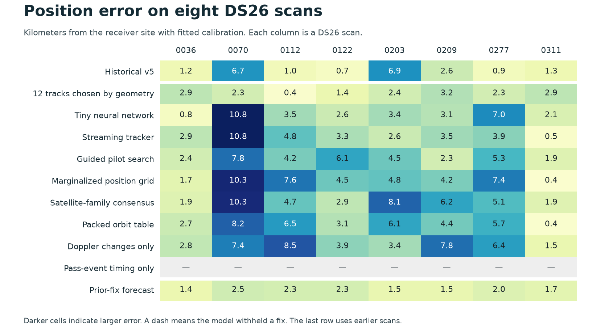

# Ten embedded positioning prototypes on DS26

The 12-track geometry solver had the lowest median error among the eight prototypes that produced positions from the current scan. With fitted calibration its median was **2.355 km** and its worst error was **3.153 km**. Historical v5 reached **1.259 km** median and **6.858 km** worst on the same scans. The 12-track solver was closer on three of eight recordings. Two of those were the largest v5 misses, where errors fell from 6.72 to 2.32 km and from 6.86 to 2.36 km. Its lower mean of 2.24 km versus 2.68 km depends on those two cases. Dropping either one reverses the mean advantage. [Per-scan scores](scores.csv)

Ten GPT-6.2 Sol agents, each at xhigh reasoning and standard service speed, implemented one design apiece. The primary designs were fixed before independent geographic scoring. From 158 available DS26 recordings we took one lower-edge and one upper-edge scan from each chronological quarter using a deterministic hash, for eight five-minute scans at one receiver site. The geographical search box spanned 25 km per side. Always returning its declared center would give 8.19 km error. Position error is great-circle distance to the campaign reference. All eight happened to have completed v5 repeat-zero outputs. [Panel](panel.json) · [Protocol](PROTOCOL.txt) · [Scorer](compare.py)

## Geographic results

The rank column compares designs that produced a current-scan fix, ordered by fitted-calibration median. The stationary forecast has a different use case. The event-timing experiment includes every withheld decision in its coverage. Times are per-scan host medians, usually through both calibration arms. The start of each timer appears in the last column.

| Fresh rank | Prototype | Outputs | Median km, c = 0 | Median km, fitted c | Worst km, fitted c | Host time and input |
|---:|---|---:|---:|---:|---:|---|
| Reference | Historical v5, no repair | 8/8 | 1.28 | 1.26 | 6.86 | 491.65 s, recorded full analysis worker including evidence production |
| 1 | [12 tracks chosen by geometry](06_coreset/METHOD.txt) | 8/8 | 2.48 | 2.35 | 3.15 | 0.250 s from archived tracks |
| 2 | [Tiny coordinate network](10_network/METHOD.txt) | 8/8 | 3.25 | 3.25 | 10.82 | 0.181 s from archived tracks |
| 3 | [Streaming Doppler tracker](01_stream/METHOD.txt) | 8/8 | 3.42 | 3.40 | 10.79 | 0.426 s from saved detector candidates |
| 4 | [Guided pilot search with blind reacquisition](02_pilots/METHOD.txt) | 8/8 | 4.27 | 4.36 | 7.81 | 0.584 s from saved detector candidates |
| 5 | [Marginalized position grid](08_grid/METHOD.txt) | 8/8 | 4.50 | 4.62 | 10.34 | 0.368 s from archived tracks |
| 6 | [Satellite-family consensus](03_consensus/METHOD.txt) | 8/8 | 4.90 | 4.90 | 10.27 | 0.297 s from archived tracks |
| 7 | [Packed Doppler orbit table](04_compact/METHOD.txt) | 8/8 | 5.02 | 5.02 | 8.18 | 0.522 s from archived tracks |
| 8 | [Doppler changes only](07_differences/METHOD.txt) | 8/8 | 5.13 | 5.13 | 8.54 | 0.282 s from archived tracks |
| Withheld | [Pass-event timing only](09_events/METHOD.txt) | 0/8 | — | — | — | 0.417 s from decoded detector output, including 19 null controls |
| Fixed site | [Forecast from prior fixes](05_stationary/METHOD.txt) | 8/8 | 1.87 | 1.86 | 2.46 | 47 µs foreground for both arms, plus 2.75 s total to build ten earlier anchors |

## What each design demonstrated

| Prototype | Assumption tested | Observed result |
|---|---|---|
| 12 tracks chosen by geometry | A few tracks can constrain both horizontal directions despite unknown receiver offsets and clock drift. | At the same 12-track budget, choosing the longest tracks gave 7.27 km median fitted-c error. Using up to 64 tracks gave 4.24 km. Selecting by geometry gave 2.35 km and cut the median grid workload from 37,632 to 7,056 candidate-cell evaluations. Host replay took 250 ms versus 252 ms with the full set. The shared front end alone took 246 ms. |
| Tiny coordinate network | A small model can extract position from an anonymous Doppler score map and transfer to unseen locations. | The 6,920-byte model took about 3.5 µs per warm forward pass. Building the evidence dominated its 181 ms scan time. On 144 displaced synthetic examples from held-out orbit snapshots, the network scored 2.86 km median versus 2.20 km by simply taking the grid peak. On real DS26 the two scored 3.25 and 5.68 km. Permuting the real maps among scans preserved aggregate error because every scan shares a site. |
| Streaming tracker | Fixed-size chronological state can produce an early position using only completed detector probes. | Fitted-c medians were 5.01 km at 60 seconds of recording, 4.34 km at 120 seconds, and 3.40 km after five minutes. All eight produced a coordinate at each deadline. Reopening all 16 prefixes reproduced the incremental estimates and assignments. The tracker used up to 51 simultaneous states. The orbit bank used 2.14–2.85 MB before solver scratch. |
| Guided pilot search | Past detections predict enough of the next frequency and time search region to preserve blind detections. | It searched 28.0% of the estimated blind area and reproduced 35.0% of archived winning peaks. Of 22,925 missed peaks, 22,730 fell on idle visits. Guided and blind downstream medians were 4.36 and 5.13 km. This location result at one site gives little assurance that the gate will retain new satellites. |
| Marginalized grid | Summing evidence over competing satellite identities and refining promising cells can improve localization. | Expanding 49 cells to 113 raised the best in-sample score on every scan. Fitted-c median improved from 5.19 to 4.62 km, while mean error increased by 0.03 km. Two scans still had an alternative at least 5 km away within two score units. The mean gain on held-out tracks was 0.011 score units per track. |
| Satellite-family consensus | Limiting the influence of tracks assigned to one satellite can protect against a corrupted family. | Duplicate rows left the result unchanged. A ±6 kHz corruption of five tracks moved fitted-c position 90 m, versus 580 m for the compact control. On the original recordings consensus gave 4.90 km versus 4.24 km median. The all-family proposal won each clean arm, so the extra omission folds have no demonstrated value here. |
| Packed orbit table | An 8-second, 10-byte knot can replace a 32-byte float64 knot without materially changing the solve. | In all eight scans both tables selected identical track/satellite pairs. The largest endpoint difference was 2.60 m. Median table size fell from 1.22 MB to 0.38 MB. Once built, the packed and float64 pipelines took 0.360 and 0.349 s on this host. The strongest evidence supports the memory saving. |
| Doppler changes only | Differencing can remove receiver bias and RF-dependent calibration while retaining sufficient position information. | Injected channel offsets, RF terms and integer frequency wraps left all eight fits unchanged. Three endpoints hit the search boundary. Adding the wrapped mean frequency back to the same paired changes improved fitted-c median from 5.13 to 3.85 km and helped seven of eight scans. |
| Pass-event timing only | Event times alone can identify a satellite and locate the receiver. | Each scan had 8–20 observed event clusters and 231–318 predicted events. Every scan admitted a location at least 20.8 km from its best fit at near-equal cost. A circular shift of the event times matched or beat the original fit on each scan. The synthetic unambiguous case produced its planted position. |
| Stationary forecast | A receiver that stays put can reuse earlier radio fixes between acquisitions. | A median of up to four eligible fixes gave 1.86 km versus 2.23 km for the latest fix alone. The replay used two or three anchors per query and zero current-scan radio samples. The ten historical anchor jobs represent 50 minutes of existing recordings. After a synthetic 10 km move, the first new anchor still left the forecast 10 km wrong. |

The [paired control scores](paired-controls.csv) contain each current-scan, prefix, and alternate-fit geographic comparison in both calibration arms. Design-specific synthetic perturbations, timing breakdowns, memory counters and ambiguity tests are in each prototype's neighboring `result.json`.

## Two integration checks

**Streaming tracker into the 12-track solver.** After ranking the ten designs, we connected the existing streaming tracker to the fixed 12-track selector and reran these same eight scans. The same-stream full-track control exactly reproduced the streaming prototype's observation hashes, satellite assignments, coordinates and residuals. With 12 tracks the median was **1.86 km at c = 0 and 1.84 km with fitted c**, compared with 3.42 and 3.40 km using every eligible streamed track. Five of eight fitted-c positions improved. The worst error grew from 10.79 to **13.53 km** on DS26-0070. That endpoint was inside the search box and survived the local geometry checks. Median host time was 0.421 s from saved detector output, versus 0.423 s for the corresponding full control. The combination improves the median while losing the 3.15 km worst case seen with the archived graph. [Integration method](stream_coreset_check/METHOD.txt) · [Per-scan integration scores](stream-coreset-scores.csv)

**Actual pilot waveforms.** We ran a blind and gated known-pilot bank on a fixed sample from the existing DS26 recordings, reading 62 MiB of compressed data. The 16 checksum-verified 20 ms windows at 10 MS/s covered all eight scans. The raw blind bank and the archive found positives on the same nine windows. Eight of those nine peak frequencies and frame phases agreed within the declared tolerances. On three actual same-channel revisits, the two searches agreed on one positive and one rejection. They selected different peaks on the other positive. Median bank time on those revisits was 66.50 ms blind and 30.31 ms guided on the host. Within a single window, all five seeded 10 ms follow-ups agreed. The full-scan guided position estimates still use the saved detector table. [Raw-waveform results and search settings](02_pilots/iq-check.json)

We also replayed the earlier pilot scheduler against these exact eight recordings. It runs a blind search whenever a channel loses its tracked signal or reaches its eighth visit. Across the same 108,052 probes and 35,391 archived winners, that policy reproduced **85.3%** of winners for **30.4%** of the blind search area. The new idle-and-rescue implementation reproduced **35.0%** for **28.0%**. The earlier policy is the stronger starting point for acquisition. Both area fractions describe a search space, and real CPU savings depend on the fixed cost of the detector. [Same-probe policy comparison](02_pilots/scout-policy-control.json) · [Reproduction script](02_pilots/compare_scouts.py)

## Calibration and timing

The coefficient `c` models how the frequency offset varies with the RF channel. Each prototype used matched inputs, candidate policies, other priors, and search budgets across its two arms. Changes-only, event timing, and the network's within-track centering mathematically remove a constant per-track offset. Their reported calibration arms coincide. The forecast applies calibration when forming historical anchors.

Frequency fit is measured separately from geographic error. Geometry selection reduced median *paired* in-sample RMS by 1.94 Hz when fitting `c`, and improved position on five of eight scans. Guided search reduced paired RMS by 3.51 Hz while producing no closer positions. The streaming tracker's fitted frequency residual decreased on all eight and position improved on four. Residual definitions differ across prototypes, particularly for frequency changes, and the stationary forecast has no current-scan residual. [Both arms, per-scan RF and position](scores.csv)

All reported timings are descriptive single-numerical-thread x86-64 Python replays. A five-minute scan takes five minutes to observe. Models starting from archived tracks omit the native detector and offline track construction. Models starting from saved detector output omit full-scan waveform processing. Historical v5 time includes generating scientific evidence and figures. End-to-end embedded latency, peak board RAM and power require measurements on the intended hardware. The linked published v5 report summarizes a different, 127-recording matched cohort. Its mean and median are separate from this eight-scan comparison. [Published v5 report](https://github.com/misko/leo-tracker-reduxredux/blob/db94afc0d/docs/analysis/algo07v5-ds26-performance.md)

## Reproduce

To rescore the saved endpoints from this directory, run `python3 compare.py`. The scorer uses the bundled campaign reference and the Python standard library. It produces [scores.csv](scores.csv), [paired-controls.csv](paired-controls.csv), [stream-coreset-scores.csv](stream-coreset-scores.csv) and [comparison.json](comparison.json) with primary result hashes. Run `python3 plot_errors.py` with NumPy and Matplotlib installed to reproduce the figure.

To rerun each inference, follow its method link above on the corpus host. The replay used Python 3.12.14, NumPy 2.5.2, SciPy 1.18.1, SGP4 2.27 and the project's frozen sky code. Set `OPENBLAS_NUM_THREADS=1`, `OMP_NUM_THREADS=1`, and the frozen source path given in the [protocol](PROTOCOL.txt). The shared [control replay](run_controls.py) verifies the native detector exports and anonymous graph digests, rebuilds the orbit banks from causal TLEs, reruns the earlier graph and streaming compact solvers, and reads the historical v5 results. [Input receipts and three control series](controls.json)
