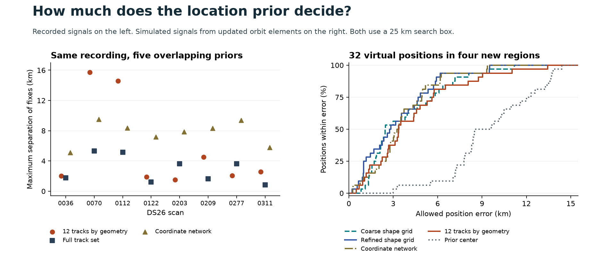

# Choosing a receiver that works at a new location

**Develop the ability to verify a search region before choosing the final position solver.** In the previous study, the 12-track geometry selector was the best fresh solver on eight recordings from one roof. In this review, it produced a fix in every deliberately wrong search region. Its 2.35 km roof median justifies keeping the selector as a candidate for reducing work. The geographical validity of a returned fix needs an independent test. [Previous benchmark](../2026_11_18_embedded_prototypes/README.md) · [Recorded-scan replay](real-predictions.json)

The DS26 evaluation reference describes one physical site. All 615 DS29 references describe one coordinate only 0.75 m away. A predictor that always returns the DS26 coordinate gets zero DS26 error and sub-meter DS29 error without reading the radio. The checked station authorities also resolve to this roof or omit coordinates. These data can test time, sky and acquisition changes at the installation. A geographically independent field score remains open. [DS26 reference](../2026_11_18_embedded_prototypes/scoring-reference.json) · [Reference inventory](summary.json) · [Station authority](../../docs/operations/radio20-roof-pose-20260926.md)

## What happened when only the search region changed

The existing backend screens visible satellites, chooses a short list and fits a position inside a 25 km square around a fixed Bay Area center. I supplied the center explicitly to the archived solver for each replay. At the original center, the two calibration arms of the geometry, full, longest-track, network and coarse-grid controls reproduced their published endpoints exactly. Native recordings and original prototypes were kept intact. [Frozen regional solver](../2026_11_18_embedded_prototypes/support/cold_replay.py) · [Experiment protocol](protocol.json)

For each of the same eight recordings, I tried the original center and four centers shifted 5 km east, west, north or south. All five squares contained the actual receiver. I also ran two intentionally invalid boxes centered 150 km east and 150 km north. The remote runs test what a regional solver does when its supplied prior is wrong.

| Fitted-calibration solver | Median spread across the five valid boxes | Largest spread for identical radio | Wrong-box fixes published | Wrong fixes inside the box |
|---|---:|---:|---:|---:|
| 12 tracks chosen by geometry | 2.31 km | **15.71 km** | 16/16 | 8 |
| Full track set | 2.70 km | 5.33 km | 16/16 | 4 |
| Coordinate network | 8.09 km | 9.51 km | 16/16 | 15 |
| Coarse Doppler-shape grid | 5.27 km | 9.98 km | 16/16 | 1 |
| Refined Doppler-shape grid | 3.99 km | 10.26 km | 16/16 | 1 |

“Spread” is the largest distance between two reported positions for one recording. The 15.71 km spread occurred on DS26-0070. DS26-0112 also reached 14.60 km. Median error of the 12-track fixes in the wrong boxes was 155.11 km. The old solver assumes an independently supplied region and has no out-of-region acceptance test. [Full geographic scores](geographic-scores.csv)

**Fresh radio helped select the right region.** I fitted the early half of each scan separately in the original and two remote regions. Only whole tracks ending by 150 s entered the fit. Whole tracks beginning at or after 150 s scored the frozen coordinates by agreement with their Doppler shapes. Between 27 and 37 early tracks and 24 to 42 late tracks were available. Both the geometry and full solvers ranked the region containing the receiver first on **8/8** scans, in both calibration arms. All three regions yielded a score in seven scans. On the eighth one remote early fit failed. The test supplied three candidate regions, reused one roof, and started with offline anonymous tracks. [Time-split scores per scan](summary.json)

I then tested an explicit rule for withholding an answer. A region must beat the best score anywhere in the same candidate set under **all 19** shifted schedules. Each shift preserves the held-out track's measured shape and moves its observation time within the available second half. Both the candidate satellite list for each track and the winning region are recomputed for each shifted schedule. No threshold was fitted to reference coordinates. I ran this rule again with the correct region removed. [Shifted-time controls and per-case decisions](time-shift-guard.json)

| Region check on eight recorded scans | Correct region accepted, c = 0 / fitted | Wrong region accepted when true region omitted, c = 0 / fitted |
|---|---:|---:|
| Early 12-track fit, scored on later tracks | 7/8 / 7/8 | 1/8 / 0/8 |
| Early full-track fit, scored on later tracks | 8/8 / 8/8 | 1/8 / 0/8 |

The c = 0 false publication occurred on DS26-0311 and was 165.38 km wrong. Even with the correct region accepted, the fitted-calibration full-track *early* coordinates had 6.36 km median and 15.92 km worst error. The seven accepted early 12-track coordinates had 5.30 km median and 8.03 km worst error. Region selection and precise position need separate checks. The related time shifts have no calibrated false-alarm probability. Eight scans at a single site and two remote decoys leave the operating rate at another site unknown.

## Moving the simulated receiver and regenerating its sky

I used archived channel visit times and catalog epochs to generate new anonymous Doppler tracks at separate geographical locations. Each scene contained 48 simulated tracks from visible satellites. The generator propagated actual orbital elements at the synthetic receiver and included per-receiver offsets and drift, an RF-dependent term, per-satellite timing and frequency errors, noise and six corrupted tracks. Heights of 0 and 1.2 km and open or west-facing sky masks were balanced across the design. No measured roof-track frequencies entered this generation. The deployed-style solvers received the regional prior and only elements known by the recording time. All observation and search inputs were matched between calibration arms. [Generator](synthetic.py) · [Models](models.py)

The initial six regions spanned both hemispheres, the equator, 65° north and the date line. Each had four distinct horizontal offsets and two test epochs, giving 48 regional scenarios at 24 locations. Different catalogue file hashes do not guarantee different orbital predictions. At one epoch the first later file changed **none** of 1,152 sampled track elements. I retained that run and repeated the pairs with the first later file that updated at least 80% of the common Starlink elements. The solver always used the causal version. Comparisons of old and updated orbit physics are made within each paired generation, since changing the common satellite set also changes some simulated schedules and satellite choices. On the materially updated runs, fitted median errors were **3.29 km** for geometry and **3.23 km** for all tracks. Both placed 35/48 within 5 km. [Initial run](synthetic-predictions.json) · [Updated-orbit sensitivity](updated-orbit-predictions.json)

The four fixed offsets in that experiment put every true point at the same offset from the grid lattice. I therefore froze a follow-up with four previously unused regions, two different epochs and 32 distinct randomized positions. I also added a simple control that evaluates the same Doppler score at up to 50 subcell positions around the best coarse cell. All weights and physical solver settings stayed frozen. No geographical score from these 32 cases was used to set the refinement rule. [Refinement implementation](shape_refinement.py) · [Confirmation predictions](confirmation-predictions.json)

| Method on the 32 new positions | Median km, c = 0 / fitted | P90 km, fitted | Worst km, fitted | Within 5 km |
|---|---:|---:|---:|---:|
| Coarse Doppler-shape grid | 2.46 / 2.46 | 7.17 | 11.17 | 22/32 |
| Refined Doppler-shape grid | 2.80 / 2.80 | **5.91** | 9.52 | 25/32 |
| Frozen coordinate network | 3.32 / 3.32 | 6.18 | **9.36** | **26/32** |
| 12 tracks chosen by geometry | 4.44 / 3.36 | 8.68 | 13.43 | 22/32 |
| 12 longest tracks | 4.96 / 3.84 | 9.97 | 15.38 | 19/32 |
| 12 randomly selected tracks | 6.30 / 4.95 | 15.17 | 15.85 | 17/32 |
| Full track set | 5.55 / 5.15 | 8.51 | 10.82 | 15/32 |
| Regional center, zero radio | 9.06 / 9.06 | 13.64 | 14.40 | 2/32 |
| Diagnostic with supplied satellite IDs | 4.59 / 2.64 | 5.62 | 8.60 | 28/32 |

All listed methods published 32 positions. The table uses the harder paired condition, in which a materially updated later catalogue generated the radio and a causal catalogue predicted it. The supplied-ID diagnostic also removes injected corrupt tracks and conditions on the true ID surviving the blind short list. Its gain combines identity and clean-track information. The simple grids and the network use the same shape features, which remove a constant per-track RF offset. Their two calibration columns therefore coincide. In the geometry solver, fitting `c` reduced paired median in-sample RF RMS by 34.96 Hz, with a paired median position improvement of 0.10 km. These are separate outcomes. [Per-scenario errors and residuals](geographic-scores.csv)

The leading method depends on the metric and the sky. For example, the refined shape grid had median errors of 1.22 km in the Borneo geometry and 4.56 km in the Patagonia geometry. On the original measured roof scans, refinement gave 6.11 km and the coarse grid 5.68 km. Under matched simulation orbits the refined grid reached 1.05 km median on the four-region confirmation. That rose to 2.80 km with updated orbit elements. The simulations exercise station geometry and model mismatch. They grant the correct 25 km search region, start from already formed tracks, use a restricted receiver noise and obstruction model, and reuse one equipment schedule. Worldwide acquisition, multipath, other receivers and real cross-site accuracy remain open.

## Revised prototype priorities

| Priority | Design | Evidence or test that could change the decision |
|---:|---|---|
| 1 | **Compare candidate regions using later observations.** Keep a small set of plausible Earth-fixed regions. Fit early tracks and rank regions on later tracks at fixed coordinates. | The three-region trial selected the correct box 8/8. Vary prior width and include nearby decoys and a wider search. Measure correct-region recall at a fixed compute budget. |
| 2 | **Give the receiver an explicit “insufficient evidence” output.** Challenge the winning region with another plausible location, time-shifted radio and empty input. | With the true region removed, the time-shift check published a wrong region in one of eight trials at c = 0 and zero with fitted c. Freeze the rule and measure both false publications and usable fix coverage at unseen sites. |
| 3 | **Use a coarse Doppler-shape grid as the regional baseline.** Try a short bounded refinement only when appropriate. | The coarse grid had the lowest blind median on the confirmation. Refinement improved the tail there and worsened the median on the roof. On another site compare both with the frozen network from identical RF inputs. |
| 4 | **Expand the track budget when the position is unstable.** Start with 12 geometrically distinct tracks. Admit more tracks or competing satellite assignments when disjoint fits disagree. | Geometry beat 12 random tracks in both updated-orbit panels. It moved 15.71 km under a valid prior shift on one real scan. Compare fixed 12, adaptive and full on the same tracks, and charge the cost of preparing all candidate tracks. |
| 5 | **Carry multiple satellite IDs when measurements permit several.** Score candidate identities with withheld observations. Treat duplicate tracks from one satellite as related. | In the 32-case diagnostic, supplied IDs and clean tracks put 28 fixes within 5 km. Vary catalogue age, orbital density and blockage. Report true-ID shortlist recall in simulations and agreement on later radio in the field. |
| 6 | **Make the orbit model portable across latitude and elevation.** Use Earth-fixed geometry, a local tangent plane per tile, a stated height source or bounded height uncertainty, and a packed orbit table. | The earlier table reduced storage by 69% with 2.60 m maximum endpoint change on the roof. Check approximation error, visibility and memory at altitude, high latitude, both sides of the date line and tile boundaries. |
| 7 | **Keep acquisition independent of a favorite sky.** Search blindly after losing a signal, guide subsequent pilot searches and start new tracks chronologically. | The earlier scheduler recovered 85.3% of saved winners at 30.4% of the search area on this roof. Test pilot recall, false alarms, missed visits, latency and power on fresh fields of view and radios. |
| 8 | **Estimate receiver calibration on the current acquisition.** Combine curve shape with calibrated frequency level, fit shared receiver nuisances using training tracks, then predict another channel or pass. | The 32-case geometry fit lowered RF RMS more consistently than position error. Preserve matched `c = 0` and fitted-`c` arms and test a second oscillator, antenna orientation and temperature range. |
| 9 | **Use learning for measurement quality or candidate ranking.** Feed normalized physical residuals to the model. Let the orbit model produce the geographical position. | The frozen coordinate network published 15 interior wrong-box fixes and had the best count within 5 km in the simulation. Compare a learned quality model against fixed physics weights with whole sites, receivers and epochs held out. |
| 10 | **Keep history and event timing as supporting evidence.** Use a history-based forecast only in an explicitly warm mode with re-acquisition after a move. Use pass-event times to corroborate identified signals. | The prior forecast missed a simulated 10 km move, and anonymous event times alone withheld all eight original fixes. Relocate the simulated receiver, discard old anchors, and measure cold recovery time and wrong publications. |

## What counts as evidence of transfer

- **Separate two deployment promises.** For a receiver with a legitimate rough location, document its source, age and error distribution and test that distribution at every site. For a receiver starting anywhere, measure global or wide-area candidate generation, correct-region recall, false-region acceptance and compute. The experiments above condition on a supplied region or small candidate list.
- **Split by installation before model selection.** Keep all scans, same-roof coordinate aliases, fitted calibration, learned weights derived from a site, and historical anchors on the appropriate side of the split. For a cold start, clear old-site state. Use only orbital information available at fix time. Let a separate scorer see the precise reference after submitting predictions. With several development sites, hold one site out per fold. Reserve a further untouched site for the final comparison where feasible. The benefit of blocking correlated observations is documented in the spatial-validation literature. [Roberts et al.](https://nsojournals.onlinelibrary.wiley.com/doi/full/10.1111/ecog.02881)
- **Separate the receiver from the site.** Record ground-reference uncertainty and coarse prior provenance. Where recordings allow, cross the same hardware between sites and compare two receivers at one site. Cover open and blocked sky, different elevations and different orbital epochs. Distinct scans from one roof are one location for geographic inference.
- **Score the product, including failure.** Give each site equal weight. Show per-site median, P90, worst error, first-fix time, accepted fixes, abstentions, and large-error fixes among published outputs. Report cold and warm modes separately. Keep a prior-only predictor, shuffled or time-shifted RF, wrong-box cases, the full physics solver and an equal-budget random selector as controls. The 5 km column here is a descriptive threshold.

The highest-value field result would be a blind replay of already recorded, independently georeferenced observations from another installation. The sensor can use the deployment's declared coarse prior. The operator's precise coordinate stays with the scorer. Until such field evidence exists, the appropriate conclusion is sensitivity to geometry, epochs and priors in the conditions tested.

## Reproduction

From this directory on the corpus host, set `OPENBLAS_NUM_THREADS=1`, `OMP_NUM_THREADS=1`, `PYTHONDONTWRITEBYTECODE=1`, and `PYTHONPATH=/home/mouse9911/.cache/accuracy-repair-20261115/frozen-001/src`. Use the repository virtual environment, for example `../../.venv/bin/python real.py`. Run the following in order with that interpreter:

1. `real.py`
2. `synthetic.py`
3. `synthetic.py --updated-catalogues`
4. `synthetic.py --confirmation`
5. `null_guard.py`
6. `evaluate.py`
7. `plot.py`

The component checks run with `../../.venv/bin/python -m pytest -q test_transfer.py`. The scoring script verifies the baseline reproduction, complete scenario accounting, holdout satellite-catalogue hashes for the frozen network, geographic coverage of the valid boxes, and 32 distinct confirmation locations. [Scorer](evaluate.py) · [Summary and source hashes](summary.json)
