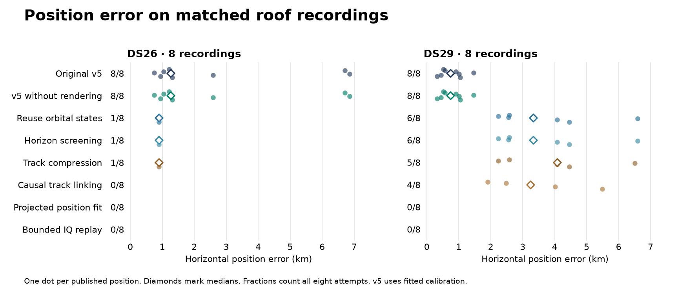

# Which receiver simplifications keep v5 accuracy?

Removing evidence rendering from the position path kept all 32 v5 coordinates on 16 recordings. Batching the Python pilot-bank GLRT was the largest measured stage improvement, at 2.60×, with the same 64 receiver-window decisions. Replacing the capture-era GLRT proved much harder. On two complete recordings the alternative native detector improved one final position and degraded the other. This experiment did not establish a full-pipeline speedup at v5 accuracy or real-time operation on embedded hardware.

## One position-error figure per modification

The ten-page book uses the same **127 DS26 recordings and eight DS29 recordings** as the original roof comparison. Each page shows one modification against all four v5 configurations. The curves give the fraction of all recordings within each distance. The dots and median diamonds use only the coordinates each method returned. For a regional solver, the forced row also shows the best coordinate when the solver withheld publication. Both datasets come from one installation. [View all ten charts](figures/fitted_c/README.md) · [Fitted-calibration PDF](figures/fitted_c/modifications.pdf) · [Zero-calibration PDF](figures/c0/modifications.pdf) · [Fix counts, medians and P95](figures/README.md) · [Recording-level errors](figures/fitted_c/modifications.csv)

Orbital-state reuse and horizon screening have identical error distributions. Track compression also published 71 DS26 fixes and five DS29 fixes. On DS26 it gained one publication, lost another and moved 13 shared fixes by more than 1 m, with a maximum shift of 368 m. On DS29 it moved one shared fix by 261 m. Causal linking published 68 DS26 fixes and four DS29 fixes. [DS26 regional outputs](evidence/ds26-common127-regional-positions.jsonl.gz) · [DS26 orbital-state outputs](evidence/ds26-common127-four-region.jsonl.gz) · [DS29 and small-panel outputs](evidence/roof16-four-region.jsonl.gz)

The raw-IQ figures use 80 scheduled 20 ms windows per recording. Of 10,800 windows, 10,739 were eligible, giving 21,478 receiver-window measurements. Each Python GLRT produced 8,328 positive detections. Neither produced a track that met the fixed continuity rules on this sparse schedule. The streamed reader and bounded native-IQ receiver use the same measured downstream run. On the separate 16-recording panel, each modified Python detector agreed with its own original control on all 2,504 receiver windows in detection, winning epoch and alias-resolved CFO. The lean v5 figure uses archived fit axes to recover every DS26 coordinate and a full numerical refit on the eight DS29 recordings. The second book includes all 16 lean refits and ends with the two complete recordings passed through the alternative native detector and v5. [16-recording and complete-IQ figures](figures/fitted_c/additional-recordings.pdf) · [Measurement commands](../../tools/pipeline_eval/README.md#get-one-position-error-figure-per-modification)

The first command runs a real localization experiment on a clean checkout using bundled anonymous tracks and orbit catalogues. The second runs all ten experiments on the corpus host. Running the module with no arguments prints the original v5 comparison.

```sh
.venv/bin/python -m tools.pipeline_eval run --panel transfer16 --variant orbit_interp --jobs 4 --require-inputs
.venv/bin/python -m tools.pipeline_eval run --panel roof16 --variant all --jobs 4 --pin --out /tmp/receiver-eval
```

The portable run reproduced all 16 original orbital-reuse decisions, published coordinates and diagnostic coordinates from the larger corpus. The evaluation protocol fixes the rosters, access to labels and acceptance criteria before the candidate runs. [Commands](../../tools/pipeline_eval/README.md) · [Portable run receipt](evidence/portable-transfer16.json) · [Protocol](../../tools/pipeline_eval/PROTOCOL.md) · [Experiment decisions](decisions.tsv)

## What runs between the antenna and a position?

1. The recorded acquisition contains complex 16-bit I/Q samples for two receivers, sample counters, RF tuning, clock brackets and validity flags. Decoding must preserve the sample order and the relationship between sample count and time. Every raw experiment here starts with an existing sealed recording.
2. The GLRT searches for a known pilot at different arrival times and carrier frequency offsets (CFO). It compares each candidate with a control waveform. The capture-era producer emits ranked fractional-epoch and CFO candidates, with their margins, for each eligible receiver window.
3. A tracker links those detections across visits into Doppler curves. Two correlation peaks from the same signal can look like two tracks. The raw prototype removes duplicates before counting independent support.
4. Orbit propagation predicts how the Doppler curve of each candidate satellite would change at each possible receiver location. The search uses orbital catalogues available at the observation time. Track association, nuisance-frequency terms and the position fit share this information.
5. Original v5 uses a fixed 25 km tile, evaluates its numerical hypotheses and publishes the selected position in two calibration arms. The regional receiver uses early/late track agreement, competing tiles and shifted-time controls to decide whether to publish. They have different priors and different coverage. The benchmark scores published coordinates against independent reference positions and counts every withholding.

## Ten implemented directions

Rank reflects readiness to simplify a receiver whose accuracy requirement is original v5. Ratios divide control time by candidate time for the same operation on a recording, then take the median across the panel. Three rows end at the detector. Their numerical tests establish what the next stage would receive at those tested inputs.

| Rank | Implementation and hypothesis | Matched measurement | Position result and decision |
|---:|---|---|---|
| 1 | `v5_lean` computes both original endpoints without plot construction, PNG rendering or scientific ZIP packaging. | Original evidence plotting and PNG generation alone took 30.59 s and 35.59 s on two controls. Whole-worker times went in opposite directions. | 16/16 roof fixes. All 32 coordinates exactly equal original no-repair v5. Retain the numerical path and make rendering optional. |
| 2 | `glrt_batch` evaluates the pilot correlations as a batched FFT calculation. | 2.60× on the Python pilot bank, across 23,592,960 search cells. All 37 positives and 27 negatives, peak CFOs and epochs agreed. Maximum score discrepancy was 2.22 × 10⁻¹⁶. | Strongest measured detector-stage improvement. The complete capture-era fractional detector still needs its own equivalence test. |
| 3 | `iq_stream` decodes just the required archive prefix into bounded blocks. | 1.06×. Median peak traced allocation fell from 20.26 to 4.94 MB. All 32 two-receiver detector inputs were bitwise identical. | Use the bounded reader where memory is limiting. Peak covers the Python/NumPy allocations measured during decoding. |
| 4 | `glrt_cascade` uses an upper bound to skip rolled-control scores that cannot rescue a weak peak. | 1.58× on the Python pilot bank. Rolled cells fell from 11,796,480 to 159,744. All 64 original waveform decisions agreed and all 16 phase-scrambled controls remained negative. | Worth testing in the production bank. This and batched GLRT were timed independently. |
| 5 | `orbit_interp` reuses propagated orbital states and interpolation terms across the search. | 1.38× on the roof and 1.25× on the 124 regional queries. The regional trials used 39.47M propagated states versus 59.55M. | Reproduced regional fixes and withholding decisions, including all 127 DS26 cases. The roof grid published 7/16 versus 16/16 for v5. Keep this optimization with the regional solver. |
| 6 | `shape_score` rules out below-horizon satellites before full Doppler interpolation and time-shift scoring. | 0.98× on the roof and 1.14× on the regional panel. Returned coordinates and decisions agreed with the original grid. | Useful with four region offers. The roof panel showed a small slowdown. |
| 7 | `track_reduce` approximates tracks with short line segments bounded to 45 Hz and 10 s. | 59,416 input rows became 53,958. Roof timing was 1.03×. | 6/16 roof fixes versus 7/16 for the uncompressed grid. It also shifted a returned four-offer DS29 coordinate by 261 m. |
| 8 | `track_link` links native detector peaks using a causal tracker with bounded active state. | 1.02× for linking against the matched tracker control. | 4/16 roof fixes, 3/16 within 5 km. The link-stage control yielded five fixes. |
| 9 | `iq_position` rebuilds detections, tracks and a regional decision from a bounded raw-IQ replay. | 1,252 eligible windows and 500.8M complex samples on the roof panel. A denser replay reached all 19 shifted-time checks. | 0/16 roof fixes. A planted waveform localized within 244 m. The separate whole-recording experiment below establishes what full data and the v5 solver change. |
| 10 | `projected_fit` analytically removes per-track frequency offsets before fitting the position and tests independent track support. | 0/127 original DS26 fixes. Across the transfer panel its one published position came from simulation, with 2.138 km error. | 0/16 roof fixes. Its present withholding rule and available evidence do not support a v5 replacement. |

The original three front-end timing trials used the same initial two 20 ms windows per recording, with two receivers and a 10 MHz sample rate. The published position figures above extend each front end to 80 windows per recording. The GLRT controls use the experimental Python Qin pilot bank. Stream and detector timings exclude downstream tracking and inference. None of these timings can be multiplied to predict a deployed receiver's latency. [Individual predictions and timed measurements](predictions) · [Validated numerical reference bindings](evidence/reference-migration.json)

## Complete recordings through GLRT and v5

The integration replay verifies all 14 raw segments per recording, preserves capture exclusions and UTC timing, and runs the alternative native fractional GLRT on every eligible window. It uses the new detections, their new content digest and the original no-repair v5 solver. Each calibration pair shares its detections, search tile, catalogue, priors and search budget.

| Recording | Raw windows processed / recorded | Fresh receiver probes | Historical → fresh error, `c = 0` | Historical → fresh error, fitted `c` | Raw replay and assembly | Position worker | Total elapsed |
|---|---:|---:|---:|---:|---:|---:|---:|
| DS26-0036 | 6,765 / 6,769 | 13,530 | 1.278 → **0.231 km** | 1.208 → **0.186 km** | 176.11 s | 195.17 s | 371.30 s |
| DS29-0082 | 4,868 / 6,772 | 9,736 | 0.567 → **2.802 km** | 0.517 → **2.662 km** | 116.94 s | 111.44 s | 228.39 s |

Both recordings span 300 seconds between the first and last window delivery. Processing consumed 1.24 times that span on DS26 and 0.76 times on DS29 on the shared x86 host. The DS26 run missed a recording-length time budget. The DS29 run met that budget and missed the accuracy requirement. These batch measurements do not establish a per-fix latency on an embedded receiver. [Recorded clock spans and elapsed-time ratios](evidence/whole-recording-time.json)

Every probe retained its original acquisition support. Only one complete candidate list matched the original on each recording. Original and alternative counts of positive candidates were 9,488 and 15,073 on DS26, and 4,582 and 7,962 on DS29. These are detector disagreements. There is no per-detection truth label. On short prefixes the exact capture-era producer independently reproduced all 16 DS26 and 12 DS29 archived probe rows. A complete replay of both historical producers was outside the bounded experiment. Historical v5 positioning times start with prepared detector outputs and cannot serve as an IQ-to-position timing control. [Scorer errors](evidence/full-iq/scorer-errors.csv) · [Capture and detector receipts](evidence/full-iq)

The smaller `iq_position` experiment uses 80 scheduled windows per recording. It decoded 1,280 of 108,356 recorded windows, excluded 28 for capture quality, and yielded 2,591 projected detections. None formed sufficiently supported independent tracks for the frozen gate. Increasing one DS26-0112 replay to 381 valid windows yielded 44 tracks, 11,109 causal orbit candidates and three grid fits. Its early and late positions disagreed by 23.08 km, so the receiver withheld. A 168-window positive control recovered 12 independent tracks and localized within 0.244 km. Removing its correct tile produced a withholding on the same samples. [Denser recording](evidence/dense-ds26.json) · [Planted signal](evidence/planted-present.json) · [Missing tile](evidence/planted-missing.json)

## Position errors and coverage

The dots represent individual returned coordinates on the original single tile. A withheld attempt contributes to the denominator and has no distance to plot.



| Original v5 configuration, fitted `c` | DS26 fixes within 5 km / fixes / attempts | DS26 median / P95 / worst (km) | DS29 fixes within 5 km / fixes / attempts | DS29 median / P95 / worst (km) |
|---|---:|---:|---:|---:|
| No repair, also reproduced by lean v5 | 6 / 8 / 8 | 1.259 / 6.808 / 6.858 | 8 / 8 / 8 | 0.742 / 1.312 / 1.458 |
| Selective gap repair | 6 / 8 / 8 | 1.259 / 6.808 / 6.858 | 8 / 8 / 8 | 0.742 / 1.312 / 1.458 |
| One omitted track | 6 / 8 / 8 | 1.259 / 6.808 / 6.858 | 8 / 8 / 8 | 0.740 / 1.312 / 1.458 |
| Two omitted tracks | 5 / 7 / 8 | 1.310 / 6.815 / 6.858 | 8 / 8 / 8 | 0.740 / 1.312 / 1.458 |

The roof16 controls are frozen original runs. The standard original-worker replay also reproduced both DS29-0082 selective-gap coordinates and both original RF residuals exactly, with 929 associated observations per arm, and generated a new scientific archive in 147 s. The runner can replay all four options. [Fresh original replay](evidence/original-selective-gap-ds29.jsonl) · [All original distributions](original-distributions.csv) · [All candidate errors](errors.csv) · [Candidate percentiles](distributions.csv)

On the original 127-recording common DS26 cohort, no-repair v5 published 127 fixes and placed 125 within 5 km in each arm. With fitted calibration its median was 0.999 km, P95 3.126 km and worst 6.858 km. The lean coordinate extraction reproduced all 254 coordinates when applied to original saved fit arrays. Only roof16 reran the entire fit for the lean comparison. On all 127 recordings the orbital-reuse grid produced 71 fixes, 64 within 5 km, median 2.677 km, P95 5.634 km and worst 7.393 km. Common127 selects recordings that completed all original options and repetitions. The full 159-recording roster is separately available and includes unsuccessful runs. [Per-recording projection and archive bindings](evidence/v5-postfit-127.json.gz) · [Frozen original scores](../../tools/pipeline_eval/frozen/scores.csv)

## Location transfer and withholding

Each of 62 acquisitions was submitted twice with four region offers, once including the correct region and once omitting it. The standard evaluation preserves identical observations and catalogues within each pair. These are retrospective replays of the earlier blind study. DS26 and DS29 came from one installation. StarLoc supplies 11 physical captures at eight nearby site groups. The three Altrincham windows have no usable tracks.

| Track-input receiver | DS29 roof, correct region | Physical StarLoc, correct region | Synthetic, correct region | Altrincham, correct region | False publications when correct region missing |
|---|---:|---:|---:|---:|---:|
| Original regional grid | 5/8 | 0/11 | 15/40 | 0/3 | 0/62 |
| Orbital state reuse | 5/8 | 0/11 | 15/40 | 0/3 | 0/62 |
| Horizon screening | 5/8 | 0/11 | 15/40 | 0/3 | 0/62 |
| Track compression | 5/8 | 0/11 | 15/40 | 0/3 | 0/62 |
| Projected fit | 0/8 | 0/11 | 1/40 | 0/3 | 0/62 |

The orbit and horizon variants reproduced each original regional publication and its coordinates. Of their 20 true-region publications, 16 were within 5 km. The five DS29 fixes had median 4.076 km and P95 6.129 km. The 15 simulated fixes had median 2.673 km and P95 6.209 km. Zero false publications came with zero successful fixes at the independent physical sites. The experiment therefore leaves physical new-location accuracy and coverage unqualified. Original v5's production contract fixes the search center, so the four-offer transfer runs have no equivalent v5 control. [Transfer predictions](predictions/transfer124) · [Independent scoring](results.json)

## Frequency fit, accuracy and time

Original v5 fits a receiver calibration coefficient `c` that can absorb an RF-dependent frequency error. On the 127 DS26 recordings, fitting `c` lowered matched-observation RF RMS in 109 cases, with median paired change −9.812 Hz. Only 72 positions improved, with median paired error change −0.0063 km. On the eight DS29 recordings, RF RMS improved in seven, with median paired change −13.513 Hz. Position improved in two, and median paired error increased by 0.0179 km. The calibration-invariant regional methods have one decision repeated in the two reporting columns. [Paired calibration results](calibration.csv)

For the whole-recording detector substitution, conditional fit RMS was 102.260 / 102.296 Hz on DS26 and 106.677 / 106.591 Hz on DS29 for zero / fitted `c`. Historical no-repair matched-observation RF RMS was 106.989 / 91.934 Hz and 97.004 / 96.684 Hz respectively. The detector substitution changed the observations and tracks, and conditional fit RMS and published matched-observation RMS have different definitions. Compare position errors directly and interpret each RF ablation within its own measurement. [DS26 RF reference](evidence/full-iq/DS26-0036/historical-v5-rf.json) · [DS29 RF reference](evidence/full-iq/DS29-0082/historical-v5-rf.json)

The matched lean worker took 429.71 s versus 361.90 s original on DS26-0036 and 124.54 s versus 273.56 s original on DS29-0082. Each pair used one CPU, one numerical thread and identical native input. The shared numerical stages themselves varied substantially under host contention. The two cases establish which work can be removed. A repeatable reduction in total latency and a real-time bound on the target board remain open. [Stage-by-stage paired timings](evidence/v5-time-pairs.json)

## Reproduce the tables and figure

The report includes all 16 measured panel/method prediction files. Rebuild the 1,820 recording, method and calibration rows and the figure without the radio corpus. The supplementary complete-recording experiment has its own four scored rows. Running a new candidate uses the same scorer.

```sh
.venv/bin/python -m reports.2026_11_18_pipeline_eval.compile_results
.venv/bin/python -m reports.2026_11_18_pipeline_eval.plot_position_errors
.venv/bin/python -m pytest -q tests/pipeline_eval
```
