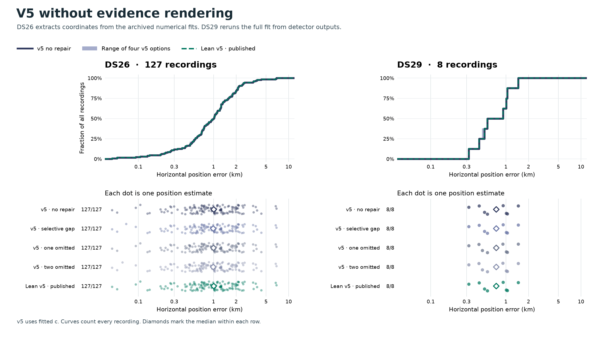
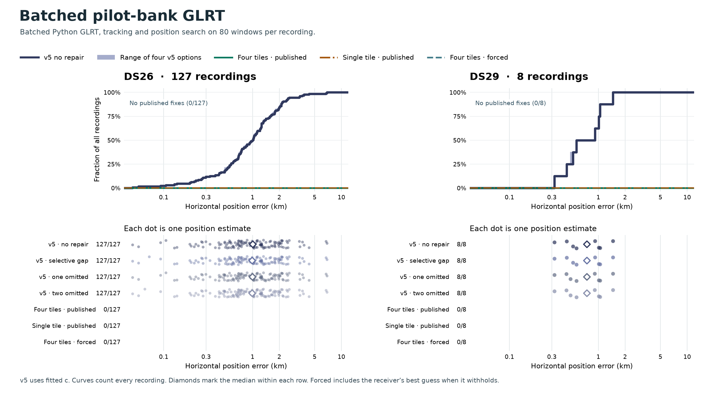
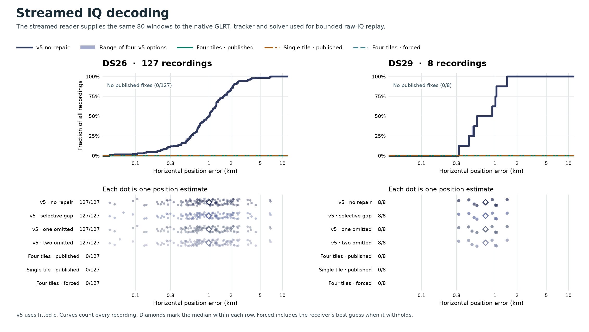
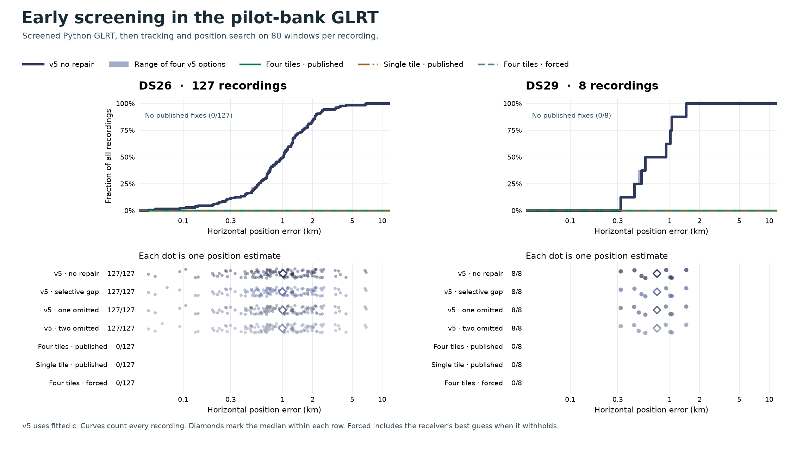
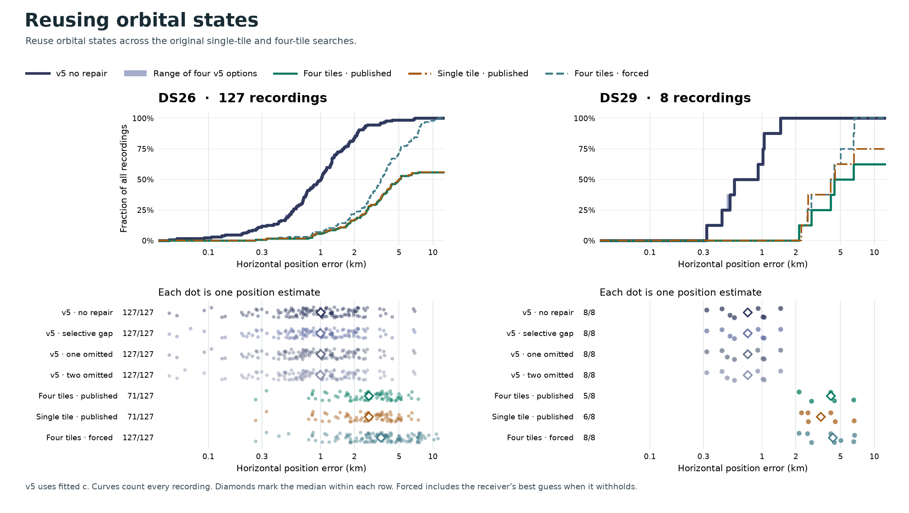
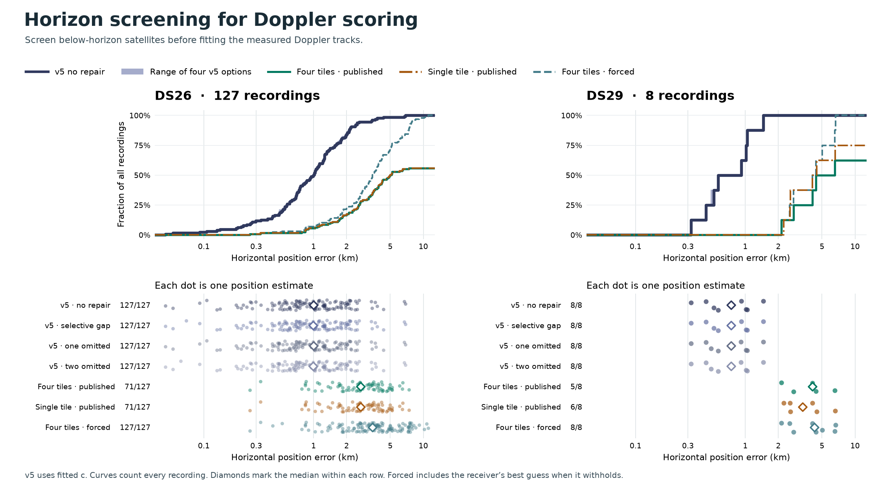
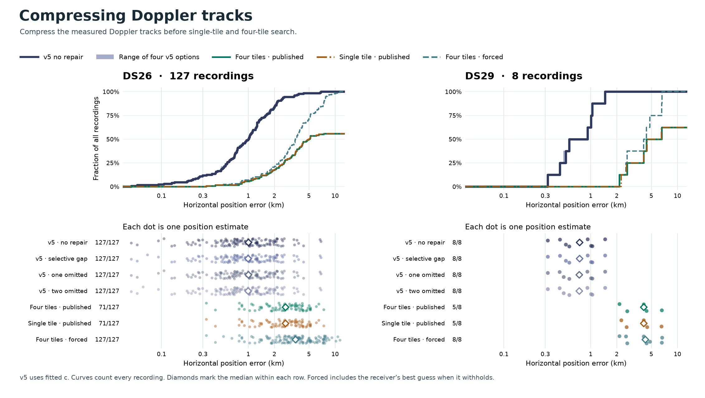
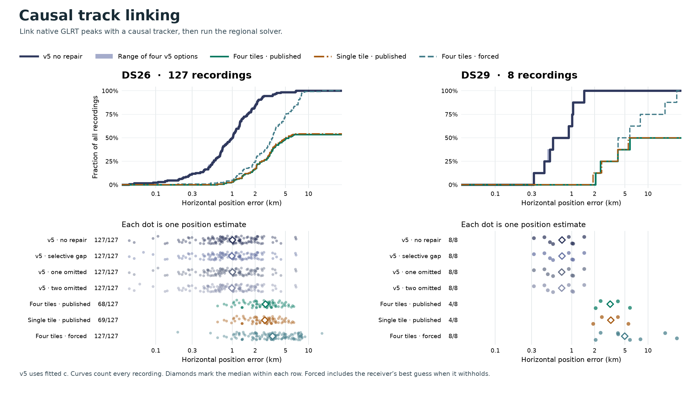
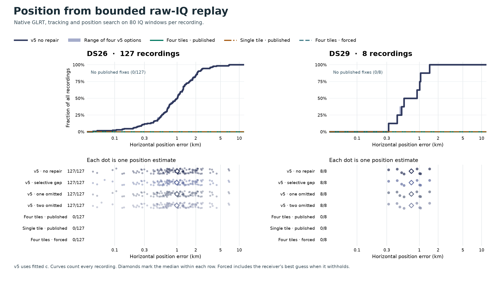
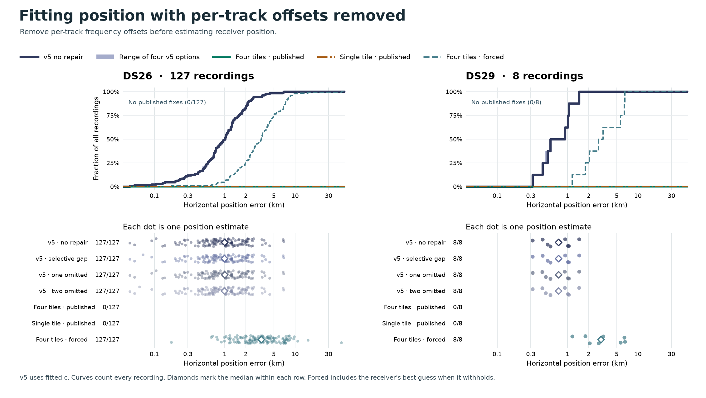

# Position error by receiver modification · Fitted calibration

The top row counts every recording. A curve that ends at 50% means the receiver returned positions on half the recordings. Each dot below is one returned position. The diamond marks their median. A forced estimate is the receiver’s best guess even when it withheld a fix.

[PDF](modifications.pdf) · [Per-recording errors](modifications.csv) · [Fix counts and both calibration settings](../README.md)

## V5 without evidence rendering

DS26 extracts coordinates from the archived numerical fits. DS29 reruns the full fit from detector outputs.

## Batched pilot-bank GLRT

Batched Python GLRT, tracking and position search on 80 windows per recording.

## Streamed IQ decoding

The streamed reader supplies the same 80 windows to the native GLRT, tracker and solver used for bounded raw-IQ replay.

## Early screening in the pilot-bank GLRT

Screened Python GLRT, then tracking and position search on 80 windows per recording.

## Reusing orbital states

Reuse orbital states across the original single-tile and four-tile searches.

## Horizon screening for Doppler scoring

Screen below-horizon satellites before fitting the measured Doppler tracks.

## Compressing Doppler tracks

Compress the measured Doppler tracks before single-tile and four-tile search.

## Causal track linking

Link native GLRT peaks with a causal tracker, then run the regional solver.

## Position from bounded raw-IQ replay

Native GLRT, tracking and position search on 80 IQ windows per recording.

## Fitting position with per-track offsets removed

Remove per-track frequency offsets before estimating receiver position.

