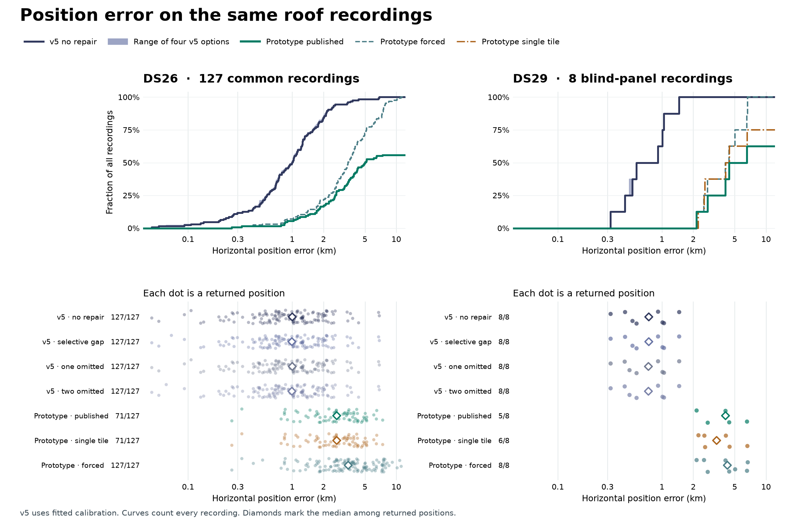
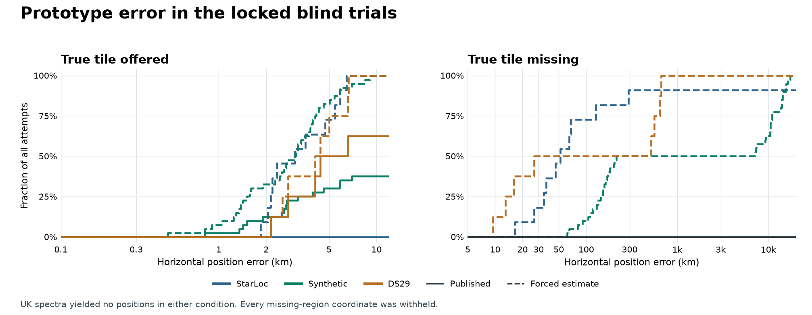

# Original fast v5 and the multi-region prototype

On the eight DS29 recordings from the blind experiment, **every v5 configuration placed all eight fixes within 1.46 km**. The four-region prototype published five positions with errors from 2.14 to 6.56 km. On the five recordings where both returned a position, median error was 0.92 km for no-repair v5 and 4.08 km for the prototype. Across the 127 original DS26 comparison recordings, no-repair v5 returned a fix within 5 km on 125. The prototype did so on 64. Both datasets come from the same receiver installation. [Per-recording errors](sample-errors.csv) · [Original benchmark](https://github.com/misko/leo-tracker-reduxredux/blob/db94afc0d/docs/analysis/algo07v5-ds26-performance.md)



## Eight DS29 recordings from the blind test

All 32 fresh v5 runs completed. Each no-repair error reproduced the earlier native v5 evaluation to within 0.001 m in both calibration arms. The table uses fitted calibration for v5. The single-tile prototype received v5’s original search region. The four-tile prototype received the original blind offers. The fixed tile center alone was 8.19 km from the receiver on both datasets. [Replay and historical cross-check](summary.json) · [Full distributions](distributions.csv)

| Method | Coordinates | Mean km | Median km | P90 km | P95 km | Maximum km | Within 5 km |
|---|---:|---:|---:|---:|---:|---:|---:|
| v5, no repair | 8/8 | 0.784 | 0.742 | 1.166 | 1.312 | 1.458 | 8/8 |
| v5, selective gap | 8/8 | 0.784 | 0.742 | 1.166 | 1.312 | 1.458 | 8/8 |
| v5, one omitted track | 8/8 | 0.779 | 0.740 | 1.166 | 1.312 | 1.458 | 8/8 |
| v5, two omitted tracks | 8/8 | 0.779 | 0.740 | 1.166 | 1.312 | 1.458 | 8/8 |
| Prototype, four tiles, published | 5/8 | 3.985 | 4.076 | 5.698 | 6.129 | 6.560 | 4/8 |
| Prototype, four tiles, forced | 8/8 | 4.265 | 4.241 | 6.585 | 6.615 | 6.645 | 5/8 |
| Prototype, v5 tile only, published | 6/8 | 3.752 | 3.333 | 5.526 | 6.059 | 6.592 | 5/8 |

These are the individual geographic errors in kilometers. Selective gap gave the no-repair coordinates on all eight. Both omitted-track settings gave the same coordinates as each other. They improved three recordings relative to no repair, reducing mean error by 4.9 m across the eight. The empirical P95 on eight recordings is sensitive to the largest observations. [Every setting and calibration arm](eight-recording-panels.csv)

| Recording | v5 no repair or selective gap | v5 one or two omitted tracks | Four tiles, published | Four tiles, forced | v5 tile only, published |
|---|---:|---:|---:|---:|---:|
| DS29-0082 | 0.517 | 0.486 | Withheld | 5.015 | Withheld |
| DS29-0127 | 0.567 | 0.567 | 2.747 | 2.747 | 2.584 |
| DS29-0174 | 0.917 | 0.912 | 2.139 | 2.139 | 2.241 |
| DS29-0247 | 1.458 | 1.458 | Withheld | 2.536 | 2.553 |
| DS29-0316 | 1.011 | 1.011 | 6.560 | 6.560 | 6.592 |
| DS29-0357 | 0.440 | 0.437 | 4.076 | 4.076 | 4.082 |
| DS29-0519 | 0.319 | 0.319 | Withheld | 6.645 | Withheld |
| DS29-0604 | 1.041 | 1.041 | 4.406 | 4.406 | 4.461 |

## Original DS26 cohort

These 127 recordings completed under every v5 option on both original repeats. The v5 rows use fitted calibration and one point per recording. Distances are in kilometers. The prototype's four-region rows include all 127 attempts in the coverage and 5 km columns.

| Method | Coordinates | Mean | Median | P90 | P95 | Maximum | Within 5 km |
|---|---:|---:|---:|---:|---:|---:|---:|
| v5, no repair | 127/127 | 1.232 | 0.999 | 2.180 | 3.126 | 6.858 | 125/127 |
| v5, selective gap | 127/127 | 1.228 | 0.988 | 2.180 | 3.126 | 6.858 | 125/127 |
| v5, one omitted track | 127/127 | 1.222 | 0.999 | 2.190 | 3.126 | 6.858 | 125/127 |
| v5, two omitted tracks | 127/127 | 1.211 | 0.988 | 2.190 | 3.126 | 6.858 | 125/127 |
| Prototype, published | 71/127 | 2.985 | 2.677 | 4.999 | 5.634 | 7.393 | 64/127 |
| Prototype, forced | 127/127 | 3.965 | 3.446 | 7.491 | 7.873 | 11.120 | 93/127 |

On the **same 71 recordings** with a published prototype fix, no-repair v5 had a **0.791 km median**. It was closer on 64, and the prototype was closer on 7. The median per-recording increase in error was 1.822 km with the prototype. Supplying the prototype only the v5 tile produced the same public decisions and coordinates as the four-tile run on the entire DS26 roster. On this roof panel, searching the extra tiles does not account for the accuracy gap. [Matched per-case results](sample-errors.csv) · [Paired summaries](summary.json)

Across all 159 original DS26 members, first-repeat v5 completion counts were 143 for no repair, 141 for selective gap, 138 for one omitted track and 132 for two. The counts within 5 km were 141, 139, 136 and 130. The prototype published 86/159 with 76/159 within 5 km. One recording lacked input. Among the 158 available inputs, forcing an answer on DS26-0064 chose a distractor 268.45 km from the receiver. The prototype withheld it for regional ambiguity. [All 159 distributions](distributions.csv)

### The eight DS26 recordings used for the earlier prototypes

This smaller panel retains the original eight recording IDs, including DS26-0277 where the two-omitted-track v5 worker timed out. Only DS26-0311 passed the new prototype’s publication rule. Its error was 0.896 km, compared with 1.310 km for no-repair v5 on that same recording. [Every result in the eight-case panels](eight-recording-panels.csv)

| Method | Coordinates | Median km | P90 km | P95 km | Maximum km | Within 5 km |
|---|---:|---:|---:|---:|---:|---:|
| v5, no repair | 8/8 | 1.259 | 6.758 | 6.808 | 6.858 | 6/8 |
| v5, selective gap | 8/8 | 1.259 | 6.758 | 6.808 | 6.858 | 6/8 |
| v5, one omitted track | 8/8 | 1.259 | 6.758 | 6.808 | 6.858 | 6/8 |
| v5, two omitted tracks | 7/8 | 1.310 | 6.773 | 6.815 | 6.858 | 5/8 |
| Prototype, four tiles, published | 1/8 | 0.896 | 0.896 | 0.896 | 0.896 | 1/8 |
| Prototype, four tiles, forced | 8/8 | 6.266 | 11.029 | 11.376 | 11.724 | 4/8 |

## Other samples in the blind test

Each cell below gives the number of coordinates, followed by median / P90 / P95 / maximum distance in kilometers. Published errors are conditional on a fix. Every present capture has a matched missing-region query with identical measurements and orbits.

| Receiver input | Published, true region present | Forced, true region present | Forced, true region missing |
|---|---|---|---|
| StarLoc, measured | 0/11 | 11/11 · 3.05 / 5.89 / 6.18 / 6.46 | 10/11 · 48.99 / 143.35 / 217.71 / 292.06 |
| Simulated locations | 15/40 · 2.67 / 5.87 / 6.21 / 6.96 | 40/40 · 3.06 / 5.85 / 7.04 / 9.16 | 40/40 · 3,702.91 / 14,477.29 / 15,798.66 / 17,326.57 |
| DS29, measured | 5/8 · 4.08 / 5.70 / 6.13 / 6.56 | 8/8 · 4.24 / 6.59 / 6.61 / 6.64 | 8/8 · 270.10 / 648.62 / 655.40 / 662.19 |
| Altrincham, measured spectra with zero qualifying tracks | 0/3 | 0/3 | 0/3 |

The prototype withheld all 62 missing-region queries. Those queries contribute no published-distance samples. The dashed curves show the errors a forced answer would have incurred. The eight StarLoc site groups share one area and one receiver array. The frozen v5 worker accepts only its original Bay Area tile, so the independent field, simulated and missing-region conditions have prototype results only. [Original blind study](../2026_11_18_blind_regional_receiver/README.md) · [Original v5 region check](v5-region-contract.json)



## Reading the distributions

The empirical curves use every recording in their denominator. At any distance they show the proportion of recordings with an output that close to the receiver. A curve ending below 100% leaves some recordings without a coordinate. The dots and percentile tables describe only returned coordinates. A forced prototype point is the best available radio fit, including points the publication rule withheld. Each v5 recording contributes once per configuration and calibration arm. P90, P95 and P99 use linear interpolation between ordered samples. Position error is the great-circle distance in kilometers to the same reference for both methods. [Per-recording errors and statuses](sample-errors.csv) · [Distributions in both calibration arms](distributions.csv)

## Which comparisons share recordings and priors

- **DS29.** All eight recordings are the same acquisitions used in the earlier blind test. The original four configurations were rerun from their frozen scientific worker and native backend. Each worker received the same content-bound detector output, track configuration, causal archive, regional prior and matched calibration arms. Receiver reference coordinates entered scoring after inference. The four-tile prototype results, including the missing-region offers, come from the original locked predictions. An additional run supplied only the production tile, centered at 37.906° N, 122.545° W, to control the geographical prior. [Blind prediction commitment](../2026_11_18_blind_regional_receiver/locks/prediction-lock.json) · [DS29 replay](run_v5_panel.py)
- **DS26.** The published campaign has 159 recordings and two repeats. Its headline distribution uses the 127 recordings that completed all four roles in both repeats. We recovered the first repeat's endpoints and checked both repeats' published mean, median, P90, P95, P99 and maximum for each calibration arm. The unchanged prototype was run on every available input using the archived anonymous graph and latest strictly pre-cutoff TLE snapshot. One run supplied only the original v5 tile. A second supplied that tile plus three distractors at 45, 65 and 250 km, rotated and shuffled by recording ID. The 127-case comparison uses the published v5 selection regardless of prototype success. Full-roster and earlier eight-recording DS26 subsets are available separately. DS26 contributed to earlier development. [Original v5 report](https://github.com/misko/leo-tracker-reduxredux/blob/db94afc0d/docs/analysis/algo07v5-ds26-performance.md) · [Recorded-input replay](run_grid_panel.py) · [Comparison design](comparison-design.json)
- **Transfer and missing-region trials.** The published v5 worker requires one particular 25 km Bay Area tile and native detector inputs. The external and simulated panels provide anonymous track curves and candidate regions in other locations. The locked prototype results cover those conditions. A worldwide or missing-region v5 comparison would require a geographically portable implementation with an explicit decision rule for four offers. [Original request validation](https://github.com/misko/leo-tracker-reduxredux/blob/db94afc0d/src/leo/operations/localization_v3_job.py#L75) · [Original engine restriction](https://github.com/misko/leo-tracker-reduxredux/blob/db94afc0d/src/leo/application/localization_v3_engine.py#L360) · [Field and simulation provenance](../2026_11_18_blind_regional_receiver/README.md)

The original validator accepted its production center. We also supplied each of the 496 offered centers in the 124 blind queries to that same validator. It rejected all 496 under the production-frame constraint. This check tests the public input contract. The DS29 v5 scientific runs use the original allowed tile, and the prototype's one-tile control uses that same center. On DS29 the four-tile condition changes the center of the containing tile as well as adding competitors. On DS26 the one- and four-tile conditions keep the same containing center. [Contract check](v5-region-contract.json)

## Calibration and timing

The frozen v5 worker produces `c=0` and fitted-`c` estimates from matched detector inputs, candidate policies, other priors and search budgets. Their final associations can differ. For each recording we computed both the frequency RMS on each arm's selected points and the RMS on only the observation IDs assigned to the same satellite in both arms. The latter also checks equality of receiver, channel, measured frequency and time for each retained observation. Geographic errors use the independent receiver reference. The prototype removes the constant frequency level from each fixed-RF track. Its position has one shape-only result for both calibration arms. In the earlier matched controls, added RF-dependent levels and reversed offer order reproduced the decisions, and every available fitted coordinate had zero measured movement. [Paired calibration results](summary.json) · [Prototype controls](../2026_11_18_blind_regional_receiver/results/invariance.json)

On the original 127 recordings, the median per-recording change in selected-fit RMS was −9.81 Hz under all four v5 options. For no repair, the mean position error changed from 1.252 to 1.232 km, while P95 changed from 3.084 to 3.126 km. The three repair variants shared those P95 values in the two arms. On this cohort, recovering two omitted tracks reduced fitted-`c` mean error by 20 m relative to no repair, and every option placed 125/127 within 5 km. [Both calibration arms by recording](sample-errors.csv) · [Published v5 performance](https://github.com/misko/leo-tracker-reduxredux/blob/db94afc0d/docs/analysis/algo07v5-ds26-performance.md)

On DS29, fitting `c` reduced median per-recording RMS by 13.51 Hz for every option. Computing RMS only on the same observation IDs with the same satellite assignments reproduced the 13.51 Hz reduction on DS29 and the 9.81 Hz reduction on DS26. For no repair or selective gap, DS29 mean position error increased from 0.759 to 0.784 km. For either omitted-track setting it increased from 0.701 to 0.779 km. DS29’s no-repair median changed from 0.753 to 0.742 km, and its P95 increased from 1.210 to 1.312 km with fitted calibration. [All calibration distributions](distributions.csv) · [Paired RF residuals](summary.json)

The v5 worker starts at saved native detector output, builds and associates tracks, fits both calibration arms, and produces audited scientific evidence and figures. The prototype's timer starts with the anonymous tracks already available. Fresh DS29 v5 runs used eight recording lanes on the shared x86 host, one CPU per worker, one numerical thread and the original 1,200-second worker deadline. On the original DS26 panel, the **mean** v5 worker times across both repeats were 445 s for no repair, 456 s for selective gap, 511 s for one omitted track and 533 s for two omitted tracks. These measurements cover different amounts of software work. End-to-end RF acquisition and target-board latency were outside the experiment. [Original worker timings](https://github.com/misko/leo-tracker-reduxredux/blob/db94afc0d/docs/analysis/algo07v5-ds26-performance.md)

On these eight DS29 recordings, **median** full-worker times were 240, 250, 255 and 297 s in the same v5 option order. The prototype from prepared tracks took a median 12.0 s with the four true-present blind offers and 7.1 s with the original tile alone. [Measured wall times](summary.json)

## Reproduction

Run the following commands from the repository root on the corpus host. The replays read the existing orbit and detector archives. The v5 workers write their full evidence under `/srv/bulk/leo-dev/blind-v5-comparison-20261118/ds29`. The scored CSV contains the result for each method, arm and condition, including every failure or withheld decision.

```sh
MOD=reports.2026_11_18_v5_blind_comparison
OPENBLAS_NUM_THREADS=1 .venv/bin/python -m "$MOD.run_v5_panel"
OPENBLAS_NUM_THREADS=1 .venv/bin/python -m "$MOD.run_grid_panel" --jobs 7
OPENBLAS_NUM_THREADS=1 .venv/bin/python -m "$MOD.summarize"
MPLBACKEND=Agg .venv/bin/python -m "$MOD.plot_errors"
.venv/bin/python -m "$MOD.check_v5_region"
.venv/bin/python -m pytest -q reports/2026_11_18_v5_blind_comparison/test_comparison.py
```
