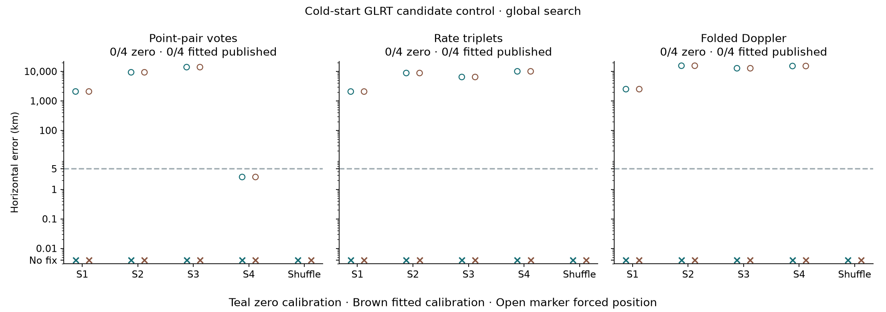

# Independent synthetic post-GLRT control

**All three receivers withheld all four planted sites and the shuffled
control in both calibration arms.** All 15 method-and-acquisition
attempts completed on the fresh corrected packet. Point-pair votes
forced a position 2.629 km from the southern Africa site but withheld
because a separated rival had nearly as much held-out support. No other
forced estimate was within 5 km. The optimistic input conditions make
this a test of global candidate association and publication.



## Position results

The receiver outputs include diagnostic positions after withholding.
Entries for the four planted sites are forced errors in kilometers. Point-pair votes
and folded Doppler are identical across calibration arms.

| Figure case | Acquisition ID | Point-pair votes | Rate triplets, zero / fitted | Folded Doppler |
|---|---|---:|---:|---:|
| S1 · Europe | `e5a7d37fc8e39afd7b8a9370` | 2,081.247 | 2,073.137 / 2,071.042 | 2,499.664 |
| S2 · Australia | `5ac877a08e97a22c2d676671` | 9,313.396 | 8,802.119 / 8,800.215 | 15,543.090 |
| S3 · Mexico | `4ee49ba5d5c3758fa5de464b` | 13,937.711 | 6,451.659 / 6,450.697 | 12,765.653 |
| S4 · Southern Africa | `e7565c3d1a8cb07b6ccf4f1b` | 2.629 | 10,036.200 / 10,036.200 | 15,192.395 |
| Shuffle | `17d6506dc14dd0993e2f14d8` | Withheld | Withheld in both arms | Withheld |

Each method had 0/4 published positions and 0/4 within 5 km in each
calibration arm. The distribution of published errors is empty.
On the shuffle, each method had 0/1 publications in each arm.
Median solver wall times across the four positive plants were 135.31 s
for point-pair votes, 59.29 s for rate triplets and 6.22 s for folded
Doppler. These timings start after input loading and use a single
numerical thread per worker. [Per-acquisition scores](scores.json) ·
[Figure PDF](position-errors.pdf)

## Association and conditional fits

Point-pair held support was 95.9–99.7% on the four planted sites.
Its lead over a separated rival ranged from −0.0023 to 0.0293, below
the 0.07 publication requirement. The 2.629 km nomination had the
largest lead of 0.0293. Rate triplets found 24 qualifying lane segments in
each positive capture. Its shape vote margins ranged from 0.238 to
1.153, below the 1.5 requirement. Its conditional CFO RMS on the
forced fits was 4,441 Hz median with zero calibration and 4,374 Hz
with fitted calibration. Neither arm yielded a published position.
Folded Doppler confirmed 0–2 independent held-bin profiles per site
with a maximum lead of 1.040, below its required three profiles and
3.0 lead.

Rate triplets nominated 6–10 distinct catalogue objects per site.
Folded Doppler nominated four per site. Neither nominated any of the
12 planted emitter IDs at any site. A post-seal reconstruction under
the planted parameters verified all high-margin peaks and recovered
23.77–24.25 Hz CFO noise RMS and 0.119–0.121 sample epoch noise RMS
across the four plants. This check used the known generator parameters
after scoring. It required no receiver reruns. [Physical input and
association audit](physics-audit.json)

## Panel and measurement model

This panel tests the global search from anonymous native GLRT candidate lists
and real causal orbital elements. It comprises four receiver sites drawn
independently inside fixed geographic boxes in Europe, Australia, Mexico and
southern Africa, plus one shuffle control. Each positive acquisition covers
300 seconds. The solver sees neither the site box nor its coordinates.
No position tile is supplied. [Frozen simulation protocol](PROTOCOL.md)

The generator propagates the archived 2026-11-14 Starlink catalogue with
SGP4. It solves the light-time equation with the transmitter position at the
emission instant and the Earth-rotating receiver position at reception.
The carrier shift uses the derivative of that range, scaled by minus the
RF frequency over the speed of light. For the epoch, the generator advances
a 750 Hz transmit frame by the light time and converts its arrival to
receiver samples relative to the probe counter. It expresses the result
modulo the nominal frame period. Measured CFO uses the signed ambiguity
interval of the 4.4 µs pilot. A finite-difference check verifies the
retarded range-rate calculation independently of either solver.

The packet models 20 ms probes at 10 MS/s on two receiver lanes and an
eight-channel sweep. Twelve distinct emitters at each site provide
coherent peaks on four RF channels. Each scheduled emitter lasts
about 44 s and stays above 25° elevation at the five geometry checks.
The peak generator includes per-emitter phase and carrier offsets,
shared receiver clock bias and skew, receiver LO bias and drift,
an injected RF-dependent constant, independent frequency and epoch noise,
weak spurious peaks, and missed detections. The shuffle preserves
candidate-list marginals and cadence within receiver/channel lanes.
It has no defined coordinate. The archived measurements, track labels
and roof geometry are absent from the simulated input.

This is an optimistic positive control. The causal elements also
generate the synthetic emitters, the station has zero WGS84 height,
and at most one coherent emitter occupies each RF visit. There is
no orbit prediction error, real IQ search, environmental propagation,
or emitter-specific frame rate drift outside the stated model.

## Source lock and scope

The corrected shared panel compares point-pair votes, rate triplets
and folded Doppler. An initial draw ended before scoring after
the point-votes confidence rule was corrected. A subsequent draw
exposed a packet timing error when folded Doppler joined the still-blind
comparison. The generator put elapsed capture time in both the valid
sample counter and the within-visit offset, so folded Doppler rejected
the input during timestamp validation. These were invalid inputs,
distinct from receiver withholding. [Pre-correction archive](pre-correction-2026-11-19/README.md)

The corrected generator puts elapsed time into the valid sample counter
and sets the within-visit offset to zero. All 13,530 archived probes
in DS26-0036 use this representation. Its first three sample-counter
offsets are 0, 44.2731 and 88.5369 ms, each with a zero within-visit
offset. An unscored preflight verified the corrected 0.010 s first and
299.986 s final probe midpoints with the folded-Doppler observation
adapter and tested that duplicate elapsed timing fails the bounds check.
The final panel draws a new seed and leaves the physical signal model
and all three solver programs unchanged. [Input timing audit](timing-audit.json)

The source manifest commits to the solver programs, generator,
input contract, orbit and score utilities, protocol, and catalogue
digest before random generation. The public capture directory
contains only candidate packets, timing and RF metadata, and the
causal TLE. The scorer verifies both input and prediction seals
before opening the secret seed and coordinates. [Source lock](source-lock.json) ·
[Input lock](input-lock.json) · [Prediction lock](prediction-lock.json) ·
[Sealed predictions](predictions.jsonl.gz)

Conditional CFO fit
is stored separately from geographic error. Both calibration arms
see the same inputs. Point votes cancels the RF constant by differencing
same-frequency measurements. Folded Doppler profiles an RF-specific
CFO offset. Rate triplets refits the RF constant only in the fitted arm.

## Reproduction

From the repository root, use the original archive paths and the solver
hashes in `source-lock.json`. This command draws a new untouched seed.
The saved `seed.hex` and manifest preserve the evaluated draw.

```sh
export OPENBLAS_NUM_THREADS=1 OMP_NUM_THREADS=1 MKL_NUM_THREADS=1
scene_root="$(mktemp -d /tmp/leo-cold-synthetic.XXXXXXXX)/run"
taskset -c 8 .venv/bin/python -m tools.pipeline_eval.qualification.cold_scenes generate "$scene_root"
taskset -c 8-14 .venv/bin/python -m tools.pipeline_eval.qualification.cold_scenes predict \
  "$scene_root" --positive-limit 4 --timeout 150
.venv/bin/python -m tools.pipeline_eval.qualification.cold_scenes score "$scene_root" "$scene_root/report"
.venv/bin/python -m tools.pipeline_eval.qualification.cold_scenes figure \
  "$scene_root/report/scores.json" "$scene_root/report/position-errors.png"
```
