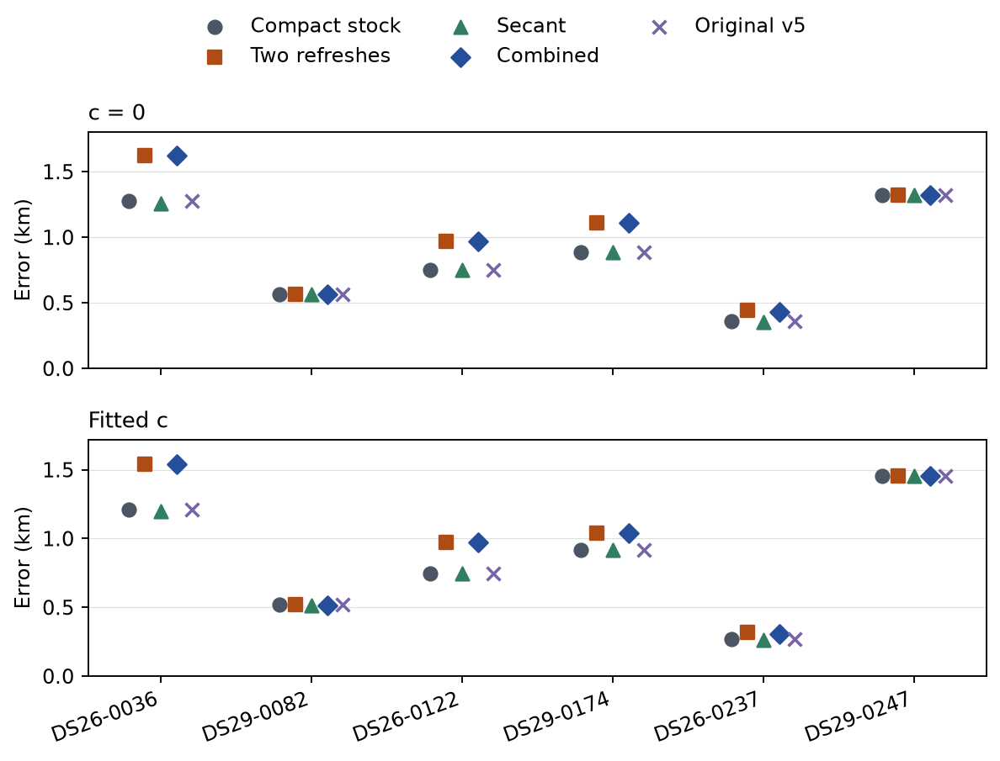

# Secant fitting with two orbital phase refreshes

The combined compact v5 receiver finished all six recordings and published all six fixes within 5 km in each calibration arm. Across the six input-matched phase-budget stock receipts, the median stock-to-combined CPU ratio was **1.68×**. The combination missed the preregistered geographic gate in both datasets and both arms. Fitted-calibration median error rose from 0.747 to 0.971 km on DS26 and from 0.917 to 1.042 km on DS29. [Protocol](PROTOCOL.md) · [Predictions and file hashes](prediction-lock.json) · [Geographic scoring](summary.json)

| Recording | Combined wall / CPU (s) | Stock wall / CPU (s) | Two-refresh CPU (s) | Combined / secant position objective evaluations | Combined fitted error (km) | Stock fitted error (km) |
|---|---:|---:|---:|---:|---:|---:|
| DS26-0036 | 64.86 / 62.90 | 137.62 / 115.94 | 88.55 | 407 / 650 | 1.539 | 1.208 |
| DS29-0082 | 51.32 / 49.03 | 128.33 / 55.37 | 48.35 | 333 / 474 | 0.516 | 0.517 |
| DS26-0122 | 119.29 / 108.21 | 312.16 / 297.19 | 212.98 | 790 / 1,137 | 0.971 | 0.747 |
| DS29-0174 | 78.86 / 74.62 | 135.22 / 122.56 | 98.20 | 400 / 544 | 1.042 | 0.917 |
| DS26-0237 | 80.14 / 76.40 | 127.02 / 115.73 | 98.04 | 317 / 455 | 0.307 | 0.271 |
| DS29-0247 | 103.74 / 101.06 | 189.03 / 172.76 | 140.69 | 498 / 654 | 1.458 | 1.458 |

The combined runs used CPUs 10 and 11, phase-budget comparisons used CPUs 22 and 23, and secant-only comparisons used CPUs 20 and 21. Median combined runtime was 75.51 CPU seconds and 79.50 wall seconds. Across six pairs, the median ratios were 1.35× for two-refresh-to-combined CPU and 1.43× for secant-only-to-combined position objective evaluations. The secant-only receipts supply elapsed time and evaluation counts. Stage measurements use wall time and CPU totals cover the whole worker. Substantial shared-host load variation affected wall times. The DS26-0122 two-refresh retry supplied whole-worker timing and reproduced both endpoints and RMS values exactly after the first supervisor exited before recording timing. [Independent scorer and stage timings](scores.csv) · [First DS26-0122 attempt](../phase-budget/interrupted-attempt.json)

The 50 m endpoint criterion against compact stock passed on five of 12 arm results. The largest shift was 357 m on DS26-0036. All 12 conditional Doppler RMS changes were within 1 Hz, with maximum absolute change of 0.173 Hz. The combined endpoints were within 11.5 m of the two-refresh-only endpoints across all 12 arm results. That agreement locates the larger shifts in the earlier phase-budget change. The DS29-0082 CPU figure was 0.68 s above the independently run two-refresh-only case, and its two combined endpoints equal the secant-only coordinates. [Per-arm scores](scores.csv)

| Dataset | Calibration | Combined median / P95 error (km) | Original v5 median / P95 error (km) |
|---|---|---:|---:|
| DS26 | `c = 0` | 0.967 / 1.557 | 0.751 / 1.226 |
| DS26 | Fitted `c` | 0.971 / 1.482 | 0.747 / 1.162 |
| DS29 | `c = 0` | 1.107 / 1.299 | 0.885 / 1.276 |
| DS29 | Fitted `c` | 1.042 / 1.416 | 0.917 / 1.404 |



The adapter nests the secant worker inside the two-refresh policy so the secant instrumentation sees the capped initial fitting calls. All six cases used two rounds for each of three initial branches. The underlying optimizers, cavity acceptance, exact capture-era native GLRT factors, causal orbit source and original tile supply the same numerical boundary as the constituent runs. Both calibration arms are retained. The measured elapsed interval begins with stored native factors and ends with compact cavity results. [Source lock](source-lock.json) · [Composition adapter](../../../tools/pipeline_eval/variants/v5_secant_two_refresh.py)

## Reproduce

From the repository root, bind the sources before opening input. Run the primary pair on separate logical cores. Continue each lane in the protocol's order after both primary attempts finish. The `summarize` command seals every prediction before reading independent references.

```sh
.venv/bin/python -m tools.pipeline_eval.qualification.secant_two_refresh_trial seal
taskset -c 10 .venv/bin/python -m tools.pipeline_eval.qualification.secant_two_refresh_trial \
  replay --case DS26-0036
taskset -c 11 .venv/bin/python -m tools.pipeline_eval.qualification.secant_two_refresh_trial \
  replay --case DS29-0082
.venv/bin/python -m tools.pipeline_eval.qualification.secant_two_refresh_trial summarize
.venv/bin/python -m pytest -q tests/pipeline_eval/test_v5_secant_two_refresh.py \
  tests/pipeline_eval/test_v5_secant_fit.py
```

Use explicit `--runs`, `--phase`, `--secant` and `--report` paths when the archived comparison receipts or staged worker results live elsewhere.
