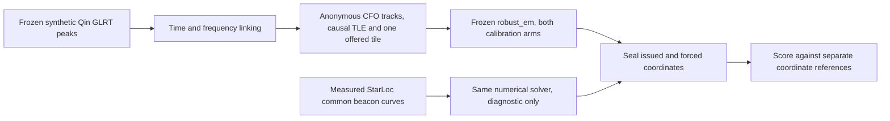

# Frozen track receiver across sites

The unchanged `robust_em` receiver published on three of four synthetic GLRT sites when the supplied 25 km tile contained the receiver. It withheld on all four single omitted tiles and on the shuffle. The measured StarLoc release used one portable array at four distinct GNSS sites, all with a single shared beacon measurement lane. The frozen receiver withheld in all eight measured diagnostic calls. These calls exercise its numerical and withholding behavior on a different observable. They provide zero compatible measured field position estimates.

The four measured sites are 3.07–6.59 km apart across their six GNSS pairs. The four synthetic sites are 7,966–16,579 km apart. These distances were computed from the previously sealed references after scoring.

| Input and offer | Attempts | Publications per arm | Forced coordinates per arm | Median position error c=0 / fitted c (km) | Median tile-center error (km) |
| --- | ---: | ---: | ---: | --- | ---: |
| Synthetic GLRT, supplied correct tile | 4 | 3 | 4 | 1.866 / 0.316 issued, 1.852 / 0.538 forced | 8.663 |
| Synthetic GLRT, receiver omitted | 4 | 0 | 4 | 41.988 / 42.085 forced | 56.705 |
| Synthetic GLRT, shuffled times | 1 | 0 | 0 | — | — |
| Measured StarLoc diagnostic, supplied correct tile | 4 | 0 | 1 | 22.871 / 22.871 forced | 6.950 |
| Measured StarLoc diagnostic, receiver omitted | 4 | 0 | 1 | 36.835 / 36.834 forced | 88.280 |

The StarLoc forced coordinate came from the same site in both offers. Compare it to that site's tile-center error of 8.071 km with the containing offer and 43.872 km with the omitted offer. On the four synthetic supplied-correct attempts, median in-sample RF RMS moved from 44.418 to 25.101 Hz across the same matched fits. The held-track gate withheld one such synthetic attempt even though its forced errors were 1.838 and 0.760 km. Its omission result had a 63 km forced error. There were zero failed or timed-out calls. [Per-query scores](scores.json) · [Prediction seal](prediction-lock.json)

## Observable and geometric assumptions

The measured packet preserves one 11.325 GHz StarLoc beacon frequency series per track. The three source antennas detect a common FFT bin, represented in the release as receiver 1 and Ku channel 3. Its nominal center is 115.3125 MHz from either Qin channel-3 edge pilot center, outside its recorded 2 MHz span. StarLoc tracks central beacon tone frequencies from a roughly 43.945 kHz comb. `robust_em` treats each curve as a Qin GLRT carrier-offset ambiguity with period 227.273 kHz and requires at least two independently supported radio lanes for publication. The prepared StarLoc curves establish neither this ambiguity model nor a common absolute carrier level across all passes. Its released pass windows have undocumented selection provenance, and the exact catalogue retrieval time is author-reported. [StarLoc experiment](https://arxiv.org/html/2604.21147v1#S5.SS1) · [Beacon comb measurements](https://link.springer.com/article/10.1186/s43020-025-00163-y) · [Measured input and GNSS audit](../../2026_11_18_blind_regional_receiver/field_private/provenance.md) · [Local raw inventory](../../2026_11_19_short_receiver/physical-transfer/raw-source-audit.json)

With one band, the calibration design column `rf_GHz − 11.5` is identically −0.175 times the lane intercept. Rank is 1 with or without `c` on all measured packets. Only the combination of lane offset and `c` is measured. The fitted values −102 and −116 kHz/GHz on the two forced fits reflect the penalized choice between those columns. Adding a second lane at a single RF per lane would still leave the RF term in the lane-intercept span. All four synthetic sites have four realized lanes and lift that rank from 4 to 5. The capture generator deliberately models a per-lane clock and a linear RF-dependent term. [Protocol](PROTOCOL.md) · [Source lock](source-lock.json)

At the four measured containing tile centers, the strict all-epoch candidate count ranges from 1,301–3,548 orbit/track pairs at the fixed receiver floor (about −2°) to 1,158–3,111 at 0°, 812–2,186 at 5°, and 112–365 at 30°. Every measured curve still has at least one candidate at 30°. These counts establish geometric visibility, and the actual receiver keeps its frozen −2° floor and shape and holdout gates. StarLoc used zenith-facing horns and a 30° floor in its own grating-lobe algorithm. This is the basis for the 30° sensitivity check. [StarLoc elevation and processing assumptions](https://arxiv.org/html/2604.21147v1#S3.SS4) · [Per-query diagnostics](scores.json)

At the measured containing tiles, the optimistic diagnostic found individually plausible shape support on all 4–11 tracks per case. A single shared offset and drift per lane supported only 2–4 of those tracks within 1.5 kHz. The maximum support count was identical with the Qin fold and with the unwrapped level on those containing tiles. At the synthetic containing tiles, the same folded diagnostic matched 4–6 of the six tracks in each lane, compared with 2–4 without the fold. This diagnostic uses the receiver’s shape-screened shortlists and fixed drift grid at the tile center. Independent offsets can absorb each track level freely. Folded counts use the fixed offset grid, and unwrapped counts maximize continuous interval overlap. Both are separate from the frozen receiver's assigned-orbit holdout test. [Per-query diagnostics](scores.json)

## Timing and provenance

The solver excludes capture and preparation. Median solver elapsed was 0.424 s per measured query and 0.372 s per synthetic query on one CPU with one numerical thread. The isolated process including imports and the separate observability diagnostic took median 1.855 s and 1.633 s respectively. For synthetic input, the previously implemented identity-free linker and capture decoding took 0.314–0.453 s per capture before offer evaluation. It retained 24 anonymous tracks of 12 samples each per positive scene and zero tracks on the shuffle. Synthetic sample packets and offers predate this run. No receive or acquisition stage was executed. [Input plan](plan.json) · [Frozen synthetic panel](../../2026_11_19_short_receiver/fresh-scenes/README.md)

## Paired fixed-assignment range-rate fit

The separately locked `robust_orbit_fit` revision used all 17 identical numerical input packets in a retrospective replay after the control results were available. Every publication and withholding decision matched `robust_em`. The three synthetic fixes with containing offers moved from 2.063 / 1.155 to 1.625 / 0.747 km, from 1.866 / 0.083 to 1.827 / 0.239 km, and from 1.216 / 0.316 to 1.147 / 0.390 km (`c=0` / fitted `c`). The still-withheld fourth forced estimate changed from 1.838 / 0.760 to 1.914 / 0.736 km. The median issued error improved for `c=0` (1.866 to 1.625 km) and worsened for fitted `c` (0.316 to 0.390 km). Across the four containing offers, median in-sample RF RMS rose from 44.418 to 46.496 Hz with `c=0` and dropped from 25.101 to 24.859 Hz with fitted `c`. [Locked paired comparison](comparison.json) · [Range-rate prediction seal](robust-orbit-fit/prediction-lock.json) · [Range-rate scores](robust-orbit-fit/scores.json)

Both runs withheld all omitted and shuffle trials. On the four compatible omitted trials, median forced error changed from 41.988 / 42.085 to 41.653 / 41.693 km. The eight StarLoc diagnostics remained withheld. The one correct-tile forced answer stayed 22.871 km from GNSS in both arms. The omitted forced error was 36.267 / 36.266 km. Geographic transfer under the Qin measurement contract remains supported only by the synthetic panel. [Retrospective replay protocol](robust-orbit-fit/PROTOCOL.md) · [Exact release](robust-orbit-fit/source-lock.json)

For the four synthetic containing offers the added fit-stage time was a median 0.051 s per paired attempt, and the sum of the shared observation, orbit, shortlist and fit stages increased by a paired median 0.110 s. The stage sums had medians of 0.378 s for the control and 0.519 s for the fixed-assignment range-rate receiver. Overall process-wall measurements include different diagnostics in the two wrappers. [Stage data](comparison.json)
