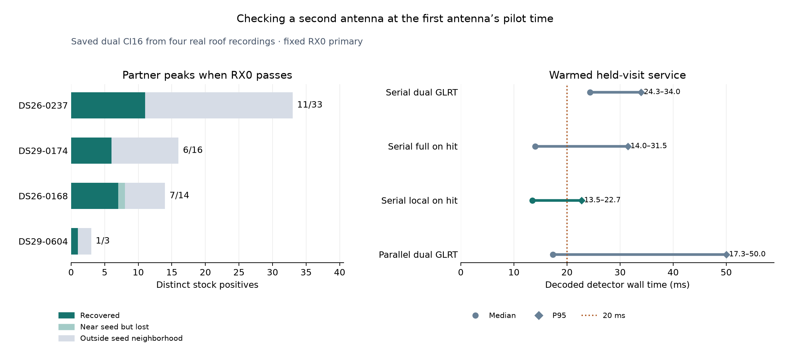

# Local GLRT confirmation on the second antenna

Local confirmation recovered **17 of 49** distinct stock partner detections on primary-hit visits in two held recordings. All 17 detections within two samples of an admitted primary epoch were recovered. The other 32 stock partner detections had no nearby admitted epoch. The held partner-call median CPU fell from 12.01 to 3.45 ms, and the serial on-hit P95 wall fell from 31.46 to 22.74 ms. The method failed the preregistered support gate in both recordings. No position fits were run. [Protocol](PROTOCOL.md) · [Result lock](result-lock.json)



## Detector and support

The released four-region GLRT runs on physical RX0 and gates at the original 0.025 fractional margin. The strongest two distinct passing epochs seed the partner search. The partner's samples determine its own CFO through the existing signed-band fine FFT and its own fractional epoch and exact/control scores through the released five-point GLRT. The partner's standalone timing proposal and coarse grid are removed. A primary miss emits an empty RX1 row. The replay checks every decoded RX0 candidate and every non-timing row field against the parallel release, including candidates below the gate. [Native source and input binding](source-lock.json)

In two separate development archives, 699 of 1,648 and 502 of 1,677 partner detections shared any positive primary epoch within two samples. The coincident peaks had near-zero median timing differences, with separate relative CFO modes from −67.5 to +16.5 kHz. This supported zero timing shift and measuring the partner CFO from its own samples. The offsets were diagnostic. The receiver takes neither those archives nor an oscillator calibration as input. [Development audit](development.json)

| Cohort and recording | Visits | Primary hits | Stock partner peaks on hit | Near a local seed | Recovered | Additional local peaks | Stock partner peaks on miss |
| --- | ---: | ---: | ---: | ---: | ---: | ---: | ---: |
| Held DS26-0237, lower | 72 | 32 | 33 | 11 | 11 | 13 | 3 |
| Held DS29-0174, upper | 72 | 27 | 16 | 6 | 6 | 6 | 6 |
| Stress DS26-0168, lower | 32 | 16 | 14 | 8 | 7 | 6 | 0 |
| Stress DS29-0604, upper | 32 | 7 | 3 | 1 | 1 | 3 | 1 |

The replay decoded all 208 scheduled real visits and all 14 synthetic controls. The same one-to-one test matches gated outputs within two samples and 1 kHz modulo the symbol alias. The 28 additional local positives lack a match in the full partner output, so they do not establish either correct new detections or false alarms. Zero, noise and silent-partner controls produced no partner detection. A silent primary skipped partner processing even when stock found the planted partner signal. The local fit recovered signed pilots at zero and +1 sample delay on both edges. It missed the planted partner signal at +4 samples on both edges. [Per-visit candidates, times and raw IQ digests](paired.json.gz) · [Control results](summary.json)

## Host detector cost

Three warmed calls per input and mode are counterbalanced. Timings use the median per visit and then summarize the 144 held real visits. The boundary starts with locally staged dual CI16 and includes gathering, detector calls and decoded row assembly. One-core modes ran on CPU16. Parallel dual used CPU16 plus CPU17 and records process CPU summed across threads. This is saved-IQ host execution without arrival pacing.

| Mode | CPU P50 / P95 (ms) | Wall P50 / P95 (ms) | Visit medians ≤20 ms |
| --- | ---: | ---: | ---: |
| Serial full dual | 23.35 / 29.25 | 24.35 / 33.97 | 11 / 144 |
| Serial full partner on hit | 12.19 / 30.64 | 14.01 / 31.46 | 83 / 144 |
| Serial local partner on hit | 12.54 / 19.51 | 13.48 / 22.74 | 132 / 144 |
| Parallel full dual | 23.86 / 30.49 | 17.32 / 50.04 | 86 / 144 |

Local confirmation reduced the sum of held per-visit median CPU from 2.467 to 1.967 s against full partner on hit. The median over all held visits was slightly higher. The complete comparison process reached 227,508 KiB peak RSS with both detector controls and the candidate resident. [Stage CSV](stage.csv) · [Machine-readable summary](summary.json)

## Reproduction

The opt-in `PartnerLocal(library, edge).analyze(dual_ci16, primary=0)` callable emits both rows in physical order. The overlay adds `leo_single_rx_glrt_analyze_partner_v1` to the released active-grid detector. Building again after source formatting reproduced the measured DSO byte for byte. The artifact remains a stage experiment because the primary timing proposals cover too little of the stock partner support. [Initial build](build.json) · [Rebuild](rebuild.json) · [Detector build receipt](detector-build.json)

Run `python -m tools.pipeline_eval.qualification.partner_local_results` to regenerate the stage materials from the sealed raw-pair receipt. To repeat the measurement under a clean study checkout with the sealed native-pruning build and frozen raw corpus, run the following commands. This overwrites this study's local receipts in that checkout.

```bash
mkdir -p /var/tmp/partner-local-replay
python -m tools.pipeline_eval.qualification.partner_local_build /var/tmp/partner-local-replay/build
python -m tools.pipeline_eval.qualification.partner_local_eval materialize /var/tmp/partner-local-replay
python -m tools.pipeline_eval.qualification.partner_local_eval freeze /var/tmp/partner-local-replay
OPENBLAS_NUM_THREADS=1 OMP_NUM_THREADS=1 taskset -c 16 nice -n 10 timeout 90s \
  python -m tools.pipeline_eval.qualification.partner_local_eval replay /var/tmp/partner-local-replay
report=reports/2026_11_19_receiver_screening/antenna-confirmation/partner-local
cp /var/tmp/partner-local-replay/build/build.json "$report/build.json"
cp /var/tmp/partner-local-replay/build/detector/build-receipt.json "$report/detector-build.json"
python -m tools.pipeline_eval.qualification.partner_local_build /var/tmp/partner-local-replay/rebuild
cp /var/tmp/partner-local-replay/rebuild/build.json "$report/rebuild.json"
python -m tools.pipeline_eval.qualification.partner_local_results
```
