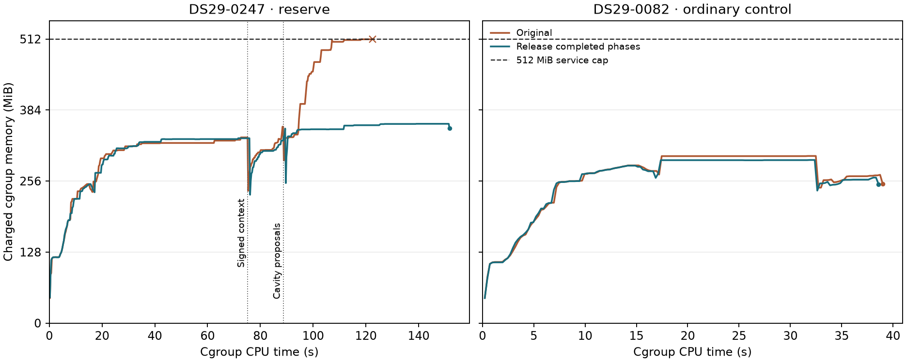

# Release completed phase models in the compact cavity

The standalone receiver returned both DS29-0247 estimates at the physical 512 MiB limit after releasing completed constrained phase models. The exact original package was killed on the same factors. The change leaves every fit, constrained iteration budget, admission check, observation, and prior in place. DS29-0082 reproduced both original geographic fixes, conditional frequency RMS, frequency objectives, and reported counts exactly.

## Factor-to-position services

| Capture and package | Outcome | Supervisor wall (s) | Cgroup CPU (s) | Charged peak (MiB) | Worker peak RSS (MiB) |
| --- | --- | ---: | ---: | ---: | ---: |
| DS29-0247 original | Kernel OOM | 123.14 | 122.63 | 512.00 | — |
| DS29-0247 release | Both arms | 154.15 | 151.76 | 359.16 | 366.25 |
| DS29-0082 original | Both arms | 39.42 | 39.11 | 301.19 | 316.16 |
| DS29-0082 release | Both arms | 39.69 | 38.66 | 293.96 | 309.07 |

The parent observer held approximately 24 MiB of anonymous cgroup charge throughout each service. All four services used zero swap, a 165 s deadline, one numerical thread, and nice 10. Each capture used the same core for both runs. DS29-0247 used CPU 12 and DS29-0082 used CPU 13. Cgroup accounting includes the observer and file charge. Worker peak RSS is available from the successful workers' terminal counters. The original reserve killed before it could write those counters. The small difference on DS29-0082 does not measure savings from constrained refinement, which this ordinary control did not need.

| Capture | Arm | Location error (km) | Conditional RMS (Hz) | Frequency objective |
| --- | --- | ---: | ---: | ---: |
| DS29-0247 | c = 0 | 0.711 | 98.279708 | 34763.865712 |
| DS29-0247 | Fitted c | 0.980 | 98.324388 | 34761.690236 |
| DS29-0082 | c = 0 | 2.789 | 106.672251 | 11815.163225 |
| DS29-0082 | Fitted c | 2.654 | 106.588481 | 11818.344654 |

Both arms publish on one of two recordings with the original package and on two of two with the release. DS29-0247 returns 5,114 observations, 161 tracks, and 6,349 compact projections for its completed decision. Its fitted-c arm has a lower frequency objective and a larger geographic error.

## Allocation and release

DS29-0247 original preparation peaked at 250.6 MiB. Initial search raised the peak to 324.6 MiB and family nomination to 353.9 MiB. Between the first pair of ordinary event refits returning and the next pair beginning, cavity proposal fitting raised anonymous memory from 325.4 to 505.2 MiB in about 19 CPU seconds. At the return of that second pair, original anonymous charge was 508.3 MiB. The release had 343.3 MiB at the same boundary and completed all proposal fits.

Constrained candidate fitting builds a new likelihood at every phase round. The methods attached to each likelihood retain the model and up to eight cached posterior results through a reference cycle. The next round reads the updated receiver coordinates and phase reference. The released package invokes the existing model disposal function after each of the first four phase updates and after the final summary and gate read for each arm. The test compares every objective and slack in both arms and verifies weak-reference collection after each model's last use with cyclic garbage collection disabled.

The only scientific source edit in the 78-source standalone package is `leo/analysis/localization_v3/feasible.py`, SHA-256 `86922fff38e147c38d1c4380d71715d490d642db771c11f69d943aecd97c53bd`. The native manifest names the relocated source while both compiled libraries retain their original bytes. The first transport omitted a C file required by the native manifest and both startup-only attempts failed before inference. Their logs and original lock are retained. The measured transport includes both original C files and validates the complete native manifest before launch.

## Boundaries and evidence

The original complete saved-IQ predecessor is preserved separately. It reached factor assembly after 68.64 s and was killed while the position executable was active after 144.90 s supervisor wall and 201.58 s total CPU. At handoff 442.88 MiB was charged, including 77.03 MiB anonymous and 365.08 MiB file. The factor-only replay reproduces the original failure with a small file charge and shows the late anonymous increase directly. The measured release here starts with stored factors; the full saved-IQ service has a separate receipt and timing boundary.

The reserve replay uses the sealed complete native factor digest `6ea607c55fae631c3e525a12942085495231d4a2d056d4492ab5b7a50a62fb59`. Ordinary-detector normalization validates the complete document with only the three detector lineage fields changed. Both factor-only pairs use their original stored causal catalogue, truth-free request, tile and screen. Coordinates are scored after the prediction seal.

[Study protocol](PROTOCOL.md) · [Stage and resource counters](resources.json) · [Position and frequency scores](scores.csv) · [Position chart manifest](figures.json) · [Receipt](receipt.json) · [Installed source lock](candidate-lock.json)

### Supplemental reserve stock parity

The unmodified standalone package published DS29-0247 at a separate 896 MiB, zero-swap cap on CPU 12. Its geographic coordinates, conditional frequency RMS, frequency objectives, and every reported count and decision field exactly matched the 512 MiB release in both calibration arms. The original consumed 119.62 s supervisor wall with a sampled peak of 570.11 MiB in this invocation. The larger-cap run omitted the stage tracer and the deliberate observer charge. Its elapsed time has a different measurement scope, and the 512 MiB OOM remains in the primary chart. [Larger-cap receipt](larger-cap-receipt.json)
