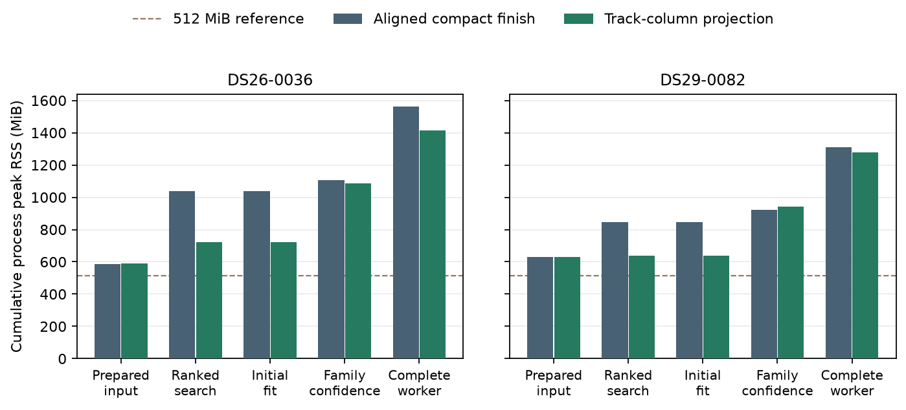

# Track-column Doppler during early v5 inference

Track-column projection reduced ranked-search peak RSS by **315 MiB** on DS26-0036 and **210 MiB** on DS29-0082. The complete worker saved **146 MiB** and **32 MiB** respectively. Both published positions and conditional Doppler results were exact in both calibration arms. Complete peaks still reached **1,416 MiB** and **1,277 MiB** because conservative recovery and the late catalogue stages allocate independently. [Resource counters](resources.csv) · [Sealed comparison](comparison.json)

Two complete aligned-compact-finish pairs use the same authenticated ordinary native GLRT factors, causal archive, region, optimizer and fit options. The candidate computes Doppler, elevation and phase derivative only for the original samples requested by a track. It reuses one track-sized result across those three fields and overlays shifted satellite rows on demand. It holds the ordinary compact C calculation and float64 layout fixed. Nothing is written to scratch for this projection policy. [Protocol](PROTOCOL.md) · [Source lock](source-lock.json) · [Candidate implementation](../../../../tools/pipeline_eval/variants/v5_track_projection.py)

The original ranked search materializes a full candidate-by-unique-time grid of each projected field. Its association step copies those grids before overlaying the phase-shifted satellites. Both discovery statistics and association then gather one track's original time columns. The family-confidence pass also builds all three grids before reading them by track at each anchor. The new view supplies the same original advanced-index order and Fortran-layout track arrays to these consumers. It changes neither the science buffers prepared before discovery nor the later conservative and recovery policies.

The instrumentation records process high-water via Linux RSS and samples anonymous, file and shared RSS every 25 ms. The per-stage projector call counter did not activate in the sealed harness because its initial `Counter` was empty. Each candidate's independent counters still record track requests, cache reuse and the largest requested and equivalent dense buffers. The original compact projector also records worker-level call totals. The RSS and scientific evidence measurements are independent of the unavailable call breakdown.

## Memory and runtime

| Recording | Ranked peak RSS, control → candidate (KiB) | Complete peak RSS (KiB) | Sampled anonymous RSS (KiB) | Sampled file RSS (KiB) |
|---|---:|---:|---:|---:|
| DS26-0036 | 1,063,304 → 740,612 | 1,599,672 → 1,449,772 | 1,546,696 → 1,396,296 | 53,224 → 53,748 |
| DS29-0082 | 868,376 → 653,388 | 1,341,288 → 1,308,052 | 1,287,864 → 1,254,948 | 53,836 → 53,528 |

The RSS decrease was predominantly anonymous memory. Sampled shared RSS was zero in every worker. The candidate's preparation peak was 588 MiB on DS26 and 631 MiB on DS29, already above the 512 MiB reference. Through family confidence, cumulative peak fell from 1,132,576 to 1,111,788 KiB on DS26 and rose from 942,500 to 962,748 KiB on DS29. End-of-stage current RSS fell on both recordings. The subsequent catalogue stages supplied the complete-worker peak. [Resource counters and per-stage data](resources.csv)



| Recording | Largest three-field dense → track buffer (MB) | Computed projections | Worker CPU, control → candidate (s) | Worker wall, control → candidate (s) |
|---|---:|---:|---:|---:|
| DS26-0036 | 87.64 → 3.58 | 45 → 4,872 | 139.48 → 164.90 | 144.99 → 174.33 |
| DS29-0082 | 57.13 → 2.98 | 45 → 2,494 | 103.58 → 104.92 | 106.47 → 105.71 |

Overlapping track queries and repeated reads in later discovery passes increased the total projected cells by 3.13× and 2.55× compared with filling each deferred dense stencil once. The candidate reused track computations 5,127 and 2,639 times across the three fields. Ranked CPU rose from 13.81 to 18.34 s and from 7.23 to 10.66 s. The complete CPU and wall times are one same-core pair per recording, measured from the archived factors through recovery. They exclude the earlier raw-IQ replay. [Whole-worker receipts](prediction-lock.json)

## Paired scientific outputs

Ordered ranked nodes and aliases, original track scores, family confidence, eligible ECEF state bytes, residual candidate shortlists and final reassociation nominations matched exactly. Both final arms retained their ownership counts, optimizer work counts, position, frequency objective and conditional Doppler RMS. Geography was joined after sealing the receipts. [Exact comparisons](comparison.json)

| Recording | Geographic error, `c = 0` / fitted `c` (km) | Conditional Doppler RMS, `c = 0` / fitted `c` (Hz) |
|---|---:|---:|
| DS26-0036 | 0.229 / 0.185 | 102.259 / 102.295 |
| DS29-0082 | 2.784 / 2.651 | 106.670 / 106.587 |

Both methods returned these values. No board resources or timing were measured. [Paired geographic and RF scores](scores.csv) · [Whole-IQ input receipts](../../end-to-end/README.md)

## Reproduce

```sh
.venv/bin/python -B -m tools.pipeline_eval.qualification.early_memory_trial seal
taskset -c 10 .venv/bin/python -B -m tools.pipeline_eval.qualification.early_memory_trial replay --case DS26-0036
taskset -c 11 .venv/bin/python -B -m tools.pipeline_eval.qualification.early_memory_trial replay --case DS29-0082
.venv/bin/python -B -m tools.pipeline_eval.qualification.early_memory_trial publish
.venv/bin/python -B -m tools.pipeline_eval.qualification.early_memory_trial score
.venv/bin/python -B -m tools.pipeline_eval.qualification.early_memory_resources
.venv/bin/pytest -q tests/pipeline_eval/test_v5_track_projection.py
```
