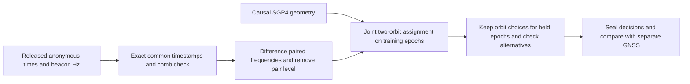

# Coincident beacon differences at eight measured sites

The measured cross-satellite difference fit published zero positions in 24 queries across eight StarLoc GNSS sites. Five sites supplied at least one eligible coincident pair, three supplied two disjoint pairs, and two retained two pairs through held-frequency tests. Multiple orbit assignments and distant tiles matched those pairs. At one site the omitted tile gave a slightly higher held score than the containing tile, even though its forced point was 41.86 km from the measured receiver. [Exact overlap inventory](simultaneous-coverage.json) · [Per-query results](scores.json)

## What the released measurements support

StarLoc captures all three receiver inputs around 11.325 GHz with a common OctoClock. The authors form the frequency observable from a common FFT bin at the same sample-window center, alongside separate phase measurements. The released `main_tone_dict` supplies elapsed capture time and the track frequency in Hz. The preprocessor chooses a strong beacon tooth per pass and can merge nearby teeth by an integer harmonic offset. Its later satellite labels and GNSS-assisted phase calibration are external to the numerical input used here. The release supports an exact common timestamp and a common additive receiver-frequency term for simultaneous curves under that acquisition model. It provides no measured receiver-drift time series or independent evidence that non-overlapping curves have a smooth shared frequency offset. [StarLoc clock, calibration and STFT](https://arxiv.org/html/2604.21147v1#S4.SS2) · [Released array contract](https://raw.githubusercontent.com/GiddaZhang/Starloc/fc010f950dfac5ac6d7a345db24513217fbb81d5/data/README.md) · [Beacon extraction source](https://raw.githubusercontent.com/ConnectedSystemsLab/starloc_preproc/main/starlocProcessRawSignal/utils/track_centertones.py)

At each common STFT timestamp, subtract the second track frequency from the first. The difference cancels any additive receiver-frequency error at that instant under the common-clock model. Centering each disjoint train and held block also removes the surviving constant transmitter and beacon-tooth difference. It leaves the differential Doppler rate and shape, including any source-specific time-varying carrier. The two measurements have one common nominal RF, so the constant `c` contribution cancels in each difference. Both calibration arms have exactly identical outputs. We do not use the per-window identities, measurement phases, attitudes, IMU data or GNSS in inference. The orbit catalogue is the published capture-time source with the previously sealed causal filtering. [Frozen protocol](PROTOCOL.md) · [Capture provenance](../../../2026_11_18_blind_regional_receiver/field_private/provenance.md)

The audit read all eleven released MAT files and checked exact coincident timestamps after consolidating repeated bins by median. A harmonic-like duplicate was excluded on site 06, and the pair selector uses disjoint anonymous tracks. Three of the eight first captures have zero qualifying pairs, two have one, and three have two. The retained pairs span 6.90–22.66 s and 87–2,037 exact timestamps before fixed sampling. The three repeat captures add one pair at site 03, one at site 04 and zero at site 02. They do not add distinct sites. Groups 01–04 extend the earlier four-site screening cohort, while the older public field study previously documented all eight. [Capture and pair counts](simultaneous-coverage.json)

## Position and observability

| Offer | Attempts | Issued | Forced | Median forced error (km) | Median tile-center error on same five covered sites (km) |
| --- | ---: | ---: | ---: | ---: | ---: |
| Containing tile | 8 | 0 | 5 | 6.91 | 8.79 |
| Receiver omitted | 8 | 0 | 5 | 115.02 | 119.80 |
| Containing tile, common timestamps shifted by 180 s | 8 | 0 | 5 | 9.97 | 8.79 |

The eight-site tile-center medians are 7.95 km for containing offers and 136.04 km for omitted offers. The shuffle preserves pair coincidence and both frequency sequences while changing their absolute orbital time. One shuffled forced point was only 1.65 km from the GNSS reference. That accidental close guess remains withheld. All 24 jobs completed, and median isolated elapsed time was 0.75 s for containing offers, 0.74 s for omitted offers and 0.77 s for shuffled offers on CPUs 0 and 7. These times start from prepared coincident vectors and include the isolated worker and orbit computation. [Scored receipts](scores.json) · [Measurement seal](prediction-lock.json)

Sites 03 and 06 provided two supported pairs and four distinct fitted orbit rows. In their containing tiles the forced errors were 1.70 and 5.30 km. The weakest pair assignment gaps were 0.0019 and 0.0006 normalized loss units, below the preregistered 1.0 requirement. Their worst locally linearized position SDs were 58.24 and 20.47 km under the optimistic independent-noise model, above the 6 km threshold. Their held score differences against separated locations were also negative. The omitted offer at site 06 fit the held pairs with residual RMS 56.3 and 23.7 Hz, comparable with 57.7 and 24.8 Hz in the containing tile. An anonymous orbit pair can pass the held residual test at the wrong place. [Model support, conditioning and alternatives](scores.json)

For a matched historical comparison, sites 06 and 08 are the two older four-site subjects with available coincident pairs. On those same two containing tiles, median forced error was 6.10 km for coincident differences, 5.45 km for the tile center, 3.53 km for the earlier offset-only fit and 13.91 km for independent per-arc curvature. The other two subjects from that older cohort have no qualifying coincidence. The new observable preserves shared-clock invariance and additional differential rate information. The measured overlap, source-identity ambiguities and weak spatial conditioning limit its geographic evidence in this cohort. [Earlier offset-only scores](../../../2026_11_19_short_receiver/physical-transfer/scores.json) · [Earlier independent curvature scores](../../physical/scores.json)

The portable observation export contains all 24 anonymous input packets with the repeated TLE text replaced by its archive digest. The export was regenerated from the verified MAT files and checked against every already sealed packet hash. The original catalogue bytes are in the public field archive. [Coincident observations](coincident-inputs.jsonl.gz) · [Export seal](input-export-lock.json) · [Catalogue files](../../../2026_11_18_blind_regional_receiver/public_field/orbits)
