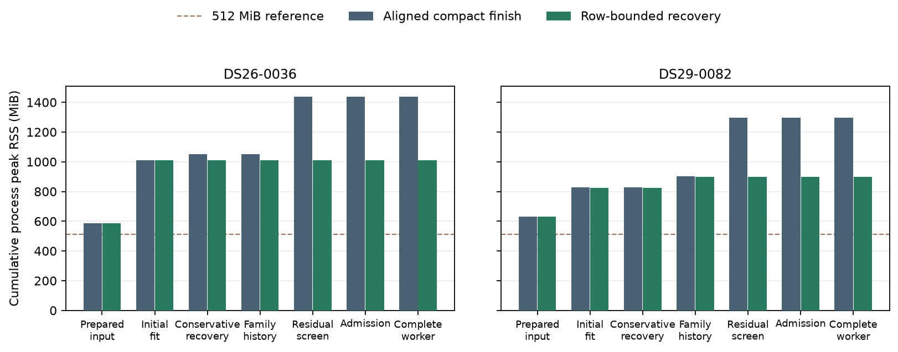

# Row-bounded causal orbit banks for complete v5 recovery

The row-bounded orbit bank cut peak process RSS by **30%** on both complete aligned v5 replays. Position, conditional Doppler RMS, frequency objective and recovery decisions matched exactly in both calibration arms. Peak process RSS remained **1,011 MiB** on DS26-0036 and **900 MiB** on DS29-0082. The sample of worker RSS plus resident scratch on DS26-0036 reached **1,571 MiB**. [Paired resources](resources.csv) · [Sealed predictions](prediction-lock.json)

Each comparison used fresh processes on the same pinned core, from authentic ordinary GLRT factors through residual addition, reassociation and final publication. The detector ran in the earlier whole-IQ qualification. [Protocol](PROTOCOL.md) · [Source lock](source-lock.json) · [Whole-IQ authority](../../end-to-end/README.md)

## Live arrays

The full recovery catalogue spans 381 one-second knots. The matched DS26 stock run built about 194 MiB of float64 ECEF states during residual screening. SGP4's TEME input and its conversion work were live during propagation. The stock code then kept the full ECEF arrays while selecting eligible rows and constructing the immutable residual bank. Final admission built a second complete ECEF bank and independently allocated full TEME vectors for its propagation audit.

The candidate writes eligible ECEF rows to unlinked scratch files in 128-row blocks. Its largest simultaneous position/velocity **state-buffer read** is 2,340,864 bytes, or 2.23 MiB. The original frozen projection computes the same per-site frequency and elevation on those rows. The scalar outputs remain in original candidate order, so the existing fold scoring and sorting see the same vectors. A fine finalist reads only its original orbital row. The final propagation audit scans the integer status grid and reads raw TEME rows on demand for the same causality, invalid-state and eligibility decisions. Scratch writes remain outside the corpus. [Receiver variant](../../../../tools/pipeline_eval/variants/v5_stream_recovery.py)

The unchanged earlier salvage stage can materialize 81 phase predictions per satellite. On DS26-0036 the largest recorded input was 123,444 × 55 doubles, with 54,315,360 bytes of predictions and 112,580,928 bytes of returned profile arrays. The corresponding DS29 input was 136,080 × 27 with 29,393,280 bytes of predictions and 63,141,120 bytes returned. The family-history confidence pass still projects three all-satellite, all-track-time grids for each anchor before visiting the track slices. DS29's measured family-confidence boundary reached a cumulative 922,040 KiB in the streamed worker before it read a late bank. Those conservative and family arrays stay outside the candidate's late-state change.

## Measured memory and runtime

| Recording | Complete peak RSS, control → candidate (KiB) | CPU, control → candidate (s) | Wall, control → candidate (s) | Candidate limit |
|---|---:|---:|---:|---|
| DS26-0036 | 1,471,404 → 1,035,592 | 160.27 → 181.61 | 166.29 → 193.77 | Initial selection |
| DS29-0082 | 1,327,368 → 922,040 | 131.20 → 120.25 | 144.43 → 126.21 | Family confidence |

The peak reduction was 426 MiB on DS26-0036 and 396 MiB on DS29-0082. The candidate's initial preparation already reached 588 and 631 MiB respectively. The complete worker missed the 512 MiB reference on both recordings. CPU and wall changes were mixed. The residual ECEF preparation itself took 4.33 → 2.39 and 5.22 → 2.35 CPU seconds, while complete residual screening and final admission combined took 64.72 → 75.78 and 56.14 → 48.58 CPU seconds. [Stage and resource counters](resources.csv)



The retained scratch files totaled 611.0 and 613.7 MB. The candidate made 223 and 161 full scalar projection queries. The largest surviving scalar output grid sets were 16.39 and 13.96 MB. Independent Linux `mincore` polling on DS26-0036 found 611.0 MB resident in the six scratch files alongside 1,012,176 KiB of process RSS. This adds to 1,571 MiB at that sample before other system memory. The measurement captures a sampled combined footprint, with no comparable stock system-cache measurement. By its last recorded sample the process had issued 45.4 GB of logical reads and recorded 0.156 GB fetched from storage in the Linux I/O counter. The host page cache absorbed most of those reads. With a smaller cache, storage latency and system memory would need a separate measurement. [Page-cache probe and receipt](cache-receipt.json) · [Samples](ds26-cache-samples.jsonl)

## Paired position and RF evidence

The frozen causal eligibility mask, ordered FP64 ECEF positions and velocities, and propagation audit compare exactly. Residual shortlist and final reassociation nomination output hashes match. Both methods produced the same decision fields, selected ownership, and optimizer work counts. The publication adapter compares resource counters separately, preserving the source-locked inference worker and its raw predictions. The optional stress recording was outside these four runs. [Exact scientific comparison](comparison.json)

| Recording | Geographic error, `c = 0` / fitted `c` (km) | Conditional Doppler RMS, `c = 0` / fitted `c` (Hz) |
|---|---:|---:|
| DS26-0036 | 0.229 / 0.185 | 102.259 / 102.295 |
| DS29-0082 | 2.784 / 2.651 | 106.670 / 106.587 |

Both methods returned the values above. Geography was scored after sealing predictions. [Both arms and frequency objectives](scores.csv)

## Reproduce

```sh
.venv/bin/python -B -m tools.pipeline_eval.qualification.stream_recovery_trial seal
taskset -c 10 .venv/bin/python -B -m tools.pipeline_eval.qualification.stream_recovery_trial replay --case DS26-0036
taskset -c 11 .venv/bin/python -B -m tools.pipeline_eval.qualification.stream_recovery_trial replay --case DS29-0082
.venv/bin/python -B -m tools.pipeline_eval.qualification.stream_recovery_publish
.venv/bin/python -B -m tools.pipeline_eval.qualification.stream_recovery_trial score
.venv/bin/python -B -m tools.pipeline_eval.qualification.stream_recovery_resources
.venv/bin/pytest -q tests/pipeline_eval/test_v5_stream_recovery.py
```

`--raw` selects the directory with the authenticated ordinary artifacts and original requests. Choose an empty `--runs` path for new measurements. During the streamed worker, pass its process ID and its scratch directory to `tools.pipeline_eval.qualification.stream_recovery_cache_probe` to sample cache residency without reading the numerical file pages.
