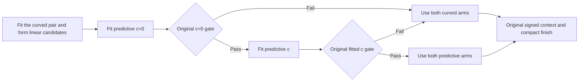

# Skip the unreachable predictive fit in compact v5

The lazy receiver matched all eight final coordinates and all reported RF RMS and frequency objective values exactly on four complete replays. It removed one five-round fitted predictive pass in each of the two first-arm rejections. Those passes cost 2.188 and 7.748 CPU seconds in the same-core eager controls. The independent archive audit found 7 first-arm rejections in 135 recordings. [Exact values and timings](comparison.json) · [Prediction seal](prediction-lock.json)

The frozen history gate checks `c=0` first. It reaches the fitted-`c` predictive record only after that first arm qualifies. When `c=0` fails, the compact worker now returns the original curved pair and leaves the unused fitted predictive arm unevaluated. Both published calibration outputs still pass through the unchanged signed context, cavity and compact finish. [Frozen protocol](PROTOCOL.md) · [Gate-selected replay plan](selection.json)

`history_policy.pair_passes` reads the two arms in order and returns on the first failure. The compact worker supplies a deferred mapping only for the fitted predictive record during this predicate. It restores the actual fitted record if evaluated. Otherwise it removes that diagnostic and checks that the selected object is the original curved pair before the record leaves history. `signed_context` reads `policy_arms`, and it retrieves predictive entries only if `linear_paired_valid` is true. The raw rejected `linear_arms` diagnostic has no compact consumer. Both fitted arms use the same original five phase rounds and optimizer, with unchanged masks, weights, priors, candidate entries and ownership. The later signed proposal retains its original eager behavior. This prototype proves successful decision parity under the compact worker’s ordered mapper. Skipping an unselected fit also skips any exception that fit alone would have raised. The archived eager runner continues preserving its original diagnostics. [Qualified source hashes](source-lock.json)

The independent gate audit reproduced all 135 frozen decisions. The first arm rejected in 7 cases, so those cases are eligible to skip one full fitted predictive pass. A further 3 cases qualified in `c=0` and rejected in fitted `c`, and therefore still require both fits. The other 125 passed the pair. The fresh replay panel deliberately covers all four combinations of individual arm outcomes. It cannot estimate a corpus-wide average time saving. [All archived gates](archived-gates.csv) · [Audit counts](archived-gates.json)

The fresh comparisons start from stored native factors. They use the same authenticated request, candidate masks and original optimizer on the same pinned CPU per case. Eager and lazy jobs run sequentially, with alternating order across cases. The predictive-fit CPU includes the worker and its waited numerical child processes. Whole-worker wall includes preparation, orbit-library compilation, inference and scheduler effects. The CPU time of the removed fit measures the work saved directly. A whole-worker difference can also reflect normal timing variation, as shown by the cases that ran both fits in both modes.

| Recording | Archived c=0 / fitted gate | Fresh paired decision | Predictive calls eager → lazy | Removed fit CPU / wall (s) | Whole CPU eager → lazy (s) | Whole wall eager → lazy (s) |
| --- | --- | --- | ---: | ---: | ---: | ---: |
| DS26-0036 | pass / pass | predictive pair | 2 → 2 | — | 112.32 → 111.40 | 130.62 → 120.47 |
| DS29-0082 | pass / fail | curved pair | 2 → 2 | — | 90.05 → 90.48 | 102.87 → 105.18 |
| DS26-0002 | fail / pass | curved pair | 2 → 1 | 2.188 / 2.195 | 121.90 → 123.25 | 148.83 → 138.11 |
| DS26-0070 | fail / fail | curved pair | 2 → 1 | 7.748 / 8.312 | 249.04 → 236.36 | 279.38 → 246.29 |

The archived fitted gate outcome records how that diagnostic would qualify on its own. The paired gate never accesses it after a `c=0` failure. The fresh eager worker evaluates it regardless, providing the removed-fit timing. Both arms of the published result continued through the original downstream stage. All eight workers completed within the fixed deadline.

| Recording | Calibration | Final shared latitude | Final shared longitude | Shared conditional RF RMS (Hz) |
| --- | --- | ---: | ---: | ---: |
| DS26-0036 | `c=0` | 37.853054831257495 | −122.49940304097825 | 74.76091584692344 |
| DS26-0036 | fitted | 37.85210007037036 | −122.49896065042755 | 74.6822975132965 |
| DS29-0082 | `c=0` | 37.845496107002454 | −122.48113274446547 | 97.00356915094589 |
| DS29-0082 | fitted | 37.849671446478126 | −122.47991581718864 | 96.68362191875039 |
| DS26-0002 | `c=0` | 37.85481993993258 | −122.48778563475042 | — |
| DS26-0002 | fitted | 37.85501419548064 | −122.4882394752343 | — |
| DS26-0070 | `c=0` | 37.84888341636777 | −122.56853584600165 | 83.37746174592662 |
| DS26-0070 | fitted | 37.851331029721 | −122.56218302412499 | 83.26768304019075 |

The conditional RF RMS field is absent for both DS26-0002 arms on its original qualified-addition path. Both fresh implementations retain that absence and reproduce its frequency objectives, 24156.75834780708 and 24165.93091731982. The other six RMS values and all eight frequency objectives match exactly. Non-timing result metrics, family masks, prior parameters and admission decisions also match. DS26-0036, DS29-0082 and DS26-0002 independently reproduce their existing unmodified compact records. The post-run scorer was corrected to preserve the original optional RF field as null. The measurement harness bytes and all earlier prediction receipts remain sealed. [Matched coordinates and missing fields](comparison.json) · [Normalized candidates](positions.jsonl.gz) · [Eager controls](control-positions.jsonl.gz)
