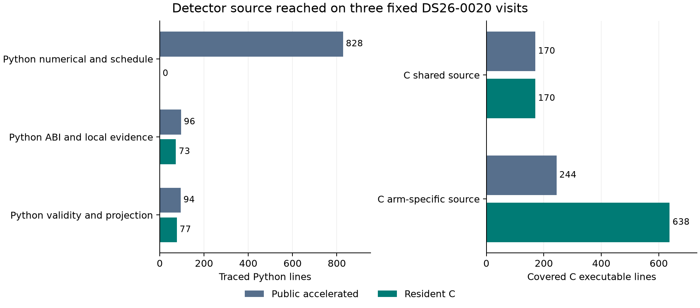

# DS26-0020 detector source footprint

The resident C path replaced four numerical shared libraries with one and reduced the Python detector path from **1,018 to 150 reached lines**. The compiled project C closure grew from **826 to 1,803 physical source lines**, and covered C lines grew from **414 to 808**. This change simplifies the active interfaces and removes per-visit Python numerical scheduling. Total maintained implementation grew because the public accelerated route is still supported and the resident route adds code. [Numeric summary](summary.json) · [Line and function evidence](trace.json.gz)

| Scoped measure | Public accelerated | Resident C |
| --- | ---: | ---: |
| Python numerical and scheduling lines / functions | 828 / 54 | 0 / 0 |
| Python ABI and local evidence lines / functions | 96 / 3 | 73 / 4 |
| Python validity and public projection lines / functions | 94 / 9 | 77 / 5 |
| All traced Python lines / functions | 1,018 / 66 | 150 / 9 |
| Active project C libraries / compiler translation units | 4 / 4 | 1 / 8 |
| Project C and header files in the compiled closure | 7 | 13 |
| Covered project C lines / functions | 414 / 26 | 808 / 62 |
| Physical project C and header lines | 826 | 1,803 |
| Active C library bytes | 84,264 | 92,536 |

Python counts cover unique line events inside detection after signed decode through public factor projection. Function counts omit implicit comprehension, class and module code objects. The exact union contains 77 shared Python lines. The shared decoder, cold imports and analyst scripts are outside the table. Python ABI includes the installed CI16 conversion or the resident pointer call, and the latter includes the diagnostic attempt packet. The portable C library includes 57 covered lines in its C entry point, including lifecycle, retry and ABI marshalling code. Both C arms include the same three source files `conditioned_cfo_bank.c`, `fine_search.c` and `refine_bank.c`. They contribute 328 physical and 170 covered lines to each closure. The remaining C source accounts for 498 physical lines on the earlier route and 1,475 on the portable route. GCC coverage includes C initialization and cleanup. Keep its executable-line counts separate from Python line events and physical source lines. [Protocol](PROTOCOL.md) · [Coverage by file](trace.json.gz)



The matched roster used visit 0 for dual primary passes, visit 2 for the partner retry, and visit 4 for dual rejection. Both release binaries exactly reproduced their published factors on these visits. Both GCC coverage builds reproduced their own release factors exactly. Across the arms, all 27 published candidates and all six passes agreed in rank, physical support and gate decision. Maximum differences were `1.16e−10` Hz CFO, `2.60e−13` sample fractional offset and `5.24e−14` margin. One separate rejected candidate changed on the full replay. [Verification and fixed CI16 digests](summary.json) · [Complete replay](../portable-field/README.md)

The public path executes four project libraries for prepared coarse scoring, batched fine search, conditioned CFO scoring and fused refinement. It uses external FFTW3f and NumPy PocketFFT. Its ELF dependencies include `libfftw3f.so.3`, `libm.so.6`, `libc.so.6` and `ld-linux-x86-64.so.2`. The resident numerical library depends on `libm.so.6` and `libc.so.6`. Both Python envelopes use NumPy 2.5.2, Pydantic 2.13.4 and the standard `ctypes` FFI. The shared signed decoder uses Zstandard 0.25.0. System versions were FFTW 3.3.10 and glibc 2.43. These external sources are outside the project line counts. [Builds, hashes and mapped libraries](trace.json.gz)

The complete eight-core raw runs measured 212,340 KiB maximum worker-process RSS for the earlier route and 157,524 KiB for the resident route. Both services reached the 512 MiB cgroup cap with zero swap. The measured resident C context reports 11,232,336 bytes of named workspace inside that process. The matched earlier receipt gives no comparable total for the numerical workspace. Raw elapsed was 282.428 s and 266.743 s respectively. These are the prior full, uninstrumented runs. [Memory and timing receipts](summary.json) · [Complete replay](../portable-field/README.md)

## Reproduce

Run from the repository using a fresh local output directory. The audit uses CPU 0, the pinned installed capture release, both sealed full-run read-only directories and the archived C sources. It executes the three selected visits with the two original shared-library configurations and with separately built coverage libraries. The commands only consume saved IQ.

```bash
repository=/home/mouse9911/gits/leo-tracker-reduxredux
scratch=/srv/bulk/leo-dev/detector-footprint-reproduction
report="$repository/reports/2026_11_19_receiver_screening/native-receiver/detector-footprint"
cd "$repository"
.venv/bin/python -B -m tools.pipeline_eval.qualification.portable_footprint \
  --out "$scratch" --cpu 0 \
  --baseline /var/tmp/leo-original-schedule-20261120/completion \
  --portable /srv/bulk/leo-dev/portable-field-20261120.xvq04X/full
mkdir "$scratch/report"
cp "$report"/{PROTOCOL,README}.md "$scratch/report/"
MPLCONFIGDIR="$scratch" .venv/bin/python -B \
  -m tools.pipeline_eval.qualification.portable_footprint_results "$scratch" "$scratch/report"
```

[Figure data](stage.csv) · [Figure descriptor](stage-figure.json) · [Evidence hashes](evidence-lock.json)
