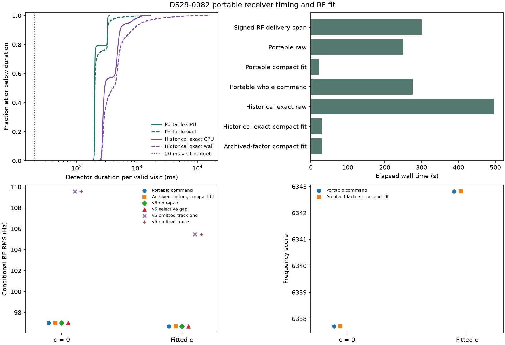

# Portable saved-recording receiver on DS29-0082

The command authenticated **6,772 / 6,772 visits** on the upper-edge recording and reached `ok` in **275.97 s**. Exact native probe parity failed. Both-arm geographic targets versus v5 no-repair were **pass at 5%** and **pass at 10%**. [Protocol](PROTOCOL.md) · [Sealed prediction comparison](prediction-lock.json) · [Score lock](score-lock.json) · [Report seal](report-seal.json)

## Geographic and RF outcomes

| Fit | Error at `c = 0` (km) | Error with fitted `c` (km) | RF RMS, zero / fitted (Hz) | Frequency score, zero / fitted |
|---|---:|---:|---:|---:|
| Portable command | 0.56810 | 0.51579 | 97.00342 / 96.68376 | 6,337.71752 / 6,342.80917 |
| Archived factors, compact fit | 0.56810 | 0.51579 | 97.00342 / 96.68376 | 6,337.71752 / 6,342.80917 |
| v5 no-repair | 0.56695 | 0.51723 | 97.00357 / 96.68362 | Unavailable / Unavailable |
| v5 selective gap | 0.56695 | 0.51723 | 97.00357 / 96.68362 | Unavailable / Unavailable |
| v5 omitted track one | 0.11542 | 0.48617 | 109.55875 / 105.47084 | Unavailable / Unavailable |
| v5 omitted tracks | 0.11542 | 0.48617 | 109.55875 / 105.47084 | Unavailable / Unavailable |

| v5 control | Relative error, `c = 0` | Relative error, fitted `c` |
|---|---:|---:|
| v5 no-repair | +0.20% (pass/pass) | -0.28% (pass/pass) |
| v5 selective gap | +0.20% (pass/pass) | -0.28% (pass/pass) |
| v5 omitted track one | +392.21% (fail/fail) | +6.09% (fail/pass) |
| v5 omitted tracks | +392.21% (fail/fail) | +6.09% (fail/pass) |

The paired decisions are for the 5% and 10% degradation ceilings respectively. [Numeric position and RF data](scores.csv) · [Original v5 execution receipts](original-v5-receipts.json) · [`c = 0` chart](charts/c0/portable-command-ds29-0082.png) · [Fitted `c` chart](charts/fitted_c/portable-command-ds29-0082.png)

For the portable command, fitted `c` moved the endpoint **0.47696 km**, changed survey error by **-0.05231 km**, changed conditional RF RMS by **-0.31965 Hz**, and changed the frequency score by **5.09165**. The two arms shared factors, candidate sets, priors, causal catalogue, tile and search budget.

For the archived factors, compact fit, fitted `c` moved the endpoint **0.47696 km**, changed survey error by **-0.05231 km**, changed conditional RF RMS by **-0.31965 Hz**, and changed the frequency score by **5.09165**. The two arms shared factors, candidate sets, priors, causal catalogue, tile and search budget.

The fresh and independently produced archived-factor endpoints were **0.05994 mm** apart at `c = 0` and **0.06073 mm** apart with fitted `c`. The arm and frequency score fields were compared at full precision. [Compact fits and requests](command-evidence.json)

## Detector parity

The command authenticated **106 signed chunks** and **1,904 exclusions**. Exclusions matched in compared coverage. Delivery clocks differed for 0 visits. The ordered output had **38 exact** and **9,698 differing** shared probe records. There were **42,162 fresh** and **42,162 archived** candidates, with 0 / 0 unmatched under the physical tolerance. The comparison found 0 matched rank changes and 0 matched gate changes. Fresh and archived outputs had 4,582 / 4,582 passes and 1,868 / 1,868 positive probes. 2,211 probes admitted more than one physical matching edge. [Exact per-field and gate audit](native-parity.json) · [Changed rows](native-differences.jsonl.gz) · [Ambiguous peaks](equivalent-peaks.jsonl.gz) · [C candidate attempts and near-tie flags](portable-attempts.jsonl.gz)

Maximum matched drift was 9.22e-12 sample, 4.66e-10 Hz CFO, and 2.95e-13 fractional margin. The clock and sample-counter fields matched exactly. Published probe order matched exactly. The published C groups recorded 4,572 equivalent acquisition tie flags and 19 conditioned tie flags. [Native parity](native-parity.json)

## Host measurements

| Boundary | Portable CPUs 3–7 | Historical exact replay |
|---|---:|---:|
| Raw elapsed (s) | 250.10 | 496.59 |
| Detector CPU across valid visits (s) | 1,093.78 | 1,892.65 |
| Raw worker cgroup CPU (s) | 1,114.85 | 1,919.27 |
| Raw worker charged peak (MiB) | 512.00 | 512.00 |
| Raw worker process RSS (MiB) | 162.20 | 208.92 |
| Compact fit elapsed (s) | 21.29 | 29.60 |
| Compact service cgroup CPU (s) | 21.22 | 27.08 |
| Compact fit charged peak (MiB) | 318.61 | 272.79 |
| Full command elapsed, through exit (s) | 275.97 | Unavailable |
| Command supervisor peak RSS (MiB) | 315.41 | Unavailable |
| Detector CPU p50 per valid visit (ms) | 199.17 | 290.89 |
| Detector CPU p95 per valid visit (ms) | 326.72 | 754.94 |
| Detector CPU p99 per valid visit (ms) | 330.99 | 1,105.40 |
| Detector CPU max per valid visit (ms) | 354.65 | 1,683.75 |
| Valid visits at or under 20 ms detector CPU | 0 / 4,868 | 0 / 4,868 |
| Detector wall p50 per valid visit (ms) | 200.40 | 401.22 |
| Detector wall p95 per valid visit (ms) | 344.50 | 1,197.60 |
| Detector wall p99 per valid visit (ms) | 593.48 | 3,804.31 |
| Detector wall max per valid visit (ms) | 1,681.04 | 15,699.16 |
| Valid visits at or under 20 ms detector wall | 0 / 4,868 | 0 / 4,868 |

Signed delivery spanned **299.997 s**, including exclusions. Valid windows account for **97.36 s** of detector exposure. Each service had a 512 MiB memory limit and zero swap. The external clock includes startup, build, raw replay, factor assembly, fitting and sealing. Its RSS covers the supervisor and local subprocesses. The service receipts measure detached workers. The earlier exact replay used eight workers on CPUs 0, 1, 4–7, 20 and 21. This single run supplies absolute timing on a shared host. [Whole command clock](whole-command.time) · [Timing CSV](stage.csv) · [Per-visit timings](raw-visits.csv)



## Reproduce

```bash
.venv/bin/python -B -m tools.pipeline_eval.portable_receiver --case DS29-0082 \
  --out /var/tmp/ds29-portable-full --cpus 3 4 5 6 7 --raw-limit 600 --position-limit 180
```

The same command accepts `--input` with `--input-sha256` for an authenticated saved-recording locator. The first attempt stopped before decoding because the archive interpreter lacked a reporting dependency. Reporting imports now stay in the supervisor. [Public receiver command](../../../../tools/pipeline_eval/portable_receiver.py)
