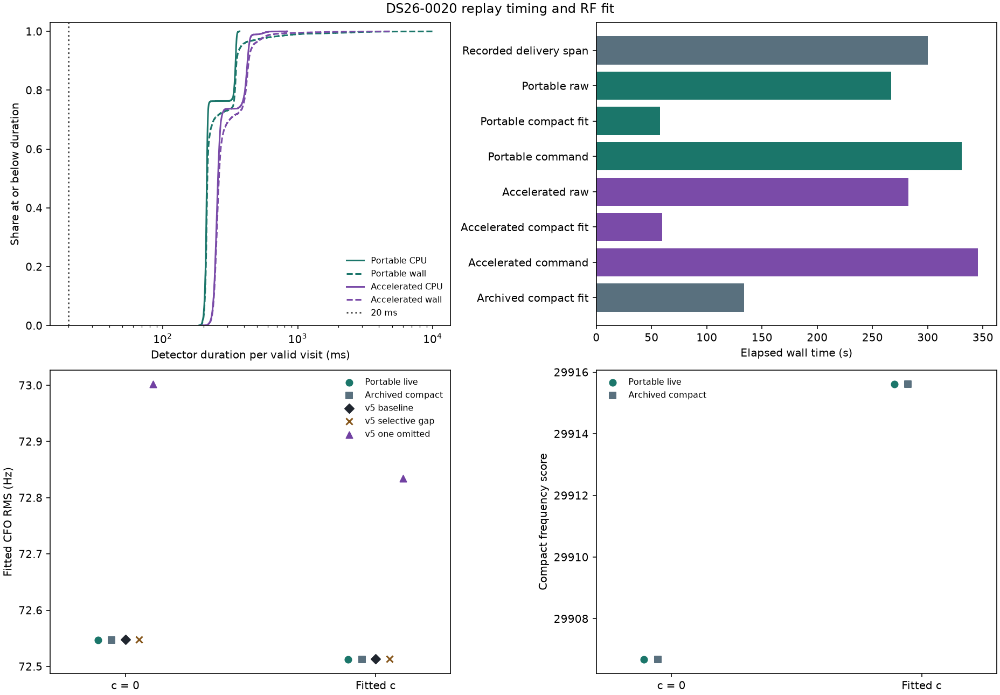

# Portable C receiver on DS26-0020

The experiment tests whether the portable acquisition and GLRT verifier can retain v5 accuracy while reducing processing cost on the preselected passive recording. The portable run covered **6,764/6,764 signed visits in 106 closed chunks**. Both calibration arms met the 5% geographic error target against the original v5 baseline on this recording. The detector used **18.46% less CPU time** than the historical accelerated replay. [Scoring protocol](SCORING-PROTOCOL.md) · [Prediction seal](prediction-lock.json) · [Score seal](score-lock.json)

## Geographic error and RF fit

| Run | `c = 0` error (km) | Fitted `c` error (km) | `c = 0` CFO RMS (Hz) | Fitted `c` CFO RMS (Hz) | `c = 0` frequency score | Fitted `c` frequency score |
| --- | ---: | ---: | ---: | ---: | ---: | ---: |
| Portable live | 0.81313 | 0.73386 | 72.54674 | 72.51226 | 29,906.675 | 29,915.612 |
| Archived compact | 0.81313 | 0.73386 | 72.54674 | 72.51226 | 29,906.675 | 29,915.612 |
| v5 baseline | 0.81805 | 0.73856 | 72.54755 | 72.51301 | Unavailable | Unavailable |
| v5 selective gap | 0.81805 | 0.73856 | 72.54755 | 72.51301 | Unavailable | Unavailable |
| v5 one omitted | 0.75604 | 0.67049 | 73.00199 | 72.83410 | Unavailable | Unavailable |
| v5 two omitted | Timed out | Timed out | Unavailable | Unavailable | Unavailable | Unavailable |

| v5 comparison | `c = 0` relative error change | Fitted `c` relative error change |
| --- | ---: | ---: |
| v5 baseline | -0.60% | -0.64% |
| v5 selective gap | -0.60% | -0.64% |
| v5 one omitted | +7.55% | +9.45% |
| v5 two omitted | Unavailable | Unavailable |

Both portable arms also met the 10% target against v5 one omitted. Both exceeded the 5% margin. Fitting `c` changed the portable error by **-0.07926 km**, the CFO RMS by **-0.03448 Hz**, and the compact frequency score by **8.93718**. Both arms used the same raw factors, causal snapshots, region, track settings and compact solver invocation. The archived original v5 requests lack a comparable frequency objective. The original v5 two-omitted process reached its 1,200 s deadline and ended after 1,200.41 s. [Scores](scores.csv) · [Four original v5 execution receipts](original-v5-receipts.json) · [`c = 0` chart](charts/c0/portable-field-ds26-0020.png) · [Fitted `c` chart](charts/fitted_c/portable-field-ds26-0020.png)

Endpoint separation from the independently timed archived compact fit was **0.07758 mm** at `c = 0` and **0.00856 mm** with fitted `c`. [Fit and request receipts](field-evidence.json)

## Timing

| Measurement | Portable | Accelerated completion |
| --- | ---: | ---: |
| Raw pipeline wall (s) | 266.74 | 282.43 |
| Closed valid visits, detector CPU sum (s) | 1,632.74 | 2,002.39 |
| Terminal raw workers, cgroup CPU sum (s) | 1,651.87 | 2,023.45 |
| Valid visit CPU p50 (ms) | 211.88 | 256.32 |
| Valid visit CPU p95 (ms) | 349.55 | 434.57 |
| Valid visit wall p50 (ms) | 213.96 | 260.60 |
| Valid visit wall p95 (ms) | 381.17 | 464.21 |
| Valid visit CPU at or below 20 ms | 0/6,761 | 0/6,761 |
| Valid visit wall at or below 20 ms | 0/6,761 | 0/6,761 |
| Compact service wall (s) | 57.75 | 59.68 |
| Compact worker CPU (s) | 57.08 | 58.93 |
| Whole command wall (s) | 330.83 | 345.23 |

The signed delivery timeline spanned **299.97 s**. The archived compact service took **133.82 s** of wall and **99.60 s** of worker CPU on CPU 19. Per-visit detector clocks exclude compressed IQ decode and compact fitting. Raw pipeline clocks include read and decode. Worker CPU aggregates span concurrent workers. The accelerated completion used CPUs 0 to 7. The portable CPU set was 0, 1, 2, 3, 4, 5, 6, 7. The runs occurred at different times on a shared host. Embedded end-to-end throughput remains unmeasured. [Timing and CPU receipts](field-evidence.json) · [Stage plot data](stage.csv)

The 6,761 valid visits carried **135.22 s** of IQ at 20 ms each. Each C detector reserved **10.71 MiB** of workspace per worker. The portable raw services reached a maximum cgroup peak of **512.00 MiB** including file cache. The full command uses the independent boot clock through pidfd exit. [Run receipt](field-evidence.json)

## Detector parity

Parity covers the complete native handoff with **13,522** portable and **13,522** archived physical probes. Canonical JSON matched at **40** probes and differed at **13,482**. There were **62,160** portable and **62,161** archived candidates. Physical correspondence left **0** portable and **1** archived candidates unmatched. Matched peaks differed by at most **2.445e-09 Hz** circular CFO and **7.601e-12 sample** in epoch. There were **0** matched rank changes and **0** matched fractional gate changes. **4,998** probes admitted alternative peak matches. Delivery clocks differed at **0** visits. The exclusions matched. [Native parity](native-parity.json) · [Changed probe fields](native-differences.jsonl.gz) · [Equivalent peaks](equivalent-peaks.jsonl.gz) · [C acquisition and refinement attempts](portable-attempts.jsonl.gz)

Coarse search consumed **1,077.96 CPU s** and verification consumed **552.67 CPU s** across all attempted C groups. The source lock binds the rolling coarse implementation and the verifier build. [C and TLE source bindings](field-evidence.json)

At visit 931 on RX0, seven retained coarse cells agreed in order. A maximum coarse-grid score delta of **7.27e-08** reversed the eighth slot between epochs 13153 and 2164. The archived candidate had a fractional margin of **0.005540** against a gate of **0.025**. The substituted portable attempt did not bracket a fractional epoch. [Signed single-visit diagnostic](visit-931-coarse.json)
