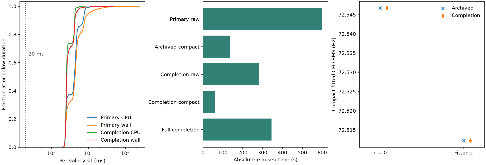

# Public accelerated receiver on DS26-0020

The public command reproduced all **62,161** archived detector candidates and both compact position estimates when it ran on eight performance cores. It took **282.43 s** for raw replay and **345.23 s** through position and command exit. The primary mixed-core run reached its 600 s raw limit one chunk short and returned no position. Both launches used the same recording, detector settings and service limits. [Protocol](PROTOCOL.md) · [Prediction seal](prediction-lock.json)

## Capture and source binding

The case selector used the frozen input inventory. DS26-0020 had the fewest scheduled visits among the **166** entries with an authenticated native input, original request and acquisition run ID. The case contains **6,764** visits in **106** signed chunks for the lower edge. The public flag ran the stored-measure 256-point coarse FFT, the original 12/22 anchor schedule, row-wise peak selection and four-frame batched refinement. A 64-visit smoke chunk completed before the full launch. [Public command summaries](public-summaries.json) · [Worktree candidate sources](candidate-sources.tar.gz) · [Source and installed release lock](source-lock.json)

The position worker fit both calibration arms using the same installed release, track configuration, original causal TLE archive and offered square. Its native input and output path are the two experiment-specific request bindings, with their associated input and run IDs. The raw services used a 600 s deadline and 512 MiB memory cap. The compact services used 180 s and the same memory cap. [Measured and archived service boundaries](compact-receipts.json) · [Archived-fit receipt](archive-receipt.json)

## Primary deadline

The raw services returned after **600.387 s**. CPU 17 timed out and the other seven workers completed. Its last 64-visit chunk did not close. Of the **6,700** visits inside closed chunks, **6,697** were valid and the three exclusions matched the archive. The service had written an extra visit in the unclosed chunk when it ended. The primary never launched the compact fit. [Primary raw receipts and CPU clocks](raw-receipt.json)

All **13,394** physical probes and **61,557** candidates in the closed chunks matched exactly, including candidate fields, probe order, ranks and gates. The first anchor and every compared delivery clock matched. The archive coverage boundary remains **6,764** visits. The evaluator also has a one-to-one peak correspondence check for recordings where exact floats differ, preserving discrete rank comparisons with a 0.5-sample and 250-Hz aliased gate. [Primary native parity](native-parity.json) · [Changed native fields](native-differences.jsonl.gz)

The valid closed visits accumulated **2,790.64 s** of detector CPU time. Median detector CPU was **416.24 ms** per valid visit and median detector wall was **437.18 ms**. **0/6,697** valid visits completed within 20 ms in either detector clock. The measured raw interval starts after **1.43 s** of independently timed setup. [Per-visit clocks](raw-visits.csv)

## Completion on eight performance cores

All eight workers completed, covering **106/106** signed chunks and **6,764/6,764** visits. The **13,522** physical probes and candidate fields, order, rank and gates matched exactly. All delivery clocks, the initial clock anchor and all three invalid-visit exclusions matched. The fresh native package carries its own analysis-manifest digest. [Complete native parity](secondary-native-parity.json) · [Changed native fields](secondary-native-differences.jsonl.gz)

The recorded delivery timestamps span **299.97 s**. The raw batch took **282.428 s**, and the compact service took **59.684 s** on CPU 0. The run used **2,002.39 detector CPU seconds** and **2,023.45 CPU seconds** across the raw services. Median detector CPU and wall times were **256.32 ms** and **260.60 ms** per valid visit. **0/6,761** valid visits completed within 20 ms in either clock. Per-visit detector clocks exclude compressed IQ decode and position fitting. This throughput observation covers offline replay of a single recording on eight pinned host cores. [Completion raw receipt](secondary-raw-receipt.json) · [Per-visit clocks](secondary-raw-visits.csv)

The **345.23 s** full-command interval spans process start to exit, using the kernel start tick and a pidfd exit observation. Public setup was **1.17 s**. Closed raw workers reported at most **512 MiB** peak, the raw service cap. The completion compact worker used **58.93 CPU seconds** and **403.54 MiB** peak. The archived compact service, independently scheduled on CPU 19, took **133.819 s** with **99.60 worker CPU seconds** and **383.83 MiB** peak. The runs use different CPU affinities and happened under different concurrent loads. [Full-command clock](command-clock.json) · [Both compact service receipts](compact-receipts.json) · [Data behind the stage panels](stage.csv)



## Position and RF results

The completion and independently scheduled archive compact jobs published identical coordinates and RF scores in both arms. Their separation was **0.000 km** in each arm. Fitted `c` reduced horizontal error by **79.26 m** and matched CFO RMS by **0.03448 Hz**. The compact frequency score was **29,906.675** at `c = 0` and **29,915.612** with fitted `c`. This comparison covers one surveyed recording. [Compact numerical parity](compact-parity.json) · [Measured scores](scores.csv)

| Run | `c = 0` error (km) | Fitted `c` error (km) | `c = 0` CFO RMS (Hz) | Fitted `c` CFO RMS (Hz) |
| --- | ---: | ---: | ---: | ---: |
| Primary replay | Timed out | Timed out | — | — |
| Completion replay | 0.81313 | 0.73386 | 72.54674 | 72.51226 |
| Archived factors, same compact fit | 0.81313 | 0.73386 | 72.54674 | 72.51226 |
| Original v5 baseline | 0.81805 | 0.73856 | 72.54755 | 72.51301 |
| Original v5 selective gap | 0.81805 | 0.73856 | 72.54755 | 72.51301 |
| Original v5 one omitted | 0.75604 | 0.67049 | 73.00199 | 72.83410 |
| Original v5 two omitted | Timed out | Timed out | — | — |

The original v5 two-omitted role stopped at **1,200.41 s**. The official full DS26 roster retains the recording, survey and all four results. This role's timeout excludes the case from the common 127-recording roster. The original v5 runs provide endpoint and residual comparisons. A common frequency score is unavailable for those runs. [Original v5 execution bindings](original-v5-receipts.json) · [Score seal](score-lock.json) · [`c = 0` position plot](charts/c0/accelerated-command-ds26-0020.png) · [Fitted `c` position plot](charts/fitted_c/accelerated-command-ds26-0020.png)

## Reproduce

The [public command](../README.md#reproduce) records detector and compact service receipts. Replay the archived request independently using the authenticated one-chunk smoke receipt. The runtime root holds `smoke`, `full`, `completion` and `archive`. The latter two replay outputs can be verified without another RF run.

```bash
repository=/home/mouse9911/gits/leo-tracker-reduxredux
checkout=/srv/bulk/leo-dev/pipeline-eval-20261118/clean-checkout
runtime=/var/tmp/leo-original-schedule-20261120
study=reports/2026_11_19_receiver_screening/original-schedule/accelerated-command

# For a new archived compact run, use a fresh output directory.
(cd "$checkout" && PYTHONPATH="$checkout" .venv/bin/python -B \
  "$repository/tools/pipeline_eval/qualification/accelerated_command_archive.py" \
  "$runtime/smoke" "$runtime/archive-reproduction")

.venv/bin/python -B -m tools.pipeline_eval.qualification.accelerated_command_results \
  seal "$runtime" "$checkout" --secondary "$runtime/completion" \
  --command-clock "$runtime/completion-process-clock.json"
.venv/bin/python -B -m tools.pipeline_eval.qualification.accelerated_command_results score
.venv/bin/python -B -m tools.pipeline_eval benchmark --study "$study" --pack \
  --out /var/tmp/leo-accelerated-command-pack
```
