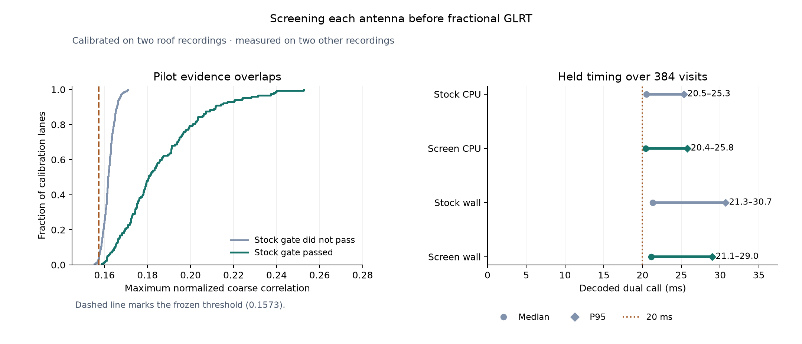

# Independent antenna activity screen

The activity screen preserved **270 of 270 positive physical lanes**, including all **24 RX1-only visits**, across 384 held dual-IQ visits on the two pilot edges. It skipped refinement on only **10 of 498 stock-negative lanes**. Sequential decoded detector CPU P50 changed from **20.48 to 20.41 ms**, below the required 10% improvement. The screen did not advance to a whole-recording replay or position fit. [Protocol](PROTOCOL.md) · [Result lock](result-lock.json)

## One frozen rule

Each antenna runs its own released global four-region scout and all 21 coarse CFO bins. The largest retained normalized coarse pilot correlation gates the lane before the fine FFT, integer GLRT and fractional GLRT. An admitted lane continues with the full stock detector. A screened lane returns an empty physical row at the same visit. The gate uses only that antenna's current samples. [Native build receipt](native-build.json) · [Paired held rows](held-paired.json.gz)

The two calibration recordings supplied 240 valid dual visits and 154 stock-positive lanes. The smallest positive coarse maximum was 0.158678. With the existing 0.152 per-candidate floor and the predeclared slack, this yielded a common threshold of **0.1573423921**. Calibration score overlap left only 13 of 480 physical lanes below that threshold. The released and instrumented threshold-zero paths reproduced the same decoded rows during calibration. [Threshold lock](threshold-lock.json) · [Calibration measurements](calibration-paired.json.gz)

## Held support and measured cost

Each held recording supplied four contiguous blocks of 48 visits, with all 384 scheduled visits replayed. The frozen threshold retained every decoded field of admitted rows and every one of the 1,285 stock-positive candidate records. The known signed strong and weak controls passed on both edges. An artificial signal on RX1 with RX0 silent remained detectable on both edges. Noise, empty and one-frame controls generated no positive gate in either path. [Bound inputs](held-source-lock.json) · [Controls and scores](summary.json)

| Recording and edge | Valid visits | Retained RX0 positive lanes | Retained RX1 positive lanes | Retained RX1-only visits | Negative lanes screened |
| --- | ---: | ---: | ---: | ---: | ---: |
| DS26-0273, lower | 192 | 86/86 | 70/70 | 9/9 | 6 |
| DS29-0604, upper | 192 | 77/77 | 37/37 | 15/15 | 4 |

The candidate executed 6,062 fine precision calls versus 6,141 in stock and saved 28.29 ms in the sum of held per-lane fractional-stage CPU medians. Both arms made 384 complete dual-detector calls per repetition. Each dual call includes packed CI16 input through decoded rows on CPU8, with three warmed counterbalanced repetitions. Calibration ran on CPU9. Integer, fine and fractional stage clocks are available separately in the raw receipt. [Stage CSV](stage.csv) · [Complete stage clocks](held-paired.json.gz)

| Boundary over 384 held visits | Stock | Activity screen |
| --- | ---: | ---: |
| CPU P50 / P95 (ms) | 20.48 / 25.35 | 20.41 / 25.78 |
| Wall P50 / P95 (ms) | 21.32 / 30.72 | 21.12 / 28.99 |
| CPU visit medians ≤20 ms | 166/384 | 177/384 |
| Wall visit medians ≤20 ms | 127/384 | 138/384 |
| Sum of CPU visit medians (s) | 7.975 | 7.945 |

After replay, only 53 of 498 held negatives fell below the smallest positive held score. This is a descriptive zero-loss limit for this statistic on the observed inputs. It does not qualify another threshold. The test measures native support and warmed host cost from saved IQ, without arrival pacing, a position estimate, or embedded timing. [Machine-readable results](summary.json)

## Reproduction

Use `tools.pipeline_eval.variants.lane_screen.LaneScreen(library, edge).analyze(dual_ci16, threshold)` for the opt-in detector. The candidate adds only the `leo_native_glrt_analyze_lane_screen_v1` export to the released ABI. Rebuild with `python -m tools.pipeline_eval.qualification.lane_screen_build /var/tmp/lane-screen-new/build` and the earlier sealed native-pruning build available. The measured library SHA-256 starts with `735687e7356a`. [Build bindings](build.json)

To regenerate the existing stage chart, run `python -m tools.pipeline_eval.qualification.lane_screen_results`. To repeat the saved-IQ study in a separate checkout with authentic raw inputs, run `tools.pipeline_eval.qualification.lane_screen_eval` with `materialize calibration`, `measure calibration`, `materialize held`, and `measure held` followed by the common local work directory. Affinitize measurement to CPU9 for calibration and CPU8 for held replay. Copy the fresh `build/build.json` and `build/detector/build-receipt.json` from that work directory to this report's `build.json` and `native-build.json` before publishing.
