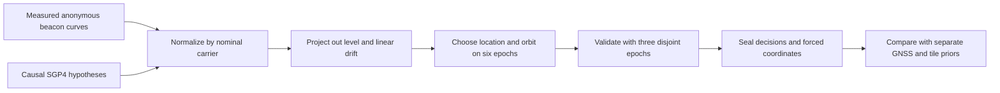

# Physical transfer and carrier-invariant Doppler

The inspected collections yielded zero independent recordings suitable for replaying the complete multi-lane Qin pilot receiver. The new archive evidence is a genuine wideband Starlink IQ excerpt from UT Austin. It spans 50 ms on channel 6 and contains seven whole frames from one exemplar satellite. Separate published Ohio State and MIT Haystack experiments establish that richer recordings exist. The inspected primary inventories supplied no downloadable bundles of their raw IQ, calibrated location, exact UTC and capture-time catalogue. [Archive evidence](raw-source-audit.json)

On four distinct measured StarLoc receiver sites, a new frequency-normalized curvature receiver withheld all 12 position attempts. With the correct tile, its median forced error was 12.51 km, compared with the 6.95 km tile center and 3.53 km for the earlier offset-only method. The result measures position inference from released beacon-frequency curves. Qin pilot detection and end-to-end transfer on independent wideband RF remain unmeasured. [Curvature predictions and seal](prediction-lock.json) · [Per-query scores](scores.json) · [Earlier offset-only receiver](../../2026_11_19_short_receiver/physical-transfer/README.md)

## Available wideband evidence

The measured single-beacon replay uses four public observation documents and three distinct causal catalogue files. The checkout contains the exact bytes for all twelve queries. The plan binds them by SHA-256, with each document stored under its digest. [Sealed physical query plan](plan.json) · [Measured observation files](../../2026_11_18_blind_regional_receiver/public_field/observations) · [Causal element sets](../../2026_11_18_blind_regional_receiver/public_field/orbits)

| Source | Verified evidence | Transfer boundary |
| --- | --- | --- |
| UT Austin raw Qin supplement | One 250 MS/s sc16 stream centered at 12.075117 GHz, containing both nominal channel-6 pilot-edge centers. ZIP metadata identifies 12.5 million complex samples, 50 ms, and seven whole frames from an exemplar set of STARLINK-31848. | The archive is a pilot-detection control. It has no coordinate, the embedded `unix_time` field has undocumented units, and the ZIP contains no causal orbit catalog. The track duration and independent-satellite support also fall short of the positioning experiment. [Raw archive](https://rnl-data.ae.utexas.edu/datastore/supplementaryMaterial/qin-starlink-pilots/raw-iq-data/) · [Exemplar guide](https://rnl-data.ae.utexas.edu/datastore/supplementaryMaterial/qin-starlink-pilots/GUIDE.txt) |
| Ohio State ElectroScience Laboratory | The paper reports Columbus stationary X410 captures in June and August 2025 at 10.825 GHz, with 250 MHz acquisition and 10 satellite tracks in six minutes of full-channel processing. The outer band has analog roll-off. | The paper establishes the measurement. No public IQ file, per-capture UTC authority or exact causal catalog accompanied the observation in the inspected sources. [Wideband tracking experiment, section IV](https://people.engineering.osu.edu/media/document/2025-09-26/kassas_joint_tracking_and_beacon_refinement_of_wideband_starlink_leo_signals_for_pnt.pdf) |
| MIT Haystack Westford | The paper reports Digital RF IQ collections typically covering up to half a channel and shows the same STARLINK-5949 pass at two frequencies. Westford is a geodetic VLBI site. | The paper establishes multi-frequency observation. Public figures do not give a replayable set of raw files, file-level pilot coverage, observation clock and contemporaneous ephemerides. [Westford measurements, figure 4](https://par.nsf.gov/servlets/purl/10570502) · [Geodetic site](https://www.haystack.mit.edu/about/haystack-telescopes-and-facilities/westford-radio-telescope/) |

The UT Austin inspection used 66,616 bytes of HTTP range responses to verify the ZIP inventory and four metadata-member checksums. The RF member was left on the host. The local decoded UT tree contained no corresponding raw file. The read-only local Starlink snapshot directories span August through November 2026. The previously documented independent StarLoc beacon and UK spectral archives remain available under their original measurement contracts. [Range hashes and local paths](raw-source-audit.json) · [Prior local inventory](../../2026_11_19_short_receiver/physical-transfer/raw-source-audit.json)

## What survives affine carrier removal

Subtracting two frequency measurements removes an unknown additive carrier level. Projecting out both `1` and `t` goes further and removes an arbitrary linear frequency drift within each track. We project the observed and predicted frequency residual, normalized by the nominal RF, over six training epochs and three disjoint held epochs. At a candidate site, the training block selects the orbit. The held block tests that orbit without fitting an offset, drift or time shift. It contributes only one independent curvature measurement per track. The same projection removes the constant `c` term, so the two calibration arms produce identical outputs. [Frozen protocol](PROTOCOL.md)

| Geography given to each run | Sites | Curvature publications | Offset-only publications | Forced median curvature / offset-only (km) | Tile-center median (km) |
| --- | ---: | ---: | ---: | ---: | ---: |
| Worldwide search, no site input | 4 | 0 | 1 | 5,419 / 6,830 | — |
| Supplied single tile containing receiver | 4 | 0 | 0 | 12.51 / 3.53 | 6.95 |
| Supplied single tile omitting receiver | 4 | 0 | 0 | 94.93 / 78.67 | 88.28 |

The earlier worldwide publication was 9,471 km from GNSS. The new four worldwide runs evaluated 4,400 sites each and produced forced errors from 3,088 to 8,239 km. Its four supplied-correct forced errors exceeded their individual tile-center errors. All four omitted tiles still admitted 4–11 independently assigned held orbits and scored 0.982–0.993 on held curvature. Across all 12 trials the largest positive held advantage over a spatial alternative was 0.0104, below the predeclared 0.08 threshold. For these track lengths and search budgets, good held curvature agreement is common even far from the receiver. [Held evidence and errors](scores.json) · [Original sealed queries](../../2026_11_19_short_receiver/physical-transfer/plan.json)

Median isolated-process elapsed time on CPU 7 was 7.19 s worldwide, 1.37 s with the correct tile, and 1.30 s with an omitted tile. All 12 scored runs completed. A prior wrapper run produced a type error in the call to the shared seed-ranking function. The fix converted its score list into the expected NumPy array before any new GNSS scores were read. The original failed receipts remain available. [Scored release hashes](source-lock.json) · [Retained wrapper preflight](wrapper-preflight/prediction-lock.json) · [Score seal](score-lock.json)
