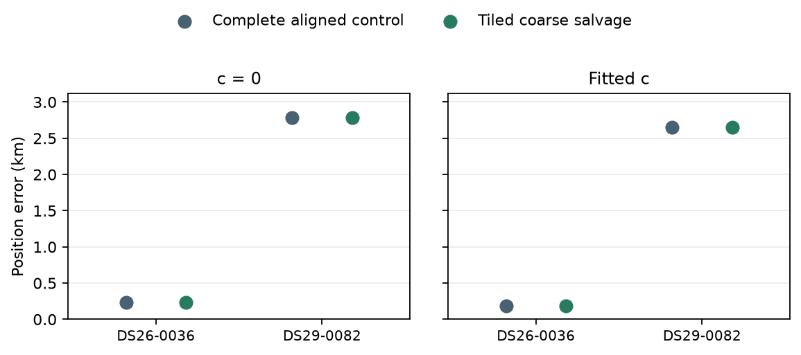

# Tiled conservative salvage in complete compact v5

The tiled salvage stage reduced its largest prediction and returned-profile payload from **166.90 to 1.75 MB** on DS26-0036 and from **92.53 to 0.88 MB** on DS29-0082. It cut salvage CPU time on both. It preserved the full candidate ranking, accepted salvage evidence, complete recovery and both calibration-arm positions and radio metrics exactly. Whole-worker peak RSS rose on DS26 and fell on DS29. [Exact comparison](comparison.json) · [Sealed positions](prediction-lock.json)

The original coarse salvage expands every satellite across 81 orbital phases and each track's original times. Each profile returns residual, innovation and other arrays for every phase even though the shortlist only uses the minimum cost per satellite. The candidate materializes up to 16 contiguous satellite rows at a time, profiles them with the frozen arithmetic and retains only their per-satellite minima. The original full-roster sort then uses all scalar costs in source order. The existing fine phase/support search and vetoes run on the same shortlists. Both methods use the bounded regional bank and preparation-local history cache on authenticated whole-ordinary GLRT factors. [Protocol](PROTOCOL.md) · [Candidate implementation](../../../../tools/pipeline_eval/variants/v5_tiled_salvage.py) · [Preparation control](../../refinement/history-stream/README.md)

## Measured allocation and timing

| Recording | Largest stock prediction shape | Prediction bytes, stock → tile | Returned profile bytes, stock → tile | Salvage CPU (s) |
|---|---:|---:|---:|---:|
| DS26-0036 | 123,444 × 55 | 54,315,360 → 570,240 | 112,580,928 → 1,181,952 | 3.382 → 1.995 |
| DS29-0082 | 136,080 × 27 | 29,393,280 → 279,936 | 63,141,120 → 601,344 | 1.381 → 0.482 |

Every roster order and selected support matched across 19 coarse windows on DS26 and five on DS29. The measurements above count live numerical buffers rather than the entire profile scratch or process heap. They show the resource saving in the operation that changed. [Shape, CPU and stage measurements](resources.csv)

| Recording | Preparation peak RSS (KiB), stock → tile | Through salvage RSS (KiB) | Complete peak RSS (KiB) | Complete wall / CPU (s) |
|---|---:|---:|---:|---:|
| DS26-0036 | 490,532 → 490,956 | 1,022,972 → 1,018,212 | 1,364,180 → 1,431,608 | 101.38 / 94.99 → 122.12 / 98.78 |
| DS29-0082 | 496,536 → 496,028 | 805,908 → 801,236 | 1,307,684 → 1,277,004 | 83.22 / 75.80 → 81.54 / 78.08 |

Each pair used the same pinned host core and one numerical thread. The complete high-water occurred later during residual catalogue work. The eligible 381-knot ECEF position/velocity pair alone occupies 203.66 and 204.55 MB on these two inputs. Bulk propagation and the frozen screen also retain large copies and temporaries while preparing that state. These arrays explain why shrinking salvage scratch yielded little change in the cumulative peak at salvage and mixed complete-worker results. [Measured arrays and memory categories](resources.csv)

## Enforced 512 MiB limit

The uncapped candidate completed both aligned replays under their 300-second wall caps. In a separate DS29-0082 run, the same numerical request entered a 512 MiB Linux memory cgroup with swap disabled. The kernel killed the worker at the exact limit without a result. A traced repeat again reached 536,870,912 bytes and was OOM-killed after 20.275 wall seconds. Its log completed native preparation and initial scan construction, then entered `initial_selection`, `ranked_initial_nodes` and `fresh_discovery`. It exited before `fresh_discovery` returned or any `explore` call began. The trace locates the first blocked stage under this host limit to initial discovery, before conservative salvage. It does not identify the exact failed allocation. [Initial cap receipt](memory-cap.json) · [Traced cap receipt](memory-cap-trace.json)

Earlier track-column evidence measured a 57.13 MB dense three-field projection on this DS29 recording and showed that removing the slab shrinks early RSS, but its complete worker also exceeded the target. The 512 MiB host gate must cover both early discovery and the independent late catalogue allocations. The matched sample in this experiment contains two ordinary replays. [Earlier early-discovery measurement](../../factors/early-memory/README.md)

## Coordinates and radio evidence

Both paths retained the same ordered prepared bank, history, forecasts, conditioned fit, ownership, optimizer work, residual shortlists and final reassociation decisions. Geography was joined after predictions were sealed. [Exact evidence](comparison.json) · [Per-arm scores](scores.csv)

| Recording | Position error `c = 0` / fitted `c` (km) | Conditional Doppler RMS `c = 0` / fitted `c` (Hz) |
|---|---:|---:|
| DS26-0036 | 0.229 / 0.185 | 102.259 / 102.295 |
| DS29-0082 | 2.784 / 2.651 | 106.670 / 106.587 |



## Reproduce

```sh
report=reports/2026_11_19_receiver_screening/recovery/solver-memory
.venv/bin/python -B -m tools.pipeline_eval.qualification.solver_memory_trial seal --report "$report"
taskset -c 4 .venv/bin/python -B -m tools.pipeline_eval.qualification.solver_memory_trial replay --case DS26-0036 --report "$report"
taskset -c 5 .venv/bin/python -B -m tools.pipeline_eval.qualification.solver_memory_trial replay --case DS29-0082 --report "$report"
.venv/bin/python -B -m tools.pipeline_eval.qualification.solver_memory_trial publish --report "$report"
.venv/bin/python -B -m tools.pipeline_eval.qualification.solver_memory_trial score --report "$report"
.venv/bin/python -B -m tools.pipeline_eval.qualification.solver_memory_figures --report "$report"
.venv/bin/pytest -q tests/pipeline_eval/test_v5_tiled_salvage.py
```

The optional Linux memory-cap experiment uses `solver_memory_cap --trace --report "$report" --work` with a new scratch directory after the ordinary DS29 candidate completes.
