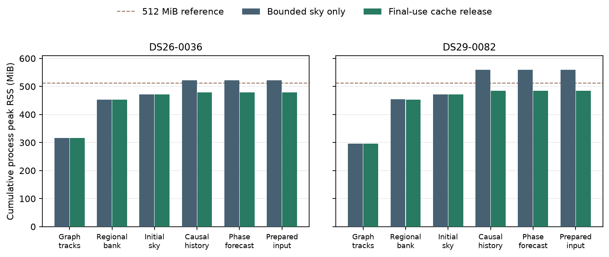
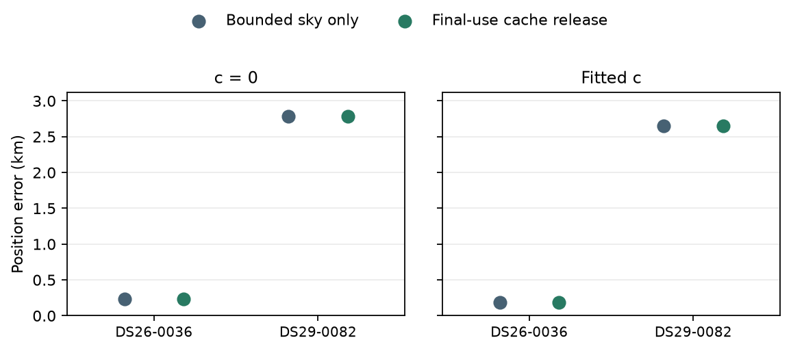

# Final-use TLE cache release during v5 preparation

Peak RSS through native preparation reached **479 MiB** on DS26-0036 and **485 MiB** on DS29-0082. Both met the **512 MiB** host preparation target. The complete aligned finish peaked at **1,354 MiB** and **1,270 MiB**. Prepared evidence, final positions, radio metrics and recovery decisions matched exactly in both calibration arms. [Sealed predictions](prediction-lock.json) · [Exact comparison](comparison.json)

Both paths use the sealed bounded regional sky preparation and complete aligned compact finish on the same authenticated ordinary factor files. This isolates the cache lifetime change after the regional bank, without changing the earlier 48-hour causal selection or previous-catalogue computations. [Protocol](PROTOCOL.md) · [Source lock](source-lock.json) · [Bounded regional sky control](../prep-stream/README.md)

The frozen 72-hour phase-history stage is the final consumer of this preparation call's parsed TLE snapshots. The candidate returns each snapshot through the original strict parser, then releases that snapshot's cache entry. A miss still validates and constructs the same `Satrec` catalogue; the parser keeps no new cache entry during this final pass. Captured causal archive reads, epoch deduplication, selected per-satellite history, ordering, and phase forecasting are unchanged. The fallback still receives an explicitly supplied parser as-is. Each candidate worker owns a fresh cache, so its releases have no effect on other host or receiver jobs. [Implementation](../../../../tools/pipeline_eval/variants/history_stream_prep.py)

## Memory and runtime

| Recording | Preparation peak RSS (KiB), control → candidate | Complete worker peak RSS (KiB) | Sampled anonymous RSS (KiB) | Sampled file RSS (KiB) |
|---|---:|---:|---:|---:|
| DS26-0036 | 535,236 → 490,648 | 1,450,040 → 1,386,808 | 1,396,608 → 1,333,100 | 53,756 → 53,880 |
| DS29-0082 | 572,272 → 496,412 | 1,366,620 → 1,300,380 | 1,313,336 → 1,247,140 | 53,772 → 53,728 |

The last pass drained 19 and 20 cached snapshots, releasing 113.15 and 119.55 MB of accounted records and text. The original cache retained 160.80 and 197.26 MB after preparation. The candidate retained zero parsed snapshot rows after the final pass. Control and candidate recorded the same cache hits and misses, so the candidate preserved the original parsing work as well as its numerical results. The complete-worker savings were mostly anonymous RSS. File RSS remained about 52 MiB and sampled shared RSS was zero. [Stage and cache counters](resources.csv)



| Recording | Phase-history CPU (s), control → candidate | Total preparation CPU (s) | Complete worker wall / CPU (s) |
|---|---:|---:|---:|
| DS26-0036 | 2.87 → 3.61 | 11.39 → 12.57 | 102.57 / 93.13 → 91.79 / 86.95 |
| DS29-0082 | 4.55 → 3.85 | 15.34 → 12.94 | 69.53 / 66.78 → 71.65 / 68.68 |

Preparation CPU starts after native decoding. Each pair ran on the same pinned host core, with a single numerical thread. Timing effects were mixed across the two matched comparisons. The complete receiver remained above 512 MiB. [Measured host receipts](prediction-lock.json)

## Positions and radio fit

All ordered FP64 regional state arrays, native track evidence, previous catalogues, phase-history rows, forecast, ranked hypotheses and family confidence matched. The complete finish returned the same associations, optimizer counts, residual shortlists and reassociation decisions. [Exact prepared and final scientific comparisons](comparison.json)

| Recording | Geographic error `c = 0` / fitted `c` (km) | Conditional Doppler RMS `c = 0` / fitted `c` (Hz) |
|---|---:|---:|
| DS26-0036 | 0.229 / 0.185 | 102.259 / 102.295 |
| DS29-0082 | 2.784 / 2.651 | 106.670 / 106.587 |

Both methods returned these values. Truth was joined after the predictions were sealed. [Position and frequency objectives](scores.csv)



## Reproduce

```sh
.venv/bin/python -B -m tools.pipeline_eval.qualification.history_stream_trial seal
taskset -c 4 .venv/bin/python -B -m tools.pipeline_eval.qualification.history_stream_trial replay --case DS26-0036
taskset -c 5 .venv/bin/python -B -m tools.pipeline_eval.qualification.history_stream_trial replay --case DS29-0082
.venv/bin/python -B -m tools.pipeline_eval.qualification.history_stream_trial publish
.venv/bin/python -B -m tools.pipeline_eval.qualification.history_stream_trial score
.venv/bin/python -B -m tools.pipeline_eval.qualification.history_stream_figures
.venv/bin/pytest -q tests/pipeline_eval/test_history_stream_prep.py
```
