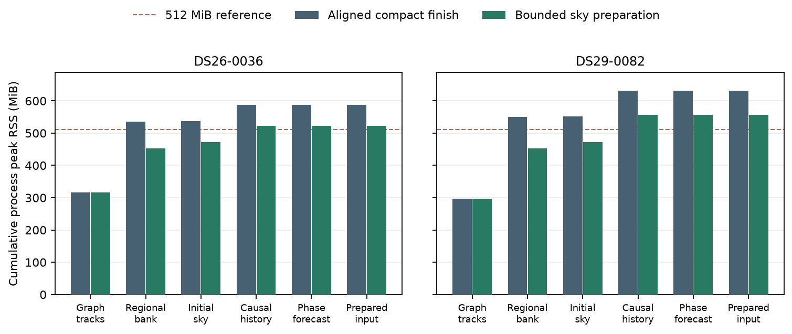
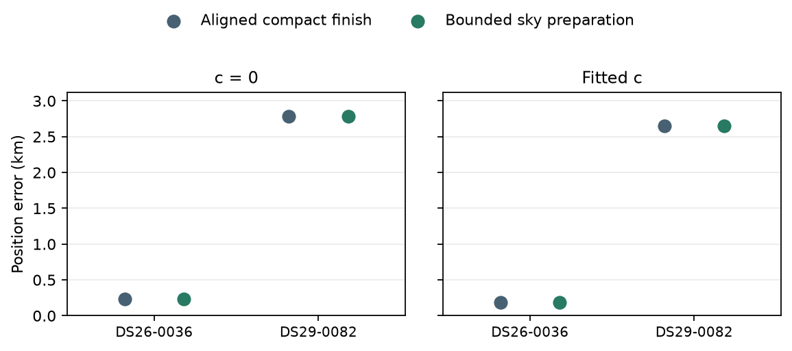

# Bounded causal sky preparation for compact v5

Screening the causal sky in satellite blocks reduced peak preparation RSS by **65 MiB** on DS26-0036 and **75 MiB** on DS29-0082. The regional bank and all prepared scientific evidence matched exactly. Both calibration arms returned the same positions, Doppler RMS and recovery decisions. Preparation still peaked at **523 MiB** and **556 MiB**, above the 512 MiB reference. [Resource counters](resources.csv) · [Prediction lock](prediction-lock.json)

The two matched pairs replay authenticated ordinary native GLRT factors through the complete aligned compact finish. Each method uses the same graph tracks, explicit regional centre, causal archive, original tile and both calibration arms. The only scientific-path change is how the regional orbit bank is allocated. [Protocol](PROTOCOL.md) · [Source lock](source-lock.json) · [Authenticated detector inputs](../../end-to-end/README.md)

The original preparation propagates the entire causal catalogue on the coarse five-second grid and constructs all look-angle arrays before filtering. The candidate invokes the same FP64 propagation and look-angle functions on at most 128 satellite rows, retaining source indices whose states are usable and whose maximum elevation meets the original −12° threshold. It fills the identical dense regional one-second state bank from batches of at most 256 survivors. It uses neither an orbit shortlist nor disk backing. [Implementation](../../../../tools/pipeline_eval/variants/prep_stream_sky.py)

On the measured inputs, the coarse screen processes 11,087 and 11,155 satellite rows on 61 coarse knots, retaining 1,524 and 1,680. The coarse position, velocity and four returned scalar look-angle buffers total 54.10 and 54.44 MB for the full catalogue. Each candidate block limits those buffers to 0.625 MB. These are numerical payload sizes, separate from process RSS and propagation's temporary buffers. The surviving FP64 ECEF position and velocity arrays occupy 24.51 and 27.01 MB on the same 335 fine knots.

## Memory and runtime

| Recording | Regional bank peak RSS (KiB), stock → candidate | Complete preparation peak RSS (KiB) | Complete worker peak RSS (KiB) |
|---|---:|---:|---:|
| DS26-0036 | 548,740 → 462,932 | 602,308 → 535,508 | 1,499,084 → 1,477,528 |
| DS29-0082 | 563,004 → 464,088 | 645,948 → 569,496 | 1,357,424 → 1,341,664 |

The regional bank itself finished below 512 MiB on both recordings. Preparation reached its final peak during causal history, after the regional bank finished. The frozen element parser accounted for 160.8 and 197.3 MB of retained text and validated records across 27 and 33 distinct snapshots. Both methods retained the same cache contents and forecast inputs. The complete-worker RSS savings were predominantly anonymous memory. Sampled file RSS remained about 52 MiB and sampled shared RSS was zero. [Per-worker memory and cache counters](resources.csv)



| Recording | Regional-bank CPU (s), stock → candidate | Preparation CPU (s) | Whole worker wall / CPU (s) |
|---|---:|---:|---:|
| DS26-0036 | 0.73 → 0.63 | 15.40 → 14.66 | 133.63 / 129.90 → 127.81 / 124.60 |
| DS29-0082 | 0.70 → 0.60 | 17.66 → 17.72 | 96.43 / 93.06 → 96.88 / 95.92 |

The preparation clock in the table runs from the decoded native document through graph, sky, noise, history and forecast. The separate decode added 0.11–0.15 CPU seconds to the complete native-to-prepared boundary. Each pair used one pinned host core and one numerical thread. The small CPU and wall differences are single matched host measurements. [Measured spans](resources.csv)

## Positions and radio fit

Both methods selected the same ordered regional catalogue and propagated bytewise identical fine state arrays. Graph support, previous causal TLEs, phase history and phase forecast match. The complete worker retained its ranked hypotheses, family evidence, residual shortlists, reassociation nomination, ownership and optimizer work. Geography was read after sealing both methods' predictions. [Exact comparison](comparison.json)

| Recording | Position error `c = 0` / fitted `c` (km) | Conditional Doppler RMS `c = 0` / fitted `c` (Hz) |
|---|---:|---:|
| DS26-0036 | 0.229 / 0.185 | 102.259 / 102.295 |
| DS29-0082 | 2.784 / 2.651 | 106.670 / 106.587 |

Both methods returned these values. [Paired positions and frequency objectives](scores.csv)



## Reproduce

```sh
.venv/bin/python -B -m tools.pipeline_eval.qualification.prep_stream_trial seal
taskset -c 10 .venv/bin/python -B -m tools.pipeline_eval.qualification.prep_stream_trial replay --case DS26-0036
taskset -c 11 .venv/bin/python -B -m tools.pipeline_eval.qualification.prep_stream_trial replay --case DS29-0082
.venv/bin/python -B -m tools.pipeline_eval.qualification.prep_stream_trial publish
.venv/bin/python -B -m tools.pipeline_eval.qualification.prep_stream_trial score
.venv/bin/python -B -m tools.pipeline_eval.qualification.prep_stream_figures
.venv/bin/pytest -q tests/pipeline_eval/test_prep_stream_sky.py
```

`--raw` selects an alternate directory for the authenticated whole-IQ factors and original numerical requests. Use a new `--runs` directory for fresh measurement.
