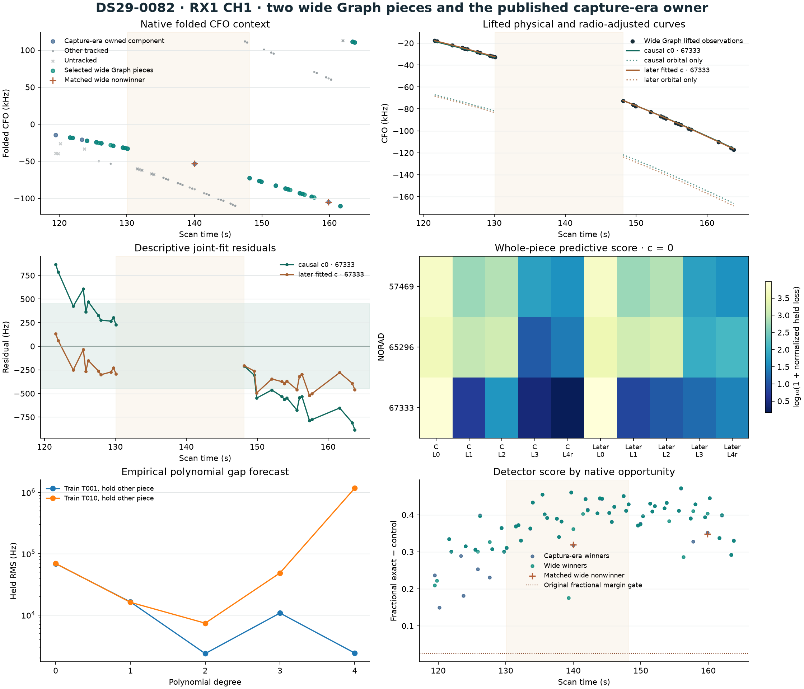

# DS29-0082 wide Graph fragment identity

Both directions of the whole-fragment holdout rank **STARLINK-36427 (NORAD 67333)** first under the shared satellite phase model. This is the authenticated capture-era owner in both calibration arms. With causal elements, the held RMS exceeds the 450 Hz diagnostic scale for both fragments in both arms under that model. A receiver-rate sensitivity improves the zero arm and worsens the fitted arm. The evidence supports a shared identity conditional on the original causal location and the searched models. Production admission and localization effects remain unmeasured.

## What divided the track

The longest qualifying published parent among 28 audited component–owner pairs was `SCAN-RX1-CH1-T003-RF10940312500.000000`. Its 25 verified observations span 119.457–163.759 s (44.302 s). Both arms have identical ownership and native support. Times refer to the original capture clock. The physical lane is raw receiver 0 (published RX1), channel 1, upper edge, 10.9403125 GHz, with 20 ms probes at 10 MS/s. On the parent support, archived frequency RMS is 107.8 Hz for `c = 0` and 106.9 Hz for fitted `c`. Those are original-fit residuals on different observations, so the wide cross-fragment errors below measure a different task. [Selection rule](PROTOCOL.md) · [Native matches and ownership keys](selection.json)

Strict reciprocal overlap linked 9 parent points to wide `T010` and 12 to wide `T001`. Two parent points have no reciprocal wide epoch family (visits 2696 and 2784). Two have reciprocal wide families that passed the detector margin and lost winner selection (visits 3160 and 3608). The fit uses all measured wide Graph points inside the parent span, 11 from early `T010` and 15 from late `T001`. Both wide components were classified as insufficient support by the original preparation. Their end-to-start gap is 18.074 s, above the configured 8 s join limit. The per-point export includes all 126 opportunities per detector source in this lane. [Per-point CSV](fragment-identity.csv)

Visit **3160** provides a specific acquisition lead. At 140.012 s the matched wide nonwinner differs from the capture-era parent by +23.02 Hz folded CFO and −0.004 sample in epoch. Its fractional margin is 0.31868. The chosen wide peak, with margin 0.36155, enters wide `T003`. This visit falls 9.924 s after the early piece and 8.151 s before the late piece. Retaining it would put both gaps below the 10 s support-gap setting. Both gaps would still exceed the 8 s join setting. Its inclusion has not been replayed through the production Graph. The other nonwinner, at visit 3608, also passed its margin (0.34839 against the selected peak’s 0.40304). The acquisition and Graph evidence leave separate questions about peak retention and valid track continuation. [Raw bridge candidates](comparison.json)

## Whole-fragment prediction

The common spatial hypothesis is the published original `c = 0` causal endpoint. The search does not use a surveyed coordinate. Original owners authenticate the sources, select the inquiry and provide other families for receiver calibration. The target owner's label enters scoring as a comparison after the full catalogue search. The calibration fit uses 13 other training families and reserves three for a separate check. The target comparison holds the 26 observations, position, catalogue, phase grid, alias alternatives and search budget fixed between `c` arms. Each arm fits the same receiver terms and the fitted arm additionally estimates the shared RF coefficient from independent multi-carrier rows. [Frozen fit specification](FIT-PROTOCOL.md)

The causal ledger screens 11,155 identities through the original cutoff of 2026-11-03 17:35:00.592 UTC. The strictly diagnostic later ledger screens 11,113 identities selected by first valid post-scan element epoch within 48 h. The common ledger has 11,056 identities. The target's causal element epoch is November 2 at 12:00:02.999 UTC, collected November 3 at 17:03:18.226 UTC. The later element has epoch November 3 at 22:00:01.9996 UTC and was collected November 4 at 17:37:00.001 UTC. State validity and a −2° horizon guard allow at least one tested phase for 607 causal and 602 later identities. All of these enter the same five-level search in both arms. Exclusions and any unavailable fixed-phase levels are retained in the evidence. Search time was 5.06 s causal and 4.55 s later, on one assigned CPU per search under a 240 s limit. [Element provenance](ledger-receipt.json) · [All identities and exclusions](tle-inventory.csv.gz)

Each row below fits one Graph piece and predicts the other, twice. The two held sets are 11 and 15 points. They stay whole and are separated by 18.074 s. Lower covariance-whitened loss is better. Full-fit counts use a separate fit on both fragments and are shown as a descriptive frequency diagnostic.

| Elements | Calibration | Mean held whitened loss | Runner-up | Held RMS early / late | Full fit within ±450 Hz |
|---|---|---:|---|---:|---:|
| Causal | `c = 0` | 1.709 | 65296 · 10.971 | 493 / 615 Hz | 9 / 26 |
| Causal | Fitted `c` | 4.789 | 57469 · 42.159 | 834 / 1,191 Hz | 0 / 26 |
| First later | `c = 0` | 16.712 | 57469 · 62.865 | 1,767 / 2,145 Hz | 0 / 26 |
| First later | Fitted `c` | 0.613 | 57469 · 110.109 | 223 / 389 Hz | 21 / 26 |

NORAD 67333 also ranks first on each of the eight individual held-fold lists at this model level. The shared-phase fit uses one integer alias per fragment. For all four joint fits the branches are −1/−1 relative to the stored Graph lift. The held fragment is evaluated in the wrapped frequency representation without fitting any continuous nuisance there. Without receiver correction and phase profiling, the target ranks 139th in the causal nominal search. A shared receiver-rate-only step with fitted `c` ranks NORAD 63265 ahead of it. Allowing an additional orbital frequency-rate discrepancy reduces causal held RMS to 165/318 Hz at `c = 0`, but increases it to 1,811/1,655 Hz with fitted `c`. A polynomial-only prediction across the gap has degree-two held RMS of 2.34 and 7.33 kHz, the best held RMS in each direction among the tested polynomial degrees. [All fits and unavailable trials](candidate-fits.csv.gz) · [Fold rankings and nuisance sensitivities](comparison.json)

With the later elements substituted at the frozen causal phase and aliases, the joint fitted-`c` RMS grows from 1,055 to 2,932 Hz. Refitting the shared phase from +2.5 to +1.25 s reduces it to 329 Hz. At `c = 0` the corresponding joint RMS grows from 567 to 1,654 Hz and remains there after phase refitting. The improved fitted-arm later prediction therefore depends on a new phase fit and does not supply causal evidence. The 450 Hz scale is three times the configured Graph noise and is only a residual reference. This single recording, lane, fixed position and set of nuisance assumptions do not establish unconditional uniqueness, reliable acceptance, or improved position accuracy.

## Evidence and reproduction

The [chart seal](chart-lock.json) binds the measured PNG, PDF, CSV, full catalogue/fit exports and all upstream locks. [Selection lock](selection-lock.json) · [Ledger lock](ledger-lock.json) · [Causal search lock](causal-search-lock.json) · [Later search lock](later-search-lock.json) · [PDF](fragment-identity.pdf)

The numerical workers are `tools.pipeline_eval.qualification.fragment_identity_search causal` and `tools.pipeline_eval.qualification.fragment_identity_search later`. Run the modules with `python -m` in the repository environment. They verify sealed inputs before fitting. `tools.pipeline_eval.qualification.fragment_identity_report` renders from the locked results. Initial input preparation uses read-only archived observations and the frozen original Graph source. The exact measured selection launcher is retained in [selection-launcher.py.gz](selection-launcher.py.gz) because the live copy later gained an import separator. [Selection plan](selection-plan.json)

The initial fit launch exited before numerical fitting because packed ledger keys were JSON strings. The sealed retry uses the same roster and model after correcting key access and mask dtype. [Initial launch plan](fit-launch-preflight.json) · [Executed plan](fit-plan.json)
