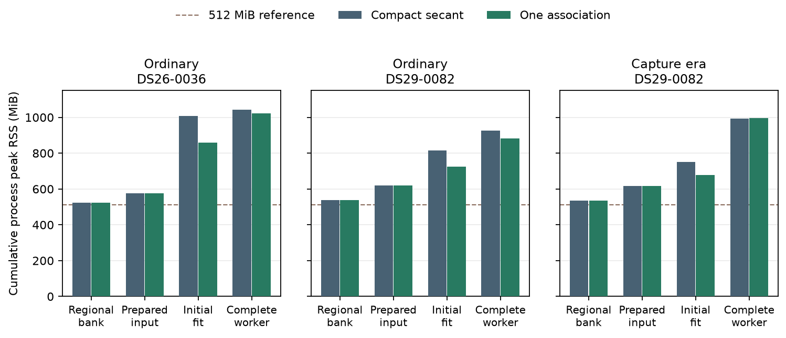

# Working memory in compact secant discovery

Reusing the first of two identical exploratory associations cut peak memory during the initial fit by **147 MiB** on DS26-0036 and **91 MiB** on DS29-0082. The complete fitter saved only **19 MiB** and **44 MiB** because later recovery still dominated. Both positions and conditional Doppler RMS were numerically identical in each calibration arm. The ordinary candidate peaks were 1,023 and 883 MiB on the host, above a 512 MiB single-process reference. [Protocol](PROTOCOL.md) · [Source lock](source-lock.json) · [Sealed predictions](prediction-lock.json)

## Measured cause

The existing regional sky stage screened 11,087 and 11,155 catalogue entries and retained 1,524 and 1,680 respectively. It finished below the full preparation and initial fit peaks on both recordings. Its FP64 bank, candidate list and order are unchanged. Batching the coarse sky screen would address that stage's temporary allocations while leaving the larger observed downstream peak.

The original discovery code passes the same state, base projection, point and method twice to `ScanLikelihood.association` inside each exploration. The first result remains live throughout the second call. On the stock DS26-0036 replay, current RSS rose from 713,376 to 861,108 KiB during the first call, then to 1,009,344 KiB during the second. The returned records included 87,636,096 bytes of predicted frequency, elevation and derivative grids and 57,278,016 bytes of per-track residuals and innovations. DS29-0082 returned 57,133,440 and 29,998,080 bytes in the same categories. These sums describe those numerical buffers, with process RSS measured separately. The candidate keeps a single association result for the identical second call and discards it at the end of that exploration. Both ordinary replays use 12 full computed associations in place of 24.

| Recording | Initial peak RSS, stock → candidate (KiB) | Whole fitter peak RSS, stock → candidate (KiB) | Whole fitter CPU, stock → candidate (s) | Whole fitter wall, stock → candidate (s) |
|---|---:|---:|---:|---:|
| DS26-0036, ordinary GLRT | 1,030,444 → 880,364 | 1,066,592 → 1,047,156 | 82.93 → 78.20 | 88.38 → 85.50 |
| DS29-0082, ordinary GLRT | 833,388 → 740,676 | 949,188 → 904,008 | 51.20 → 58.57 | 56.80 → 63.97 |
| DS29-0082, capture-era GLRT | 767,920 → 694,840 | 1,016,972 → 1,019,780 | 49.48 → 45.45 | 51.26 → 48.06 |

Each pair used the same pinned host core and one numerical thread. The CPU and wall outcomes differed by recording, with stock and candidate in different scheduled intervals. The fitter clock starts at existing complete native factors. The discovery trace hashes and resource counters add work to both paths. The previous whole-IQ stage is outside these clocks. Conservative recovery set the complete-worker high-water mark for DS26-0036, and family/history set it on ordinary DS29-0082. The capture-era control also saved 71 MiB during the initial fit while its complete-worker peak rose by 3 MiB. The change consistently removed half the measured exploratory association calls. A lower peak in initial discovery alone left the complete receiver above the embedded memory reference on all three measurements. [Stage and resource counters](resources.csv)



## Scientific comparison

The paired requests match after removing the output location. Every case uses the original graph configuration and archive cutoff. The stock and candidate generated the same ordered causal source indices, ordered NORAD IDs, and bytewise FP64 fine state and velocity arrays. Track and observation digests match. The discovery traces match for the selected association rows, projected elevations and returned candidate hypotheses. Both endpoint and conditional RMS values match exactly for all six paired calibration results. [Exact comparison](comparison.json)

| Recording | Position error `c = 0` / fitted `c` (km) | Conditional RMS `c = 0` / fitted `c` (Hz) |
|---|---:|---:|
| DS26-0036, ordinary GLRT | 0.218 / 0.180 | 102.253 / 102.289 |
| DS29-0082, ordinary GLRT | 2.789 / 2.654 | 106.672 / 106.588 |
| DS29-0082, capture-era GLRT | 0.568 / 0.516 | 97.003 / 96.684 |

The ordinary replay inputs were produced from complete CI16 earlier and each independently matched the prior complete whole-IQ factor hash. The capture-era control supplies different detector factors and uses the original capture-era numerical request. Geography was read after sealing both methods. [Geographic and RF scores](scores.csv) · [Whole-IQ input receipts](../end-to-end/README.md)

## Reproduce

```sh
.venv/bin/python -B -m tools.pipeline_eval.qualification.working_memory_trial seal
taskset -c 10 .venv/bin/python -B -m tools.pipeline_eval.qualification.working_memory_trial replay --case ordinary-DS26-0036
taskset -c 11 .venv/bin/python -B -m tools.pipeline_eval.qualification.working_memory_trial replay --case ordinary-DS29-0082
taskset -c 11 .venv/bin/python -B -m tools.pipeline_eval.qualification.working_memory_trial replay --case capture-era-DS29-0082
.venv/bin/python -B -m tools.pipeline_eval.qualification.working_memory_trial publish
.venv/bin/python -B -m tools.pipeline_eval.qualification.working_memory_trial score
.venv/bin/python -B -m tools.pipeline_eval.qualification.working_memory_figure
.venv/bin/pytest -q tests/pipeline_eval/test_v5_discovery_memory.py
```

Use `--raw` for another location containing the authenticated ordinary factor and original secant request files. Use an empty `--runs` directory for a fresh replay.
