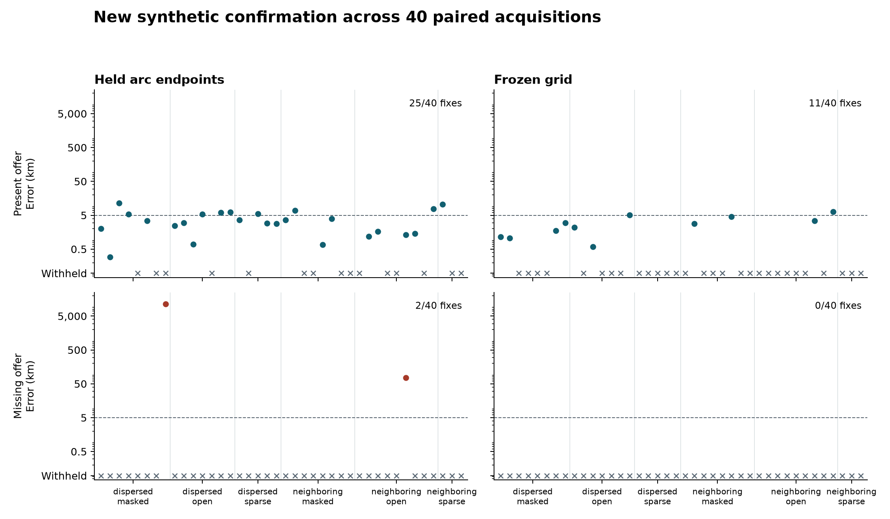

# Fresh synthetic confirmation of the Doppler endpoint receiver

The endpoint receiver delivered 16 fixes within 5 km on 40 correct-region
offers. The frozen grid delivered nine. The endpoint receiver published more
fixes, 25 versus 11, with a larger P95 error across its publications,
9.893 km versus 5.740 km. Both methods nominated the correct square on all
40 present offers. The endpoint receiver also published on two missing
offers, with errors of 75.471 km and 11,384.810 km. The frozen grid withheld
all 40 missing offers. The new panel reproduces the endpoint receiver's
coverage improvement and missing-region failure without any threshold changes.



## Results by scene

Counts and error distributions apply to both calibration arms. Each row
contains the stated number of paired present and missing offers. Count cells
show endpoint receiver / frozen grid. Error cells show median / P95 / maximum
in kilometers across published fixes for the present offer.

| Scene | Pairs | Correct nominations | Present fixes | Within 5 km | Endpoint error (km) | Frozen grid error (km) | False missing fixes |
|---|---:|---:|---:|---:|---:|---:|---:|
| All | 40 | 40 / 40 | 25 / 11 | 16 / 9 | 3.460 / 9.893 / 11.553 | 2.812 / 5.740 / 6.331 | 2 / 0 |
| Dispersed, masked | 8 | 8 / 8 | 5 / 4 | 3 / 4 | 3.460 / 10.327 / 11.553 | 1.441 / 2.765 / 2.947 | 1 / 0 |
| Dispersed, open | 7 | 7 / 7 | 6 / 3 | 3 / 2 | 4.186 / 6.170 / 6.241 | 2.213 / 4.855 / 5.148 | 0 / 0 |
| Dispersed, sparse | 5 | 5 / 5 | 4 / 0 | 3 / 0 | 3.270 / 5.216 / 5.493 | — | 0 / 0 |
| Neighboring, masked | 8 | 8 / 8 | 4 / 2 | 3 / 2 | 3.807 / 6.400 / 6.829 | 3.682 / 4.466 / 4.553 | 0 / 0 |
| Neighboring, open | 9 | 9 / 9 | 5 / 2 | 4 / 1 | 1.454 / 6.571 / 7.804 | 4.881 / 6.186 / 6.331 | 1 / 0 |
| Neighboring, sparse | 3 | 3 / 3 | 1 / 0 | 0 / 0 | 10.415 / 10.415 / 10.415 | — | 0 / 0 |

The endpoint region gate accepted 37 of 40 present offers and 7 of 40
missing offers. Its position boundary check withheld five of the seven
incorrect accepted regions. The frozen grid's region gate accepted 36 of
40 present offers and zero missing offers. The two false endpoint fixes
occurred in the neighboring open and dispersed masked scenes respectively.
The median forced error on all 40 present offers was 3.809 km for the
endpoint receiver and 3.192 km for the frozen grid. [Per-query and
per-scene scores](scores.json) · [Figure PDF](position-errors.pdf)

## Evidence and scope

The authoritative generator produced 40 new synthetic receiver positions
in eight geographic groups and generated two queries per acquisition
using the same four-offer format, one with the correct region and one
without it. The new panel
has 80 new query IDs, 40 new observation hashes and 40 new capture
timestamps. It shares 21 of the 40 causal catalogue hashes with the
earlier panel because both panels sample the same archive window and
constellation. This tests repeatability across independent scene draws
within the simulator's domain. Both methods received identical public
inputs per query. [Predeclared protocol](predeclared.md) ·
[Generator receipt](holdout-receipt.json)

The generator evaluates 300 s captures with exact SGP4 propagation from
updated archives and WGS84 rotating-Earth range rates. Inference uses
the older catalogue available before capture, while signal generation
requires a materially updated archive retrieved 14–48 hours after
capture end and uses only its post-capture elements. The visibility
model draws receiver heights, azimuth masks and elevation floors for
open, masked and sparse rigs. Track sampling follows eight previously
held-aside dual-receiver RF visit templates with independent randomized
start times and gaps. The generator adds per-receiver/band biases up to
14 kHz, Gaussian linear drift with 2.8 Hz/s scale, a quadratic drift
term, additive RF calibration, per-satellite frequency and timing
offsets, and smooth and white Gaussian noise. It adds larger
piecewise distortions to 195 of the 1,247 retained tracks. The 32
open or masked scenes all have at least nine clean tracks in each
half. The remaining eight scenes use the sparse rig. The domain
contains no IQ detection, beam calibration, temporal hardware failure,
or field receiver truth. [Pinned generator](../../../2026_11_18_blind_regional_receiver/holdout_private/publish.py) ·
[Generator configuration](../../../2026_11_18_blind_regional_receiver/holdout_private/protocol.json)

The fixed-RF additive calibration coefficient is absorbed into a
per-track offset by both methods. The two reported calibration arms
therefore share every decision and error statistic, including in
scenes with multiple RF channels. The methods and their thresholds
were frozen before the generator sampled the seed.

## Reproducing the panel

The preserved files include the [position predictions](predictions.jsonl.gz),
[prediction lock](prediction-lock.json), [code and runtime hashes](sources.json),
and [generator seed](seed.hex), disclosed after both methods were sealed.
The [runner](../../../../tools/pipeline_eval/qualification/field_confirmation.py)
verifies the public hashes before inference and the generator's seed,
truth, and provenance hashes before scoring. Its prepare step copies
the generator and configuration into a fresh tree and refuses an
existing target. The source archives must remain accessible at the
paths in the original generator configuration.

```sh
export OPENBLAS_NUM_THREADS=1 OMP_NUM_THREADS=1 MKL_NUM_THREADS=1
confirmation_root="$(mktemp -d /tmp/leo-arc-reproduction.XXXXXXXX)/panel"
confirmation_report=reports/2026_11_19_receiver_streaming/field/confirmation
.venv/bin/python -m tools.pipeline_eval.qualification.field_confirmation prepare \
  "$confirmation_root" "$confirmation_report/predeclared.md"
xxd -r -p "$confirmation_report/seed.hex" > "$confirmation_root/holdout_private/seed.bin"
.venv/bin/python "$confirmation_root/holdout_private/publish.py"
taskset -c 16-19 .venv/bin/python -m tools.pipeline_eval.qualification.field_confirmation predict \
  "$confirmation_root"
.venv/bin/python -m tools.pipeline_eval.qualification.field_confirmation score \
  "$confirmation_root" "$confirmation_root/score"
.venv/bin/python -m tools.pipeline_eval.qualification.field_confirmation figure \
  "$confirmation_root/score/scores.json" "$confirmation_root/score/position-errors"
```

The Python and library versions in the source lock, archived data and
seed determine the non-timing outputs. Run receipts and elapsed times
can vary between reproductions.
