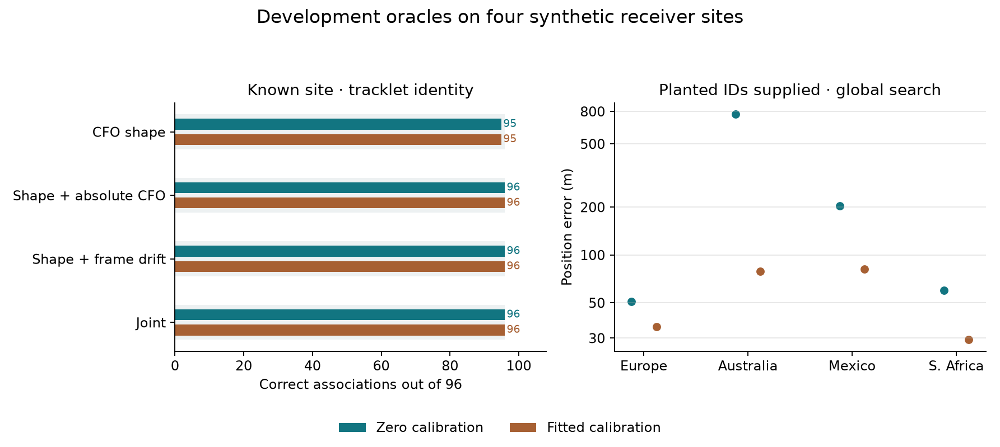
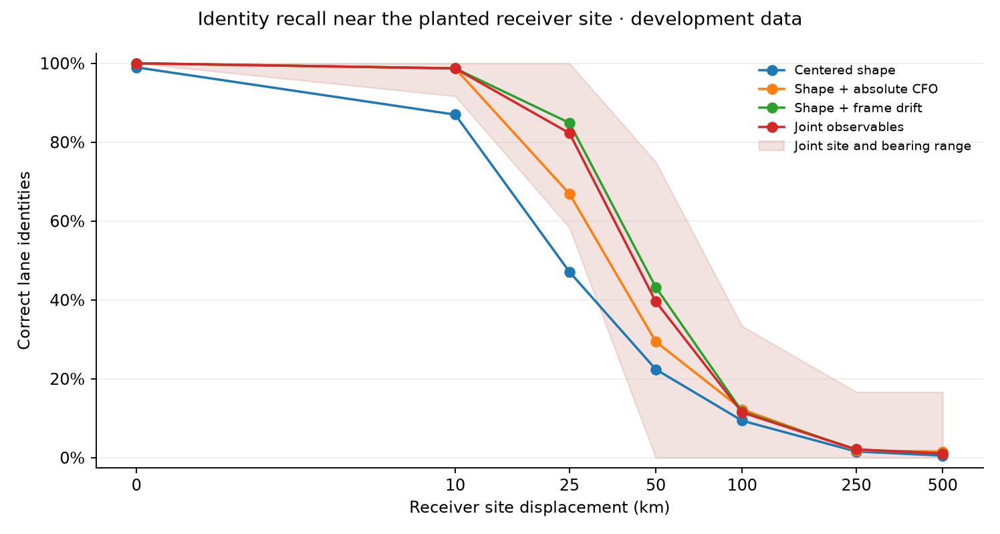

# What the synthetic cold-start measurements can identify

With the receiver site supplied, centered CFO shape alone recovered
95 of 96 anonymous lane tracklet identities and all 12 planted emitters
at each of the four sites. Either shared absolute CFO or shared frame
drift resolved the remaining one-lane error. With emitted satellite
IDs supplied and position withheld from inference, a fixed global
mesh and local fit recovered all four sites within 82 m with fitted
calibration. The original blind cold-start experiments withheld all
four. The two oracle results isolate the difficulty of solving
site and identity together on this synthetic model.

## Known site, unknown IDs

The pinned native rate-triplet extractor recovered 24 qualifying
tracklets per site and zero on the time-shuffled control. Each site
had 12 emitting satellites and two receiver lanes. All 96 true
tracklet identities were in the common 16-candidate, centered-CFO
shortlists. The receiver site entered the predicted sky geometry.
Planted NORADs entered only the identity scorer. Nominations and
clock terms used the first eight sampled raw observations per
tracklet. The last four supplied conditional prediction residuals.

| Observable | Correct tracklets, zero / fitted | Planted emitters recovered, zero / fitted | Held absolute CFO RMS median, Hz, zero / fitted | Held frame RMS median, samples |
|---|---:|---:|---:|---:|
| Centered CFO shape | 95 / 95 of 96 | 48 / 48 of 48 | — | — |
| Shape and shared absolute CFO | 96 / 96 of 96 | 48 / 48 of 48 | 672 / 59 | — |
| Shape and shared frame drift | 96 / 96 of 96 | 48 / 48 of 48 | — | 0.122 |
| Joint | 96 / 96 of 96 | 48 / 48 of 48 | 672 / 59 | 0.122 |

The joint fit's median held centered CFO RMS was 28.5 Hz. The RF
term reduced shared absolute CFO residuals while the selected
satellite identities stayed the same. All comparators used the
same causal candidates, sample split and assignment budget.

## Known IDs, unknown site

The selected tracklets receive their planted IDs from the development
schedule. A 1,536-point global mesh supplies four matched geometric
starts to each arm. Both arms fit the shared receiver clock slope,
carrier intercepts and drifts, and position with the same samples and
search budgets. The fitted arm estimates one additional RF term.
There is no supplied correct tile or known-site initialization.

| Plant | Position error, m, zero / fitted | Held absolute CFO RMS, Hz, zero / fitted | Held epoch RMS, samples, zero / fitted |
|---|---:|---:|---:|
| Europe | 51 / 35 | 873 / 102 | 0.155 / 0.168 |
| Australia | 767 / 79 | 982 / 76 | 1.428 / 0.186 |
| Mexico | 204 / 81 | 579 / 77 | 0.570 / 0.217 |
| Southern Africa | 60 / 29 | 184 / 94 | 0.316 / 0.253 |

The shuffled control has no coherent emitter and no reference
position. It produced zero qualifying tracklets, so neither oracle
fit was attempted for it. The physical model uses the same causal
elements for generation and reception, limited static emitters with
one dominant peak per visit, known antenna height, and injected
clock noise. These results describe the synthetic development
packet. None of its supplied oracle information enters the fresh
receiver acceptance workers. [Protocol](PROTOCOL.md) ·
[Per-case identities, residuals and positions](results.json)

## Displacing the known site

The development sweep repeats identity selection at radii of 10, 25,
50, 100, 250 and 500 km along four cardinal bearings for each site.
It uses one hypothesis per capture at zero displacement and 16 at
each other radius. Each hypothesis nominates 24 lane IDs. The table
shows correctly assigned lanes over all site and bearing hypotheses
at that radius. Joint and absolute CFO use fitted calibration here.
Both calibration arms are preserved in the CSV.

| Displacement | Centered shape | Shape + absolute CFO | Shape + frame drift | Joint | Joint per-hypothesis range, lanes out of 24 | True tracklets in common shortlist |
|---|---:|---:|---:|---:|---:|---:|
| 0 km | 99.0% | 100% | 100% | 100% | 24–24 | 96/96 |
| 10 km | 87.0% | 98.7% | 98.7% | 98.7% | 22–24 | 384/384 |
| 25 km | 47.1% | 66.9% | 84.9% | 82.3% | 14–24 | 384/384 |
| 50 km | 22.4% | 29.4% | 43.2% | 39.6% | 0–18 | 351/384 |
| 100 km | 9.4% | 12.2% | 11.7% | 11.5% | 0–8 | 230/384 |
| 250 km | 1.6% | 1.8% | 2.1% | 2.1% | 0–4 | 114/384 |
| 500 km | 0.5% | 1.6% | 1.0% | 1.0% | 0–4 | 63/384 |

All true emitters stayed above the five-degree elevation threshold
at every displaced hypothesis. At 25 km centered shape already
misselected more than half the lane identities with every true
emitter still in the shortlist. By 100 km both ranking and shortlist
recall had weakened. The joint method's zero-calibration recall
at 10, 25, 50 and 100 km was 98.4%, 81.8%, 42.2% and 14.1%.
Fitted calibration alone did not arrest the decline.

The sweep propagated 11,189 causal catalogue objects at each
tracklet midpoint once per capture. Each displaced site then screened
midpoint visibility, evaluated the surviving objects at 12 tracklet
samples, ranked the valid candidates by the first eight samples and
scored the same 16-candidate shortlist. The median valid pool was
about 5,900–6,096 orbit-tracklet pairs per site. Median per-site
wall time ranged from 0.27 to 0.45 s. The sum across the 100 fitting
and nomination operations was 42.7 s on one CPU. The old 1,536-point
Earth mesh allocates roughly 330,000 km² per point. The model tested
here needs much closer seed positions to retain reliable identities
across bearings. [Displacement protocol](DISPLACEMENT_PROTOCOL.md) ·
[Per-radius CSV](displacement.csv) · [Per-hypothesis evidence](displacement.json)
