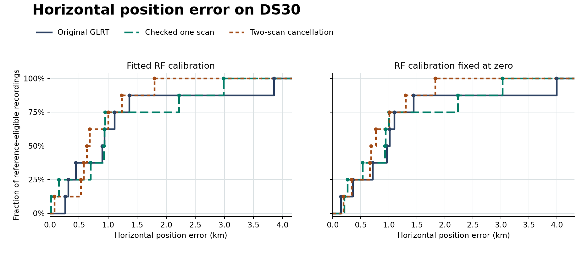
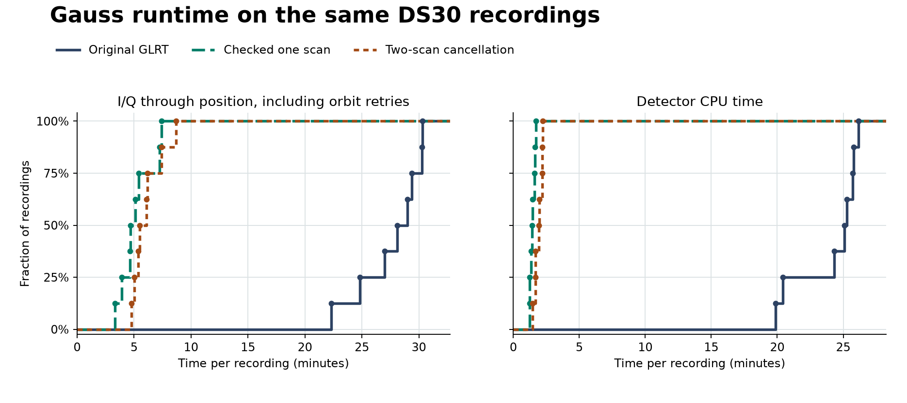

# DS30 fast recordings and blind Gauss replay

DS30 revision 1 covers whole fast acquisitions from **November 13, 2026 at 04:55:00 UTC, inclusive, through November 20, 2026 at 23:37:05 UTC, exclusive**. DS29 revision 1 ends at the same lower boundary. Each acquisition belongs to a dataset according to its earliest segment. Copies share a single raw-content identity.

## Blind results on eight DS30 sessions

All three receivers returned a compact v5 position on all eight recordings. **Two-scan cancellation had the lowest median error (0.659 km) and the smallest worst error (1.798 km). Checked one-scan was fastest (4.90 minutes per recording).** Its median position error was 0.929 km, close to original GLRT at 0.917 km. Both alternatives were faster than GLRT on every recording. [Per-recording results](recordings.csv) · [Paired comparisons](paired.csv)

| Receiver with fitted RF calibration | Fixes | Median error | P95 error | Within 1 km | Within 2 km | Median Gauss runtime | Paired speedup over GLRT |
|---|---:|---:|---:|---:|---:|---:|---:|
| Original GLRT | 8/8 | 0.917 km | 2.979 km | 5/8 | 7/8 | 28.55 min | 1.00× |
| Checked one-scan | 8/8 | 0.929 km | 2.718 km | 6/8 | 6/8 | 4.90 min | 5.69× |
| Two-scan cancellation | 8/8 | 0.659 km | 1.600 km | 6/8 | 8/8 | 5.79 min | 4.72× |

Each speedup is the median of the eight within-recording runtime ratios. Each error curve counts all eight reference-eligible recordings. P95 is interpolated between the two largest errors. The dots show the individual observations. [Summary CSV](summary.csv)



Both alternatives beat GLRT on position error in five of eight paired sessions. The median paired change was a reduction of 0.085 km for one-scan and 0.266 km for cancellation. The largest errors occurred on different recordings. On DS30-0068 cancellation brought GLRT's 3.850 km error down to 1.798 km. On DS30-0267 one-scan increased GLRT's 0.899 km error to 2.986 km. Cancellation returned 1.231 km on that recording.

| Session | Original GLRT error | Checked one-scan error | Two-scan cancellation error |
|---|---:|---:|---:|
| DS30-0068 | 3.850 km | 2.219 km | 1.798 km |
| DS30-0106 | 1.361 km | 0.016 km | 0.580 km |
| DS30-0127 | 1.110 km | 0.933 km | 0.682 km |
| DS30-0237 | 0.444 km | 0.949 km | 1.000 km |
| DS30-0267 | 0.899 km | 2.986 km | 1.231 km |
| DS30-0424 | 0.934 km | 0.924 km | 0.636 km |
| DS30-0431 | 0.312 km | 0.151 km | 0.078 km |
| DS30-0435 | 0.260 km | 0.698 km | 0.533 km |

The recordings each span five minutes. On Gauss, checked one-scan finished within that time on four of eight recordings, cancellation on one, and GLRT on zero. One-scan on DS30-0424 used the current-orbit support retry. The other 23 runs used the stock solver path. Times cover both calibration estimates. Stage medians can come from different recordings.

| Receiver | Median raw read and acquisition | Median detector CPU time within acquisition | Median solver elapsed | P95 end-to-end elapsed |
|---|---:|---:|---:|---:|
| Original GLRT | 27.34 min | 25.19 min | 1.16 min | 30.30 min |
| Checked one-scan | 3.28 min | 1.46 min | 1.48 min | 7.36 min |
| Two-scan cancellation | 4.05 min | 1.96 min | 1.74 min | 8.23 min |



## Calibration and detector evidence

Each row below compares fixed-zero and fitted RF calibration on identical detector observations, candidate inputs, priors and search budgets. Both arms returned eight fixes per receiver. The frequency residual measures the fit to each receiver's observations. Original GLRT had the smallest residual while two-scan cancellation had the smallest median position error under both calibrations.

| Receiver | Median error, zero / fitted | P95 error, zero / fitted | Median conditional frequency RMS, zero / fitted |
|---|---:|---:|---:|
| Original GLRT | 0.991 / 0.917 km | 3.100 / 2.979 km | 66.39 / 66.36 Hz |
| Checked one-scan | 0.935 / 0.929 km | 2.749 / 2.718 km | 110.75 / 110.68 Hz |
| Two-scan cancellation | 0.726 / 0.659 km | 1.643 / 1.600 km | 111.56 / 111.47 Hz |

Replayed GLRT reproduced the archived accept/reject decision on all 99,750 valid receiver opportunities. At each of the 29,095 opportunities with a detection, the strongest peak matched the archived result to within 1 Hz and 0.01 sample modulo the signal period. Checked one-scan added detections on 17,600 opportunities where GLRT had none and missed 1,365 where GLRT detected a peak. The corresponding counts for cancellation were 17,911 and 1,219. On peaks matched to GLRT, the per-recording median absolute frequency difference was 48–56 Hz for both alternatives. These measurements identify two differences worth testing independently, the choice of peaks and their frequency estimates. The panel measures their combined effect on position. [Original replay parity](original-replay-parity.csv) · [Peak agreement by recording](factor-agreement.csv)

On the preceding 16 DS26/DS29 sessions, fitted-calibration median errors were 0.971 km for GLRT, 1.256 km for one-scan and 0.859 km for cancellation. Cancellation had the lowest median again on DS30. The one-scan gap narrowed from 0.285 km to 0.012 km. All eight DS30 sessions come from the same Gauss roof, so this extends the evidence to a later acquisition period at that site. [Preceding panel results](preceding-panel-accuracy.csv) · [Independent distance and result checks](result-verification.json)

## Dataset membership

The census found **455 fast acquisition directories** across 25 storage roots. It checked 29,423 manifests and identified 364 adaptive manifests outside the requested recording format. Gauss had 446 of the fast acquisitions on bulk storage and nine on the NVMe spool. The automatic acquisition ledger independently named the same 455 recordings. [Discovery census](dataset/discovery.json) · [Ledger reconciliation](dataset/ledger.json)

All 455 acquisitions used 10 MS/s. There are **411 complete recordings and 44 incomplete recordings**. Of the complete recordings, 387 have a published tracking input and 24 lack one. The 44 incomplete recordings also lack a published tracking input. The corpus contains 2,878,757 windows in 45,080 chunks, totaling 3,521,160,723,188 compressed bytes. The index and payload-size checks reported zero integrity errors.

| Acquisition date, UTC | Recordings | Complete | With a published tracking input |
|---|---:|---:|---:|
| November 13 | 44 | 43 | 42 |
| November 14 | 62 | 53 | 53 |
| November 15 | 57 | 52 | 52 |
| November 16 | 60 | 52 | 52 |
| November 17 | 61 | 55 | 55 |
| November 18 | 62 | 52 | 50 |
| November 19 | 57 | 54 | 50 |
| November 20 | 52 | 50 | 33 |
| **Total** | **455** | **411** | **387** |

The compressed manifest binds acquisition metadata, chunk and index digests, payload lengths, and available native timing contracts. The raw I/Q stays in the recording archive. The freezer checks chunk indexes and payload lengths across the dataset. Each blind replay also verifies its individual I/Q windows. [Full manifest](dataset/manifest.json.gz) · [Membership summary](dataset/membership-summary.json) · [Evaluation units](dataset/evaluation-units.json) · [Verification](dataset/verification.json)

The first acquisition began at 05:00:57 UTC on November 13 and the last at 23:23:26 UTC on November 20. All 455 content identities are unique and there is zero overlap with DS29. The uncompressed manifest SHA-256 is `a4ce879975be0593f1adeb7c106f31660c6c423f17e2c7858985244530dc0eb8`.

## Replay design

The panel uses eight distinct sessions selected from 387 eligible recordings by the preceding Gauss experiment's fixed session hash. The selection spans November 14, 15, 17 and 20, with 54,181 recorded windows. All three receivers process the same signed I/Q, recording clocks, hardware exclusions and causal orbit snapshots for each session. Each receiver generates its own frequency and timing measurements. All three pass them to compact v5 with the same 25 km search tile and the same two exception-specific orbit retries. The solver computes both `c = 0` and fitted-`c` estimates from each receiver's measurements. [Protocol](PROTOCOL.md) · [Session selection](selection.json) · [Inference roster](roster.json)

The evaluation reference is the operator's Gauss roof position. Its authority binds the station radio serial and capture dates. Its survey uncertainty is unknown. Predictions are locked before the scoring program joins the coordinates. [Prediction lock](prediction-lock.json) · [Reference audit](reference-audit.json)

Each session used one Gauss performance core (CPUs 0–7). Receiver order rotated across sessions. Elapsed time includes reading and verifying I/Q, detection, compact v5 inference, and any orbit retry. Each method has one timing observation per session on a shared host. The previous paired benchmark and the frozen DS26 inputs share zero known session IDs with DS30. [Host and core assignments](host.json) · [Source fingerprints](source-digests.json) · [Overlap check](cohort-overlap.json)

## Reproduce on Gauss

The catalogue command reads the packaged metadata.

```sh
PYTHONPATH=src .venv/bin/leo datasets list --dataset DS30 --json
```

The following commands use the Gauss project virtual environment, the frozen DS29 inventory tools, the archived receiver binaries and the mounted recording corpus. The reservation and scoring steps need read access to the recording and orbit archives. The three-receiver replay opens the signed I/Q through the same bounded reader used for DS26 and DS29. The reservation and prediction lock protect an existing result from being overwritten with different inputs.

```sh
export PYTHONPATH=.:src
export OPENBLAS_NUM_THREADS=1 OMP_NUM_THREADS=1 MKL_NUM_THREADS=1
sudo -n -- .venv/bin/python -B reports/2026_11_20_ds30_fast/freeze_ds30.py --verify
sudo -n -- env PYTHONPATH=.:src .venv/bin/python -B -m tools.pipeline_eval.qualification.ds30_panel reserve
.venv/bin/python -B -m tools.pipeline_eval.qualification.ds30_panel run
sudo -n -- env PYTHONPATH=.:src .venv/bin/python -B -m tools.pipeline_eval.qualification.ds30_score
```

On Gauss the full uncompressed dataset and per-method solver evidence live under `/srv/bulk/leo-dev/ds30-20261120`. The default replay resumes verified completed cases. Use the prediction lock and recordings CSV to inspect existing results.
