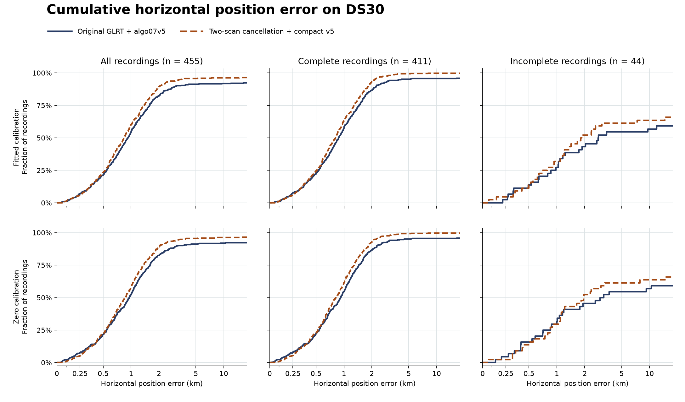
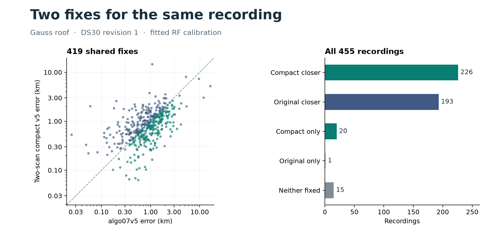
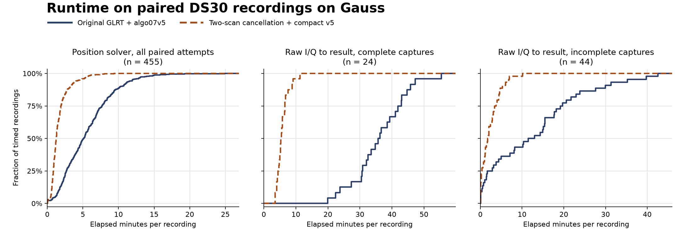

# DS30 field report · algo07v5 and two-scan compact v5

**Two-scan cancellation with compact v5 delivered 19 more fixes and 32 more positions within 2 km on the same 455 recordings.** On the 24 complete recordings timed from raw I/Q on both pipelines, compact was faster on every recording. This is the DS30 configuration promoted as **ALGO08**. The benchmark reference is **algo07v5 fast, no repair**. The deployed ALGO07 chain has its own scientific identity. [Algorithm catalogue](../../algorithms.md)

| Gauss roof · fitted RF calibration | Original GLRT + algo07v5 | Two-scan cancellation + compact v5 |
|---|---:|---:|
| Fixes / assigned | 420 / 455 (92.3%) | **439 / 455 (96.5%)** |
| Position within 1 km / assigned | 248 / 455 | **274 / 455** |
| Position within 2 km / assigned | 375 / 455 | **407 / 455** |
| Median error among fixes | 859 m | **814 m** |
| 95th-percentile error among fixes | 2.700 km | **2.258 km** |
| Median raw-to-result time on 24 matched complete recordings | 35.97 min | **5.44 min** |

## Where the positions landed



Read the curves at a distance to see the fraction of **all assigned recordings** that returned a position within it. A withheld fix stays in the denominator. The benchmark covers 411 complete scans and 44 interrupted scans. Eight appeared in an earlier comparison, and 447 were previously unreported. [Recording-level data](recordings.csv)

## Which recordings changed the result



Each dot represents one recording with two fixes. Below the diagonal, compact landed closer to the roof. The bars also count recordings with just one fix or neither fix.

**Compact v5 with two-scan cancellation returned 439 fixes to original algo07v5's 420.** With fitted calibration, 407 compact fixes and 375 original fixes landed within 2 km of the roof. Compact supplied 20 fixes where original returned none, and 19 of those 20 were within 2 km. Original supplied one fix where compact returned none, with 0.721 km error. On the 447 previously unreported sessions, compact returned 431 fixes and original returned 413. [Per-recording results](recordings.csv) · [Paired comparisons](paired.csv)

Among the 419 recordings where both returned positions, compact was closer on 226 and original was closer on 193. The median paired change favored compact by 39 m. The 95% recording-bootstrap interval runs from 92 m closer to 4 m farther. The 95th-percentile error among all returned fixes fell from 2.700 km to 2.258 km. All measurements come from one roof with an operator-supplied position of unknown survey uncertainty. [Paired estimates](paired-summary.csv) · [Error distributions](position-error.png)

## How long a fix took



Both pipelines ran from raw I/Q on the same single core on 68 recordings. On the 24 complete captures in that group, the median of the individual speedup ratios was **6.08×**. Median detector CPU time fell from 27.12 to 2.18 minutes. On the 22 shared fixes in this timing subset, original was closer on 14 and compact on 8. Compact returned a fix within the capture duration on 9 of these 24 complete recordings, compared with 0 for original. Across all 455 recordings, compact met that deadline on 93. The original timed run includes generating and validating its scientific archive. The compact benchmark ends at the solver decision, before deployment PNG rendering. [Timing and calibration tables](RESULTS.md)

On the 411 complete captures, original returned 394 fixes and compact returned 410. Original's most frequent complete-capture failure was a final orbit-propagation fallback on ten recordings. The one complete capture without a compact fix failed the refit stability check. Of the 44 interrupted captures, original returned 26 fixes and compact returned 29. Both pipelines reported insufficient Doppler curvature on the same 14 interrupted captures. An independent check recomputed all 1,718 scored distances across the two calibrations. [Failure reasons](failures.csv) · [Verification](verification.json)

## Inputs and pipeline definitions

All 455 session identities are unique. The recorded clocks and capture-quality checks admit 2,581,792 of 2,878,757 visits, or 5,163,584 antenna opportunities. The 68 reconstructed inputs cover 24 complete and 44 interrupted captures. Reconstructing the inputs on the eight previously evaluated sessions reproduced every archived clock, quality exclusion and receiver header. [Input audit](input-audit.json) · [Frozen protocol](PROTOCOL.md) · [Recording roster](cohort.json) · [Earlier eight-session results](../2026_11_20_ds30_fast/README.md)

| Pipeline | Signal measurements | Position solver |
|---|---|---|
| Original GLRT + algo07v5 | Published original-GLRT measurements when the DS30 manifest binds them, otherwise fresh GLRT on the recorded samples | Original fast no-repair baseline with scientific archive validation |
| Two-scan cancellation + compact v5 | Fresh timing-first search on both antennas, subtraction of the first pilot, search of the residual, and final GLRT verification | Five-refresh secant solver with the two previously published orbit-support retries |

Both pipelines use the same search region and the same capture-era orbit files per recording. Each computes a fitted RF calibration and a fixed-zero calibration. For recordings without a published timing contract, the driver reconstructs both antenna headers, the clock anchor and capture-quality exclusions from signed indexes. Each fresh detector also verifies the individual I/Q windows. An interrupted capture can end with a signed zero-sample visit. The replay verifies the digest of the empty payload, counts the visit as excluded and passes the earlier usable samples to each receiver. Scoring joins the operator's Gauss roof reference after every prediction is locked.

## Reproduce on Gauss

Use the project environment with the research dependencies and native extensions installed. The input preparation needs read access to the recording archive, the historical orbit archive and the frozen DS29 and DS30 fixtures. It writes to the study's own snapshot. A recording can start as soon as its input binding is complete.

```sh
export PYTHONPATH=.:src
export OPENBLAS_NUM_THREADS=1 OMP_NUM_THREADS=1 MKL_NUM_THREADS=1
sudo -n -- env PYTHONPATH=.:src OPENBLAS_NUM_THREADS=1 .venv/bin/python -Bu -m tools.pipeline_eval.qualification.ds30_full_inputs
sudo -n -u "$(id -un)" -g leo -- env PYTHONPATH=.:src OPENBLAS_NUM_THREADS=1 OMP_NUM_THREADS=1 MKL_NUM_THREADS=1 nice -n 5 ionice -c2 -n5 .venv/bin/python -Bu -m tools.pipeline_eval.qualification.ds30_full --cpus 0,1,2,3,4,5,6,7,8,9,10,11,12,13,14,15
sudo -n -- env PYTHONPATH=.:src OPENBLAS_NUM_THREADS=1 .venv/bin/python -Bu -m tools.pipeline_eval.qualification.ds30_full_score score
```

The work directory on Gauss is `/srv/bulk/leo-dev/ds30-full-20261121`. The two pipelines run serially on the same assigned CPU for each recording. The order rotates through the seeded roster. The run command resumes completed outcomes and acquisition receipts. The scoring command verifies the roster, signed input bindings, predictions, scientific settings and successful original-v5 archives. It reports solver elapsed time for archived detections and measures end-to-end time where both raw detection and solving ran.

To verify the published tables from a checkout with the research dependencies, run `PYTHONPATH=.:src .venv/bin/python -m tools.pipeline_eval.qualification.ds30_full_verify`. This verifies each scored position using a second great-circle distance calculation, then checks the counts, error percentiles, timing medians and artifact hashes.
