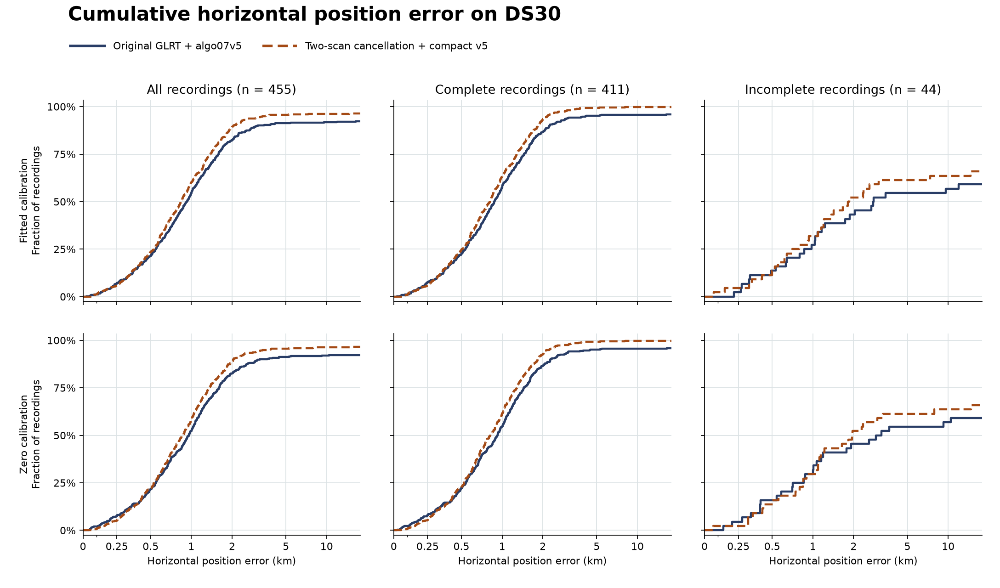
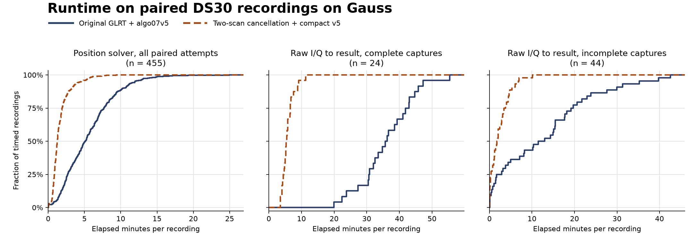

# Full DS30 results on Gauss

Original uses original GLRT and algo07v5 fast with no repair. Compact uses two-scan cancellation and the five-refresh compact v5 solver. Both use the same 25 km region and capture-era orbit files. This comparison measures the combined effect of the detector and solver changes. [Protocol](PROTOCOL.md) · [Replay instructions](README.md)

With fitted RF calibration, original returned **420/455 fixes** and compact returned **439/455**. Their median horizontal errors among scored fixes were **0.859 km** and **0.814 km**. Across all assigned recordings, **248 original** fixes and **274 compact** fixes landed within 1 km of the roof.

## Position error

The operator's rooftop reference covers 455 of 455 recordings. Percentiles describe scored fixes. Each threshold counts how many of the assigned recordings yielded a position within that distance. [Recording results](recordings.csv) · [Group summaries](summary.csv)

| Recordings | Pipeline | Fixes | Median km | P90 km | P95 km | ≤1 km | ≤2 km | ≤5 km |
| --- | --- | --- | --- | --- | --- | --- | --- | --- |
| All recordings | Original | 420/455 | 0.859 | 2.045 | 2.700 | 248 | 375 | 415 |
| All recordings | Compact | 439/455 | 0.814 | 1.873 | 2.258 | 274 | 407 | 435 |
| Previously unreported | Original | 413/447 | 0.856 | 2.042 | 2.604 | 244 | 369 | 408 |
| Previously unreported | Compact | 431/447 | 0.820 | 1.878 | 2.285 | 268 | 399 | 427 |
| Complete captures | Original | 394/411 | 0.840 | 1.949 | 2.444 | 236 | 356 | 391 |
| Complete captures | Compact | 410/411 | 0.811 | 1.827 | 2.151 | 260 | 384 | 408 |
| Interrupted captures | Original | 26/44 | 1.036 | 3.124 | 8.038 | 12 | 19 | 24 |
| Interrupted captures | Compact | 29/44 | 1.089 | 2.702 | 5.626 | 14 | 23 | 27 |

## Comparing the same recordings

The error change is compact minus original on recordings with two scored fixes. Negative values favor compact. The interval resamples whole recordings 5,000 times. These repeated measurements describe one roof. [Paired results](paired.csv) · [Paired summaries](paired-summary.csv)

| Recordings | Both scored | Original only | Compact only | Neither | Original closer | Compact closer | Median change km | 95% bootstrap interval km |
| --- | --- | --- | --- | --- | --- | --- | --- | --- |
| All recordings | 419 | 1 | 20 | 15 | 193 | 226 | -0.039 | -0.092 to 0.004 |
| Previously unreported | 412 | 1 | 19 | 15 | 192 | 220 | -0.035 | -0.091 to 0.005 |
| Complete captures | 393 | 1 | 17 | 0 | 182 | 211 | -0.034 | -0.093 to 0.004 |
| Interrupted captures | 26 | 0 | 3 | 15 | 11 | 15 | -0.072 | -0.313 to 0.190 |

## Runtime

Each row includes recordings with both measurements on the same Gauss CPU. Original and compact run serially within each recording. The raw timing includes I/Q read, integrity checks, acquisition and positioning. A fresh, uninterrupted measurement qualifies for that timing. The raw pairs come from the subset without an archived original detection. For an archived detection, the measured interval starts at the solver. Times include both calibration fits and any configured retry.

| Measured interval | Pairs | Original median min | Original P95 min | Compact median min | Compact P95 min | Median paired speedup × |
| --- | --- | --- | --- | --- | --- | --- |
| Position solver · all | 455 | 5.12 | 11.95 | 1.26 | 4.50 | 3.52 |
| Raw I/Q to result · all | 68 | 19.79 | 44.14 | 3.56 | 8.39 | 5.89 |
| Raw I/Q to result · complete | 24 | 35.97 | 47.05 | 5.44 | 9.08 | 6.08 |
| Raw I/Q to result · interrupted | 44 | 12.25 | 34.66 | 1.80 | 6.70 | 5.60 |

A recording meets its capture-duration deadline when the pipeline returns a fix within the elapsed time covered by its hardware sample counters. Both pipelines were freshly timed on every recording in this comparison.

| Recording state | Timed pairs | Original fixes within span | Compact fixes within span |
| --- | --- | --- | --- |
| Complete captures | 24 | 0 | 9 |
| Interrupted captures | 44 | 0 | 2 |

## Calibration

Each pipeline uses the same receiver observations, orbit files, priors and search budgets in its two calibration fits. The RF residual describes agreement with that pipeline's own frequencies. Position error is scored independently against the roof reference. The compact solver exposes its RF residual.

| Pipeline | RF calibration | Fixes | Median km | P95 km | Median frequency RMS Hz | Median reported score |
| --- | --- | --- | --- | --- | --- | --- |
| Original | Fixed zero | 420/455 | 0.888 | 2.592 | 123.42 | 21430.72 |
| Original | Fitted | 420/455 | 0.859 | 2.700 | 97.42 | 21427.21 |
| Compact | Fixed zero | 439/455 | 0.828 | 2.299 | 115.08 | — |
| Compact | Fitted | 439/455 | 0.814 | 2.258 | 115.05 | — |

The following changes are the median of the fitted value minus the zero-calibration value on recordings with both measurements. Each pair uses the same receiver input.

| Pipeline | Position pairs | Position change km | RF pairs | RMS change Hz | Score pairs | Score change |
| --- | --- | --- | --- | --- | --- | --- |
| Original | 420 | -0.013 | 420 | -21.42 | 420 | -0.72 |
| Compact | 439 | -0.010 | 439 | -0.04 | 0 | — |

## Replay of the earlier panel

On the previously published compact two-scan panel, 16/16 recording/calibration pairs reproduced the earlier fix decision. The largest endpoint displacement among the 16 jointly returned estimates was 0.000000 km. [Earlier-panel comparison](repeated-panel.csv)

DS30 uses one station and one search region. The station authority associates the radio and capture times with an operator-supplied roof position of unknown survey uncertainty. [Reference audit](reference-audit.json) · [Prediction lock](prediction-lock.json) · [Failure details](failures.csv) · [Independent verification](verification.json)
