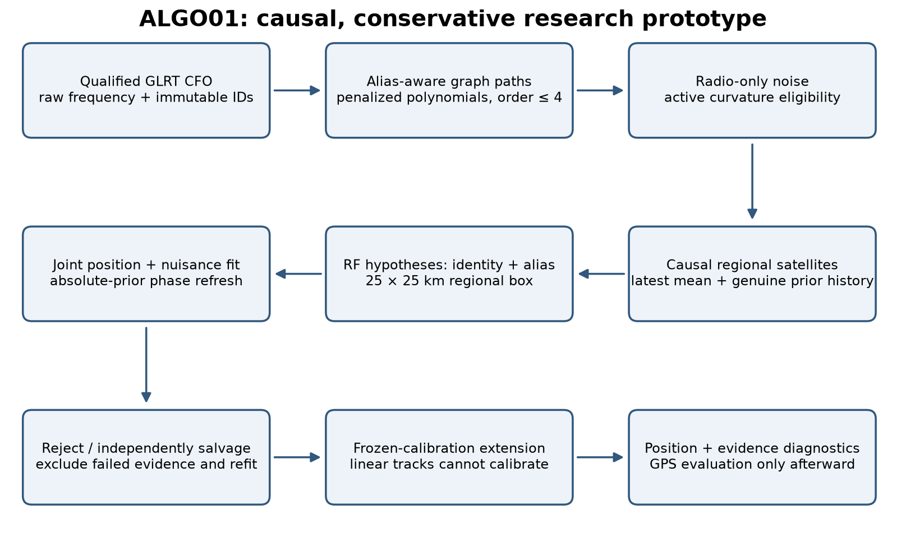
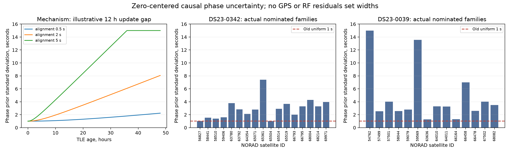
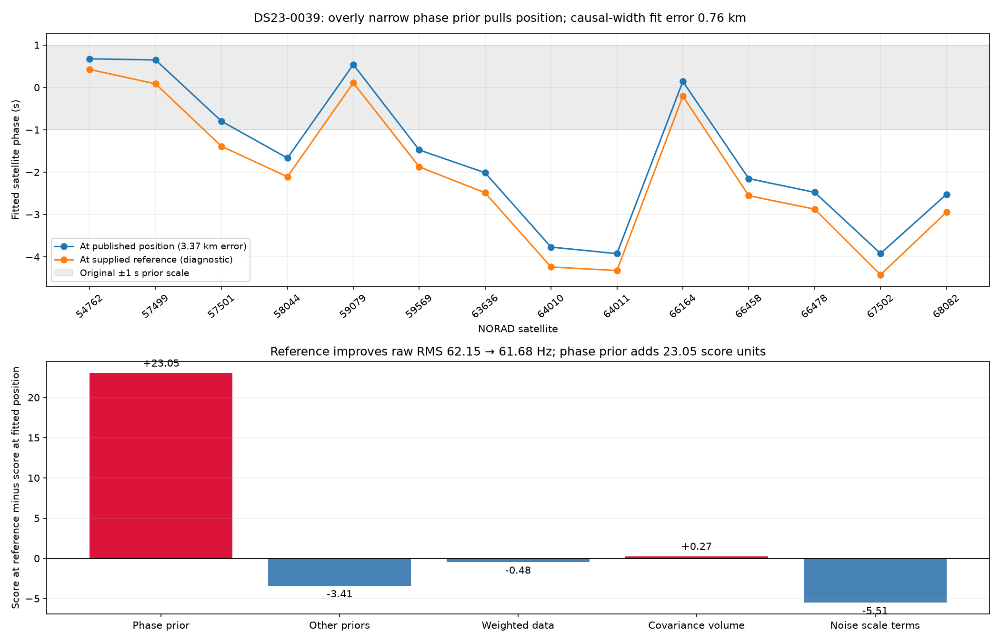
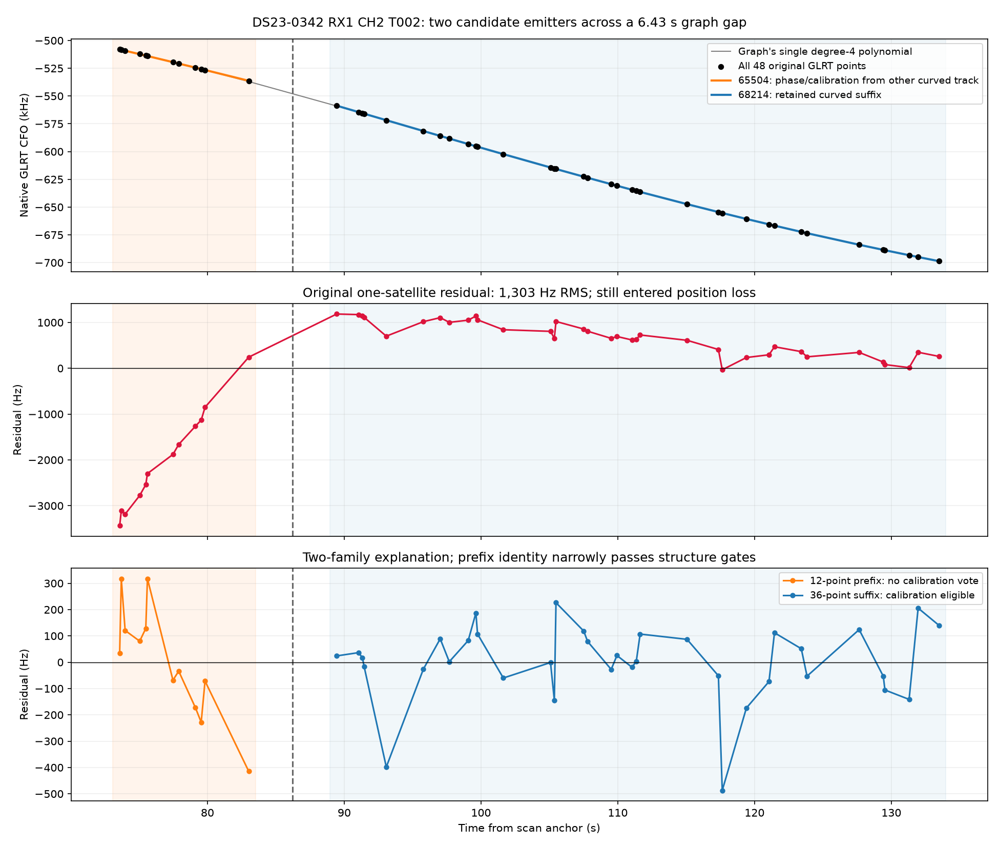
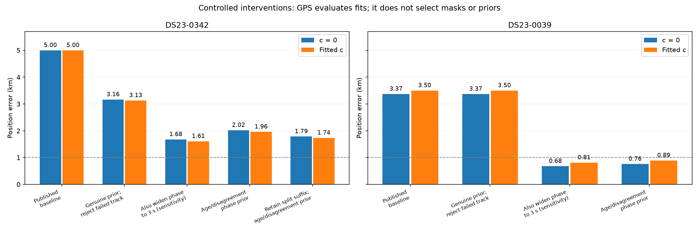
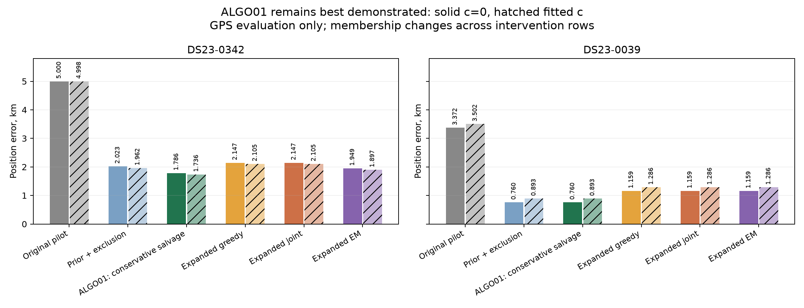
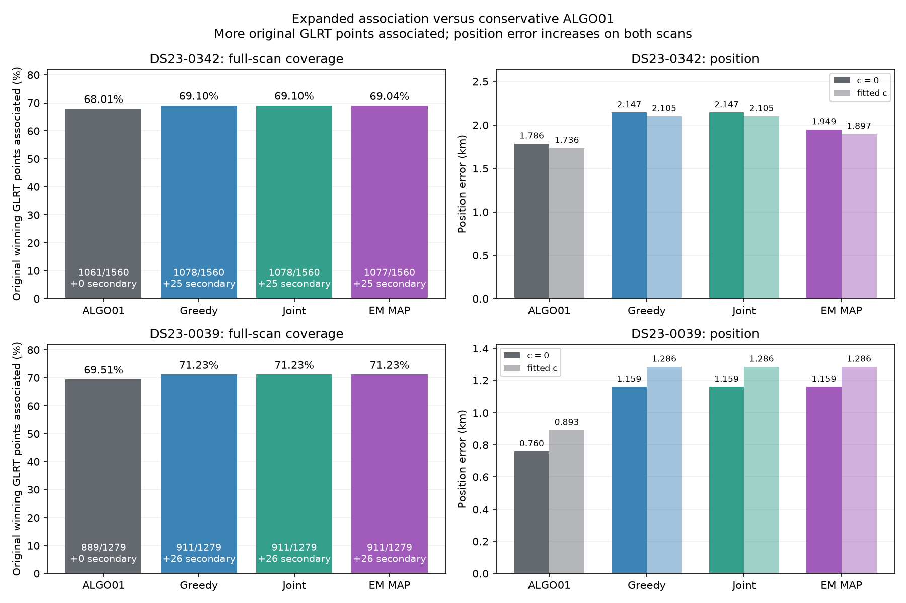
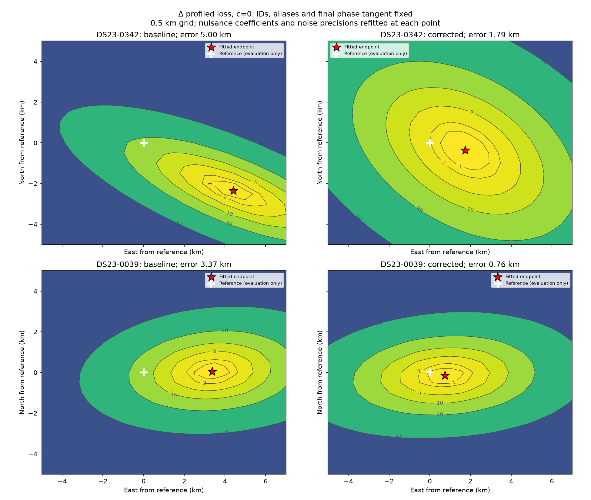

# ALGO01 — causal, phase-refreshed graph localization

Published October 18, 2026 (America/Los_Angeles). ALGO01 names the **conservative research prototype** that takes archived GLRT CFO observations to a receiver position, with corrected causal satellite phase uncertainty and quality-gated calibration. It is a reproducible specification and a composition of existing research tools, not a new production API or a claim of validated accuracy at new locations.

The best demonstrated corrected results on the two inspected DS23 scans are **1.786 km for scan 342 and 0.760 km for scan 39**, with `c=0`; matched fitted-`c` errors are **1.736 km and 0.893 km**. The 342 result needs both the prior correction and conservative track salvage. Changing the prior alone does not produce that result. These are retrospective case studies; rules and uncertainty scales need independent validation.

**Subsequent 20-scan DS23 evaluation:** mean/median error is **1.771/1.924 km at c=0**, and **1.747/1.913 km with fitted c**. Six scans are below 1 km in each arm. The individual case studies above do not represent cohort accuracy. See the [sealed sample report](../2026_10_18_algo01_ds23_random20/README.md). The active development target is mean and median error of 0.5 km; it has **not** been achieved. [DBG01](../DBG01/README.md) records the standard diagnostic procedure, and the [scan-217 experiments](../2026_10_18_algo01_0217_improvements/README.md) separate association confidence, receiver residuals, simultaneous identity replacements and secondary-peak recovery. Those experiments do not change the published ALGO01 specification.

An independently specified [receiver-support weighting prototype](../2026_10_18_ds23_family_weighting_active_support/README.md) reaches **1.612/1.325 km mean/median at c=0** and **1.607/1.305 km with fitted c** on that same 20-scan development benchmark, with all final paired gates passing. It remains a separate variant; this is not the 0.5 km target or new-location validation.



## 1. Scope, evidence and causal boundary

Inputs are qualified tracking-port contracts, not satellite-corrected CFO values. No new RF acquisition was performed for this report. The GLRT output supplies a fractional CFO estimate and gate/margin evidence at each physical probe. The algorithm consumes actual RF, receiver/channel, device-counter-derived time and an immutable observation identity. It never replaces measured CFO with a polynomial prediction or a satellite residual correction.

The fixed region is **25 × 25 km**, centered at **37.906° N, −122.545° E**; local coordinates are east/north kilometers, bounded independently to ±12.5 km. The prototype maps coordinates with `lat = 37.906 + north/111.0` and `lon = -122.545 + east/(111.32 cos(37.906°))`. Controlled continuous refits start at `(0,0)` in this region. This center is a declared regional prior; ALGO01 does not infer it from the scan.

Only causal Space-Track elements are eligible: both the archive collection timestamp and the epoch encoded in the TLE bytes precede the scan's cutoff. For adaptive captures the cutoff is the **earliest** qualified first-sample UTC; propagation uses the midpoint UTC anchor. The two are distinct and recorded in receipts. No post-observation TLE, supplied reference GPS, previous fitted position, or manually selected satellite whitelist enters inference. Historical TLEs are an external causal input, so this is single-scan RF inference, not an algorithm whose every input originates inside one scan.

The evaluation coordinate `37.849061591561885, -122.48574968092912` is used only after fitting and in explicitly labeled oracle diagnostics. Height remains fixed at 0 m; site altitude and UTC uncertainty have not been fully ablated. Errors are conditional on both recordings sharing that supplied coordinate, not independent survey certification.

**Version boundary.** The original DS23 pilot is a frozen published experiment. ALGO01 adds the causal-prior repair, gate/exclude/refit, and conservative salvage through diagnostic composition. The frozen pilot's own generic `fit` entrypoint still has the old one-second phase bank unless these overrides are applied. Do not assume that running the original pilot command automatically runs ALGO01.

## 2. Observations and persisted research data

These are the serialized research fields, not a replacement for existing public versioned contracts:

| Object | Required content and units | Authority |
|---|---|---|
| Tracking input | Qualified timing; session/input-manifest identity; sample rate Hz; receiver, channel, actual RF Hz; candidate rank, fractional CFO Hz, margin, pass flag | Original public tracking export and checksum |
| `observations.json` | `observation_id`, `receiver`, `native_receiver_id`, `channel`, `time_s`, `measured_cfo_hz`, `actual_rf_hz`, `fractional_margin`; adaptive rows also retain probe/visit/counter fields | One physical probe, stable identity |
| `tracks.json` | `key`, receiver/channel/RF, ordered times s and lifted measured values Hz, observation IDs, polynomial pieces, quality status | Graph component output; original-row membership |
| `bank.npz` | `time_s`; ECEF position km and velocity km/s per candidate; NORAD IDs; original phase-scale array | Propagated causal TLE bytes plus origin |
| Causal receipts | Origin/cutoff UTC ns; element epochs and collections ns; SHA-256; archive digests; regional screen and candidate count | Latest and genuine previous TLE files |
| RF branch | Candidate index/NORAD per curved fragment; integer alias per fragment; RF discovery evidence | Scored from GLRT and causal regional bank |
| Fit | East/north position; branch/mask; absolute phase posterior; expansion references; nuisance estimates; precision and convergence histories | Numerical solve, without GPS selection |
| Report | Geographic error; plots; intervention tables | Separate evaluation stage |

For adaptive inputs, derive each probe midpoint from `(valid_start_counter + probe_start_ms × fs/1000 − session_start_counter)/fs + probe_ms/2000`. Do not use a concatenated IQ payload offset, which erases retune gaps. Validate the raw host UTC bracket, capture/session ownership, receiver-wise nonoverlapping physical support and unique observation IDs. Fast-scan inputs use their corresponding frequency-evidence adapter. Receiver numbering is derived from sorted native receiver IDs, not assumed hardware serialization order.

Keep **one maximum-margin gate-passing fractional GLRT candidate per original probe**, with lower candidate rank breaking ties. ALGO01's demonstrated conservative baseline does not substitute the later multi-peak experiment. No random points are withheld in these fits; all eligible observations remain available. Independence validation should randomize whole scans or physical groups, not adjacent correlated points.

Unassociated GLRT points are valid members of the measurement denominator, even if no polynomial track owns them. Report unique measured IDs; do not count interpolated polynomial samples as evidence. Association totals, curved calibration totals and all GLRT totals are different quantities.

## 3. Alias-aware graph polynomial tracks

Partition observations into lanes by receiver, channel and actual RF. Sort by time. For ALGO01 the alias period is

`P = 1/(4.4 microseconds) = 227272.72727272726 Hz`.

Wrapped frequency differences use `(delta + P/2) mod P − P/2`. Discovery creates a directed acyclic graph with local frequency/velocity edges. Retain at most 48 predecessor candidates per target over a 10 s horizon, with minimum separation 0.15 s. Enumerate integer branches consistent with the 8000 Hz/s slope limit. The second-order dynamic program penalizes differences between successive edge velocities. Its noise variance is `2 σ²(1/a² + 1/b² + 1/(ab)) + [20(a+b)/2]²`, where `a,b` are edge durations; transition cost is twice the squared velocity change divided by that variance. Point reward is `association_sigma² = 9`, start cost 18 and gap cost `0.05 × dt`.

Dynamic programming gives the best path for the **current additive costs**. Repeated exclusive extraction is greedy path packing, not globally optimal multi-track flow. A path is accepted only after polynomial refinement; rejected exact edge chains are disabled while their observations can participate in alternatives. Recursive fallback splits failed paths at their midpoint to depth five. The graph can miss a real full path, and local slope continuity does not prove one physical emitter.

The frozen [graph configuration](config/graph_selected.json) records all settings:

| Setting | Value |
|---|---:|
| Fixed graph noise σ / association multiplier | 150 Hz / 3 |
| Maximum polynomial order | 4 |
| Minimum points / points per coefficient | 8 / 4 |
| Minimum span / maximum graph gap | 6 s / 10 s |
| Maximum slope | 8000 Hz/s |
| Track / breakpoint penalties | 18 / 10 |
| Maximum tracks per lane / final joint iterations | 64 / 4 |
| Maximum join gap | 8 s |
| Seed recorded in common config | 1701 |

The common config also carries RANSAC windows/trial limits for other fitters; those are not the graph's discovery mechanism. At each refinement, compare supported degrees 0–4 on the **same observations**, using `sum((residual/150 Hz)²) + (degree+1) log(N)`. Require at least four points per coefficient; bound slope over the full support, including derivative extrema. Grow/filter members within a 450 Hz wrapped-residual gate. The shared finishing stage refines ownership, optional joins and residual diagnostics; its exact behavior is preserved in the source snapshot rather than inferred solely from config names.

Polynomial residual checks look for nonzero mean, slope, extra quadratic structure, mean steps and lag-one correlation. Passing means **no structure detected at this support and sensitivity**, not proof of white Gaussian noise or one satellite. Polynomial model degree alone is not evidence of active curvature.

### Calibration eligibility

A track must span **at least 20 s** and have **at least 250 Hz RMS departure from its best affine fit** to calibrate receiver offsets/drifts, satellite corrections or position. A quartic fitting a straight line remains ineligible. Linear/short tracks can later be associated under frozen calibration; they never determine it. Same-receiver cross-channel, cross-band and cross-receiver tracks can share a satellite through the global model. They need not overlap if the shared orbit prediction and independent calibration support their continuation.

## 4. Radio-only observation uncertainty

Estimate observation noise before satellite matching using actively curved graph-polynomial pieces. For each sufficiently supported piece, refit its saved order in a normalized time basis, obtain leverage `h_ii`, and use `r_i²/(1−h_ii)` as noise evidence. Test a constant variance against `variance_i = floor + strength/fractional_margin_i`. Clip variance to `[40²,600²] Hz²`; activate the extra parameter only when its likelihood gain exceeds `log(N)` (BIC gain > 0). If there are no eligible samples, use a declared 150 Hz fallback.

The localization consumer uses the per-point law only when its recorded BIC decision enables it. The independent radio noise must not be recomputed from satellite residuals. It is an engineering uncertainty proxy, with possible selection/segmentation contamination, not a calibrated receiver error bar. Freeze it across paired `c=0`/fitted-`c` position runs.

## 5. Broad causal satellite bank and RF discovery

Read Space-Track snapshots collected within the preceding **48 hours**, retain only collection- and byte-epoch-causal records, and choose latest eligible elements per identity. Propagate the regional screen at 5 s increments over at least 300 s. Keep candidates whose maximum elevation at the coarse center **37.5°, −122.0°** is at least **−12°**. This is a broad screening guard, not a hard 250 km geographic cut despite the receipt's descriptive `radius_km=250` field. Scan 342 has **1539** candidates and scan 39 **1488**.

Build the mean state bank on a one-second grid from −17 s to `ceil(duration)+17 s`. Propagation must succeed; interpolation cannot extrapolate. Latest TLEs remain the mean prediction. Genuine earlier elements affect uncertainty and physical perturbation directions, never replace the mean with future information.

The DS23 pilot uses four cold radio discovery seeds plus RF proposals at the region center and four corners. Deduplicate label/alias branches, rank at the center with the c=0 frequency/prior objective and fully fit the best three. Discard the fitted discovery position and nuisance state before each controlled position solve: restart position at `(0,0)`, phases/reference at zero and nuisance priors at their declared means. Reuse the c=0 selected branch in fitted c. This finite search is not exhaustive satellite identity inference or a global-optimum guarantee.

Discrete identities and integer aliases stay fixed within each continuous solve. Alternative hypotheses are compared outside that solve. The broader later repair experiments refreshed only requested lanes; they must not be described as redoing all satellite discovery at every position step.

### Preserve the alias gauge

Graph output values are original measured CFO lifted by integer multiples of `P`. The satellite association adds one fixed fragment alias; neither operation may apply a continuous data correction. Receiver/band offsets can sit near `P/2`. When adding a new fragment, choosing its alias against a zero hardware offset can select the adjacent branch and create a 227 kHz residual. Use a common receiver/band gauge inferred from independent preserved curved tracks and their RF-discovered aliases. Check that every reconstructed value differs from raw CFO by an integer period and that nominally accepted added tracks have ordinary residuals and non-negligible precision. A robust solver silently downweighting an alias mistake is not successful association.

## 6. Updated causal satellite phase prior

Phase means a **time displacement along a predicted satellite orbit/Doppler curve, in seconds**, shared by its tracks within a scan. It is not RF carrier phase. Previously all satellites used `phi_s ~ Normal(0,1 second²)`, which can force receiver position to compensate for old-TLE errors.

Select the latest genuinely earlier causal element whose epoch is at least **one second earlier** than the latest epoch. Near-duplicate epochs do not estimate independent uncertainty. In scan 342, 9 of 17 nominated families had previous epochs only 0.864 ms older; other orbital elements were identical. The latest mean, radio observations and regional candidate set remain unchanged by the repair.

At times 0,150,300 s, compare previous and latest propagated positions. Convert ECEF velocity to inertial-equivalent velocity using the implemented Earth-rotation correction, project the state difference onto along-track time, then take its median across those times. Let this alignment be `delta_s` seconds, latest element age at the scan midpoint be `A_s` seconds and latest-minus-previous epoch gap be `G_s` seconds. The updated prior is

\[
\phi_s\sim\mathcal N(0,\sigma_{\phi,s}^{2}),\qquad
\sigma_{\phi,s}=\operatorname{clip}\!\left(\sqrt{(1\,\mathrm{s})^2+(\delta_s A_s/G_s)^2},1\,\mathrm{s},15\,\mathrm{s}\right).
\]

The mean stays **zero**, independently of measured CFO and GPS. All inputs are causal satellite history. The scale grows with history disagreement and extrapolation age. It is a forecast uncertainty heuristic, **not a calibrated probability law**; two agreeing but jointly biased TLEs can still understate uncertainty. The 15 s cap respects the numerical phase-bank support; it does not establish physical impossibility outside that range.



**Missing-history behavior:** the prototype falls back to **1 s** if no usable alignment exists. This is an explicit reproducibility fact, not a recommended robust uncertainty model for all missing-history cases. Preserve a missing-history flag; validate a more conservative fallback independently before deployment. Do not silently invent data-driven widths from the same satellite residuals.

A uniform **3 s** width was an exploratory sensitivity control, not the updated causal uncertainty formula. It happened to give smaller GPS errors, but was not adopted on that basis. The conservative 342 trim's *candidate-ranking grid* separately uses a fixed 3 s phase penalty, as documented below; its final position refit uses the updated per-satellite uncertainty. These stages must not be conflated.



For scan 39, residual RMS at the reference was 61.68 Hz versus 62.15 Hz at the old fitted position, but the old phase prior cost was 96.01 versus 72.96. The optimizer was minimizing the declared prior/data objective, not geographic error. A narrow engineering prior can indirectly impose a biased position constraint.

## 7. Continuous Doppler and nuisance model

Let `q_i = actual_RF_i/(11.5 GHz)`. Doppler is evaluated from the propagated ECEF satellite state and candidate ground position, retaining the implementation's Earth rotation/time-displacement convention. Let `r_s` be the numerical phase expansion reference. For a point in fragment `k` assigned to satellite `s`, use

\[
\mu_i=q_i\{f_s(r_s)-r_sf'_s(r_s)+f'_s(r_s)\phi_s+
\mathbf m_{si}^{\mathsf T}\boldsymbol\eta_s\}
+\mathbf h_i^{\mathsf T}\boldsymbol\beta+\mathbf b_i^{\mathsf T}\boldsymbol\gamma+d_k.
\]

The measured response is `raw_CFO_i + integer_alias_i × P`. Offset, drift and orbital freedom change the **prediction**, never measured CFO.

| Nuisance term | Scope and Gaussian prior standard deviation |
|---|---|
| Receiver/band frequency offsets | Four constants: RX1/RX2 × channels1–4 / channels5–8; `P/sqrt(12)` Hz |
| Mean receiver frequency drift | One per receiver, centered at time150 s; 10 Hz/s |
| Band drift contrast | One per receiver; 1 Hz/s, with low/high receiving ∓ half the contrast |
| Receiver smooth curve | Saved projected smooth basis per receiver, native RF scaled; coefficient200 Hz |
| Satellite phase | One absolute time shift per satellite; updated causal σ above |
| Physical orbit modes | Mean motion, inclination and RAAN, only with ≥2 distinct RX/channel owners |
| Fragment constant | One independent term per original calibration fragment;1000 Hz |
| Optional learned RF coefficient `c` | Shared column `(actual_RF/GHz−11.5) × 200000 Hz`; unit-normal latent coefficient |

Thus cross-RX and cross-band shifts are permitted per scan, with small differential linear drifts. Shared satellite identity supplies the common physical curve. No constant offset is imposed across all DSX01/DS23, and there is no unconstrained per-satellite frequency line. All latent columns include their engineering scale, giving standardized zero-mean unit-normal coefficients. Relative offsets have a gauge ambiguity resolved by these regularized priors; their fitted certainty is conditional on the model and identities.

Physical orbit modes come from aligned latest/previous causal state disagreement, with radial floor0.05 km and cross-track floor0.025 km when prior history exists; missing-history scales are0.5/0.25 km. Radial scale maps to mean motion; normal scale maps to inclination/RAAN, with finite-difference SGP4 modes. Require multi-owner curved support before enabling those shared modes. Larger orbit floors, eccentricity terms and additional shared satellite Doppler scale were experiments, not ALGO01 defaults.

## 8. Integrated robust objective

At a fixed position and phase reference, assemble prior-scaled design `U`, response `r = lifted_CFO − q × phase_intercept`, and fixed radio σ. Use

\[
z\sim\mathcal N(0,I),\quad
r_i|z,\lambda_{g(i)}\sim\mathcal N((Uz)_i,\sigma_i^2/\lambda_{g(i)}),\quad
\lambda_g\sim\operatorname{Gamma}(2,2),
\]

where Gamma uses shape/rate and `g` is an original fragment group. Gaussian integration gives `Sigma=(I+UᵀWU)⁻¹` and posterior mean `Sigma UᵀWr`, with `W_ii=E[lambda_g]/sigma_i²`. Gamma updates include residual energy **and posterior predictive variance**. Alternate up to256 times, stopping at maximum log-rate change below1e−5.

The optimization criterion includes weighted data residual, Gaussian prior cost, integrated nuisance log-volume, Gamma terms, fixed noise volume and negative-elevation penalty `sum((max(0,−elevation_deg)/2)²)`. It is a variational frequency/prior bound, not raw CFO RMS or a normalized position probability. Restore normalization when comparing different sample/group structures or noise models. A fragment's learned robust precision is not its association probability.

Keep observations, identities, aliases, other priors, noise and search budgets matched for the **`c=0` versus fitted-`c` ablation**. Select branches through the declared c=0 RF objective, not GPS. Report score/RMS changes separately from geographic accuracy. Scores on different deletion masks do not rank competing explanations of identical data.

## 9. Absolute-prior phase refresh and position optimization

At phase reference `r`, approximate `f(phi)=f(r)+f'(r)(phi−r)`. **Subtract `r f'(r)` from the intercept.** The coefficient is still absolute `phi/sigma`, with the original zero-centered prior. Merely recentering the prior at every posterior estimate changes the model and understates the cost of orbital displacement.

For each branch and c arm:

```text
x = (0,0) km; phase_reference[s] = 0 s
repeat exactly 5 rounds:
    build the same absolute-prior model at current phase_reference
    for each tested x:
        evaluate orbit Doppler and elevation at phase_reference
        fprime = (f(reference+0.01s)-f(reference-0.01s))/0.02s
        intercept = f(reference)-reference*fprime
        integrate Gaussian nuisance terms; update grouped Gamma precisions
        return residual coordinates including prior/volume/visibility terms
    x = bounded damped Gauss–Newton, at most48 iterations
    extract absolute posterior phases
    save x, score, stop status, inner precision diagnostics, reference changes
    phase_reference = clip(absolute_phases, -15s, +15s)
evaluate accepted membership and residual diagnostics; repair/refit if required
evaluate geographic error only after inference is finished
```

Gauss–Newton uses0.001 km position finite differences, initial damping0.01, at most9 damped proposals per iteration, proposal clipping to±12.5 km and loss improvement >1e−9 for acceptance. Damping divides by3 after success and multiplies by5 after rejection. Small-step stop needs displacement<1e−4 km and improvement<1e−5. Other outcomes include no accepted damped step and budget exhaustion. Five refresh rounds are a finite budget, not an exact nonlinear convergence guarantee. The reference produced after round5 is logged, not silently used for a sixth fit. Check exact SGP4 conditional mean against the final tangent and retain reference changes/gradients; a stop alone does not certify stationarity or a global minimum.

## 10. Residual gates, exclusion/refit and conservative salvage

The completed position must be produced by the accepted calibration set. In the original342pilot a rejected48-point track still influenced position at precision0.01083. A tiny robust weight is not zero influence. Exclude it, preserve the intended nuisance-prior support for the controlled ablation and **refit**. Do not just hide rejected rows in plots after fitting.

For conditional satellite residuals require RMS≤450 Hz, regularized fragment bias magnitude≤3000 Hz, visibility/alias consistency and the existing structure screen. Structure uses `sigma=max(sample_std(residual),75 Hz)` and checks:

| Statistic | Gate |
|---|---:|
| Standardized mean | ≤3 |
| Standardized linear slope | ≤3 |
| Quadratic improvement over zero residual, BIC gain | ≤10 |
| Largest two-sided mean step, ≥4 points per side | ≤4 sigma |
| Absolute lag-one correlation | ≤`4/sqrt(N)` |

These are simultaneous engineering screens, not a calibrated overall false-association probability. A boundary outlier can inflate the residual-derived σ and escape the step test. During salvage additionally require `max(abs(residual_i)/independent_radio_sigma_i) ≤ 6`. Freeze that radio scale and use independent other tracks for calibration. Do not allow candidate residuals to set their own permissive noise scale.

### Actual scan 342 salvage and implementation scope

RX1 CH2 T002 contains48 points over73.582–133.486 s. The first12 occupy9.44 s; a6.428 s gap precedes the last36. One quartic passes polynomial checks (157.9 Hz RMS), but the original satellite explanation has1302.7 Hz RMS and strong structure. Polynomial smoothness alone concealed a plausible emitter switch.



Radio-only partition BIC compares degrees≤4 using one common N, four points per coefficient and one extra `log(N)` breakpoint penalty. The best split improves BIC from87.98 to73.47; the physically supported12/36 partition gives78.71. The radio-only best breakpoint is later than12/36, so it supports segmentation without uniquely identifying the handover.

The actual salvage code first excludes failed curves and fits other curved evidence. It shortlists satellites from **all causal candidates**, considering the whole failed track and each≥8-point20 s section. It then tests whole/prefix/suffix supports, requiring≥12 points and≥20 s, using a phase grid−15…+15 s in0.25 s steps. Candidate ranking uses the existing fixed3 s phase penalty, RMS/bias/structure/visibility gates and independent6σtail screen. Choose the greatest supported point count, with RF score breaking ties; GPS does not choose the trim or identity. Finally refit both c arms using the selected mask/identity/alias and **updated causal phase uncertainty**.

This retains36 points as68214. Independent frozen-calibration RMS is151.2 Hz; corrected joint-fit RMS is143.8 Hz, slope z0.028, quadratic BIC gain−10.74, step z1.20 and lag-one correlation0.235. A looser gate retained38points including a−1837 Hz boundary residual and worsened position; the independent tail gate is therefore material, not cosmetic.

The excluded12-point prefix plausibly belongs to65504, supported by a separate curved RX1 CH3 track. Its independent fit has205 Hz RMS but near-threshold structure; it is tentative and only9.44 s long. **It never calibrates position, receiver offsets/drifts or satellite corrections.** Conservative output leaves it unassigned pending confirmation. Do not report this interpretation as established truth or claim the full48points contribute to the1.786 km solution.

### Scope of the outer loop

ALGO01 specifies exclusion/refit and independent support for salvage. The published numerical demonstration composes these steps around the pilot's RF-selected nomination branch on two cases; it is not already a generalized automatic all-track segmentation/identity EM solver. Persist every mask, reason, chosen support and source calibration IDs, cap iterations and report instability. Re-evaluate eligibility and multi-owner orbit support after changes; do not let short/linear children become calibrators by inheritance.

After final accepted curved calibration, test other graph tracks against its satellites with receiver/band calibration frozen. Linear and short tracks may be attached if their own gates pass and the receiver/band is supported. They cannot update position. Untracked isolated GLRT points remain unassociated. The earlier conservative report did not recompute whole-scan association totals; the new endpoint audit below does so. Calibration counts must not be substituted for association percentages.

## 11. Measured results and competing reconstructions

Position errors below are km. Each c pair shares measurements, branch, masks, priors other than c and the5×48 search budget. Across intervention rows membership can change.

| Stage |342 c=0|342 fitted c|39 c=0|39 fitted c|
|---|---:|---:|---:|---:|
| Original published pilot |5.000|4.998|3.372|3.502|
| Genuine causal age/disagreement prior + failed-track exclusion |2.023|1.962|0.760|0.893|
| **ALGO01 conservative prototype: also retain36-point342suffix** |**1.786**|**1.736**|**0.760**|**0.893**|
| Expanded greedy graph repair |2.147|2.105|1.159|1.286|
| Expanded joint paths |2.147|2.105|1.159|1.286|
| Expanded satellite EM MAP |1.949|1.897|1.159|1.286|





Expanded greedy/joint/EM variants are **experimental branches, not ALGO01's default**. They consider secondary GLRT peaks and broader path reconstruction.342gets77–78target-lane points across two simultaneous satellite curves, with973–974full-scan calibration samples versus932for conservative salvage.39replaces fragments containing58calibration points with an88-point primary plus26secondary points, giving910full-scan samples versus854. Changes in membership and group constants/robust weights change the global compromise between receiver calibration, phase and position. This is not a fixed-data optimizer comparison.

EM improves342relative to the2.023 km pre-salvage control, but is163 m worse than the full1.786 km ALGO01 fix. Greedy/joint are361 m worse. All three worsen39by399 m at c=0. An additional shared satellite Doppler-scale correction slightly improves frequency RMS but worsens all repaired position errors; its penalized RF evidence also prefers the native nuisance model without consulting GPS. More points and a better in-sample frequency fit do not establish better localization.

Remaining error is not demonstrably one bad secondary track. Individual added-track ablations affect position, but cannot resolve all of scan 39's bias. Fragment-frequency covariance, phase/position ambiguity, uncertainty calibration, timing/altitude and residual identities remain open. Do not select the visually/GPS-best deletion or smaller nuisance prior as a deployable rule.

### Whole-scan association audit at the saved endpoints

The denominator is the original one-winning-mark-per-probe set. Resolved secondary peaks are additional measurements, reported separately; they are never divided by the original-winner denominator. Counts below happen to agree in the two c arms. These are frozen-calibration association results, not new position fits.

| Scan | Method | Original winners associated | Original-winner coverage | Extra secondary peaks | Total distinct measurements | Associated tracks |
|---|---|---:|---:|---:|---:|---:|
|342|**Conservative ALGO01**|1061 / 1560|68.01%|0|1061|42|
|342|Expanded greedy / joint|1078 / 1560|69.10%|25|1103|43|
|342|Expanded EM MAP|1077 / 1560|69.04%|25|1102|43|
|39|**Conservative ALGO01**|889 / 1279|69.51%|0|889|31|
|39|Expanded greedy / joint / EM MAP|911 / 1279|71.23%|26|937|30|



The 342 greedy/joint repairs recover **46 of the original rejected 48 points**, while EM recovers 45 and ALGO01 retains only the independently supported 36-point suffix. Their target-lane totals of 78/77 also include surrounding and secondary peaks; they are not counts of the original 48-point polynomial. Conservative ALGO01's 1061 associated winners are not simply the historical pilot's 967 plus 36: corrected calibration changes which frozen extensions pass.

The audit replays each stored endpoint objective to absolute tolerance `1e-5`, applies profile and conditional gates to **retained observations only**, checks fully active results against `actual_metrics`, then runs the existing frozen-calibration extension over remaining graph tracks. Masked prefix observations never count as part of the accepted suffix; duplicate ownership fails validation. The unchanged lanes retain their earlier RF nominations. No new all-lane satellite rediscovery occurs. See [coverage values](evidence/coverage_comparison.csv) and [audit validation](evidence/coverage_validation.json).

## 12. What the geographic plots mean



These particular maps sample0.5 km spacing over east−5…+7 km and north−5…+5 km around the supplied reference, all within the fixed regional box. At each grid point refit nuisance coefficients and grouped precisions, while holding identities, aliases and final phase tangent fixed separately for each panel. They are **conditional profiled loss surfaces**, not normalized probabilities and not full GLRT→graph→association reruns at every grid point. Stars are continuous phase-refreshed endpoints, not necessarily grid minima. Reference-centered plotting is an evaluation choice, never an inference seed.

Earlier81-start reassociation maps and independent-start campaigns are different frozen experiments. Their lines connect accepted optimizer steps and possibly hypothesis changes under their own branch/phase rules. They do not establish that the corrected ALGO01 solver rediscovered all satellites at every grid node. Multiple starts diagnose basins; they cannot repair model bias by themselves.

## 13. Reconstruction and audit package

The report ships a [frozen source snapshot](source_snapshot/README.md), [source digest map](source_snapshot/sha256.json), [compact evidence catalogue](evidence_manifest.json), [upstream input authorities](input_authorities.json), [runtime versions](runtime_versions.json), [graph configuration](config/graph_selected.json), [validation receipt](validation.json) and figure-generation script. Source paths preserve repository layout. Snapshot hashes bind the exact research code, including legacy helper imports; do not substitute whichever modified helper happens to be in an active workstation.

Some legacy research modules import reporting helpers containing evaluation constants. That is historical code organization, **not permission to use GPS in inference**. The controlled inference functions and their read boundaries are distinguished from diagnostic `error_km`, reference-start and mapping functions. A future production implementation should separate these modules structurally. The snapshot is an audit/replay artifact, not a sanctioned analyzer-to-storage dependency or a change to public contracts.

### Environment and entrypoints

Use the repository dependency declarations and frozen runtime versions. On the original checkout `.venv/bin/python` was used, with `PYTHONPATH=src:tools`, `OPENBLAS_NUM_THREADS=1` and `OMP_NUM_THREADS=1`. In an **isolated checkout**, overlay snapshot `src/`, `tools/` and `tests/` while preserving paths; use the included graph config at its original frozen path. Do not overwrite an active development worktree.

```bash
# Inspect the published evidence and regenerate ALGO01-specific figures:
OPENBLAS_NUM_THREADS=1 OMP_NUM_THREADS=1 .venv/bin/python reports/ALGO01/build_evidence.py --figures-only

# Original DS23 preparation/discovery: these produce the OLD pilot model.
PYTHONPATH=src:tools .venv/bin/python tools/evaluate_ds23_phase_refreshed.py \
  --case DS23-0342 --stage prepare
PYTHONPATH=src:tools .venv/bin/python tools/evaluate_ds23_phase_refreshed.py \
  --case DS23-0342 --stage fit --noise-mode radio

# Rebuild genuinely earlier causal elements (requires causal archive access):
PYTHONPATH=src:tools .venv/bin/python tools/prepare_ds23_genuine_causal_prior.py

# Correct prior + exclude/refit, preserving pilot RF nominations:
PYTHONPATH=src:tools .venv/bin/python tools/investigate_ds23_adaptive_failures.py \
  --case DS23-0342 --prior genuine --stage repairs
PYTHONPATH=src:tools .venv/bin/python tools/investigate_ds23_adaptive_failures.py \
  --case DS23-0039 --prior genuine --stage repairs

# Candidate shortlist is saved in the original diagnostic directory:
PYTHONPATH=src:tools .venv/bin/python tools/investigate_ds23_adaptive_failures.py \
  --case DS23-0342 --prior frozen --stage failed_candidates
# Independent calibration, tail-gated maximum-support trim and paired refits:
PYTHONPATH=src:tools .venv/bin/python tools/investigate_ds23_adaptive_failures.py \
  --case DS23-0342 --prior genuine --stage trim_failed
```

Preparation needs sealed tracking inputs and archive snapshots; it is not required when replaying already frozen observations/tracks/banks. Radio-noise generation is separately in `tools/ds23_radio_noise.py`. `prepare` returns early if an existing `prepared.json` is present; isolate output directories and verify hashes instead of assuming a rerun rebuilt data. The candidate-shortlist command intentionally reproduces the original frozen-prior search stage; the final causal-prior fit is separate. `trim_failed` enumerates supports only for failed curves, so39's benchmark is the `causal_phase` repair record rather than a fabricated trim.

### Exact frozen replay versus fresh reconstruction

To reproduce the numeric table, recover the precise case inputs from `input_authorities.json`: original `tracking.json`, `bank.npz`, `tracks.json`, `observations.json`, noise, latest/previous elements and receipts, and the RF-selected branch in `fit_radio_noise.json`. The last is a **cached RF discovery output**, not a supplied true identity. Original authority receipts and output hashes are preserved. Small data and source are published; large contracts, propagated banks, original IQ and full fit histories are not duplicated here. They remain checksum-addressed local/archive prerequisites. This is explicit missing replay material, not an assertion that a reader can run the entire chain from this Markdown alone.

The compact evidence includes the actual chosen branch, masks, phase-width receipts, suffix selection, numerical fits and c-pair results. For full independent reconstruction rather than cached replay, restore tracking/archive authorities and rerun RF discovery; the finite search can produce another branch if dependencies, tie order or configuration differ. Do not feed saved positions, post-scan elements or reference GPS to discovery. References to the legacy repositories `leo-tracker` and `leo-tracker-redux` are numerical-oracle history only; this snapshot uses this repository's code at runtime.

### Core source map

| Stage | Snapshot source |
|---|---|
| Adaptive timing and GLRT row adapter |[public_tracking_points.py](source_snapshot/src/leo/analysis/research/public_tracking_points.py)|
| Fast row adapter / graph serialization |[evaluate_ds22_merged_tracks.py](source_snapshot/tools/evaluate_ds22_merged_tracks.py)|
| RF lane partition |[evaluate_ds22_public_tracks.py](source_snapshot/tools/evaluate_ds22_public_tracks.py)|
| Graph discovery |[graph_tracklets.py](source_snapshot/src/leo/analysis/graph_tracklets.py)|
| Polynomial order, residuals and common finishing |[polynomial_tracklets.py](source_snapshot/src/leo/analysis/polynomial_tracklets.py), [tracklet_fitting.py](source_snapshot/src/leo/analysis/tracklet_fitting.py)|
| Radio noise |[ds23_radio_noise.py](source_snapshot/tools/ds23_radio_noise.py)|
| Causal bank and finite RF branch discovery |[evaluate_ds23_phase_refreshed.py](source_snapshot/tools/evaluate_ds23_phase_refreshed.py)|
| Genuine previous TLE epoch selection |[prepare_ds23_genuine_causal_prior.py](source_snapshot/tools/prepare_ds23_genuine_causal_prior.py)|
| Causal phase scale, mask/refit, independent salvage |[investigate_ds23_adaptive_failures.py](source_snapshot/tools/investigate_ds23_adaptive_failures.py)|
| Phase/state alignment |[prototype_s01_causal_shape.py](source_snapshot/tools/prototype_s01_causal_shape.py)|
| Receiver/phase/orbit/fragment design |[dsx01_joint_marginal.py](source_snapshot/tools/dsx01_joint_marginal.py)|
| Physical orbit modes |[build_dsx01_orbit_modes.py](source_snapshot/tools/build_dsx01_orbit_modes.py)|
| Integrated robust bound |[dsx01_hierarchical_bound.py](source_snapshot/tools/dsx01_hierarchical_bound.py)|
| Absolute-prior position refits |[investigate_dsx01_localization_failures.py](source_snapshot/tools/investigate_dsx01_localization_failures.py)|
| Satellite residual structure screen |[polynomial_satellite_diagnostics.py](source_snapshot/src/leo/analysis/research/polynomial_satellite_diagnostics.py)|
| Later expanded-association position comparison |[propagate_ds23_arc_positions.py](source_snapshot/tools/propagate_ds23_arc_positions.py)|

## 14. Acceptance criteria and next validation

Before treating ALGO01 as a general algorithm, freeze the rules above and evaluate untouched scans. Require causal provenance/hash validation; raw-CFO integer-alias preservation; no linear/short calibration votes; gate/refit consistency; independent tail-noise scale; paired c arms; bounded/stable phase and position histories; exact-mean consistency; and honest unique-ID association denominators. Record numerical stop conditions and unresolved cases rather than label every endpoint converged.

The updated phase prior and tail thresholds were motivated by these two inspected failures. They need calibration across independent scans and locations. Establish missing-history behavior, receiver/fragment covariance and identity confidence from external evidence. Expanded recovery can remain an association-only output until it has demonstrated unbiased localization under a fixed validation policy. Good polynomial residuals, plausible satellite fits and high point coverage are useful evidence, but none alone proves the receiver position.
