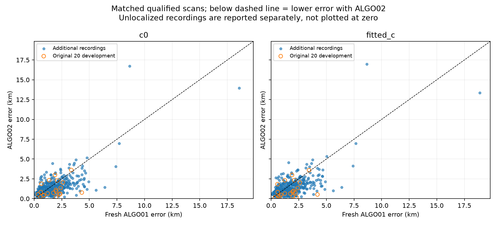
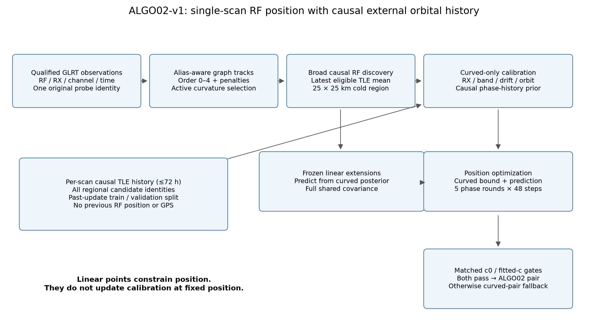
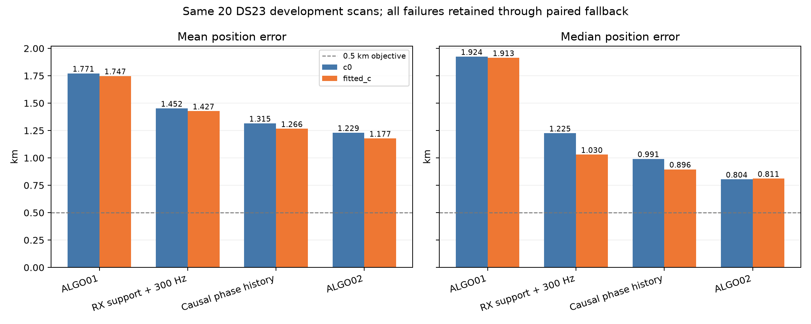
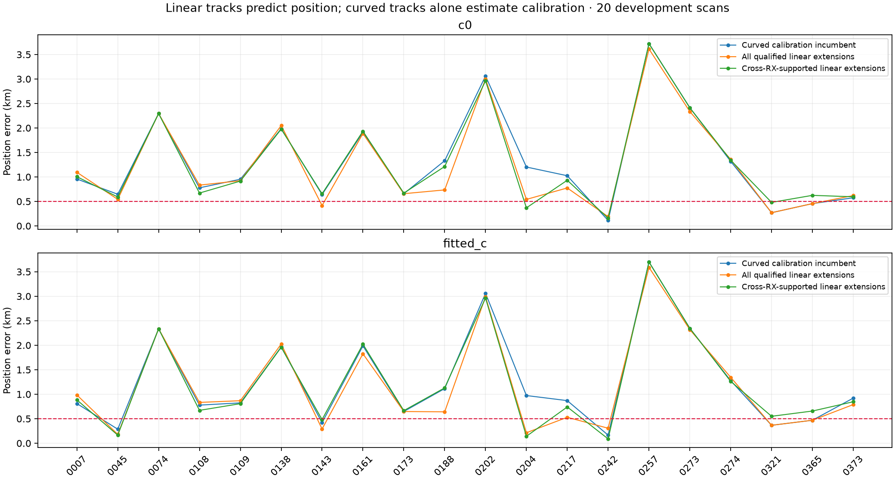
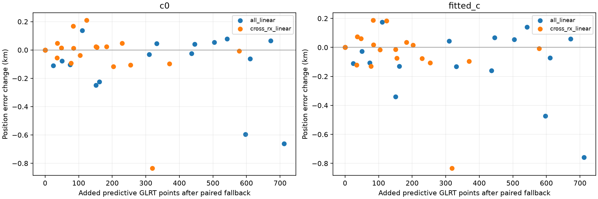

# ALGO02-v1: causal satellite localization with independent curved calibration

ALGO02 freezes the strongest balanced single-scan research configuration from
the DS23 development campaign: causal TLE-history phase priors, receiver-support
weighting, 300 Hz fragment constants, and Gaussian conditional position evidence
from additional linear graph tracks. It preserves ALGO01 as a separate published
experiment; it does not change public contracts or golden fixtures.

**The full 413-recording evaluation is complete.** On the 404 recordings with
qualified positions from both freshly run methods, ALGO02 improves mean and
median in both c arms. Coverage is **407/413 for ALGO01 versus 404/413 for
ALGO02**; three missing tracking contracts and six 1200 s timeouts remain in
the recording denominator.

| Matched 404 recordings | Fresh ALGO01 mean / median km | ALGO02 mean / median km |
|---|---:|---:|
| c0 | 1.870 / 1.633 | **1.520 / 1.270** |
| Fitted c | 1.870 / 1.602 | **1.508 / 1.249** |

On the additional 393 recordings outside the original development sample,
384 common pairs improve fitted-c mean/median by **18.7% / 20.8%**. Both fast
and adaptive capture formats improve. This supports broader within-site
performance, not validation at new locations. Accepted outliers, including the
16.98 km maximum, remain untrimmed. The 0.5 km mean-and-median objective remains
unmet. See the [completed full-corpus report](../2026_10_19_algo02_ds23_full/README.md)
for all failures, strata, matched comparisons, figures and audited numerical data.



On the same **20 development scans**, fitted-`c` mean/median position error is
**1.177 / 0.811 km**, compared with **1.747 / 1.913 km** for the original ALGO01
cohort: reductions of **32.6% / 57.6%**. With `c=0`, error is **1.229 / 0.804 km**,
reductions of **30.6% / 58.2%**. This is a development comparison with changed
priors and accepted membership, not an untouched validation or attribution of
the whole gain to one algorithmic change. The 0.5 km mean-and-median goal remains
unmet. Lower frequency residuals alone are never treated as better localization.

The development benchmark below is preserved separately from the completed
413-recording run. Fresh discovery reproduces all 20 historical ALGO02 branches,
curved masks and c-arm endpoints exactly. See [campaign status](campaign_status.json)
and [execution specification](#full-ds23-execution-and-final-error-estimation).



## Frozen definition and improvements over ALGO01

| Stage | ALGO01 reference | ALGO02-v1 |
|---|---|---|
| Measurements and tracks | Original per-probe GLRT winners; alias-aware graph polynomials | Same measurement semantics and graph fitter |
| Regional position prior | 25 × 25 km; center `(37.906,-122.545)`; cold start | Same |
| Catalogue | Broad causal Space-Track bank | Same causal restriction; fresh corpus runs must discover identities from it |
| Phase prior | Zero mean, causal pairwise disagreement scale | Forecast mean, scale and tail family learned solely from earlier TLE updates |
| Fragment constant prior SD | 1000 Hz | 300 Hz |
| Curved observation power | Original retained-fragment weighting | RX/channel support powers `1, 0.6, 0.2` |
| Linear graph tracks | Output-only frozen-calibration associations | Additional conditional position factors; no calibration feedback at fixed position |
| Shared uncertainty for added tracks | No additional position factor | Full cross-point and cross-track calibration covariance |
| Failed added-evidence trial | Not applicable | Matched c-pair fallback to qualified curved-only result |

ALGO02 is the **all-qualified-linear Gaussian policy**, not the narrower
cross-RX-only policy. The earlier TLE-history training can select Student phase
priors; new linear-track predictive noise and constant biases remain Gaussian.
These are different distributions with different roles.

The following experiments are **excluded from this freeze**: pooling previous
RF positions, statistical gate recalibration, robust Student new-track noise or
biases, precise RX2 IQ remeasurement, fitted height, sample-clock scale, extra
eccentricity modes, secondary GLRT peaks and GPS-selected family replacements.
Their occasional lower errors do not define ALGO02. No constant position or
frequency correction is learned across DS23 scans.

## Inputs, timing and causal authority

The acquisition/GLRT producer records physical receiver, channel, actual RF Hz,
sample rate, probe timing, fractional CFO Hz, gate/margin and immutable probe
identity through qualified tracking contracts. ALGO02 starts from this existing
on-disk evidence; it does not collect RF or depend on the reference repositories.
The exact native acquisition and GLRT implementation is an upstream contract
authority, rather than a replacement algorithm introduced here.

Choose one maximum-margin gate-passing GLRT candidate per original physical
probe, breaking ties by lower candidate rank. Preserve the original measurement;
polynomial interpolation is never counted as a new observation. No random or
time-block points are withheld from localization. Historical **TLE updates** are
temporally split for prior qualification; that is separate from holding out RF.

Adaptive sample times preserve retune gaps and session/device-counter authority:

```text
probe_midpoint_s =
  (valid_start_counter + probe_start_ms*fs/1000 - session_start_counter)/fs
  + probe_duration_ms/2000
```

Do not use concatenated IQ byte offsets as elapsed scan time. Validate capture
ownership, raw host UTC bracket, non-overlapping physical support and unique
observation IDs. Receiver numbering follows sorted native IDs. Fast-scan
contracts use their own qualified frequency-evidence adapter. The satellite
cutoff is the earliest qualified sample UTC, whereas propagation can use a
separate midpoint anchor; persist both.

Use only TLE records whose **collection timestamp and encoded element epoch
both precede the scan cutoff**. Later TLEs from earlier diagnostic experiments
are not allowed. Up to 48 h of archive snapshots supply latest/previous causal
elements for the mean bank; up to 72 h supplies the prior-learning history.
Every scan rebuilds its own causal boundary. No later scan's RF position or
catalogue enters an earlier scan's inference.

The regional box is centered at **37.906° N, −122.545° E**, bounded independently
to ±12.5 km east/north. Convert with
`lat=37.906+north/111.0`,
`lon=-122.545+east/(111.32*cos(37.906°))`.
Every controlled position fit starts at `(0,0)`. The supplied coordinate
`37.849061591561885,-122.48574968092912` is used only by the evaluation reporter.
The box center is an explicit coarse regional input, not an inferred true site.
Height remains 0 m; survey altitude is not established.

## Alias-aware polynomial construction

Use `P=1/(4.4 microseconds)=227272.72727272726 Hz` and wrap differences into
`[-P/2,P/2)`. Partition original points by receiver/channel/actual RF. A directed
time graph proposes integer alias lifts and velocity-consistent links; repeated
exclusive dynamic-programming extraction gives candidate paths. This is greedy
path packing, not a globally optimal multi-emitter flow solution.

The [frozen graph configuration](config/graph_selected.json) contains the full
settings. Important values are fixed noise 150 Hz, association multiplier 3,
degree 0–4, minimum 8 points and 4 points/coefficient, 6 s minimum span, 10 s
graph horizon/gap, 48 predecessor proposals, 0.15 s minimum edge separation,
8000 Hz/s slope limit, point reward 9, start/track penalty 18, breakpoint
penalty 10, gap cost `0.05*dt`, at most 64 tracks/lane, four final joint
iterations and 8 s maximum join gap. Failed paths can split recursively to
depth five. The second-order graph cost penalizes edge-velocity changes using
the declared radio variance and a smooth-acceleration term.

Fit degrees on the same measured support using
`sum((residual/150 Hz)^2)+(degree+1)*log(N)`, enforcing sample support and slope
bounds including derivative extrema. Growth uses a 450 Hz wrapped-residual
gate. Mean, slope, extra curvature, steps and lag-one residual structure screen
the fitted pieces. A high polynomial order is not active curvature.

Only tracks spanning **at least 20 s** with **at least 250 Hz RMS departure from
their best affine fit** can calibrate offsets, drifts, satellite corrections or
the curved-only position model. Short/linear children never inherit eligibility
from a joined parent. Joins are evidence hypotheses, not established emitter
identity; save graph membership and masks so failures can be audited.

## Radio-only uncertainty and broad satellite discovery

Estimate observation noise from sufficiently supported actively curved
polynomial pieces before satellite fitting. Use leverage-adjusted squared
residuals `r_i^2/(1-h_ii)` and compare constant variance with
`floor+strength/GLRT_margin`. Bound sigma to 40–600 Hz. Enable the extra
parameter only when BIC gain is positive; use 150 Hz when no valid estimate
exists. Freeze this law across c arms. It is a radio-derived engineering model,
not an uncertainty fitted to whichever satellite later wins.

The causal bank uses latest eligible elements per identity. The historical
regional screen propagates at 5 s cadence over at least 300 s and retains
candidates reaching −12° elevation at the coarse screen center `(37.5,-122.0)`.
This is a deliberately broad screen, not the reference site or a satellite
whitelist. Banks interpolate one-second state samples with ±17 s support for
phase excursions; reject propagation failures and extrapolation.

Original ALGO01 discovery uses four cold RF seeds plus proposals at the box
center and four corners, deduplicates identity/alias branches, scores at the
center with c0, and fully fits the best three. It is finite RF search, not a
guarantee of the true association or global optimum. The historical 20-scan
ALGO02 comparison **inherits the RF-discovered branches** from that experiment;
it changes inference and gates without rediscovering every identity.

For a fresh DS23 run, no cached development identity may be supplied as ground
truth. Cold discovery must run against that scan's causal bank. The precise
fresh-run implementation, budgets and hashes are recorded in its run freeze.
Discrete identities and integer aliases stay fixed inside a continuous fit;
association alternatives compete outside that solve. Phase refresh is not
satellite-identity refresh at every descent step.

Graph lifts and fragment aliases change measured CFO by **integer multiples
of P only**. Hardware and orbital corrections change the prediction. New aliases
must use the existing independently supported receiver/band gauge, not a zero
offset assumption that can move a track to an adjacent 227 kHz branch.

## Phase mean and distribution from earlier TLE updates

Phase is a shared **orbital time displacement in seconds**, not carrier phase.
Start with the genuine latest/previous-element disagreement width:

```text
base_sigma_s = clip(sqrt(1 + (alignment_s*age_s/epoch_gap_s)^2), 1, 15)
```

Require a previous encoded epoch at least one second earlier; near-duplicate
epochs do not estimate independent uncertainty. Alignment is the median
along-track state displacement at 0,150,300 s with the implemented rotation
correction. Missing usable history explicitly falls back to 1 s and is flagged.

Then learn a forecast over **all candidates in the regional bank**, not just
families favored by RF. Deduplicate causal epochs, retaining earliest
publication. Consecutive historical versions A/B/C form examples at C's
publication time: A/B predict the along-track update from B to C. Require all
three encoded epochs to be available by that historical instant. TLE updates
are prediction proxies, not measured orbital truth.

Split distinct historical publication times 70%/30% chronologically. Grid-search
shrinkage `rho∈{0,.25,.5,.75,1}`, SD multiplier over 51 logarithmic values from
0.1 to 4 plus 1, and Gaussian or unit-variance Student tails with degrees
`{3,4,8,16}`. Improvement must beat a `3*log(N)` complexity cost. Qualification
requires at least 30 later historical transitions and better predictive density
than the original zero-mean Gaussian. If qualified, relearn on all pre-scan
history; otherwise use `rho=0,multiplier=1,Gaussian`.

For the current latest/previous receipt, the implemented mean is

```text
mu_s = clip(-rho * clip((age_s+150)/epoch_gap_s,0,2) * alignment_s,
            -min(15,3*base_sigma_s), +min(15,3*base_sigma_s))
sigma_s = learned_multiplier * base_sigma_s
```

The `+150 s` is the frozen implementation's midpoint convention, not a new
data-derived parameter. For Student phase priors the scale is
`sigma_s*sqrt((nu-2)/nu)` so sigma denotes standard deviation. Only phase
coefficients get these tails. The learned distribution need not be universally
calibrated; common errors in successive TLEs can remain invisible.

## Curved-only calibration and integrated objective

At position x and phase expansion reference r, build Doppler intercept
`f(r)-r*fprime(r)` and retain an **absolute** phase coefficient. Moving the
numerical reference does not reset its prior mean or cost. With
`q=actual_RF/11.5 GHz`, the predicted measured CFO combines q-scaled satellite
Doppler/phase/orbit features, receiver terms and a fragment constant.

| Nuisance | Frozen scope / scale |
|---|---|
| RX × band frequency offset | Four per scan; SD `P/sqrt(12)` Hz |
| Receiver linear drift | Two per scan; SD 10 Hz/s, centered at 150 s |
| Receiver band-drift contrast | Two per scan; SD 1 Hz/s, low/high receive ∓ half |
| Receiver smooth correction | Projected saved smooth basis, RF scaled; coefficient SD 200 Hz |
| Satellite phase | One per family, learned causal mean/SD/tails above |
| Physical orbit modes | Mean motion, inclination, RAAN; only multi-owner curved families |
| Original fragment constant | Independent **300 Hz** SD |
| Fitted `c` ablation | Shared unit-normal column `(actual_RF/GHz-11.5)*200000 Hz`; absent in c0 |

Orbit scales follow causal latest/previous radial/cross-track disagreement with
0.05/0.025 km floors where history exists and 0.5/0.25 km missing-history scales.
There is no arbitrary unconstrained per-satellite frequency line. Each receiver
and band can differ within each scan; nothing imposes one DS23-wide offset.

Receiver-support powers are computed from the active curved discovery support:
1 for a family spanning both receivers; 0.6 for multiple RX/channel owners on
one receiver and identity confidence ≥0.95; 0.2 otherwise. Confidence is the
minimum RF competition confidence at the fitted c0 point and four ±2 km probes.
Excluded observations do not create support votes. Saved powers remain fixed
during that controlled refit; linear extensions never add owner votes.

Integrate Gaussian nuisance coefficients with grouped Gamma(2,2) noise
precisions, including their predictive-variance contribution to updates. For
Student phase priors, corresponding phase coefficient precisions are also
updated. Iterate up to 256 times to maximum log-rate change below `1e-5`.
Minimize the normalized variational frequency/prior bound: weighted data,
prior penalties, integrated log-volume, Gamma terms, fixed noise normalization
and negative-elevation penalty. This is not a calibrated probability of a
position or association. Learned robust precision is not identity confidence.

Run both c arms with identical measurements, labels, aliases, masks, all other
priors and budgets. Branch choices use c0 RF evidence; GPS never chooses a branch,
mask or c arm. Scores from differing observations or distribution families need
their full normalization and cannot be compared as raw residual sums.

## Linear evidence without self-calibration

At the qualified curved-only c0 endpoint, run frozen-calibration extension to
its supported satellite families. Keep graph tracks outside the curved set
with at least six original probes, no overlap with original curved evidence,
and no overlap with an earlier selected extension. Their own residual, alias,
visibility and receiver/band-support checks must pass. Freeze their identities
and integer aliases from c0 for both arms.

At every new candidate position x, curved data alone estimate mean m and
conditional precision A. Rebuild physical features `U_L(x)` for all added
points, including actual RF/time/receiver/band. Existing fragment-constant
columns are zero for new tracks. Add the normalized Gaussian prediction:

```text
mean_L = nominal_Doppler_L(x) + U_L(x)*m(curved_data,x)
cov_L  = 2*diag(radio_sigma_L^2) + U_L*A^-1*U_L' + 300^2*Z*Z'
```

Z is one indicator column per added track. The factor 2 uses
`E[1/tau]=2` for unseen Gamma(2,2) noise. It is a Gaussian approximation to a
heavy-tailed predictive law, not a newly fitted point-noise model. All added
linear factors have power 1. Cholesky/Woodbury integration retains the full
shared covariance, complexity determinant and independent new-track bias priors.

The new points never enter calibration normal equations, Gamma updates,
phase-reference estimates or support votes **at a fixed position**. They do
influence the chosen horizontal position, at which curved data are refit.
Thus an arbitrary linear slope cannot create its own receiver drift, and many
copies of an uncertain common calibration mode do not become independent
evidence. This is a modular predictive objective, not the exact joint Bayesian
posterior. Its covariance conditions on curved Gamma precision means.


The six displayed tracks are selected by point count. Residuals subtract the
complete curved-only prediction; no added-track constant has been subtracted to
make them look accurate. This visual does not establish satellite identity truth.

## Optimization, gates and fallback

Each continuous arm starts at region center, phase reference zero. Run exactly
five absolute-phase refresh rounds, each at most 48 bounded damped Gauss–Newton
steps. Use 0.001 km finite differences, initial damping 0.01, at most nine
damped proposals/step, damping ÷3 after success or ×5 after rejection, ±12.5 km
coordinate clipping and required improvement >`1e-9`. Small-step stopping needs
step <`1e-4 km` and improvement <`1e-5`. Phase references clip to ±15 s. The
final linear trial also requires last phase change ≤0.01 s. Budget exhaustion
or a local stop does not certify global correctness.

Curved prior fitting permits up to four paired exclusion/refit rounds: failure
in either arm removes that component from both before refitting. Persist all
reasons and masks. ALGO01's independently calibrated, tail-gated failed-track
salvage is documented in its own report; the historical cohort's nominated
branches/masks are explicit inputs, not an automatic guarantee of general
segmentation repair. Never hide a failed track after it influenced position.

For the subsequent linear-evidence trial, require **every original curved gate
and every offered linear-track gate in both arms**. Do not delete a troublesome
new track to rescue this trial. If either arm fails, retain the entire qualified
curved-only pair. If no qualified curved baseline exists, report failure; a
failed scan is not silently omitted from corpus coverage.

Residual gates retain RMS ≤450 Hz, regularized bias magnitude ≤3000 Hz, ordinary
integer alias, non-negative visibility and the existing structure screen:

| Structure statistic | Gate |
|---|---:|
| Standardized residual mean | ≤3 |
| Standardized residual slope | ≤3 |
| Quadratic improvement over zero, BIC gain | ≤10 |
| Largest two-sided mean step, ≥4 samples per side | ≤4 sigma |
| Absolute lag-one correlation | ≤`4/sqrt(N)` |

The screen uses `max(sample residual SD,75 Hz)`. Existing independent 6σ tail
checks apply where declared for conservative salvage. These simultaneous
engineering checks do not have a calibrated overall false-association rate.
Passing residuals are necessary evidence, not sufficient proof of the identity,
correct calibration or location. New Monte Carlo gate experiments do not alter
these thresholds in ALGO02.

## Development performance and regressions

Each number is mean / median position error in km on the same 20 scans.

| Policy | c0 | Fitted c |
|---|---:|---:|
| Original ALGO01 | 1.771 / 1.924 | 1.747 / 1.913 |
| Receiver support + 300 Hz constants | 1.452 / 1.225 | 1.427 / 1.030 |
| Causal phase mean + distribution | 1.315 / 0.991 | 1.266 / 0.896 |
| **ALGO02 Gaussian all-linear** | **1.229 / 0.804** | **1.177 / 0.811** |
| Cross-RX-only linear control | 1.276 / 0.924 | 1.221 / 0.827 |
| Student new noise + bias, excluded | 1.209 / 1.016 | 1.171 / 0.973 |




| ALGO02 development metric | c0 | Fitted c |
|---|---:|---:|
| 90th percentile error | 2.401 km | 2.401 km |
| Maximum error | 3.612 km | 3.589 km |
| Error below 0.5 km | 4 / 20 | 6 / 20 |
| Error below 1 km | 12 / 20 | 13 / 20 |

The unchanged upper tail makes the remaining limitation visible: lower cohort
mean and median do not eliminate the difficult individual scans.

The all-linear trial offers **441 tracks / 7,046 points**. It qualifies in
**16/20 paired scans**, retaining **357 tracks / 5,734 points** as additional
position evidence. Scans 74,173,321,365 fall back. Compared with the curved-only
causal-history reference, each c arm improves on 10 scans, regresses on six and
is unchanged on four. These points were often already associated output;
they are not necessarily newly discovered GLRT associations.

Scan 217 changes from 1.025→0.775 km c0 and 0.869→0.529 km fitted c. Scan 274
regresses from 1.277→1.345 km fitted c. The latter remains in every summary.
The cross-RX-only policy has fewer additions and 19/20 paired passes, but worse
overall mean/median. The all-linear choice follows the cohort result, so this
20-scan set is development data rather than independent validation.



The c0/fitted-c controlled ablation is mandatory throughout. Better frequency
score can accompany worse geographic error, as earlier identity-replacement
and precise-CFO experiments showed. No conclusion about hardware speed follows
from these desktop position-error comparisons. The separate 3.04× pilot fitter
speedup is not an end-to-end ALGO02 embedded benchmark.

For a separate frequency-fit check, the mean per-scan **curved-data CFO RMS**
changes only 116.779→116.772 Hz with c0 and 116.690→116.693 Hz with fitted c
when adding ALGO02's position evidence. These use the same curved masks and
restore baseline RMS for fallback scans. The position gain is therefore not
explained by a substantial reduction in curved-data in-sample RMS. The linear
predictive objective has additional observations and its raw loss cannot be
compared with the curved-only loss as if they explained identical data.

## Full DS23 execution and final error estimation

The fresh campaign is frozen before inspecting its new per-scan errors. It
includes all **413 DS23 recordings**, with no random subset or GPS-based
exclusion. The full corpus overlaps the 20 development recordings; final tables
must separate those from the remaining 393 records. The latter are additional
same-site data, not independent-location validation.

Readiness is also part of coverage: DS23-0012, DS23-0184 and DS23-0286 lack a
frozen tracking contract in the sealed manifest. They remain in the 413-record
denominator and are reported as input failures when encountered, without
substitution. The other 410 are potentially eligible; that does not establish
that every preparation, fit or physical gate will succeed.

The [frozen protocol](execution/protocol.json) has SHA-256
`61a144f7674534a8ec6fe71dc5ba9f5c565620fb5ff2a425028993001893f52d`.
Its [membership manifest](execution/sample.json) binds all 413 records, including
the 20 development labels, source closure and per-record tracking authorities.
Each case has a 1200 s wall-clock bound for its full preparation/inference
chain. Archive preparation and fresh adaptive/fast integration both passed
before the **30-worker full-corpus queue was launched**. Qualification scans
0001/0002 both accepted the Gaussian linear pair, with 936+59 and 2262+616
curved+predictive points respectively. Their cold-discovery/initial/ALGO02
stages took approximately 27/12/7 s and 28/31/16 s, excluding preparation.
These are two integration cases, not full-corpus accuracy or throughput claims.
See [adaptive qualification](evidence/cold_DS23-0001.json),
[fast qualification](evidence/cold_DS23-0002.json) and the campaign launch receipt.

Run **30 concurrent single-thread numerical workers**. The host has 24 physical
cores; 30 workers is a scheduling choice for mixed I/O/CPU phases, not a claim
of 30 physical cores. Set `OPENBLAS_NUM_THREADS=1`, `OMP_NUM_THREADS=1` and any
other linked numerical-thread limits to 1. Do not nest 30-way pools. Use bounded
stages, atomic per-case receipts, input/code hashes and resumable case-owned
outputs. Existing QNAP inputs and TLE archives remain read-only.

The run must: prepare each qualified tracking input and graph; build a scan-causal
bank and TLE-history forecast; cold nominate satellite/alias branches from RF;
qualify the curved-only c pair; select fixed linear extensions from c0; cold
refit the paired ALGO02 position objective; enforce paired fallback; and write
raw trials plus final accepted results. A cached result is reusable only after
its observations, configuration, causal receipts and source hashes match the
freeze. No saved position initializes another scan.

The external reporter alone computes geographic error. Publish count attempted,
qualified positions, fallback count and every preparation/numerical/physical
failure against all 413 recordings. For finite qualified positions, show paired
c0/fitted-c mean, median, p90, maximum and fractions below 0.5/1/2 km, explicitly
stating the finite-result denominator. Show development and additional-record
strata, per-scan errors, chronological errors, empirical CDF and failures. Keep
frequency RMS/normalized scores and associated-original-GLRT fractions separate
from position accuracy. Do not assign an invented error to failed scans or
silently call the successful-only mean an all-record guarantee.

All errors are conditional on using the supplied coordinate as the common
reference. Stationarity and antenna altitude have not been independently
survey-certified. No stationary-history pooling is part of this final
single-scan error estimate.

## Replay package and validation

The [source digest map](source_snapshot/sha256.json) binds the static local import
closure of the existing development entrypoints and owned tests. Preserve paths
when overlaying it in an isolated checkout; never overwrite an active development
worktree. It is a research audit/replay artifact, not a new production package or
permission to couple analyzers to storage implementations. Large IQ, tracking
contracts and propagated banks remain explicit checksum-bound input authorities.
Dynamic archive/runtime dependencies still need qualified ports.

The [evidence manifest](evidence_manifest.json) binds original report payloads.
The lossless [development evidence archive](evidence/predictive/evidence.tar.xz)
includes raw trials and source receipts; its [inventory](evidence/predictive/evidence_inventory.json)
lists payload hashes. [Positions](evidence/predictive/positions.csv),
[phase-stage comparison](evidence/phase/comparison.csv),
[failed components](evidence/predictive/failed_components.csv),
[added evidence counts](evidence/predictive/extension_counts.csv) and
[recomputed statistics](evidence/development_summary.json) preserve numeric claims.

Focused tests verify dense shared-covariance parity, repeated shared-mode
dependence, an empty-extension identity, and zero feedback to curved calibration
under inconsistent added linear data. Prior tests verify distribution
parameterization and causal learning controls. Saved fits show exactly zero
calibration coefficient replay difference in all 80 development trial arms.
The frozen overlay passes all **31 focused tests** across predictive geometry,
causal priors, support weighting, preparation, the per-scan engine, the
30-worker supervisor and the separate evaluation reporter; see
[owned test receipt](evidence/owned_tests.json), [validation](validation.json)
and [underlying validation](evidence/predictive/validation.json).

```bash
# Regenerate report-only figures from the compact published evidence.
OPENBLAS_NUM_THREADS=1 OMP_NUM_THREADS=1 .venv/bin/python \
  reports/ALGO02/build_evidence.py --figures-only

# Historical development replay: requires original case inputs/discovery results.
PYTHONPATH=src:tools OPENBLAS_NUM_THREADS=1 OMP_NUM_THREADS=1 \
  .venv/bin/python tools/run_ds23_predictive_linear.py

# Fresh path-explicit per-scan engine, after qualified preparation/history export.
PYTHONPATH=src:tools OPENBLAS_NUM_THREADS=1 OMP_NUM_THREADS=1 \
  .venv/bin/python tools/algo02_scan.py \
  --run-dir reports/2026_10_19_algo02_ds23_full --case DS23-0217 --stage all

# Verify the sealed source/membership, then run the 30-worker full-corpus queue.
PYTHONPATH=src:tools OPENBLAS_NUM_THREADS=1 OMP_NUM_THREADS=1 \
  .venv/bin/python tools/run_algo02_ds23.py --stage verify
PYTHONPATH=src:tools OPENBLAS_NUM_THREADS=1 OMP_NUM_THREADS=1 \
  .venv/bin/python tools/run_algo02_ds23.py --stage run

# Separate evaluation; the GPS reference appears only in this reporter.
PYTHONPATH=src:tools OPENBLAS_NUM_THREADS=1 OMP_NUM_THREADS=1 \
  .venv/bin/python tools/report_algo02_ds23.py
PYTHONPATH=src:tools OPENBLAS_NUM_THREADS=1 OMP_NUM_THREADS=1 \
  .venv/bin/python reports/ALGO02/build_full_results.py --archive

# Owned numerical controls, from an isolated source overlay.
PYTHONPATH=src:tools OPENBLAS_NUM_THREADS=1 OMP_NUM_THREADS=1 \
  /path/to/repository/.venv/bin/python -m pytest -q \
  tests/analysis/test_ds23_predictive_linear_tool.py \
  tests/analysis/test_ds23_history_calibrated_phase_tool.py
```

The historical runner deliberately consumes earlier RF discovery and prior
receipts; it is **not the fresh all-DS23 orchestrator**. The fresh executable
freeze and run manifest are linked from [campaign status](campaign_status.json).
The path-explicit engine has also replayed scan 217 with **identical masks,
weights, linear entries and both c-arm endpoints** against the published
development result; see [replay qualification](evidence/engine_replay_qualification.json).
That is an implementation equivalence check on cached RF inputs, not independent
accuracy validation or a fresh-discovery timing benchmark.
[ALGO01](../ALGO01/README.md) preserves the original full acquisition-to-position
specification and conservative 342 salvage; [DBG01](../DBG01/README.md) specifies
the standard per-scan residual/association/loss-surface debugging figures.

## Remaining limitations

Association search is finite and conditional; residual-noise checks alone
cannot distinguish all wrong identities or nuisance-position degeneracies.
Satellite phase and orbit uncertainty remains a material position limitation.
Measurement precision improvements, greater model freedom or more points did
not consistently improve the development cohort. ALGO02 does not establish
sub-0.5 km accuracy, a surveyed height, calibrated confidence intervals, motion
tracking, new-location generalization or embedded real-time performance. The
all-DS23 run measures the frozen rule's same-region behaviour and failures; it
does not turn a development comparison into independent location validation.
