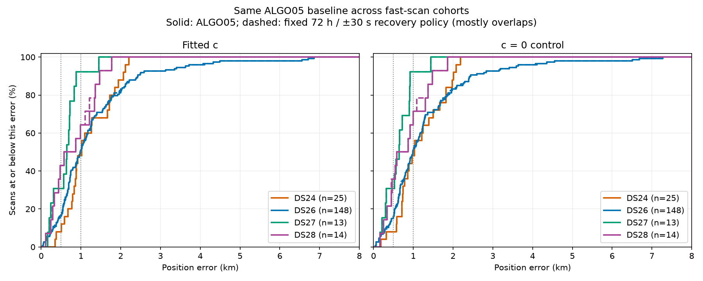
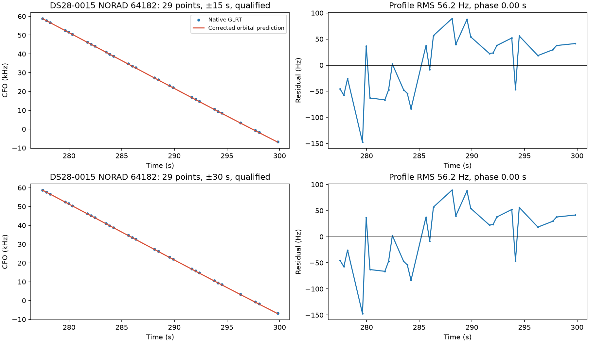
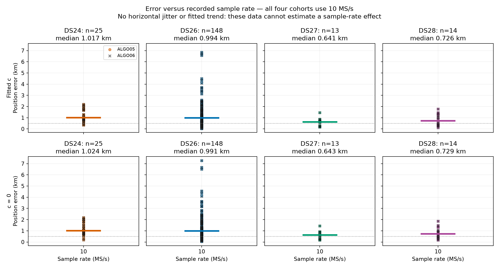

# ALGO06 — causal residual-family recovery

ALGO06 adds a bounded search for new satellite families explaining long native GLRT fragments that remain unassociated after ALGO05. The user selected **72-hour causal TLEs, ±30-second phase search, and no recency penalty** for production promotion on November 1, 2026. Accepted additions preserve every previously published observation owner. Failed, ambiguous, unsupported, or timed-out recoveries retain the exact ALGO05 position.

Model identity: `algo06-causal-residual-family-v1`; persisted terminal schema 5; independent namespace `fast-scan-graph-position-v5`. ALGO02–ALGO05 contracts, numerical implementations, and published outputs remain immutable. ALGO05 still runs upstream; ALGO06 becomes the default presentation when qualified results are available.

## Measured performance

These are paired, conditional recovery results on the same frozen fast scans, using the user-confirmed site only for evaluation. They are not full raw-IQ or cold regional discovery reruns. All cohorts use 10 MS/s, all eight channels, and approximately five-minute acquisitions.

| Cohort | Available / members | ALGO05 fitted-c mean | ALGO06 fitted-c mean | ALGO05 c=0 mean | ALGO06 c=0 mean |
|---|---:|---:|---:|---:|---:|
| DS24 | 25/34 | 1,175.2 m | 1,175.5 m | 1,162.1 m | 1,162.2 m |
| DS26 | 148/159 | 1,301.1 m | 1,295.5 m | 1,318.1 m | approximately 1,313.1 m |
| DS27 | 13/15 | 619.1 m | 619.1 m | 638.0 m | 638.0 m |
| DS28 revision 2 | 14/16 | 820.7 m | 802.5 m | 829.6 m | 812.3 m |

DS24 recovers 62 native points in one scan; DS26 941 in 18; DS27 no additions; DS28 57 in two. DS26 coverage increases 71.1115% → 71.2562%; DS28 74.8546% → 74.9685%. The 90th-percentile errors are unchanged. DS26 includes qualified recoveries with worse evaluation accuracy; increased association and better frequency evidence do not guarantee lower geographic error. Exact numbers, all four research policies, both c arms, and full availability denominators are in the [comparison data](../2026_11_01_ds24_plus_error_comparison/summary.csv).

## Algorithm from GLRT to position

1. **Preserve the upstream pipeline.** Recorded IQ is analyzed by the existing GLRT and alias-aware graph track builder. ALGO02 supplies regional causal satellite discovery and position fitting. ALGO03/04 recover qualified graph/new-family evidence, and ALGO05 conditionally recovers timing-gap fragments. The initial regional box remains 25 × 25 km about the configured regional center, not the evaluation GPS coordinate.
2. **Export the actual ALGO05 incumbent.** A versioned, read-only storage port verifies the completed public job, terminal identity, and file hashes. Private copies preserve historical exports byte-for-byte. Active paths and hash references are relocated without changing scientific values. Existing likelihood and ownership must replay before any new proposal is used.
3. **Rank native residual evidence.** Subtract published owners from canonical graph sources. Split at claimed observations, polynomial piece boundaries, and time gaps exceeding five seconds. Require at least 20 native points over at least 15 seconds. Select the three longest eligible fragments, then point count and stable identity; no geographic error is consulted.
4. **Export a general causal catalogue.** Choose the latest eligible TLE per satellite from the archive. Both element epoch and collection timestamp must precede the scan cutoff and be within 72 hours. No satellite whitelist, post-scan TLE, or evaluation coordinate is admitted. Runtime numerical code reads only the private snapshot and exported catalogue.
5. **Screen candidates at the RF-derived incumbent position.** Search whole-source aliases −4…4 and phase within ±30 s. Offset sigma is 300 Hz, rate sigma 0.5 Hz/s, phase sigma 5 s, and screening noise 150 Hz. Use normalized marginalized evidence, including nuisance-volume penalties. Catalogue age does not widen these priors, and there is no recency penalty.
6. **Check independent nominations.** Repeat training-only coarse top-three nomination separately for the full target and three seeded random 12-second whole-block partitions, with two-second guards. Seeds are 20261031, 94721, and 4081. Union nominations across the matched c arms within each partition, never across training partitions. All four partitions in both arms must select the same satellite with score margin at least 10; the full-data aliases must agree across arms. Apply the existing RMS, bias/rate, visibility, boundary-mass, and residual screens. This is conditional uniqueness among the tested shortlist, not a proof of global identity.
7. **Fit one new-family proposal.** Exclude existing satellite families; their extension route is unchanged. Rank passing proposals by minimum partition margin, then points and identity. Test at most one per scan. Preserve the incumbent receiver likelihood and priors. Integrate orbital and receiver uncertainty; if one new-family mixture already exists, integrate the pair jointly. Do not exceed two joint new-family mixtures.
8. **Compare candidate and no-addition control.** Fit both c=0 and fitted-c with the same observations, candidates, priors, and budgets. Use up to three phase-refresh rounds of L-BFGS-B, maxiter 30/maxfun 100 per round, within the same 25 km box. Existing observations cannot change satellite owner. Require successful optimizer and phase convergence, exact orbit checks, residual compatibility, visibility, interior phase mass, and local quadrature agreement. The new-family phase integral uses 0.05 s with 0.025/0.0125 s checks over a ±25 m position stencil. Both control and candidate must pass in both c arms.
9. **Publish or retain.** Publish the fitted-c endpoint and exact additive native ownership only after all checks. Otherwise retain the exact ALGO05 result with a failure/defer reason. The production adapter has one worker and a 1,200-second per-scan budget; it does not retry interrupted jobs automatically. Each terminal retains its ALGO05 incumbent and both c-arm proofs.

The nine core reconstruction, screening, and position functions were ported without AST changes from the evaluated research implementation. Only imports, configurable work directories, storage adapters, release validation, and packaging were introduced. Selecting the single policy does not change its training nominations or permitted candidate sets.

## Known scientific limits

The strongest DS28 improvement is scan 0015: 29 RX1/CH1 points assigned to NORAD 64182 improve fitted-c error from 1,341.5 to 1,103.4 m and c=0 from 1,306.3 to 1,083.7 m. The accepted residual still has visible early/late structure: means −22.6 and +34.5 Hz and a diagnostic linear slope around +5.12 Hz/s. It passes the evaluated gates; this promotion does not claim white residuals or retune a gate after seeing GPS error.

The broader age/phase policy yields only modest average gains. The tested age penalty made no decision difference and is omitted. The policy does not recover existing-family extensions or arbitrary non-graph points. Missing upstream results remain unavailable. Single-site validation and small DS27/28 cohorts do not establish general 500 m accuracy.

## Acquisition cadence and sample rate

The production timer changes its post-capture gap from 20 minutes to 7 minutes 30 seconds. With unchanged five-minute captures, the nominal acquisition cycle changes from 25 to 12.5 minutes. The existing fast/adaptive alternation remains, so nominal fast-scan cadence changes from about 50 to 25 minutes. Recording duration, sample rate, gain, channel targets, acquisition locking, and analysis-backlog protection remain unchanged. Actual intervals include processing/recording overhead and may lengthen when capture is deferred.

All 224 fast acquisitions in DS24/26/27/28 have the same 10 MS/s first-segment settings. Their 200 available position outcomes cannot identify a sample-rate effect.

## Deployment and rollback

ALGO06 is live and the production default. The sealed release manifest pins ALGO06 source and tests in addition to the unchanged upstream manifests. The numerical release is `cf16ac5bd6a8f1ac65f626eba57326f2a2d2e6b5`; the API release is `292980924a4501cd3e5cf6e9f384b090bce3fd82`. Qualification passed 60 Python and eight web tests. A bounded replay under the installed production service account reproduced the qualified research candidate exactly in both c arms. The live API returned the validated ALGO06 candidate with HTTP 200 in 2.83 seconds. The API release adds direct completed-result lookup and the ALGO06 UI label without changing the sealed numerical implementation. The live worker uses a completion cutoff to avoid an automatic historical backfill; the explicit canary was run separately.

Activation receipts, exact revision, tests, and public API verification are recorded in [the deployment report](../2026_11_01_algo06_promotion/README.md). Roll back by stopping/disabling `leo-algo06-graph-position.service` and removing only its API override, then reloading systemd and restarting the API. The earlier ALGO05 worker and API override remain installed. To revert cadence, remove only `zzzzzz-double-cadence.conf` from the acquisition timer drop-in directory and reload/restart that timer. Preserve all result namespaces and recording data.
