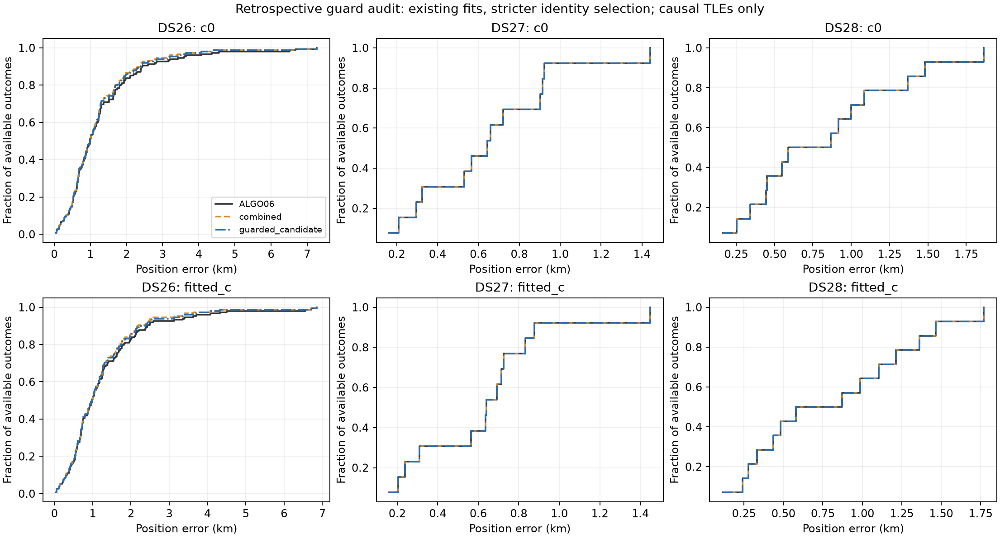
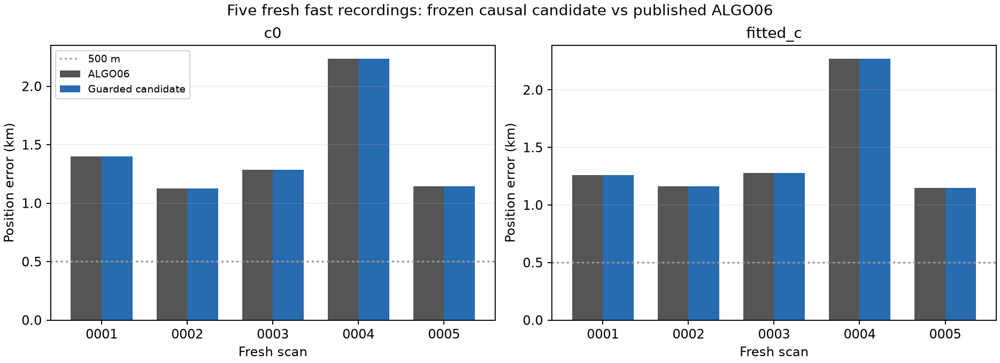

# ALGO07 — guarded causal satellite reassociation

ALGO07 adds one guarded whole-family identity repair to the ALGO06 pipeline. It preserves the published native GLRT point set, so this change targets position accuracy rather than increased association percentage. Ambiguous, incomplete, failed or timed-out proposals retain the exact ALGO06 endpoint and observation owners.

**ALGO07 is live and the production default.** The production identity is `algo07-causal-guarded-reassociation-v1`, persisted schema 6, namespace `fast-scan-graph-position-v6`. Earlier algorithms and contracts remain immutable. The user authorized promotion and deployment on November 1, 2026. Numerical and API releases use revision `7cafccaced18e6b0fa9266bd18339d61f0f9c1f4`; activation completed November 2 at 00:19:49 UTC. Deployment qualification and activation receipts are recorded in the [release report](../2026_11_01_algo07_promotion/README.md).

## Paired evidence

These are conditional analyses over frozen upstream GLRT and graph evidence, not fresh raw-IQ discovery reruns. GPS is used only for error reporting. All position values below are mean errors in kilometres; both calibration arms use matched observations, nominations, priors and search budgets.

| Cohort | Available / members | ALGO06 fitted-c | ALGO07 candidate fitted-c | ALGO06 c=0 | ALGO07 candidate c=0 | Accepted replacements |
|---|---:|---:|---:|---:|---:|---:|
| DS24 fast | 25 / 34 | 1.1755 | 1.1755 | 1.1622 | 1.1622 | 0 |
| DS26 | 148 / 159 | 1.2955 | 1.2234 | 1.3131 | 1.2419 | 3 |
| DS27 | 13 / 15 | 0.6191 | 0.6191 | 0.6380 | 0.6380 | 0 |
| DS28 revision 2 | 14 / 16 | 0.8025 | 0.8025 | 0.8123 | 0.8123 | 0 |
| Five fresh scans | 5 / 5 | 1.4241 | 1.4241 | 1.4377 | 1.4377 | 0 |

DS26/27/28 are retrospective decision audits of saved fits. DS26 influenced development; its three improvements are not independent validation. DS24 and the five fresh scans executed the frozen bounded candidate. All retained ALGO06. DS24-0010 passed predictive uniqueness but failed the conservative joint RF score comparison in both arms, and was correctly rejected. Nine DS24 scans lacked frozen GLRT inputs. Missing results are not counted as successes.

The three historical DS26 repairs are 0034 (53852 → 59188; 4.498 → 0.374 km fitted-c), 0066 (62025 → 68047; 2.370 → 1.218 km), and 0251 (56548 → 58787; 6.561 → 1.162 km). No observed regression in that retrospective audit establishes neither a general no-regression guarantee nor 500 m accuracy. The worst DS26 error remains 6.858 km. Association coverage remains unchanged: DS24 72.782%, DS26 71.256%, DS27 78.252%, DS28 74.969%.

See the [frozen readiness study](../2026_11_01_promotion_readiness/README.md) and [DS24 execution audit](../2026_11_01_promotion_readiness/ds24/README.md) for per-scan results and complete denominators.

## Algorithm and reconstruction

1. **Run the existing upstream chain.** Acquisition, GLRT, alias-aware graph construction, regional ALGO02 fitting and ALGO03–06 recoveries remain unchanged. The regional search box is 25 × 25 km about the configured center (37.906, −122.545), not the evaluation site. ALGO06 uses a 72-hour causal catalogue, ±30 s phase recovery, and no recency penalty.
2. **Replay the public ALGO06 endpoint.** A read-only versioned export port composes the public ALGO05 export and verified ALGO06 terminal. Private relocation preserves scientific values. Both baseline RF objectives must replay within 1e-4, the fitted-c latitude/longitude within 1e-9 degrees, and both complete native owner maps must agree before search.
3. **Rank suspect families by RF influence.** Estimate local gradients and Hessian-based omission displacement with 0.05 km finite differences. Consider the top two families with at least 0.5 km summed influence over both c arms, at least 30 native points and at least two tracks. No geographic error enters this ranking.
4. **Nominate from the full causal catalogue.** Require both collection and element epoch within 72 hours before the scan cutoff. Screen the two longest tracks at up to 16 samples each, phase −30…30 s in 2 s steps, and retain the top two per track/arm plus the incumbent in a common finalist set. Propagate all catalogue members on −40…340 s at one-second spacing. Only a single documented invalid SGP4 code on every knot permits an explicit exclusion; partial, mixed, unknown or nonfinite successful propagation blocks publication.
5. **Apply two predictive checks.** The inherited check uses five seeded randomized synchronized five-second blocks, adjacent five-second guards, positive mean improvement and at least four wins in each arm (seed 20261103). The stronger check generates up to ten unique feasible held-block sets (seed 20261111), requires at least five, and requires the proposed identity to beat every common finalist on every retained fold in both arms. Its constant offsets are shared by receiver, with sigma 300 Hz; common rate sigma 0.5 Hz/s, noise 150 Hz, phase sigma 5 s, and phase integration −30…30 s in 0.4 s steps. A previously owned destination is excluded. These are conditional uniqueness checks, not calibrated satellite-identity probabilities or independent catalogue discovery.
6. **Complete causal history only after admission.** Preserve valid existing earlier TLEs. For missing history, choose the newest element at least one second earlier than the nominal element from snapshots collected within the causal 72-hour window. Production exports the eligible history privately before inference, but applies no history-derived prior changes before predictive admission. No later TLE is read by numerical inference.
7. **Fit a matched replacement and control.** Use the published fitted-c endpoint and the family-omitted fitted-c endpoint as the same two starts for both arms. Allow 15 phase-refresh rounds and 40 constrained SLSQP iterations per round within the regional box. Require optimizer success, phase closure ≤0.01 s, residual/noise/visibility gates, exact orbit checks, and predictive-mixture boundary mass <0.01. Preserve all original observations; only the proposed whole family can change satellite owner. No chained replacement or standalone history-only update is published.
8. **Apply the conservative score comparison.** In each arm, the candidate must improve over the minimum of the qualified matched-history control, the original published objective, and the matched-history objective at the published endpoint, by more than `2 log(max(2, number_of_common_finalists))`. These are normalized RF scores, not position errors. Any incomplete control or admitted candidate fit causes exact fallback; a partial winner is never published. Choose at most one qualified replacement by summed two-arm gain, with a deterministic name tie break.
9. **Validate and publish through schema 6.** Persist the prior terminal, both c-arm proofs, all competitor margins, native IDs, owner hashes, causal provenance and read audit. Publication retains exactly the baseline ID set, even if numerical membership diagnostics contain incidental new points. No acceptance can discard original points or reassign unrelated owners. The API identifies ALGO07 and retains a public ALGO06 view while awaiting or falling back from the new worker.

## Runtime and qualification limits

The worker has a 1,200-second per-scan cap, including bounded export/preparation and an inference reserve for fallback publication. It has one active job, no automatic retry of interrupted jobs, and an explicit completion cutoff to avoid historical backfill. A per-process file-read guard admits only the private scan inputs and installed code/dependencies; inference has no access to the live archive, research results, evaluation GPS or QNAP.

Scientific function AST/source hashes are checked against the frozen evaluated implementation. Explicit differences are private I/O adapters, null evaluation-error metadata, and additional publication proof metadata; scientific thresholds and fit budgets are unchanged. Production canaries and source tests are recorded separately from dataset-level performance. Single-site validation and successful fallback checks do not demonstrate that every newly encountered reassociation improves geographic accuracy.

## Rollback

Stop and disable only `leo-algo07-graph-position.service`, remove only the ALGO07 API override, reload systemd and restart `leo-api.service`. The ALGO06 worker and API configuration remain installed. Preserve every result namespace. Acquisition cadence, RF settings and adaptive-scan processing are unchanged by ALGO07.
