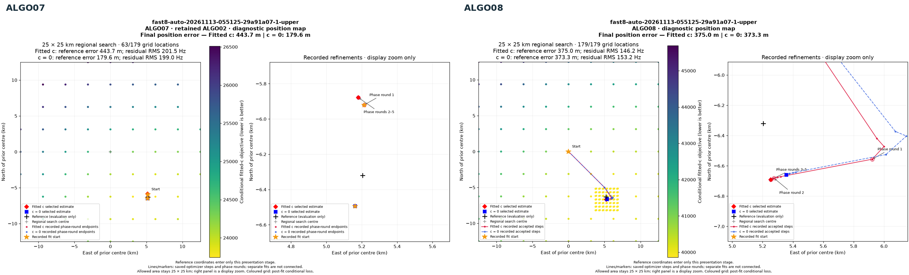
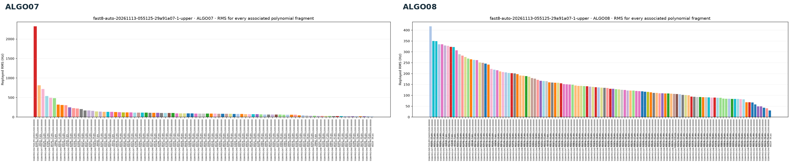

# ALGO08 · Gauss fast-scan positioning

ALGO08v2 is the default Standard analysis for new Gauss fast scans. It reads sealed dual-antenna 10 MS/s I/Q, searches for a pilot, subtracts it, and searches the residual. A fractional GLRT verifies the carriers and a causal rule selects measurements across visits. Compact v5 associates those measurements with capture-era satellites and fits the receiver position in the configured 25 km region. It runs both fitted RF calibration and a fixed-zero control. The release includes the two orbit-support retries qualified on DS30. [Full DS30 comparison with the standalone algo07v5 benchmark](../2026_11_21_ds30_full/README.md)

The [optimized two-scan triage report](ds30-optimized/README.md) compares the receiver promoted to ALGO08v2 with the previous deployed ALGO08v1 from sealed I/Q through position on 16 paired DS30 recordings. The replay tool defaults to four recordings on one worker.

## One recording through both deployed algorithms

**DS30-0003** is a five-minute upper-edge roof recording with 6,769 visits. The receiver admitted 6,714 visits and excluded 55 on capture quality. The raw-I/Q replay reproduced the frozen DS30 detection digest and both compact position estimates. The historical production ALGO07 chain retained its ALGO02 incumbent on this scan.

| Web result on DS30-0003 | Deployed ALGO07 | ALGO08 |
|---|---:|---:|
| Fitted-calibration horizontal error | 443.7 m | 375.0 m |
| Fixed-zero calibration horizontal error | 179.6 m | 373.3 m |
| Associated / supplied observations, fitted calibration | 2,695 / 3,649 | 3,764 / 5,318 |
| Associated tracks / satellites | 89 / 24 | 118 / 24 |
| Conditional RMS on associated observations | 201.5 Hz | 146.2 Hz |

The horizontal errors use the web publication’s evaluation-only roof reference. Each RMS uses that pipeline’s own fitted observations. The position maps show the regional objective grid and the recorded refinements. The grid overlays sample the objective after inference and have a separate rendering budget.



### Signal and frequency diagnostics

The four signal views show both receivers across channels 1–8. Each pair below comes from two separate, digest-addressed web images. The full-resolution originals remain available in the Gauss comparison viewer. A browser decoded all 16 originals and the gallery exporter checked every byte count and SHA-256. [Live comparison on the Gauss LAN](http://gauss:8090/api/v2/fast-scans/fast-d911a0d623499203c21d3b6832715b82/standard-analysis/compare/algo08-6079a23eed191f3079ee6ab7ef0ed108) · [PNG dimensions, URLs and digests](DS30-0003/web-figures.json)

| Diagnostic | Channels 1–4 | Channels 5–8 |
|---|---|---|
| All detections and fitted orbits | [View PNG pair](DS30-0003/ch1-4-all.png) | [View PNG pair](DS30-0003/ch5-8-all.png) |
| Unassociated detections and fitted orbits | [View PNG pair](DS30-0003/ch1-4-unassociated.png) | [View PNG pair](DS30-0003/ch5-8-unassociated.png) |
| Conditional frequency residuals | [View PNG pair](DS30-0003/ch1-4-residuals.png) | [View PNG pair](DS30-0003/ch5-8-residuals.png) |



## Running the release

The November 21 deployment check follows two recent lower-edge recordings from sealed I/Q to their Gauss scan pages. The report includes the original web PNGs and recording-level measurements. [Two-recording deployment check](2026-11-21-deployment-check/README.md)

On Gauss the automatic watcher selects ALGO08 for an unassigned sealed recording. A job already assigned to the ALGO07 pipeline resumes under its original identity. A successful ALGO08 fix publishes the eight PNGs atomically under its own run ID. A scientific withholding decision publishes its reason with no position or position PNG. Worker failures appear in the automatic recording status.

On November 21 the first recording to finish under the new default was the 08:55 UTC lower-edge scan. The standard Gauss scan page displayed the completed ALGO08 result, and Chromium decoded all eight PNGs there. Its horizontal error was 614 m with fitted calibration and 653 m with calibration fixed at zero. A separate replay of DS30-0003 through the installed service environment reproduced the published decision and both positions byte for byte in its terminal receipt. [First automatic scan on the Gauss LAN](http://gauss:8090/?scan_kind=fast&scan_id=fast8-auto-20261121-085557-e20f7f08-1-lower) · [Published manifest](http://gauss:8090/api/v2/fast-scans/algo08-75fc65851211b638301e33722fde31a5/standard-analysis)

To replay a saved fast recording manually, use the installed release with a writable local output root. The launcher supplies the Gauss regional configuration, read-only orbit archive and evaluation-only roof reference.

```sh
/opt/leo-algo08/current/run --recording "$RECORDING" --bulk-root "$OUTPUT" --region "$REGION_JSON"
```

In the regional release, supply a JSON file such as `{"center":[-33.0,20.0],"width_km":25}`. The center is latitude then longitude in degrees. The width is the full side of the square. Satellite screening uses the center unless the file supplies a separate `screen_center`. A station service can set `ALGO08_REGION_FILE`. Giving `--region` explicitly also drops the station's scoring reference. Supply `--evaluation-reference LAT LON` separately to score and annotate that offer after inference. Search squares crossing a pole or the longitude seam are unsupported. [Gauss station configuration](../../deploy/gauss/algo08-region.json) · [Blind regional evaluation and PNGs](regional-release/README.md)

The model ID is `algo08-two-scan-compact-v5-v1`. The web API serves its manifest at `/api/v2/fast-scans/{run_id}/standard-analysis`. Each named PNG accepts the manifest digest in the `sha256` query parameter. To rebuild the comparison images from the live server, pass the two run IDs in historical, then compact order.

```sh
PYTHONPATH=.:src .venv/bin/python tools/compare_algo08_web.py http://gauss:8090 \
  fast-d911a0d623499203c21d3b6832715b82 algo08-6079a23eed191f3079ee6ab7ef0ed108 \
  "$OUTPUT/gallery"
```

The Gauss staging script accepts a new absolute release directory, the qualified CPython 3.12 numerical environment’s site-packages directory, and the qualified pilot and track assets. It builds the v2 detector from its versioned C sources and checks the binary digest. Build the web app before staging. It builds the native position kernels at the release path and keeps the read-only API and analysis worker in separate environments. The systemd templates bind both services to that release. [Staging script](../../deploy/scripts/stage-algo08-gauss) · [Analysis service](../../deploy/systemd/leo-fast-scan-standard-algo08.conf) · [Web service](../../deploy/web/algo08-standard-api.conf)
