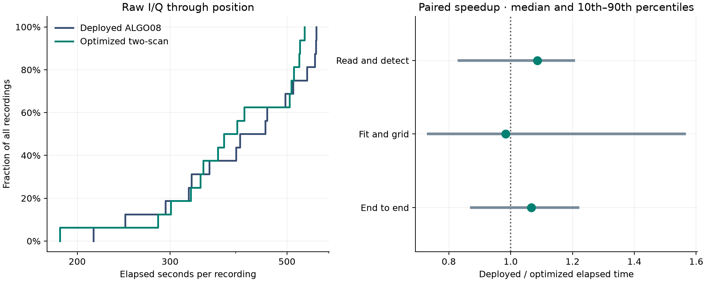
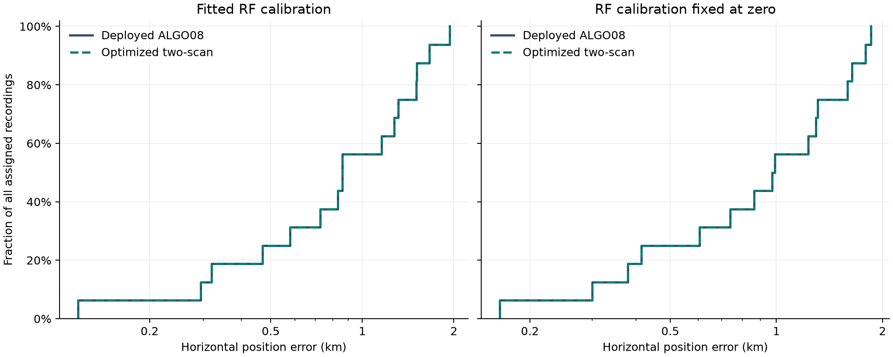

# Optimized two-scan versus deployed ALGO08 · DS30 triage panel (16/455)

On Gauss the optimized pipeline took **6.3% less elapsed time end to end** at the median of the 16 recording pairs. Deployed ALGO08 returned **16/16 fixes** and the optimized pipeline returned **16/16**. Their fitted-calibration decisions and coordinates agreed on **16/16** recordings, counting a shared withholding or solver failure as a matching decision.

The panel contains the first 16 recordings in the frozen DS30 prediction order. Panel membership is independent of completion order, timing and position error. See the [measurement protocol](PROTOCOL.md) for the worker count and timing conditions.

Each pipeline independently read the sealed I/Q and processed 97,363 eligible dual-antenna visits. Both used the installed regional compact v5 solver, the station profile and the same capture-era TLE archive. The only implementation change was the two-scan receiver library.

The optimized receiver reuses the list of eligible frequency bins, stores FFT coefficients in stage order, and returns the verified factors directly. It keeps both searches and the final exact-pilot versus control test.

## Runtime

| Stage | Deployed median / P90 elapsed | Optimized median / P90 elapsed | Paired median elapsed speedup | Paired median CPU speedup |
|---|---:|---:|---:|---:|
| Read, verify and detect | 324.6 / 364.8 s | 295.6 / 344.8 s | 1.086× | 1.182× |
| Position fit and diagnostic grid | 111.2 / 210.0 s | 110.2 / 218.4 s | 0.984× | 0.998× |
| Raw I/Q through position | 430.9 / 565.9 s | 391.1 / 528.4 s | 1.067× | 1.100× |

The optimized pipeline finished sooner on 11/16 recordings. Speedups are calculated for each pair before taking the median. Each pair ran sequentially on one pinned core with one numerical thread. The two order groups and CPU times below help separate the receiver change from shared I/O and cache effects.

| First arm | Pairs | Median elapsed speedup | Median CPU speedup |
|---|---:|---:|---:|
| Deployed | 8 | 1.116× | 1.090× |
| Optimized | 8 | 1.017× | 1.110× |

Summed over the cohort, the replay workers recorded 1.23 process CPU-hours for deployed ALGO08 and 1.12 for the optimized build (-9.0%).

## Fix rate and horizontal error

| Pipeline | Calibration | Fixes / assigned | Median error | P90 | P95 | Within 1 km / assigned | Median solver frequency RMS |
|---|---|---:|---:|---:|---:|---:|---:|
| Deployed ALGO08 | Fitted | 16/16 (100.0%) | 0.860 km | 1.586 km | 1.728 km | 9/16 | 114.09 Hz |
| Deployed ALGO08 | Zero | 16/16 (100.0%) | 0.981 km | 1.714 km | 1.806 km | 9/16 | 114.14 Hz |
| Optimized two-scan | Fitted | 16/16 (100.0%) | 0.860 km | 1.586 km | 1.728 km | 9/16 | 114.09 Hz |
| Optimized two-scan | Zero | 16/16 (100.0%) | 0.981 km | 1.714 km | 1.806 km | 9/16 | 114.14 Hz |

Error percentiles and frequency RMS use returned fixes. For the curves, the height at 1 km is the fraction of all assigned recordings that returned a fix within 1 km. The final height is the fix rate. Where the errors coincide, the dashed optimized curve lies on the solid deployed curve.

Among 16 common fitted fixes, the median change in error was +0.000 m, and the largest separation between the two published coordinates was 0.000 m.

## Recording-level checks

- Deployed ALGO08 returned 16 fixes, withheld 0 and had 0 solver failures.
- Optimized two-scan returned 16 fixes, withheld 0 and had 0 solver failures.
- The decisions matched on 16/16 recordings. The complete post-history measurement streams matched on 16/16.
- On 32 returned recording/calibration pairs, 32 coordinates and 32 solver RMS values were exactly equal. The final owner hashes agreed on 16 common fixes.
- The freshly deployed baseline reproduced 32/32 previously published DS30 decision, coordinate and frequency-RMS rows.

DS30 measures repeated recordings at one physical station. These results do not estimate accuracy at a second location or runtime on an embedded processor. The clock covers recording read, decompression, digest checks, detection, causal selection, orbit preparation, position and its diagnostic grid. It stops before PNG encoding, web publication and scoring.

[Protocol and reproduction](PROTOCOL.md) · [Paired timings](runtime.csv) · [Positions and errors](positions.csv) · [Locked raw prediction receipts](predictions.zip) · [Receiver source](receiver-source.zip)
