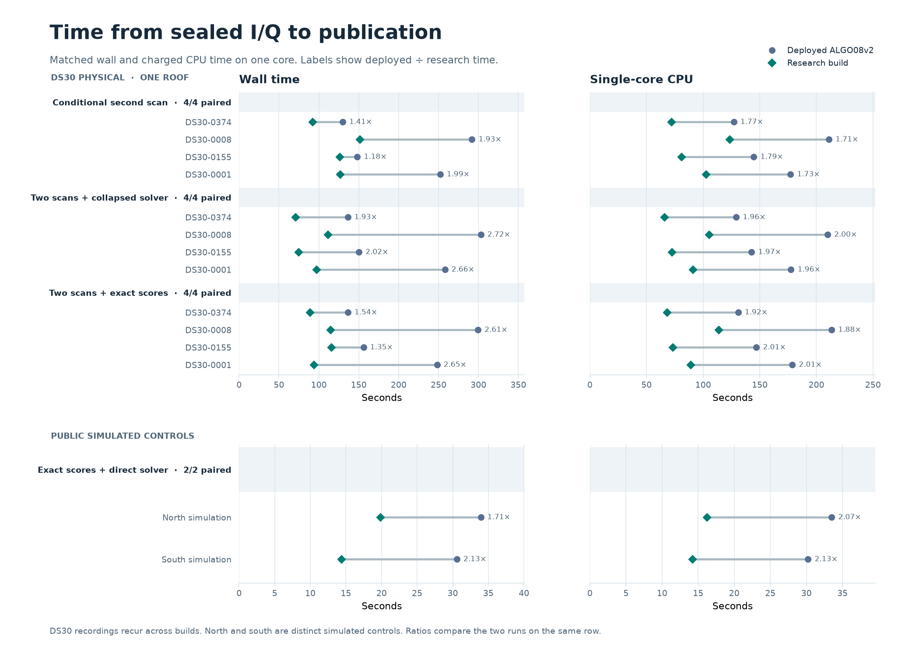
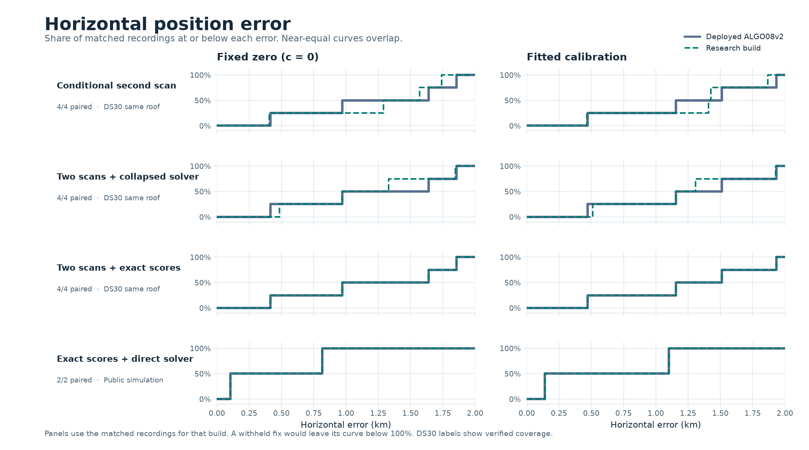

# Twelve hours of ALGO08v2 single-core experiments

**22 November 2026, 04:11–16:11 UTC.** The exact-score receiver reproduced the deployed coordinates in both calibration fits and every pixel of all 32 web figures on four physical DS30 recordings. It cut total elapsed time from 839.85 to 412.76 seconds. The median recording used 51.7% of deployed elapsed time, above the 50% target. A later implementation reached 2.10× total CPU speedup on two public simulated signals. Neither build has qualified for fresh-location confirmation. [Four physical comparisons](fractional-selected-four.md) · [Two simulations](exact-curved-public-sites.md)

| Candidate | Matched recordings | Total wall speedup | Total CPU speedup | Fitted median error, deployed → candidate |
|---|---|---:|---:|---:|
| [Conditional second scan](conditional-ds30-stage.md) | 4 DS30 | 1.66× | 1.74× | 1.334 → 1.418 km |
| [Two scans with a collapsed solver](full-phase-ds30-stage.md) | Same 4 DS30 | 2.40× | 1.97× | 1.334 → 1.233 km |
| [Two scans with exact detector scores](fractional-selected-four.md) | Same 4 DS30 | 2.03× | 1.95× | 1.334 → 1.334 km |
| [Exact scores for every factor and direct solver assembly](exact-curved-public-sites.md) | 2 public simulations | 1.89× | 2.10× | 0.621 → 0.621 km |

## Runtime

The timer starts at sealed raw I/Q and ends after both position fits and all eight required PNGs. Each row joins a candidate and its own deployed control on the same recording, on one low-priority Gauss CPU. The physical recordings all come from one roof. The public simulations exercise two different locations. Their inputs were already cached.

The earlier collapsed solver ran fastest by total elapsed time. On its two pairs where both processes reported zero disk reads, the elapsed speedup was 1.97×. It also increased fitted error by 41 m on one recording. The later exact-score implementation recovered that recording's deployed position. Across four recordings its elapsed time through detection fell from 600 to 254 s, solving from 216 to 147 s and publication from 24 to 12 s. Physical cache residency varied substantially between arms. The 1.95× CPU gain corroborates a reduction in computation. [Collapsed solver](full-phase-ds30-stage.md) · [Exact receiver and stage timing](fractional-selected-four.md)

## Position error and regional decisions

The cumulative curves include every matched recording with an offer containing the receiver. A curve at 50% means half of those recordings returned a fix within that distance. Each step represents one recording. Every build published on every containing offer shown.

The exact-score physical build matched all 48,674 detector rows, 21,690 retained observations, satellite assignments, fit residuals, solver paths and published coordinates. Its fitted median/P90 error was 1.334/1.808 km and its fixed-zero median/P90 was 1.306/1.791 km. With four recordings, P90 is an interpolated description of this panel. Diagnostic grid minima agreed, with maximum score difference 1.46 × 10⁻¹¹ and a differing model label. [Physical audit](fractional-selected-four.md)

The latest public candidate evaluates exact scores directly, assembles the solver's design matrix directly and hints the next compressed input read. At the northern and southern simulations it matched both deployed fits and all 16 PNGs. Fitted errors were 141 m and 1,101 m. Both sites correctly withheld when the receiver was 52.5 km outside the search region. Both issued false fixes when it was just 100 m outside. Each omitted-region test reuses a waveform already in the figure. The fresh geographic holdout remains sealed. [Public site and omission results](exact-curved-public-sites.md)

Generate both figures from the archived receipts with `python -m reports.ALGO08.single-core-2x.progress_12h_plot --snapshot 1611`.
