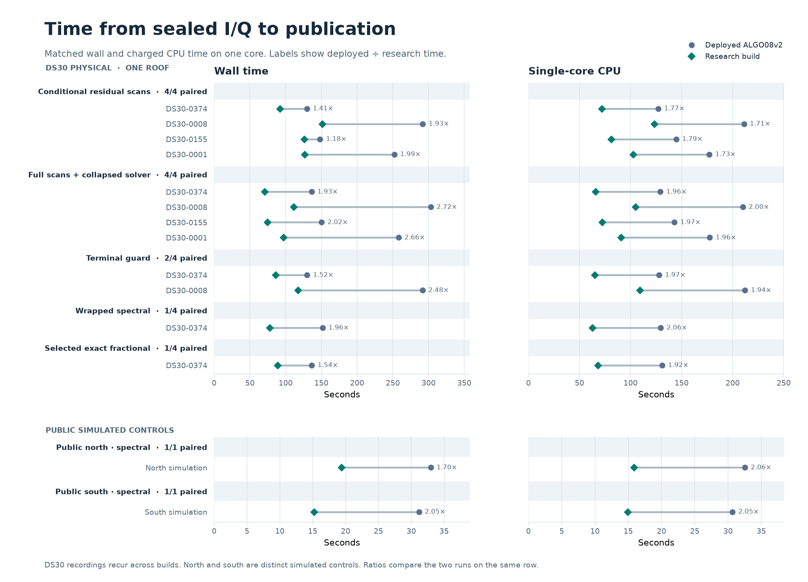
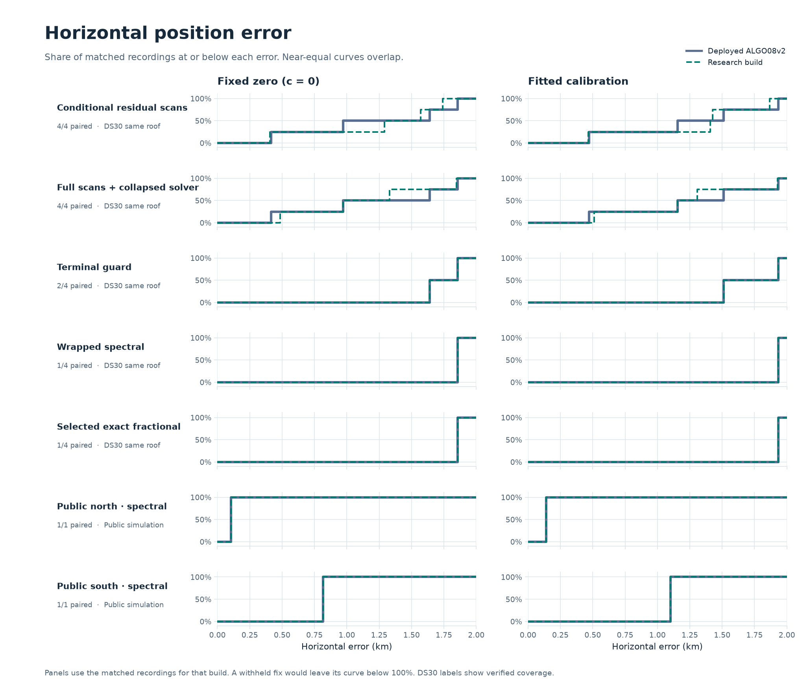

# Twelve hours of single-core ALGO08 work

**22 November 2026, 03:32–15:32 UTC.** The newest receiver reproduced deployed positions and all eight web figures on its first physical recording. It took **88.68 s** versus **136.35 s** for ALGO08v2, or **1.54× wall and 1.92× CPU**. The candidate ran first with 26% of input file pages in cache. Deployment ran with 100% cached. All 9,288 detector rows, including all 4,157 selected signals, agreed. Both calibrations had identical owners, paths and coordinates. All 179 diagnostic grid locations and their validity agreed. Grid scores differed by up to 7.28 × 10⁻¹² and the grid metadata differed. [Pair receipt](measurements/DS30-0374-fractional-selected.json) · [Field and image comparison](measurements/fractional-selected-0374-audit.json)

On 22 November, an early research build reached **2.40× summed wall-clock speedup on four DS30 recordings**, with four fixes and all 32 web figures. Two comparisons had substantial baseline disk reads. On the two pairs with zero reported input blocks for both builds the speedup was **1.97×**. Median fitted position error improved, but one recording got 41 m worse. DS30 measures repeatability at one roof. [Four-recording report and receipts](full-phase-ds30-stage.md)

## Runtime and position distributions

Each runtime line joins two measurements on exactly the same recording. Disk reads and scheduling influence wall time. The error panels show the share of tested recordings with a published fix within each distance. These five physical builds reuse at most four recordings. The two public simulations use distinct locations and each contributes one containing-region timing pair.

| Build and panel | Matched recordings | Summed wall speedup | Summed CPU speedup | Median fitted error, deployed → research |
|---|---:|---:|---:|---:|
| Conditional second scan, DS30 | 4 | 1.66× | 1.74× | 1.334 → 1.418 km |
| Both scans and collapsed solver, DS30 | 4 | 2.40× | 1.97× | 1.334 → 1.233 km |
| Final region check, DS30 | 2 | 2.08× | 1.95× | 1.724 → 1.724 km |
| Spectral receiver and wrapped longitude, DS30 | 1 | 1.96× | 2.06× | 1.935 → 1.935 km |
| Restored fractional scores, DS30 | 1 | 1.54× | 1.92× | 1.935 → 1.935 km, identical coordinates |
| Spectral receiver, public northern and southern simulations | 2 | 1.86× | 2.05× | 0.621 → 0.621 km, identical coordinates |

Every containing offer shown here returned a fix in both calibration arms. The two one-recording rows share DS30-0374. Acquisition, solver and publication respectively took 62.01, 23.97 and 2.69 s with restored fractional scores, against 91.32, 39.33 and 5.69 s for deployment. Observed single-core CPU for this pair was 68.10 versus 130.91 s. This candidate has one verified pair in the snapshot.

## Changes that mattered

- **Production.** The optimized two-scan receiver became ALGO08v2. Its separate 16-recording comparison against original ALGO08 kept all 16 fitted positions and yielded a median paired speedup of 1.067× from raw I/Q through position. That timer ends before web publication. [16-recording runtime and position distributions](../ds30-optimized/README.md)
- **Receiver and solver.** The four-case winner kept both scans, reduced the work to verify pilot phase, and combined steps in the satellite and position search. It took 353.28 s against 847.34 s elapsed, and 333.94 s against 659.45 s CPU. A version that conditionally skipped residual scans saved less time and increased median error. [Full two-scan](full-phase-ds30-stage.md) · [Conditional scan](conditional-ds30-stage.md)
- **Position reproducibility.** On DS30-0374 the later spectral receiver kept the same 4,157 winning frequencies, epochs and ranks. Score differences of at most 2.25 × 10⁻¹³ propagated through the estimated noise into a 0.0435 mm increase in fitted position error. Replaying the deployed scores recovered deployed coordinates and optimizer paths on both a sparse and a dense saved recording. The revised receiver then reproduced all 232 deployed detector rows on a separate chronological prefix. [Physical pair](wrapped-spectral-physical.md) · [Solver crossover](solver-deployed-margin-recovery.md) · [Exact receiver](receiver-fractional-absolute-score.md)
- **Geography.** The spectral candidate and deployment agreed on the positions and all 16 web figures at two public simulated sites with valid offers. Both withheld when the correct position was 52.5 km outside. Both returned false fixes just 100 m outside the offered square, also when the face orientation changed and neither center coordinate equaled the receiver's. Fresh held-out locations remain reserved. [Simulated sites](spectral-publication.md) · [Rotated offers](north-south-faces.md)

The research timer covers raw I/Q, two scans, association, both position fits and web publication on one low-priority Gauss CPU. One recording can appear in several builds. Each comparison uses its own matched deployment run. Replaying the same signal at another search boundary adds a decision test but adds no independent recording to either distribution.
