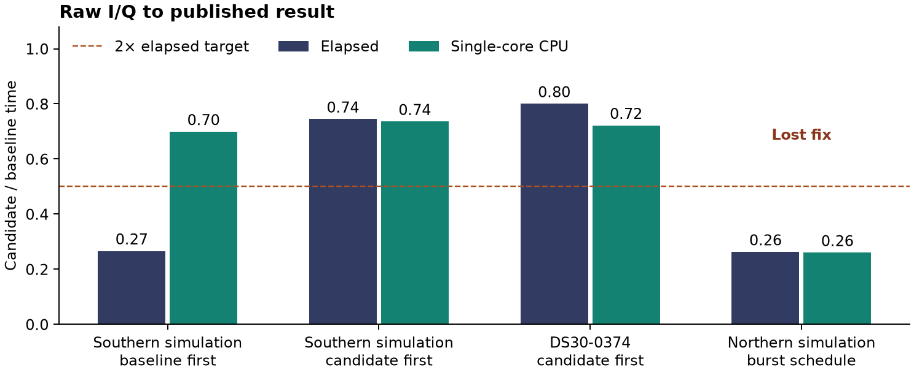
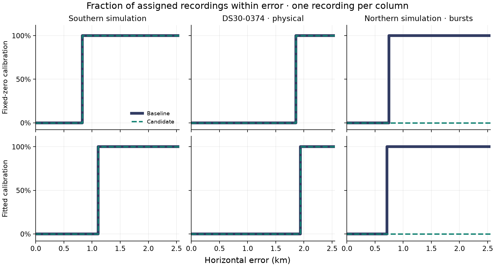

# ALGO08v2 single-core experiments

The latest frozen build adds paired SHA-256 verification and guarded reuse of position endpoint calculations. On the southern simulated boundary case it returned the same positions and eight PNGs in **16.22 versus 30.64 seconds (1.89×)**. It fell 0.90 seconds short of halving elapsed time. [Southern full-pipeline comparison and figure](full-search-publication.md#successor-on-the-southern-near-edge-recording)

The full-observation successor took **82.01 versus 147.37 seconds** on the first recording in the fixed DS30 order, and **21.71 versus 32.81 seconds** on the public northern boundary case. The physical baseline incurred disk reads. Its single-core CPU comparison was **130.00 → 80.31 seconds (1.62×)**. Both recordings retained every selected measurement, both positions and eight byte-identical PNGs. Across the two pairs the median elapsed ratio was 0.609 and the summed ratio was 0.576. [Matched runtime and position plots, stage costs and receipts](full-search-publication.md)

**The approximate track-moment search failed on DS30-0008.** Fitted position error rose from 1.512 to 2.916 km and neither shortlist contained the other solver's winning assignment. Keep full-observation ranking for qualification. On a different physical recording, DS30-0161, the integrated experimental build ran 1.66× faster with both inputs cached and exactly reproduced both positions and all eight figures. The 2× end-to-end target and physical transfer to another station remain open. [Measurements, error plot and geographic qualification](location-triage.md)

On the earlier two-case comparison, the candidate with moments and deferred receiver measurements took **18.85 versus 24.69 seconds elapsed (1.31×)** on DS30-0016 and **17.76 versus 31.58 seconds (1.78×)** on a southern simulation. Single-core CPU speedups were 1.60× and 1.77×. Every ordered detector row, both positions and all eight PNGs matched on both recordings. [Matched report and figure](moments-publication.md) · [Previous build and wrong-region results](shared-publication.md) · [Geographic qualification protocol](PROTOCOL.md)

The successor with full-observation ranking and shared plot layout preserved the valid northern near-edge fix at **106 m fixed-zero and 141 m fitted**. It ran end to end in **21.71 versus 32.81 seconds** and preserved every detector row and all eight PNGs. [Successor measurement](location-triage.md#full-observation-successor-on-a-valid-boundary-case)

## Earlier build on a longer physical recording

The build combines receiver `107909cc`, a single compressed input buffer, causal orbital parsing and coarse salvage statistics. The run traverses the same sealed recording in each arm. The physical recording is the first entry in the frozen DS30 order. It has 6,770 windows, of which 4,644 passed the existing capture-quality checks. The southern simulation has 1,200 valid windows. Both builds returned identical owners, optimizer paths, numerical grid values, frequency residuals and eight PNGs on each recording.

| Recording and run order | Elapsed seconds, baseline → candidate | CPU seconds, baseline → candidate | Position error, fixed zero / fitted |
|---|---:|---:|---:|
| DS30-0374 · candidate first | 130.64 → 104.56 | 129.42 → 93.40 | 1.855 / 1.935 km |
| Southern simulation · baseline first | 85.25 → 22.71 | 32.33 → 22.60 | 0.826 / 1.109 km |
| Same southern recording · candidate first, repeat | 30.32 → 22.58 | 30.30 → 22.29 | 0.826 / 1.109 km |

The first southern timing has a 53-second elapsed-minus-CPU gap for the baseline. On the physical recording the kernel reported 16,314,480 input blocks for the candidate and zero for the subsequent baseline. The first southern pair alone would cross the elapsed target. Its reversed-order repeat and the physical result show why that observation cannot establish a 2× speedup. [Physical receipt](measurements/DS30-0374.json) · [Southern baseline-first receipt](measurements/south-baseline-first.json) · [Southern candidate-first receipt](measurements/south-candidate-first.json)

On DS30-0374, elapsed time to the detection-file timestamp was 88.93 → 69.30 seconds. From there through the terminal decision and diagnostic grid took 36.06 → 29.62 seconds. Finishing publication took 5.65 → 5.64 seconds. Halving the baseline on this recording would require another 39.24 seconds elapsed, or 28.69 seconds using CPU time as a separate design budget. Further changes must address acquisition and inference together. The four- and sixteen-recording panels remain reserved for a stronger candidate.





The northern burst result used a separate experimental schedule. It discarded 576 valid visits and lost the baseline fix. Its shorter runtime includes the resulting withholding path. The error plot keeps that recording in the denominator. [Burst experiment](cadence.md) · [Plot generator](plot_triage.py)

A second shortcut kept every valid visit and used recent measurements on the same RF lane to propose timing and carrier frequency. On a chronological DS30-0016 prefix, it reduced receiver CPU by 17% relative to the optimized exact detector, but lost 30 of 152 verified factors and 9 of 53 causal selections. The experiment stops at receiver triage. [Causal tracking experiment](receiver-tracking.md)

The largest solver saving measured so far came from collapsing several fits into one paired fit. On the physical DS30-0374 case it cut solver-plus-grid CPU from **28.69 to 13.46 seconds**, but worsened position by more than 400 m in each calibration arm. Simulated containing sites improved under the same algorithm. A second real recording showed the existing exact solver still needed 72.66 CPU seconds starting from saved detections. A separate near-edge check also found a 106 m fix that a simple wrong-region guard would wrongly suppress. [Collapsed solver](solver-collapsed.md) · [Remaining cost and failed shortcuts](cost-checks.md) · [Near-edge geographic test](edge-trial.md)

Restoring predictive observations brought the physical errors down to 2.005 and 2.098 km, still above the control's 1.855 and 1.935 km. Trying to recover the remaining fragments in a single joint step failed the track-quality checks. On the receiver side, rechecking a short candidate list cut roughly 7% of native CPU but replaced a verified carrier on saved physical data. None qualified for a larger panel. [Predictive recovery](solver-linear-addback.md) · [Single recovery pass](solver-salvage-addback.md) · [Receiver shortlist](receiver-shortlist.md)

The complete physical detection file took about 55 ms of CPU to hand off, including validation and sealing. The paired 40-visit traces place caller overhead near 2% of acquisition CPU. Even removing this work entirely projects about 1.3% off the integrated candidate's CPU for DS30-0374. [Archive-to-detections measurements](receiver-boundary.md)

Keeping only the first and last quarters of a scan cut the long physical solve from 28.69 to 13.68 CPU seconds. The fitted position error rose from 1.94 to 6.33 km. Applying that same schedule at the two public simulated sites improved fitted error in the north and more than doubled it in the south. An alternative that sampled observations only for early ranking and restored all observations for final fits reduced the physical solver to 26.70 CPU seconds and improved both physical errors. Its existing false fix on a far northern offer moved another 3 km away. [Receiver schedules and error curves](channel-schedules.md) · [Sampled initial solver](solver-sampled-initial.md)

A shorter detector aperture retained every verified factor on one simulated prefix while losing 13 of 25 on the other. Halving the nominal scout rate also folds distinct legal carrier offsets into the same band. [Aperture results](receiver-aperture.md) · [Pilot bandwidth and sampling rate](receiver-rate.md) · [Exact discovery timing](solver-discovery.md)

On a short physical recording, actually skipping alternate RF visits cut raw-to-PNG elapsed time from 24.85 to 19.70 seconds and CPU from 24.48 to 13.71 seconds. Both pipelines published all eight figures, but fitted position error increased from 1.66 to 3.02 km. Skipping visits changed carrier selections even on visits that the candidate kept. [End-to-end comparison and plot](alternate-visits.md)

## One full recording, both run orders

The input comprised 1,200 sealed dual-antenna windows at the northern simulated site. Each invocation read the raw I/Q and started with a fresh output directory. The clock covered the receiver, both calibration fits, diagnostic grid, optimizer path, eight PNGs and standard report. The candidate combined detector `ab7b4765` with scan-scoped orbit parsing and the revised coarse salvage calculation. It ran on the same pinned CPU as the deployed baseline. [Candidate-first receipt](measurements/north-candidate-first.json) · [Baseline-first receipt](measurements/north-baseline-first.json)

| Order on Gauss | Baseline elapsed | Candidate elapsed | Baseline CPU | Candidate CPU |
|---|---:|---:|---:|---:|
| Candidate first | 33.18 s | 80.49 s | 32.92 s | 26.86 s |
| Baseline first, repeat | 32.86 s | 25.60 s | 32.62 s | 25.51 s |


The first candidate invocation spent about 54 seconds beyond its measured CPU time. File-cache state and contention were uncontrolled. Reversing order after the first pair does not recreate the initial machine state. Both observations count. They measure one unique recording.

The 2,400 lane records matched. Both runs selected identical associations, coordinates and frequency residuals in each calibration arm. The optimizer stages and numerical grid values matched apart from build provenance and timing metadata. The fixed-zero position was **745 m** from simulated truth, with 5.380 Hz frequency RMS. The fitted position was **711 m** from truth, with 5.173 Hz frequency RMS. All eight published PNGs matched by SHA-256. [Previously published position scores](../regional-release/blind-scores.csv)

## Geographic evidence

| Check | What it establishes |
|---|---|
| DS26, DS29 and DS30 | Saved real signals from the same physical station. Recordings across these datasets do not constitute independent sites. |
| Public northern and southern simulations | Regression checks across regional frames, capture geometry and pilot edges. On the containing offers, the saved-input solver reproduced both baseline positions. |
| Public northern simulation, incorrect region | The candidate solver reproduced a false boundary fix about **52.5 km** from truth in both calibration arms. Compatibility with the deployed solver gives no protection against an incorrect search offer. |
| Fresh simulated sites | The scorer can now select two unseen geographic areas in opposite hemispheres, vary which pilot edge each receives, and generate matching containing and missing-region offers. This confirmation is reserved until a complete candidate and its thresholds are frozen. |
| Independent physical site | Field transfer remains unverified. The archived off-site material identified so far lacks one or more inputs required for a matched full pipeline run. |

The inference launcher passes only the offered region, raw recording and capture-time orbital archive. The benchmark checks the region on the grid and path and excludes station truth from the publication. The scorer draws new site centers at least 1,600 km from listed development centers, allowing for jitter in generated sites. Use the regional generator's `--fresh-sites` option in a new workspace with the scorer directory restricted to its own account. Keep the scoring key hidden until predictions are locked. [Geographic sampler](../../../tools/pipeline_eval/qualification/holdout_geography.py) · [Regional generator](../regional-release/blind_panel.py) · [Independent data inventory](../regional-release/README.md)

## Component results

The later detector `107909cc` ran **1.74–1.77×** faster in native calls on the first saved 160 lanes. Across four small waveform panels, including prefixes from both simulated locations, 484 lane comparisons reproduced the exported factors. Single-allocation compressed input reduced reader CPU by 25–26% on two short sealed prefixes. The solver changes produced **1.14×** on the larger of two saved DS30 solver inputs and **1.32–1.33×** on the two containing regional simulations. [Receiver and build flags](receiver.md) · [Compressed input](receiver-ingress.md) · [Solver results](solver.md) · [Guarded residual statistics](solver-statistics.md) · [Sparse solver prototype](solver-schur.md)

## Reproduce a pair on Gauss

Build the receiver following the receiver report. Freeze a runner against the pinned release with `python -m tools.pipeline_eval.qualification.freeze_publication "$bundle" "$detector" "$detector_sha256" --solver combined --ingress compressed-buffer` using the Python and path settings below. Set `candidate_spec="$bundle/spec.json"`. For the southern and DS30 timings the measured runner and freeze script are at commit `464d79150` and the buffered reader source is at `345093401`. The earlier northern pair used the runner at `7bd42c2fa`. The candidate source hashes are in each receipt. The current runner scopes the input buffer to acquisition. Supply one saved recording and its public search offer per command.

```sh
release=/opt/leo-algo08/bdb869682a2ea63af4b198a920b763a4c6a78c4c
export PYTHONPATH="$PWD:$release/src:$release"
"$release/venv/bin/python" -BPs -m tools.pipeline_eval.qualification.paired_publication \
  "$recording" "$offer" "$tle_archive" "$bundle/reports/ALGO08/single-core-2x/run-candidate" \
  "$new_output_dir" --candidate-config "$candidate_spec" --first baseline
```

Use a separate new output directory and `--first candidate` for reverse order. The harness serializes work with the shared Gauss lock and records the run order, CPU and elapsed seconds, decisions, both calibration arms and verified publication evidence. [Paired benchmark](../../../tools/pipeline_eval/qualification/paired_publication.py)

For fresh confirmation, generate the public panel under the scorer account. Record its SHA-256 and the candidate source and binary pins before inference. Under the separate inference account, supply `--blind-panel "$public/panel.json" "$panel_sha256"` on each assigned pair. This checks the manifest digest, matching recording and offer, truth commitment, and effective isolation from the scoring key. Keep both runs on the same public inputs and lock every result before releasing the scoring key.

Store each assigned pair under `$runs/<offer>/pair.json`. Use `python -m tools.pipeline_eval.qualification.score_paired_holdout lock "$public/panel.json" "$panel_sha256" "$candidate_spec_digest" "$runs" "$locked"` to seal all assignments and record the printed SHA-256 independently. Then use `score "$locked" "$locked_sha256" "$scoring_key" "$summary"` on the same module under the scorer account. Missing cases remain in the denominator and prevent qualification. The summary includes both timing gates, errors and false fixes by site and calibration arm. A relative pass can still reproduce a known baseline false fix.
