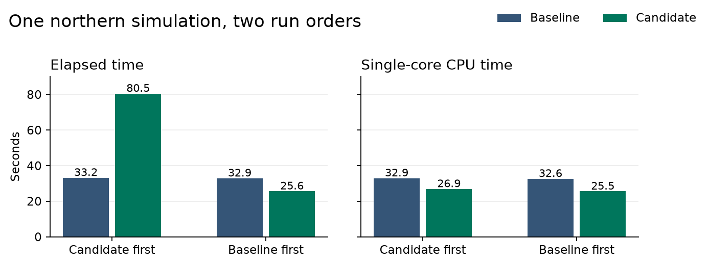

# ALGO08v2 single-core experiments

The first integrated candidate preserved both fixes and all eight PNGs on a previously published simulated recording away from Gauss. Its single-core CPU saving was 18–22%. End-to-end elapsed time varied substantially with run order. The 2× elapsed-time target remains open. [Qualification protocol](PROTOCOL.md)

## One full recording, both run orders

The input comprised 1,200 sealed dual-antenna windows at the northern simulated site. Each invocation read the raw I/Q and started with a fresh output directory. The clock covered the receiver, both calibration fits, diagnostic grid, optimizer path, eight PNGs and standard report. The candidate combined detector `ab7b4765` with scan-scoped orbit parsing and the revised coarse salvage calculation. It ran on the same pinned CPU as the deployed baseline. [Candidate-first receipt](measurements/north-candidate-first.json) · [Baseline-first receipt](measurements/north-baseline-first.json)

| Order on Gauss | Baseline elapsed | Candidate elapsed | Baseline CPU | Candidate CPU |
|---|---:|---:|---:|---:|
| Candidate first | 33.18 s | 80.49 s | 32.92 s | 26.86 s |
| Baseline first, repeat | 32.86 s | 25.60 s | 32.62 s | 25.51 s |



The first candidate invocation spent about 54 seconds beyond its measured CPU time. File-cache state and contention were uncontrolled. Reversing order after the first pair does not recreate the initial machine state. Both observations count. They measure one unique recording.

The 2,400 lane records matched. Both runs selected identical associations, coordinates and frequency residuals in each calibration arm. The optimizer stages and numerical grid values matched apart from build provenance and timing metadata. The fixed-zero position was **745 m** from simulated truth, with 5.380 Hz frequency RMS. The fitted position was **711 m** from truth, with 5.173 Hz frequency RMS. All eight published PNGs matched by SHA-256. [Previously published position scores](../regional-release/blind-scores.csv)

## Geographic evidence

| Check | What it establishes |
|---|---|
| DS26, DS29 and DS30 | Saved real signals from the same physical station. Recordings across these datasets do not constitute independent sites. |
| Public northern and southern simulations | Regression checks across regional frames, capture geometry and pilot edges. On the containing offers, the saved-input solver reproduced both baseline positions. |
| Public northern simulation, incorrect region | The candidate solver reproduced a false boundary fix about **52.5 km** from truth in both calibration arms. Compatibility with the deployed solver gives no protection against an incorrect search offer. |
| Fresh simulated sites | The scorer can now select two unseen geographic areas in opposite hemispheres, vary which pilot edge each receives, and generate matching containing and missing-region offers. This confirmation is reserved until a complete candidate and its thresholds are frozen. |
| Independent physical site | Field transfer remains unverified. The archived off-site material identified so far lacks one or more inputs required for a matched full pipeline run. |

The inference launcher passes only the offered region, raw recording and capture-time orbital archive. The benchmark checks the region on the grid and path and excludes station truth from the publication. The scorer draws new site centers at least 1,600 km from listed development centers, allowing for jitter in generated sites. Use the regional generator's `--fresh-sites` option in a new workspace with the scorer directory restricted to its own account. Keep the scoring key hidden until predictions are locked. [Geographic sampler](../../../tools/pipeline_eval/qualification/holdout_geography.py) · [Regional generator](../regional-release/blind_panel.py) · [Independent data inventory](../regional-release/README.md)

## Component results

The later detector `107909cc` ran **1.74–1.77×** faster in native calls on the first saved 160 lanes. Across four small waveform panels, including prefixes from both simulated locations, 484 lane comparisons reproduced the exported factors. This detector differs from the `ab7b4765` receiver in the end-to-end table. The solver changes produced **1.14×** on the larger of two saved DS30 solver inputs and **1.32–1.33×** on the two containing regional simulations. [Receiver measurements and build flags](receiver.md) · [Solver measurements and checks](solver.md)

## Reproduce a pair on Gauss

Build the receiver following the receiver report. Use the pinned release and a checkout of this research branch, including its matching `tools` package. In a copy of the candidate specification from either receipt, replace `detector` with the absolute path to the matching library and keep its SHA-256. Supply one saved recording and its public search offer per command.

```sh
release=/opt/leo-algo08/bdb869682a2ea63af4b198a920b763a4c6a78c4c
export PYTHONPATH="$PWD:$release/src:$release"
"$release/venv/bin/python" -BPs -m tools.pipeline_eval.qualification.paired_publication \
  "$recording" "$offer" "$tle_archive" "$PWD/reports/ALGO08/single-core-2x/run-candidate" \
  "$new_output_dir" --candidate-config "$candidate_spec" --first baseline
```

Use a separate new output directory and `--first candidate` for reverse order. The harness serializes work with the shared Gauss lock and records the run order, CPU and elapsed seconds, decisions, both calibration arms and verified publication evidence. [Paired benchmark](../../../tools/pipeline_eval/qualification/paired_publication.py)
