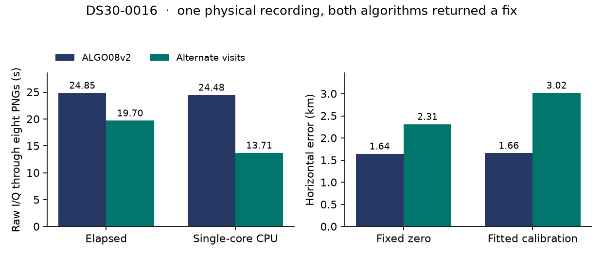

# Alternating complete receiver visits on the same RF

Process the first, third and subsequent odd-numbered valid visits independently for each channel and actual RF. Keep both antennas on those visits. This preserves time coverage across a recording and differs from taking consecutive arcs. The schedule uses neither location nor estimated signal strength.

## Two checks from saved detections

First remove every other visit **after** the existing receiver has already applied its carrier-continuation rule. This isolates the effect on the position solver. Each kept visit still benefits from the full receiver history in this diagnostic. Its output can differ from a receiver that actually skips the other visits.

| Physical recording | Solver and grid CPU, all → alternating | Fixed-zero error, all → alternating | Fitted error, all → alternating |
|---|---:|---:|---:|
| DS30-0016 | 4.70 → 4.48 s | 1.644 → 2.186 km | 1.661 → 2.166 km |
| DS30-0374 | 28.69 → 15.90 s | 1.855 → 1.625 km | 1.935 → 1.696 km |

The long recording gave promising errors and solver time. We chose the short recording for the first raw test to measure the effect of rebuilding carrier history and bound the Gauss workload. [Saved evidence scores and source digests](measurements/channel-schedules.csv)

## End to end on DS30-0016

The candidate used the frozen optimized receiver, compressed-input buffering, combined compact solver and the alternate-visit schedule. Its comparator was the deployed ALGO08v2 release. Both read the same sealed 808-window recording, used the same 95 capture exclusions, and completed both calibration arms, a region-bound grid and path, the web report and eight digest-verified, decodable PNGs. Each ran alone on CPU 2 with one numerical thread and low process and I/O priorities. The experimental candidate ran first.

| Measurement | Deployed ALGO08v2 | Alternate visits |
|---|---:|---:|
| Eligible visits searched / available | 713 / 713 | 359 / 713 |
| Selected antenna measurements | 440 | 186 |
| Elapsed through standard publication | 24.85 s | 19.70 s |
| Single-core CPU through standard publication | 24.48 s | 13.71 s |
| Fixed-zero horizontal error | 1.644 km | 2.312 km |
| Fitted horizontal error | 1.661 km | 3.017 km |

Elapsed speedup was **1.26×**, and CPU speedup was **1.79×**. The kernel charged 1,674,032 input blocks to the candidate and zero to the subsequent baseline. Both raw reads and complete artifact publication fall inside the measured boundary. The timings compare the full experimental composition against deployment, so they do not isolate the schedule's speed contribution. One pair cannot establish its latency distribution. [Full paired receipt with artifact digests](measurements/DS30-0016-alternate.json)

The alternating entries taken from the deployed detection file contained 219 selected measurements on 718 antenna visits. The real alternating receiver returned 186 measurements on the same 718 antenna visits. Joining by visit, antenna, actual RF and sample counter showed 680 identical selections, 35 lost, two newly selected and one changed carrier. Fitted error worsened by a further 0.85 km relative to the saved-detection estimate. This branch fails accuracy even though it retains a fix and produces all required artifacts. We did not expand it to a full DS30 panel.

To repeat the pair, use the research freezer with `--solver combined --ingress compressed-buffer --schedule alternate`, its pinned receiver `107909cc`, the source recording and regional inputs identified in the receipt, and the paired launcher with `--first candidate --cpu 2`. [Freezer](../../../tools/pipeline_eval/qualification/freeze_publication.py) · [Acquisition schedule](../../../tools/pipeline_eval/variants/experimental/receiver_cadence.py) · [Paired launcher](../../../tools/pipeline_eval/qualification/paired_publication.py)
