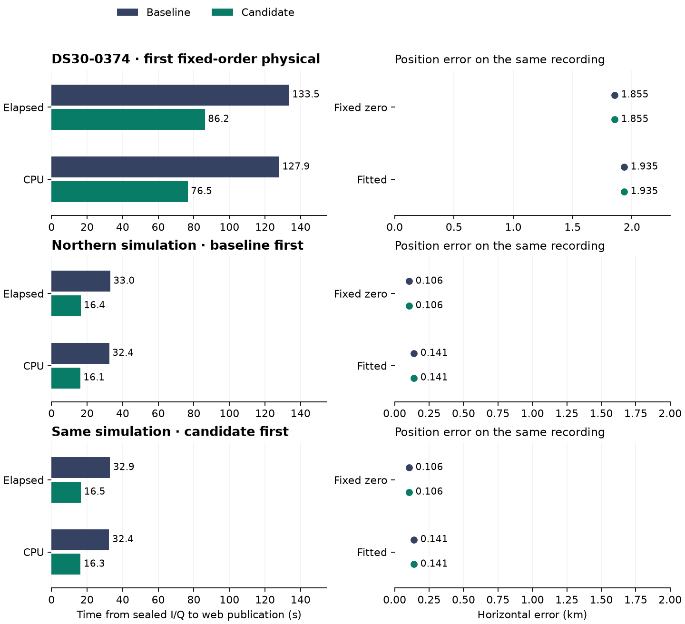
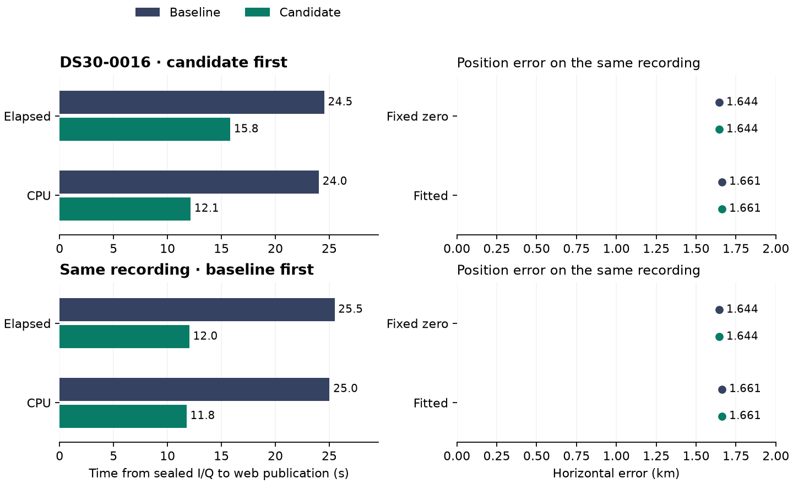

# Single-core ALGO08v2 on a longer physical recording and a geographic boundary

The new candidate took **86.17 seconds** from sealed I/Q to all eight web figures on DS30-0374, against **133.50 seconds** for deployed ALGO08v2. Its process incurred filesystem reads and the baseline's did not. The corresponding compute comparison was **76.54 versus 127.94 CPU seconds**. On a simulated northern recording it ran close to 2× in either run order. These are development measurements.

| Recording and order | Deployed → candidate elapsed | Deployed → candidate CPU | Elapsed speedup | Fixed-zero / fitted horizontal error, both builds |
|---|---:|---:|---:|---:|
| DS30-0374, candidate first | 133.50 → 86.17 s | 127.94 → 76.54 s | 1.55× | 1.855 / 1.935 km |
| Northern simulation, baseline first | 33.02 → 16.42 s | 32.43 → 16.15 s | 2.01× | 0.106 / 0.141 km |
| Same northern recording, candidate first | 32.86 → 16.53 s | 32.36 → 16.31 s | 1.99× | 0.106 / 0.141 km |

The northern receiver was 100 m inside the search square. Both builds issued the valid fix. Its first timing beat the half-time target by 0.09 seconds, while the reversed repeat missed by 0.10 seconds. The first pair for each distinct recording gives a median candidate/baseline elapsed ratio of **0.571** and summed ratio of **0.616**. The target is **0.500** on each. The repeated simulation contributes no additional location or independent recording. [Physical receipt](measurements/DS30-0374-batch.json) · [Northern receipt](measurements/north-edge-batch.json) · [Reversed receipt](measurements/north-edge-batch-reverse.json)

## Where the longer recording spends time

| Stage measured from file timestamps | Physical elapsed, deployed → candidate | Northern elapsed, deployed → candidate (first pair) |
|---|---:|---:|
| Launch to sealed detections | 89.86 → 58.06 s | 19.30 → 8.44 s |
| Detections to terminal decision and grid | 38.21 → 25.46 s | 9.38 → 6.09 s |
| Terminal decision to complete publication and exit | 5.43 → 2.65 s | 4.34 → 1.88 s |

DS30-0374 is the first recording in the frozen order, with 6,770 scheduled windows and 4,644 admitted windows. The candidate executed 8,933 native calls for the two receiver lanes. Those calls consumed **32.02 CPU seconds**, and 355 unnecessary calls were skipped. The candidate would need **another 12.58 CPU seconds** to halve deployed CPU on this recording, or **19.42 seconds elapsed** in this candidate-first pair. The OS reported 16,313,656 filesystem input blocks for the physical candidate and zero for the following baseline. Both processes used one pinned core and one numerical thread under the shared low-priority Gauss lock.

All 9,288 physical lane rows and 4,157 selected measurements, and all 2,400 northern rows and 456 selected measurements, matched within their respective pairs. Both calibration arms reproduced satellite owners, coordinates, frequency residuals, grid values and paths. Each of the eight PNGs per comparison matched in decoded pixels, dimensions, mode and metadata. The candidate's compressed PNG bytes differ, and the lossless audit checks the actual encoded files against their respective manifests. [Physical audit](measurements/DS30-0374-batch-audit.json) · [Northern audit](measurements/north-edge-batch-audit.json) · [Reversed audit](measurements/north-edge-batch-reverse-audit.json)

## Candidate and scope

The receiver evaluates four neighboring fractional pilot interpolations together while preserving each one's original arithmetic and wrapped-phase fallback. The orbital reader validates standard element records in a native pass and retains the original reader for other formats. Relative to the preceding frozen build, these two changes require neither the station's surveyed position nor a local satellite list. The matching science on one physical and one simulated site does not establish physical transfer. The proposed altitude fit has been tested separately, and the earlier missed-region false fix remains a qualification issue. [Receiver and component results](receiver-fractional-batch.md) · [Orbital parser](tle-records.md) · [Height observability](height-position.md) · [Wrong-region replay](full-search-publication.md#same-recording-with-the-receiver-outside-the-search-square)

Reproduce with research commit `2e71cb967` over release `bdb869682`. Use the preceding lossless build flags with receiver `c5fca3e24` and additional `--tle-parser PATH SHA256` for library `4bdfbfd24`. The full pins appear in every receipt under candidate spec digest `e40942b4f8ef6581b14c2ad7d49baf73c2519afa17a00f78339c92b7731cbb6a`. Run the paired publisher, then `audit_shared_publication.py --lossless-png PATH/pair.json`. Regenerate the figure with `python -m reports.ALGO08.single-core-2x.plot_shared_publication --trial batch`. [Preceding build recipe](lossless-publication.md#reproduction)

## Short physical repeat with deferred collection

The successor adds a faster checksum for canonical orbit exports and defers cyclic garbage collection during solver preparation. Both changes apply at any offered location. Research commit `678232312` adds the freezer option `--defer-preparation-gc`. The frozen specification digest is `27c54db6c798fcb41a7fa0632c0ed3933db384180b13e1b25cb68699aa965449`. [Solver preparation experiment](solver-gc.md)

| DS30-0016 run order | Deployed → candidate elapsed | Elapsed speedup | Deployed → candidate CPU | CPU speedup |
|---|---:|---:|---:|---:|
| Candidate first | 24.54 → 15.82 s | 1.55× | 24.03 → 12.15 s | 1.98× |
| Baseline first | 25.49 → 12.03 s | 2.12× | 25.03 → 11.77 s | 2.13× |

The candidate spent 3.67 seconds more in elapsed time than on CPU when run first, versus 0.25 seconds when run second. Its launch-to-detections interval fell from 10.68 to 6.96 seconds across the repeats. Both orders recorded zero filesystem input blocks. These counters do not isolate the cause of the difference. The two orders describe one recording at one physical station. The longer DS30-0374 measurement above used the preceding build. [Candidate-first timing](measurements/DS30-0016-gc.json) · [Baseline-first timing](measurements/DS30-0016-gc-reverse.json)

Both orders reproduced all 1,426 lane rows, 440 selected measurements, both calibration results, the numerical grid and all eight figures' decoded pixels. Reproduce the plot with `--trial gc`. [Candidate-first audit](measurements/DS30-0016-gc-audit.json) · [Baseline-first audit](measurements/DS30-0016-gc-reverse-audit.json)

