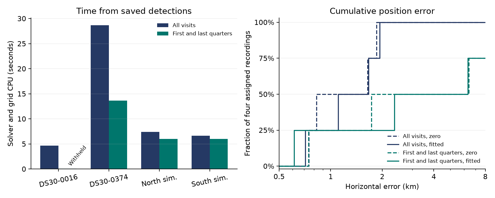

# Which receiver measurements can the position solver afford to lose?

Running about half the antenna searches has the potential to reduce both acquisition and fitting time. We tested three fixed schedules on saved two-scan detections. All use the recording clock or channel numbering. The regional solver received the usual offer and capture-era orbital archive, with identical track, fitting and publication-grid settings. Evaluation coordinates entered after each solve. The raw I/Q reader, native searches and PNG creation were outside these timings.

## First and last quarters of the recording

Keep both antennas and every channel during the first and last quarters of the capture clock. The retained arcs cover nearly the full elapsed span, including its endpoints. To reproduce the retained causal carrier selections, a receiver must also run both scans in up to eight seconds immediately before the final quarter. These measurements supply continuation history and do not enter the position fit. Earlier measurements cannot contribute to the released eight-second voting window. This allows a replay from saved detections while charging the hypothetical receiver for its warmup.

| Containing offer | Searched lanes including warmup / full | Solver and grid CPU, full → arcs | Fixed-zero error, full → arcs | Fitted error, full → arcs |
|---|---:|---:|---:|---:|
| DS30-0016, physical | 1,032 / 1,426 | 4.70 → 0.09 s | 1.644 km → withheld | 1.661 km → withheld |
| DS30-0374, physical | 4,820 / 9,288 | 28.69 → 13.68 s | 1.855 → 6.412 km | 1.935 → 6.334 km |
| North, simulated | 1,280 / 2,400 | 7.42 → 6.01 s | 0.745 → 0.742 km | 0.711 → 0.611 km |
| South, simulated | 1,280 / 2,400 | 6.65 → 6.00 s | 0.826 → 1.732 km | 1.109 → 2.352 km |

The solver returned three of four fixes. The short physical recording withheld with no active curvature. The longer physical recording returned a fix and incurred more than 4 km of additional error in each arm. A fallback triggered only by withholding would miss this regression. These two recordings share a rooftop. Both simulated sites are public development fixtures. The raw receiver search count is a projection from the timestamps. Each solver CPU time is measured on one low-priority Gauss core. [Per-case table](measurements/channel-schedules.csv) · [Full solver receipts](measurements/channel-schedules.json.gz)

The long physical recording shows what changed in the fit. The published solution went from 81 tracks across 20 satellites to 29 tracks across eight satellites. Associated observations fell from 2,905 to 962. The solver's fitted-calibration frequency RMS improved from 101.52 to 98.04 Hz on this reduced support even as horizontal error rose. On the southern simulation the fitted frequency RMS was 6.39 Hz in both cases, while the fitted position error more than doubled. Frequency agreement alone would miss both regressions.

On DS30-0374 the measured solver saving is 15.01 CPU seconds. Subtracting it from the full candidate's earlier 93.40 CPU seconds would still leave about 13.69 seconds to reach half the baseline CPU time. To close that gap by skipping 48.1% of antenna searches, those searches would have to save at least 13.69 seconds in aggregate. A raw replay of this schedule would not resolve its measured position regression, so no end-to-end speedup is claimed.

## Keeping continuous histories on fewer antennas or channels

One schedule keeps one antenna on every visit to each channel, alternating antennas by channel number. The other keeps both antennas on alternating channels. Each was tested along with its complement before selecting any outcome. Each retained receiver, channel and frequency history is identical to its original full-data history. These trials can therefore use the original selected measurements directly.

| Schedule | Short DS30-0016 | North simulation, fixed-zero / fitted horizontal error |
|---|---|---|
| All antennas and channels | 1.644 / 1.661 km | 0.745 / 0.711 km |
| One antenna per channel, two assignments | Both failed during the leave-one-family-out calculation | 0.869 / 0.768 km and 1.001 / 0.846 km |
| Stereo on alternating channels, two assignments | Both failed at the same step | 0.844 / 0.739 km and 0.955 / 1.213 km |

On the physical recording each half-input fit reached that step with only one curved satellite family, containing 42 or 48 observations. Removing that family left no observations for the comparison. All four failures count against coverage. On the northern simulation all four configurations retained enough evidence for a fix, yet both position errors rose in each configuration. [Replay and diagnostics](channel_lane_trial.py) · [Schedule implementation](../../../tools/pipeline_eval/variants/experimental/channel_lane.py)

## Can the existing timestamps certify a visit as irrelevant?

The released continuation rule requires at least three earlier measurements on the same receiver, channel and RF within eight seconds, with at least one 0.4 seconds old. It inspects at most twelve previous visits. A timestamp-only prepass can safely exclude a receiver call if that visit can neither publish under those constraints nor contribute to any later visit that can. This test assumes favorable carrier frequencies at every eligible time, so it works without a site model or a signal-amplitude threshold.

Across the saved schedules for DS30-0016, DS30-0374, DS30-0008 and both public simulations, **zero of 29,044 antenna searches** could safely be removed on this basis. Some startup visits cannot publish, but supply history to later visits. This check read the saved timestamps and required no new I/Q replay. [Measured counts](measurements/continuation-schedule.json) · [Schedule audit](continuation_schedule_trial.py)
