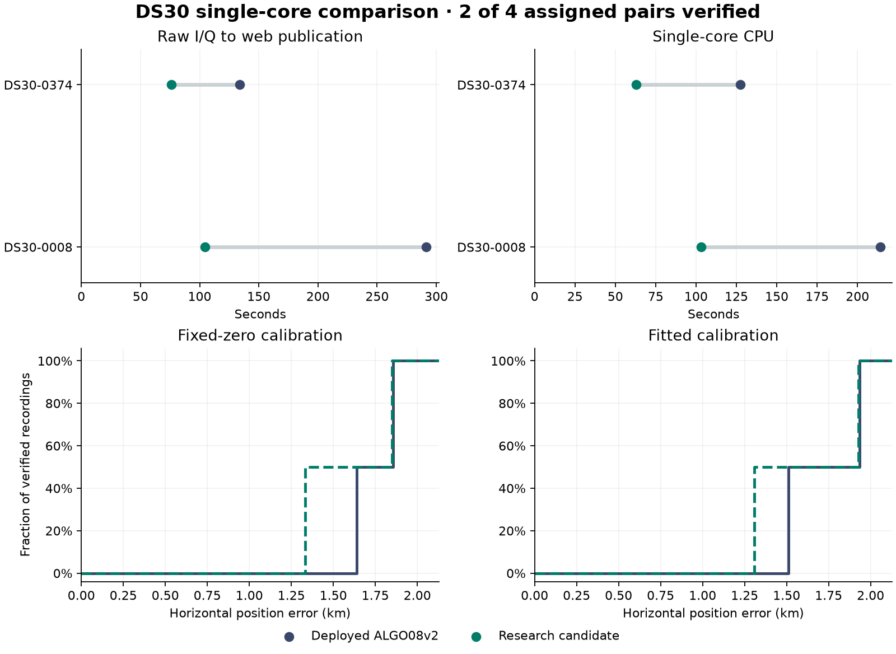

# Two Gauss recordings with the covariance receiver and predictive solver

Both pipelines returned both calibration fixes and all eight web figures on each recording. Total single-core CPU fell from **341.55 to 166.18 seconds (2.06×)**. Total elapsed fell from **425.26 to 180.24 seconds (2.36×)**, with unequal disk reads in both pairs. These are the first two assignments of the fixed four-recording stage and both come from one station. The stage score leaves its qualification gates unset. [Verified stage inventory](measurements/covariance-ds30-two-pairs.json) · [Frozen candidate](measurements/covariance-posterior-freeze.json)



| Recording | First build | Elapsed seconds, deployed → candidate | CPU seconds, deployed → candidate | OS input blocks, deployed → candidate |
|---|---|---:|---:|---:|
| DS30-0374 | Candidate | 133.77 → 75.91 | 127.55 → 63.01 | 0 → 16,470,936 |
| DS30-0008 | Deployed | 291.49 → 104.33 | 214.00 → 103.17 | 16,035,624 → 0 |

The median of the two paired elapsed ratios was 0.463. Each first build incurred substantial reads. Neither pair gives a comparison with zero filesystem input blocks on both sides. The archived checks cover a single pass over the compressed recording. [Storage audit](storage-io-accounting.md)

| Recording | Fixed-zero error (km), deployed → candidate | Fitted error (km), deployed → candidate | Fixed-zero frequency RMS (Hz), deployed → candidate | Fitted frequency RMS (Hz), deployed → candidate |
|---|---:|---:|---:|---:|
| DS30-0374 | 1.855 → 1.848 | 1.935 → 1.928 | 101.536 → 101.496 | 101.520 → 101.482 |
| DS30-0008 | 1.639 → 1.331 | 1.512 → 1.308 | 129.703 → 125.892 | 129.663 → 125.820 |

Compared separately with the earlier research build on the same inputs, this candidate preserved all 4,157 and 7,016 selected measurements, the final satellite assignments, both positions, their RF residuals and every encoded figure. The optimizer paths agreed. On DS30-0374 a small number of grid scores differed by at most 7.28 × 10⁻¹² in either arm. DS30-0008 also matched the earlier numerical grid. Deployment itself gave different positions and figures, as the errors above show. [Cross-build comparison receipts](measurements/covariance-ds30-two-cross-checks.json) · [Earlier research build](full-phase-ds30-stage.md)

The two remaining roof assignments were deferred after a saved off-site simulation exposed a regression with identical detector rows. That comparison isolates a solver problem that further Gauss recordings cannot resolve. The public edge cases also gave false fixes when the true location was missing by 100 m. The full four- and sixteen-recording qualification scores and the independent confirmation are still open for a candidate that preserves accuracy across locations. [Off-site solver results](covariance-geographic-transfer.md) · [Latitude boundary results](covariance-latitude-faces.md) · [Qualification design](PROTOCOL.md)

The plot can be regenerated from the checked-in inventory. To compare two research builds, run the following commands from the repository root with the project's Python environment and `PYTHONPATH=.:src`. The last command uses the original pair receipts on Gauss.

```sh
dir=reports/ALGO08/single-core-2x
python -m reports.ALGO08.single-core-2x.plot_ds30_stage \
    "$dir/measurements/covariance-ds30-two-pairs.json" "$dir/covariance-ds30-two-pairs.png"
case_id=DS30-0008
python -m reports.ALGO08.single-core-2x.selected_changes \
    "/tmp/ds30-v2-stage-covariance-375895/$case_id/pair.json" \
    --earlier-candidate "/tmp/ds30-v2-stage-full-phase-50d300/$case_id/pair.json"
```
