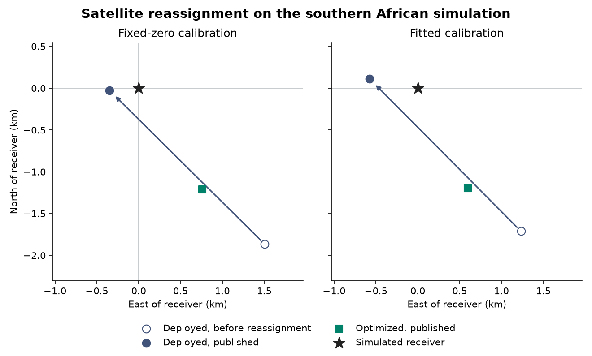

# Covariance solver replay at two additional public simulated locations

The installed ALGO08v2 and frozen covariance solver each kept two of two containing offers. Deployment returned fixes for both omitted offers. The covariance solver rejected the distant southern portable-v5 omission and returned a false fix for the India offer that excluded the receiver by 1.5 km. Covariance also increased containing-offer error in portable south on identical detector evidence. These outcomes apply to both calibration arms. [Scored receipt](measurements/covariance-geographic-transfer.json) · [Frozen covariance build](measurements/covariance-posterior-freeze.json)

## Cases and offered geometry

The India input is the released native detector output of the compiled stock wide GLRT on synthesized dual-receiver Qin CI16 windows. Its 2,400 probe rows and original native JSON SHA-256, clock envelope, region requests, TrackConfig, and 35 causal TLE collections matched the published locks. The archived waveform used a later orbit catalogue in synthesis. The inference workers received the original causal archive. [Original waveform experiment](https://github.com/misko/leo-tracker-reduxredux/blob/492ae73cb583ef4469e90c15411dea4b328490f9/reports/2026_11_19_receiver_screening/track-recovery/waveform-site/README.md) · [Detector lock](https://github.com/misko/leo-tracker-reduxredux/blob/492ae73cb583ef4469e90c15411dea4b328490f9/reports/2026_11_19_receiver_screening/track-recovery/waveform-site/detector-lock.json) · [Causal archive authority](https://github.com/misko/leo-tracker-reduxredux/blob/492ae73cb583ef4469e90c15411dea4b328490f9/reports/2026_11_19_receiver_screening/track-recovery/waveform-site/causal-authority.json)

The southern portable-v5 input is a 25,000-probe simulated measurement document. Its released seed and generator reproduced the published document, 35-collection causal history, and original jointly hashed requests byte for byte. Each case used 23 distinct TLE payloads. The portable simulator generated the factors directly using the common nominal catalogue and a simulated sample-counter clock schedule. The earlier portable worker reached its deadline on both offers at this site. The location and both offers were already public. [Original portable experiment](https://github.com/misko/leo-tracker-reduxredux/blob/492ae73cb583ef4469e90c15411dea4b328490f9/reports/2026_11_19_receiver_screening/portable-v5/README.md) · [Original prediction lock](https://github.com/misko/leo-tracker-reduxredux/blob/492ae73cb583ef4469e90c15411dea4b328490f9/reports/2026_11_19_receiver_screening/portable-v5/prediction-lock.json) · [Published portable scoring reference](https://github.com/misko/leo-tracker-reduxredux/blob/492ae73cb583ef4469e90c15411dea4b328490f9/reports/2026_11_19_receiver_screening/portable-v5/synthetic-labels.json)

| Case and reference | Offer center | Truth east / north of center | Truth clearance from nearest face | Center-alone error |
|---|---|---:|---:|---:|
| India, containing · 10.177124° N, 76.901884° E | 10.096732° N, 76.901884° E | 0.000 / +8.924 km | +3.576 km | 8.939 km |
| India, omitted | 10.050998° N, 76.901884° E | 0.000 / +14.000 km | −1.500 km | 14.025 km |
| Portable south, containing · 26.313592° S, 33.135932° E | 26.293760° S, 33.231375° E | −9.525 / −2.201 km | +2.975 km | 9.766 km |
| Portable south, omitted | 26.939949° S, 33.706494° E | −56.622 / +69.526 km | −57.026 km | 89.818 km |

Each square was 25 km wide and supplied its center for both the search and the sky screen. India’s offers disclose the true longitude. The two portable offers displace both coordinates. The nearest of the previous public covariance simulations to India is the northern site at 63.031° (7,009 km). The previous southern site is 68.130° away. The nearest to portable south is the previous southern site at 12.107° (1,346 km). The northern site is 75.655° away. These are additional geometries in released development simulations. Independent physical-station transfer at the post-detector boundary remains unmeasured. [Earlier released scoring locations](../regional-release/scoring-key.json)

## Matched results

Every paired value is fixed-zero / fitted `c`. Horizontal error is scored only for returned coordinates. The fit-quality columns report conditional Doppler RMS on each solver’s selected associations.

| Case | Center error | Installed horizontal error | Covariance horizontal error | Installed → covariance RF RMS |
|---|---:|---:|---:|---:|
| India, containing | 8.939 km | Valid · 1.017 / 0.751 km | Valid · 1.017 / 0.751 km | 15.536 / 15.306 → 15.536 / 15.306 Hz |
| India, omitted | 14.025 km | False fix · 1.580 / 1.534 km | False fix · 1.580 / 1.534 km | 15.631 / 15.451 → 15.631 / 15.451 Hz |
| Portable south, containing | 9.766 km | Valid · 0.351 / 0.583 km | Valid · 1.429 / 1.339 km | 24.107 / 24.089 → 24.472 / 24.429 Hz |
| Portable south, omitted | 89.818 km | False fix · 89.786 / 89.786 km | Withheld · `both_receivers_support_far_exterior` | 25.152 / 25.142 Hz → — |

At the containing India offer, the two builds agreed on endpoints, frequency RMS and owners for both arms. The exterior guard skipped the containing offer because both endpoints were interior. On the omitted offer, both arms hit the face. The two receivers chose the same point 3.125 km beyond that face with positive exterior gains. Keeping that fix followed the guard’s pre-existing requirement for exterior clearance of at least one square width.

Both portable estimates stayed much closer to truth than the containing offer center. Relative to deployment, the covariance solver’s containing error increased by 1.077 km at fixed zero and 0.756 km with fitted `c`. Both interior arms bypassed the guard. The shared final owner digest changed and associated points went from 4,149 to 4,203. Fitting `c` lowered conditional RMS in each build. It increased the installed position error by 0.232 km and decreased the covariance position error by 0.090 km. The solver CPU fell from 60.30 s to 29.47 s on this saved containing input. [Per-arm coordinates, owners and timings](measurements/covariance-geographic-transfer.json)

In the portable southern omission both covariance arms reached a face and triggered the guard. Each receiver agreed on a point 50 km beyond a face with positive gain. The guard withheld both arms. Deployment returned the same coordinate for both arms, 89.786 km from the reference. All eight solves completed within their limit. [Guard details and final decisions](measurements/covariance-geographic-transfer.json)

## How satellite reassignment moved the southern fix

On the southern containing offer, the deployed solver reconsidered whether two receiver tracks belonged to a different satellite. It reassigned 443 observations and its fitted position moved from 2.110 km to 0.583 km from the receiver. The optimized build published its previous fit at 1.339 km. The figure uses the public reference only to score positions after the solves. Both axes are distances in the supplied search frame. [Solver trace and earlier differences in track selection](portable-south-solver-attribution.md) · [Figure source](plot_portable_south_trace.py)



## Boundary exercised

Both schema-v1 documents entered the installed `algo08_position.solve` boundary for paired fixed-zero and fitted `c`. The two builds received the same factors, archive and offer on each query. The replay used the same solver assets, candidate composition and exterior guard as the frozen covariance measurements. It used local copies of only the published past TLE objects after verifying their digests and collection times. The scoring process opened the published references after reading all results. [Replay and scoring runner](covariance_transfer_trial.py)

The raw publication entry point requires sealed I/Q authority and publishes the Graph, path, grids and PNGs through the recording workflow. This replay measures the post-detector position solver and its internal evidence preparation. The released StarLoc physical-site suite starts from selected single-channel beacon tone tracks with separate GNSS references. Those inputs lack the ALGO08v2 native fractional candidate rows and ADC counter and delivery-clock authority. Altrincham’s released extraction had zero qualifying tracks. Those physical datasets would require a different inference boundary. [Released physical-track evidence](https://github.com/misko/leo-tracker-reduxredux/blob/492ae73cb583ef4469e90c15411dea4b328490f9/reports/2026_11_18_blind_regional_receiver/README.md)

## Reproduction

The runner uses the released Git objects pinned in its source and the read-only captured TLE archive. Use a fresh scratch directory. Workers run serially on Gauss core 2 under the shared lock with one numerical thread and a 110-second limit per solve. [Candidate specification](measurements/covariance-posterior-freeze.json)

```sh
bench=/tmp/leo-algo08v2-2x-bench
trial=reports/ALGO08/single-core-2x/covariance_transfer_trial.py
flock "$bench/gauss.lock" nice -n 15 ionice -c2 -n7 taskset -c 2 \
  env PYTHONPATH=src:. OPENBLAS_NUM_THREADS=1 OMP_NUM_THREADS=1 MKL_NUM_THREADS=1 \
  .venv/bin/python -BPs "$trial" replay "$bench/geodiverse-replay" \
  "$bench/integration-covariance-posterior"
PYTHONPATH=src:. .venv/bin/python -BPs "$trial" score "$bench/geodiverse-replay" \
  "$bench/geodiverse-scored.json"
```
