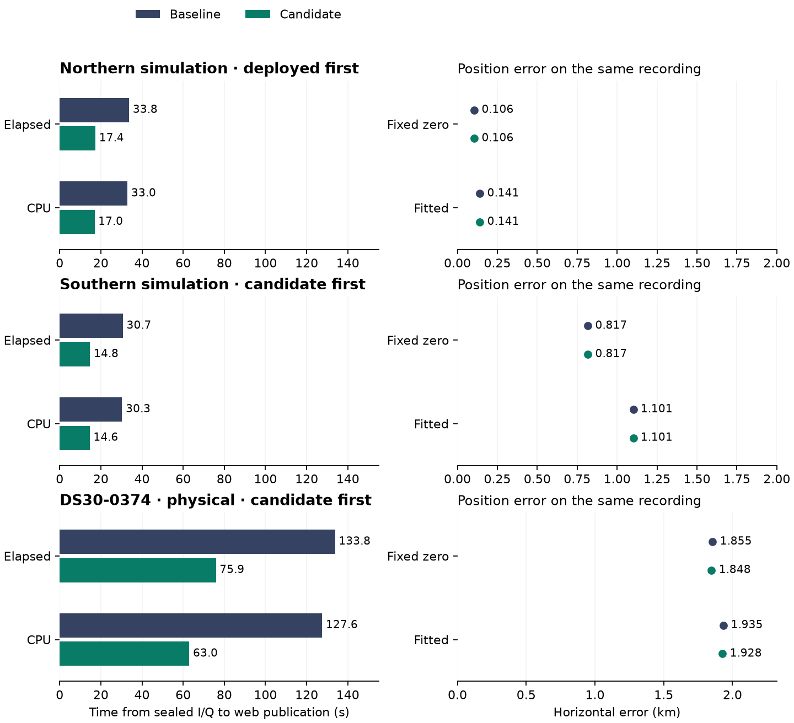

# Paired covariance receiver and predictive solver at the two public sites

The frozen build combines a full two-scan floating-point receiver with paired covariance accumulation and the signed solver with predictive grid factor reuse. The southern near-inside pair was specified before measuring it. Extend that comparison by running the identical build on the northern near-inside offer. Use candidate first in the south and deployed first in the north. Time raw I/Q through complete publication. Record CPU, elapsed time, OS input blocks, both calibration errors, winning measurements, assignments and decoded PNGs. These two recordings are public development inputs. Keep them separate from the Gauss roof stage and from fresh blind confirmation. [Frozen specification](measurements/covariance-posterior-freeze.json) · [Southern test selection](receiver-mode-pair.md#frozen-pipeline-for-the-next-paired-test)

Reuse each candidate's actual detections to move its near boundary from 100 m inside to 100 m outside and then to the published distant omission. Compare paired-median and summed elapsed ratios across the two complete raw-to-web runs only. Report valid fixes and false fixes separately. Scoring uses the existing public references after the solves. No site-specific parameters are fitted to these recordings. [Public offers](mirrored-regions.md) · [Qualification rules](PROTOCOL.md)

The two public near-inside recordings retained both positions and reached a summed elapsed ratio under 0.50. Open one pair on DS30-0374, the first existing physical assignment, with candidate first and an empty workspace. Its purpose is to measure whether the speed gain carries to a longer recording. Report cache counters and the two position errors against deployment. This single pair cannot qualify the four- or sixteen-recording stage or the missing-region decisions.

## Two matched raw-to-web comparisons

| Public recording | Elapsed seconds, deployed → candidate | CPU seconds, deployed → candidate | OS input blocks, deployed → candidate | Horizontal error in both builds, fixed-zero / fitted |
|---|---:|---:|---:|---:|
| [North, lower pilot edge](measurements/covariance-north-inside.json) | 33.75 → 17.38 | 32.99 → 16.96 | 0 → 88 | 0.106 / 0.141 km |
| [South, upper pilot edge](measurements/covariance-south-inside.json) | 30.72 → 14.78 | 30.34 → 14.61 | 0 → 40 | 0.817 / 1.101 km |

Total elapsed was **64.472 → 32.158 seconds (2.005×)**. The median paired elapsed ratio was **0.4980** and the summed ratio was **0.4988**. The summed margin below half the baseline was only **0.078 seconds**. Both CPU ratios also fell below 0.50. The northern candidate took 0.50 seconds longer than half its deployed time. There is a single timing in each order on different recordings. [Scored pairs](measurements/covariance-public-score.json)



The launch-to-detection, detection-to-terminal, and terminal-to-exit intervals in the north were 19.47 / 9.61 / 4.67 seconds for deployment and 9.41 / 6.02 / 1.95 seconds for the candidate. In the south the same intervals were 17.77 / 8.62 / 4.32 and 8.84 / 3.98 / 1.96 seconds. These elapsed intervals use the intermediate file timestamps. For both recordings the two pipelines agreed on every returned coordinate, frequency RMS and final satellite assignment. All 16 decoded figures matched deployment pixel for pixel. All 912 selections agreed on rank, measured time and carrier frequency. Numerical score differences were below 2.5 × 10⁻¹⁴. The predictive grid reused 272 factors across the two calibration arms in the north and zero in the south. [Northern replay receipt](measurements/covariance-north-bound-replays.json) · [Southern replay receipt](measurements/covariance-south-bound-replays.json)

## First physical recording in the DS30 order

On DS30-0374, time from sealed I/Q to web figures fell **133.77 → 75.91 seconds (1.76×)**. Single-core CPU fell **127.55 → 63.01 seconds (2.02×)**. The candidate ran first and incurred 16,470,936 filesystem input blocks, versus zero for deployment. Its three elapsed intervals were 54.38 / 18.96 / 2.57 seconds against 93.70 / 34.49 / 5.58. The I/O imbalance favors deployment in this pair. It does not establish the counterfactual elapsed time with identical cache state. [Matched pair](measurements/DS30-0374-covariance.json) · [One-of-four inventory](measurements/covariance-physical-inventory.json)

Fixed-zero horizontal error was **1.855 → 1.848 km** and fitted error was **1.935 → 1.928 km**. Frequency RMS fell **101.536 → 101.496 Hz** and **101.520 → 101.482 Hz**, respectively. Both builds produced all eight images. Their numerical endpoints and images differ from deployment. Compared with the previous four-pair research candidate on this very same input, the receiver reproduced all 4,157 selected measurements including scores, both position endpoints and owner maps matched, and the eight output PNG files were byte-identical. Three recordings remain unmeasured in this build's four-case stage. [Cross-build checks and stage times](measurements/covariance-physical-science.json) · [Earlier four-pair build](full-phase-ds30-stage.md)

The sealed manifest accounts for 8.41 GB of compressed I/Q. The candidate's charged reads correspond to 2,058,867 pages, against 2,058,708 pages for one pass through all recording members. Source inspection confirms that each reader traverses each compressed member once. Matching the earlier run's elapsed-minus-CPU gap would still leave this candidate about one second over half the current baseline's elapsed time. That is a sensitivity calculation. An actual run under those conditions remains unmeasured. [Storage accounting and assumptions](storage-io-accounting.md)

## Where the region decision fails

| Offered boundary | North, fixed-zero / fitted | South, fixed-zero / fitted |
|---|---|---|
| 100 m inside | Valid fix · 0.106 / 0.141 km | Valid fix · 0.817 / 1.101 km |
| 100 m outside | False fix · 0.123 / 0.118 km | False fix · 0.817 / 1.102 km |
| Distant omitted region | Withheld both arms | Withheld both arms |

The saved-input runner reproduced each original publication's coordinates, RF residuals and owner maps before substituting the two omitted offers. In the north, moving the face outside **reduced** fitted horizontal error from 141 m to 118 m while turning the publication into a false fix. An error-only metric would reward that mistake. Both distant omissions produced the reason `both_receivers_support_far_exterior`. The containing recording replays had frequency RMS **5.406 / 5.167 Hz** north and **6.502 / 6.392 Hz** south. [Northern decisions](measurements/covariance-north-bound-replays.json) · [Southern decisions](measurements/covariance-south-bound-replays.json)

Each of these six offers shares the true receiver latitude. They isolate east–west boundary behavior and cannot demonstrate independence from both coordinates of the offered center. Fresh-site qualification rejects an offer that reveals either true coordinate. [Geographic audit](geographic-input-audit.md)

An offline control also shows how uncertainty in the satellites' orbits can swamp a small boundary displacement. After fitting common nuisance terms, moving 200 m changed predicted Doppler by only 0.76 Hz north and 1.22 Hz south under the simulator's later orbital catalogue. Using the catalogue actually available at capture, the diagnostic preferred the same face for both noiseless alternatives at each site. The causal model alone can therefore produce one wrong decision in these controlled comparisons. Its contribution to the full position error remains unknown. [Orbit control, assumptions and measured receiver differences](mirrored-ephemeris.md)

Predictions grounded only in pre-capture orbit history were locked before scoring against the later orbits. Neither the signed phase mean nor rolling state extrapolation recovered the second face in either simulation. Giving less weight to satellites with less predictable orbits still chose the same face twice at both sites. These are fixed-association diagnostic results. They provide no basis for changing the deployment's orbit forecast or fitting a threshold to the two sites. [Held-time forecast comparison](mirrored-causal-forecast.md) · [Satellite weighting comparison](mirrored-orbit-weight.md)

## Reproduce the saved-region test

Use the original pair, launcher bundle and capture-time archive on Gauss. The replay requires only the saved detector output and region offers. Coordinates for error scoring are kept outside the runner. Use a new output file for each run. The example uses the public southern recording. [Raw pair launcher](../../../tools/pipeline_eval/qualification/paired_publication.py) · [Regional replay runner](replay_region_offers.py)

```sh
p=/tmp/leo-algo08v2-2x-bench
u=/tmp/leo-regional-qZJKBw4W/public
r=/opt/leo-algo08/bdb869682a2ea63af4b198a920b763a4c6a78c4c
spec=sha256:375895c3afda3abd3a916f90bbd63248b5e792f70c78a0e4f136c9bf1a79d423
flock "$p/gauss.lock" ionice -c2 -n7 nice -n15 taskset -c 2 \
  env PYTHONPATH="$PWD:$PWD/src:$r" OPENBLAS_NUM_THREADS=1 OMP_NUM_THREADS=1 MKL_NUM_THREADS=1 \
  "$r/venv/bin/python" -B -m reports.ALGO08.single-core-2x.replay_region_offers \
  "$p/covariance-south-inside/pair.json" "$p/integration-covariance-posterior" "$spec" \
  "$p/south-replay-repeat.json" "$p/mirrored-region/6bd1f26bfa0bedfcf3f100f8.json" \
  "$u/3393aaa78d96184906443a4e.json"
```
