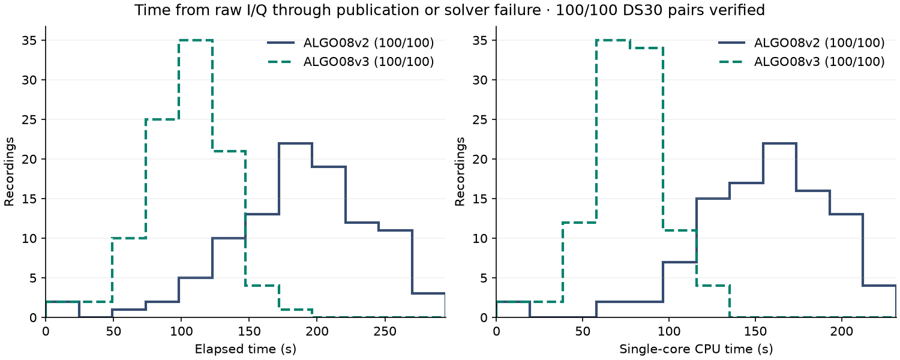
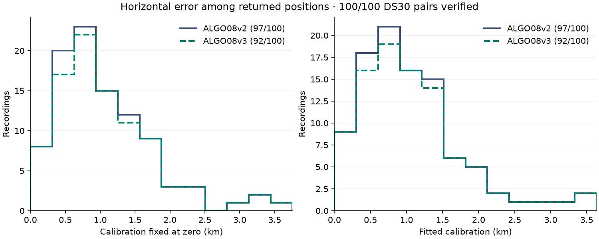

# ALGO08v3 and deployed ALGO08v2 on 100 DS30 recordings

ALGO08v3 missed the following original DS30 qualification criteria: median_time, summed_time, fix_rate, accuracy_and_decisions, no_new_solver_failures.

The frozen candidate was named ALGO08v3 at the user's request during the panel. The benchmark uses the original build, criteria and recordings throughout.

The median paired elapsed ratio was **0.56820** and the summed elapsed ratio was **0.55724**. Each compares candidate seconds with deployed seconds, with a 0.50 threshold.

These ratios correspond to **1.76×** and **1.79×** speedups respectively.

| Build | Fixes | Elapsed median / P90 (s) | Fixed-zero error median / P90 (km) | Fitted error median / P90 (km) |
|---|---:|---:|---:|---:|
| Deployed ALGO08v2 | 97/100 | 190.571 / 252.317 | 0.893 / 1.875 | 0.916 / 1.917 |
| ALGO08v3 | 92/100 | 109.554 / 135.958 | 0.925 / 1.900 | 0.948 / 1.932 |

Fixed-zero calibration had 92 shared fixes. The largest absolute difference in their horizontal errors was 1.830 m.
Fitted calibration had 92 shared fixes. The largest absolute difference in their horizontal errors was 2.581 m.

| Recordings | Pairs | Median paired elapsed speedup | Summed elapsed speedup | Summed CPU speedup |
|---|---:|---:|---:|---:|
| All assigned recordings | 100 | 1.76× | 1.79× | 2.02× |
| Both returned a fix | 92 | 1.73× | 1.75× | 1.98× |
| ALGO08v2 ran first | 50 | 2.28× | 2.24× | 2.07× |
| ALGO08v3 ran first | 50 | 1.48× | 1.46× | 1.98× |

The second arm can read input pages cached by the first. The run-order rows contain different recordings, so their difference cannot isolate the effect of caching.

Both runs started from the same sealed I/Q on one low-priority Gauss core and ended after publication or an observed solver exit. Run order alternated. Error histograms count returned fixes.

Solver failures retained in the 100 assigned pairs: baseline 0 (none), candidate 5 (DS30-0022, DS30-0129, DS30-0239, DS30-0234, DS30-0247).
DS30-0022 first stopped before the original timing harness recorded elapsed time. The archived first attempt remains in the decision audit. The timed recovery pair counts once.
For DS30-0447, a private read-only mount gave the archived recording its original path. The session identity and all 14 ordered segment manifest digests matched. The first path check stopped before either timer started.

All 100 recordings came from one roof. Both algorithms previously returned false fixes when the receiver lay 100 m outside the offered region at two simulated sites. Geographic qualification and deployment are separate from naming a version on this DS30 comparison.

[Recording-level CSV](recordings.csv) · [Gate and receipt audit](decision.json)
